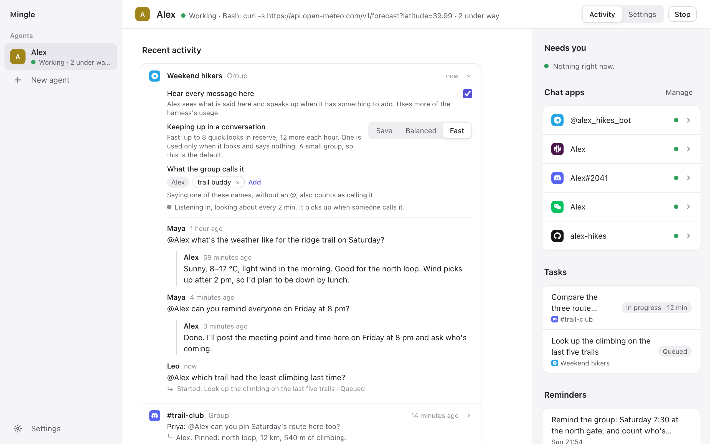
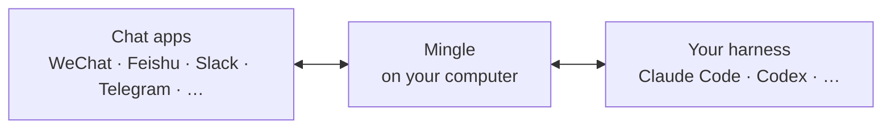

# Mingle

English · [中文](README_CN.md) · [mingle.build](https://mingle.build) · [▶ 40s Film (4K)](https://youtu.be/iuBNwl8VhCc)

**Bring your agent companion into the chat apps you already use. Runs on your machine, no server.**

<a href="https://youtu.be/iuBNwl8VhCc" title="Watch the 40s Mingle product film (4K)">
  
</a>

<p align="center"><em><a href="https://youtu.be/iuBNwl8VhCc">▶ Watch the 40s product film in 4K</a> · <a href="https://mingle.build/#film">Play on mingle.build</a></em></p>

<details>
<summary>See the native console screenshot</summary>
<br>
<picture>
  <source media="(prefers-color-scheme: dark)" srcset="site/img/agent-en-dark.png">
  
</picture>
</details>

Create an agent on your own computer: it has a name, a role, a memory and a home directory, and a coding agent you already use drives it. The agent joins your chat apps as a bot, where people can @-mention it, hand it tasks and hear back from it.

- **One agent, every chat app, one memory.** The same agent is in your Feishu work group, your WeChat family chat and your Discord server at once, and remembers all of it. Ask it in WeChat what the team decided in Feishu this morning, or have it pass a message from Slack to Telegram.
- **Your own chat apps.** No new chat platform. The agent shows up in the groups and direct messages you already have.
- **The agent you already pay for.** It runs on the harness and subscription you have; Mingle adds no model and no bill.
- **Several things at once.** Ask for something that takes a while and the agent works on it on the side, still answering everyone else, then replies under your message when it is done. Where the chat app has threads, each job gets one under your message for its questions and progress; the result comes back to the chat.
- **Your data stays on your machine.** There is no Mingle server, no account and no telemetry.

## Works with

| | |
| --- | --- |
| **Chat apps** | [WeChat](https://mingle.build/wechat/), [WeCom](https://mingle.build/wecom/), [Feishu](https://mingle.build/feishu/), [DingTalk](https://mingle.build/dingtalk/), [QQ](https://mingle.build/qq/), [Slack](https://mingle.build/slack/), [Discord](https://mingle.build/discord/), [Telegram](https://mingle.build/telegram/); [GitHub](https://mingle.build/github/) issues and pull requests, from an account of the agent's own; [iMessage](https://mingle.build/imessage/) on a Mac, by texting yourself; or chat with it right in the Mingle app |
| **Harnesses** | [Claude Code](https://mingle.build/claude-code/), [Codex](https://mingle.build/codex/), Cursor, [OpenCode](https://mingle.build/opencode/), [Kimi Code](https://mingle.build/kimi-code/), Grok Build, Qwen Code, Qoder, CodeBuddy Code, DeepSeek Harness, Pi, Antigravity, Devin, Factory Droid, through [OAR](https://github.com/botiverse/oar) |
| **Systems** | macOS, Windows, Linux |

Mingle is in early development. The core works end to end with Claude Code, Codex, OpenCode and Kimi Code. Feishu is verified on a real tenant; the other chat apps against their APIs and in tests.

## Install

Download the desktop app for your system from [Releases](https://github.com/earayu/Mingle/releases/latest), or install it from a terminal:

```sh
curl -fsSL https://github.com/earayu/Mingle/releases/latest/download/install.sh | sh    # macOS, Linux
irm https://github.com/earayu/Mingle/releases/latest/download/install.ps1 | iex         # Windows (PowerShell)
```

The macOS app is signed and notarized by Apple. The Windows app is not signed yet: choose "More info → Run anyway". The app lives in the menu bar or tray, keeps Mingle running in the background, can open at login and updates itself. A harness you don't have yet can be installed and signed in from the app.

## Quick start

In the app: **New agent**, give it a name and a role, pick a harness, then connect a chat app and follow the steps shown for it. Whoever scans the code, or sends the bot the 6-digit claim code the app shows, becomes the agent's owner. To talk to it before any chat app is connected, or just from your desk, open its **Chat** tab.

The same from source, with Node.js 24 and pnpm:

```sh
git clone https://github.com/earayu/Mingle.git && cd Mingle
pnpm install && pnpm build
node dist/cli/main.js start                       # keep this running; opens the console in your browser
node dist/cli/main.js agent create --name Alex --harness claude --role "You help me plan trips."
echo "$TELEGRAM_BOT_TOKEN" | node dist/cli/main.js connect alex telegram
```

Then send the bot a direct message from your own Telegram account; that makes you its owner.

## How it works



- Mingle receives messages through each chat app's official bot API and hands them to the agent's single, long-lived harness session. iMessage, which has no bot API, runs locally on your own Apple ID. There is no cloud bridge.
- The agent answers through the `mingle` command (reply, send, read and search chats, tasks, reminders, an address book); Mingle checks permissions and delivers. Owners can send `/stop`; there are no other session commands.
- Each agent's home holds `ROLE.md`, `MEMORY.md` and `notes/`. Everything else lives in `~/.mingle` (`MINGLE_HOME`), including the log at `~/.mingle/logs/mingle.log` (`mingle log`). Bot credentials are kept only in the macOS Keychain, Windows DPAPI or the Linux Secret Service.
- The console and API listen on `127.0.0.1` only.

## For AI agents

- **Using or explaining Mingle:** [mingle.build/llms.txt](https://mingle.build/llms.txt) summarizes the product and CLI; [mingle.build/llms-full.txt](https://mingle.build/llms-full.txt) has the complete Markdown reference (all channels, capability matrix, CLI and FAQ). Inside a session, `mingle manual` prints the agent's full guide.
- **Working on this repository:** start with [AGENTS.md](AGENTS.md), the code map and working rules, then [docs/spec.md](docs/spec.md) for scope and architecture and [DESIGN.md](DESIGN.md) before touching the interface. `pnpm check` (typecheck, lint, tests) must pass.

## Documentation

- [Security & architecture](https://mingle.build/security/) · [Comparison & 10-channel matrix](https://mingle.build/compare/)
- [Product design and architecture](docs/spec.md) (Chinese)
- [Interface design](DESIGN.md) (Chinese)
- [Remote SSH](docs/remote-ssh.md): run an agent on another machine (in development)
- [Changelog](CHANGELOG.md) · [Releasing](docs/releasing.md)

## Feedback

[Issues](https://github.com/earayu/Mingle/issues) are welcome, in English or Chinese. For a bug, include your version, system, harness, chat app and the relevant lines of `mingle log`. We aren't accepting pull requests for now. Report security problems [privately](https://github.com/earayu/Mingle/security/advisories/new) rather than in a public issue. For anything else, write to [earayu@gmail.com](mailto:earayu@gmail.com).

## License

[MIT](LICENSE)
