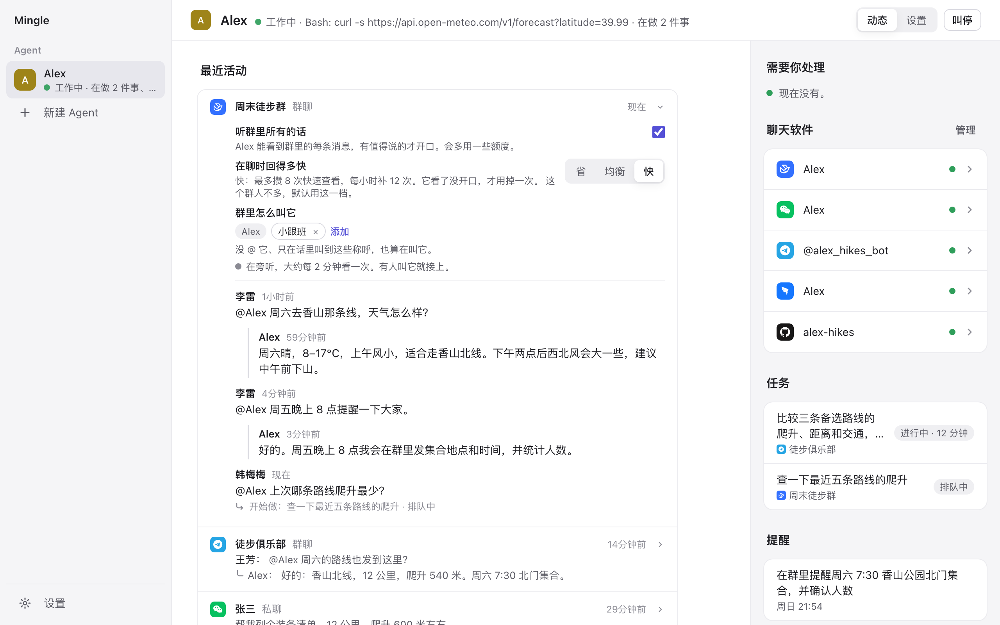
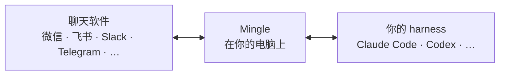

# Mingle

[English](README.md) · 中文 · [官网](https://mingle.build/zh/)

**把你的 Agent 伙伴请进你已经在用的 IM。本地运行，没有服务器。**

<picture>
  <source media="(prefers-color-scheme: dark)" srcset="site/img/agent-zh-dark.png">
  
</picture>

在自己的电脑上创建 Agent：有名字、角色、记忆和自己的主目录，由你已经在用的编码智能体驱动。Agent 以机器人身份加入你的聊天软件，大家可以 @ 它、交给它任务、听它回报。

- **一个 Agent，所有聊天软件，同一份记忆。** 同一个 Agent 同时在你的飞书工作群、微信家庭群和 Discord 服务器里，而且都记得。在微信里问它"今天上午飞书群里定了什么"，或者让它把 Slack 里的一条消息转到 Telegram。
- **用自己习惯的 IM。** 不新建聊天平台，Agent 出现在你已有的群和私聊里。
- **用你已经付费的 Agent。** 跑在你已有的 harness 和订阅上，Mingle 不加模型，也不另收费。
- **同时做几件事。** 交给它一件要花时间的活，它在旁边做，照样回别人的消息，做完回到你那条消息下面。聊天软件有话题的地方，每件事在你的消息下开一个话题，提问和进度都在里面，结果回到主聊天。
- **数据只在你的机器上。** 没有 Mingle 服务端，没有账号，没有遥测。

## 支持

| | |
| --- | --- |
| **聊天软件** | [微信](https://mingle.build/zh/wechat/)、[企业微信](https://mingle.build/zh/wecom/)、[飞书](https://mingle.build/zh/feishu/)、[钉钉](https://mingle.build/zh/dingtalk/)、[QQ](https://mingle.build/zh/qq/)、[Slack](https://mingle.build/zh/slack/)、[Discord](https://mingle.build/zh/discord/)、[Telegram](https://mingle.build/zh/telegram/)；[GitHub](https://mingle.build/zh/github/) 的 issue 和 PR（用 Agent 自己的账号）；Mac 上的 [iMessage](https://mingle.build/zh/imessage/)（给自己发消息） |
| **Harness** | [Claude Code](https://mingle.build/zh/claude-code/)、[Codex](https://mingle.build/zh/codex/)、Cursor、[OpenCode](https://mingle.build/zh/opencode/)、[Kimi Code](https://mingle.build/zh/kimi-code/)、Grok Build、Qwen Code、Qoder、CodeBuddy Code、DeepSeek Harness、Pi、Antigravity、Devin、Factory Droid，通过 [OAR](https://github.com/botiverse/oar) 接入 |
| **系统** | macOS、Windows、Linux |

Mingle 处于早期开发阶段。核心流程已用 Claude Code、Codex、OpenCode、Kimi Code 端到端跑通。飞书在真实租户上验证过，其余聊天软件对着平台接口和测试验证。

## 安装

在 [Releases](https://github.com/earayu/Mingle/releases/latest) 下载对应系统的桌面应用，或在终端里安装：

```sh
curl -fsSL https://github.com/earayu/Mingle/releases/latest/download/install.sh | sh    # macOS、Linux
irm https://github.com/earayu/Mingle/releases/latest/download/install.ps1 | iex         # Windows（PowerShell）
```

macOS 版已经过 Apple 签名和公证。Windows 版还没有签名，要点"更多信息 → 仍要运行"。应用常驻菜单栏或托盘，让 Mingle 在后台运行，可以开机启动并自动更新。没装的 harness 可以在应用里直接安装和登录。

## 快速开始

在应用里点**新建 Agent**，起名字、写角色、选 harness，然后连接一个聊天软件，按界面上的步骤做。扫码的人，或者把应用显示的 6 位认领码发给机器人的人，就是这个 Agent 的 owner。

从源码运行也一样，需要 Node.js 24 和 pnpm：

```sh
git clone https://github.com/earayu/Mingle.git && cd Mingle
pnpm install && pnpm build
node dist/cli/main.js start                       # 保持运行，会在浏览器里打开控制台
node dist/cli/main.js agent create --name Alex --harness claude --role "You help me plan trips."
echo "$TELEGRAM_BOT_TOKEN" | node dist/cli/main.js connect alex telegram
```

然后用自己的 Telegram 账号私聊这个机器人，你就成了它的 owner。

## 工作原理



- Mingle 通过各聊天软件的官方机器人接口收消息，交给 Agent 唯一的长期 harness 会话。iMessage 没有机器人接口，在本机用你自己的 Apple ID 运行。不经过任何云端桥接。
- Agent 通过 `mingle` 命令回复（回复、发送、读取和搜索聊天、任务、提醒、通讯录），由 Mingle 检查权限后发出。owner 可以发 `/stop`，除此之外没有会话命令。
- 每个 Agent 的主目录里只有 `ROLE.md`、`MEMORY.md` 和 `notes/`。其余数据在 `~/.mingle`（`MINGLE_HOME`），日志在 `~/.mingle/logs/mingle.log`（`mingle log`）。机器人凭据只存在 macOS 钥匙串、Windows DPAPI 或 Linux Secret Service 里。
- 控制台和 API 只监听 `127.0.0.1`。

## 给 AI Agent

- **使用或介绍 Mingle：** [mingle.build/llms.txt](https://mingle.build/llms.txt) 概括了产品和命令行；[mingle.build/llms-full.txt](https://mingle.build/llms-full.txt) 包含完整 Markdown 文档（全部渠道接入、能力矩阵、CLI 与 FAQ）。在会话里，`mingle manual` 会输出 Agent 的完整使用指南。
- **在本仓库里开发：** 先读 [AGENTS.md](AGENTS.md)（代码地图和工作规则），再读 [docs/spec.md](docs/spec.md)（范围和架构），改界面前读 [DESIGN.md](DESIGN.md)。`pnpm check`（类型检查、lint、测试）必须通过。

## 文档

- [架构与安全说明](https://mingle.build/zh/security/) · [方案对比与 10 渠道能力矩阵](https://mingle.build/zh/compare/)
- [产品设计与技术架构](docs/spec.md)
- [界面设计规范](DESIGN.md)
- [Remote SSH](docs/remote-ssh_CN.md)：在另一台机器上运行 Agent（开发中）
- [更新日志](CHANGELOG.md) · [发布流程](docs/releasing.md)

## 反馈

欢迎提 [issue](https://github.com/earayu/Mingle/issues)，中英文都可以。报 bug 时请附上版本、系统、harness、聊天软件，以及 `mingle log` 里的相关几行。目前暂不接受 PR。安全问题请[私下报告](https://github.com/earayu/Mingle/security/advisories/new)，不要发在公开 issue 里。其他事情可以写信到 [earayu@gmail.com](mailto:earayu@gmail.com)。

## 许可证

[MIT](LICENSE)
