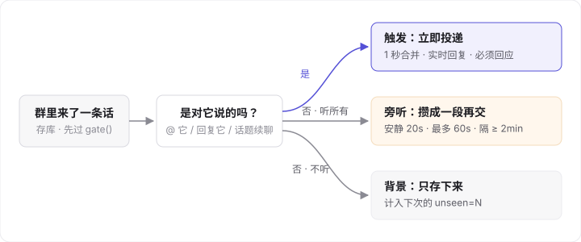
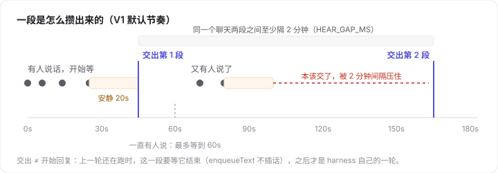
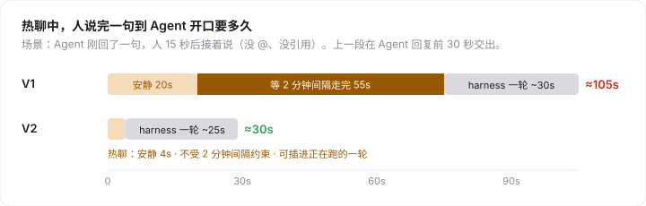
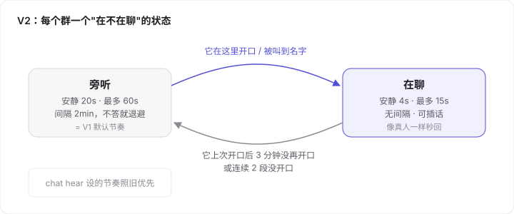

# Mingle 群聊消息投递算法 V1：Agent 什么时候"听到"群里的话

> 2026-11-20 · 对应 Mingle v0.4.6 · 规则以 [`docs/spec.md`](../spec.md) 4.2 为准，代码在 `src/core/mingle.ts`（`overhear` / `hear` / `gap`）

一个真人在群里，不会每句话都回，也不会对每句话都无视。被点名时马上答；大家在聊别的，他扫一眼，有话说才插一句；聊得正热时，几乎秒回。

Mingle 的 Agent 也住在群里。它背后是 Claude Code、Codex 这类 harness，每"看一眼"都是完整的一轮：启动、读上下文、思考、调用工具。看得太勤，烧额度、刷屏、抢话；看得太少，跟不上、插不上嘴。**群聊消息投递算法就是在回答一个问题：群里的一句话，什么时候、以什么形式交给 Agent。**

这篇写 V1 是怎么做的、为什么这么做，以及它在哪里慢了。

## 一句话进群后的三条路



每条群消息先落库、过一遍权限（`gate()`：群放行了吗、这个人被拒绝了吗），然后看它是不是对 Agent 说的：

| 路径 | 条件 | 怎么交 | 体验 |
|---|---|---|---|
| **触发** | @ 它、回复它的消息、在它说过话的话题里（Discord thread、Slack 线程） | 立即投递，1 秒内到的合并成一轮；它正忙就插进当前轮 | 表情回执、"正在思考"实时回复、必须回应 |
| **旁听** | 没对它说，但群开着"听群里所有的话"（默认开） | 攒成一段，合成一条 `[mingle] Heard in …` 输入 | 没有回执、没有实时回复，它自己决定说不说 |
| **背景** | 群没开旁听，或 Agent 静音了这个群 | 只存下来 | 下次被 @ 时，来源行带 `unseen=N`，需要时 `message read` |

触发路径快而重：每一条都有一整套"必须回应"的机制。旁听路径慢而轻：Agent 可以什么都不说。**本文的主角是旁听路径**——截图里那种"没 @ 它、但明显在和它聊"的话，走的就是这条。

## 旁听：一段是怎么攒出来的



一个能使唤它的人（不是机器人）在群里说了一句，Mingle 开始"等"。三个常量决定什么时候把这一段交出去：

- **安静 20 秒**（`HEAR_QUIET_MS`）：群里 20 秒没人说话，说明这一阵说完了，交出。每来一条新消息，重新计时。
- **最多等 60 秒**（`HEAR_MAX_WAIT_MS`）：一直有人说话时，从开始等算起最多 60 秒，不会被刷屏无限推后。
- **两段至少隔 2 分钟**（`HEAR_GAP_MS`）：同一个聊天，上一段交出后 2 分钟内不交下一段。

写成公式，一段的交出时间是：

```text
due = max( min(最后一条 + 20s, 开始等 + 60s),  上一段交出时间 + gap )
```

一段最多 30 条，只取 Agent 上次在这里说话之后的；更早的用 `message read`。等的时候有人 @ 它或回复它，这一段作废：那条消息走触发路径，前面的话由 `unseen` 提示。Agent 拿到的是这样一条输入：

```text
[mingle] Heard in c12: 3 messages said there, none addressed to you. …
[msg=m8f2a chat=c12 im=feishu group="Mingle用户反馈" from="bryce.yu" …]
我想问的就是mingle的频率
…
```

第一行告诉它：这些话不是对你说的，没人等你回答；有值得说的或明显在叫你时才开口，否则什么都不发。

**交出不等于开始回复。** 旁听的一段和提醒一样走 `enqueueText`：Agent 正在跑一轮时不插话，等这一轮结束才开始下一轮。之后才是 harness 自己的耗时——冷启动、思考、调用 `mingle message reply`，通常 20–60 秒。

## 它不说话时，自己慢下来


一个热闹但和 Agent 无关的群，每 2 分钟叫醒它一次也是浪费。所以默认节奏会退避：连续 3 段（`HEAR_BACKOFF_AFTER`）它都没在这里开口，之后每段间隔翻倍——4、8、16 分钟，最多 30 分钟（`HEAR_BACKOFF_MAX_MS`）。

放慢的依据是"它答不答"，而不是"群里说得多不多"：热闹但它在参与的群不该被拖慢。只要它在这里说话、有人 @ 或回复它、owner 在群里说话，立刻回到 2 分钟。计数在内存里，重启清零；只是晚，不会丢——下一段从它上次说话之后取。

## Agent 自己定：`chat hear`

群里任何人都能叫 Agent "少看点这个群"，所以 Agent 可以按群调节，存在 `chats.hear_pace`：

- `mingle chat hear c12 --every 1h`：最多每小时一段（2 分钟到 7 天）。
- `mingle chat hear c12 --mute`：什么都不听，直到有人 @ 它或回复它，那时自动恢复默认节奏并告诉它。
- `mingle chat hear c12 --default`：回到 Mingle 的节奏。

**只能调慢，不能调快。** 最短就是默认的 2 分钟：任何人改它，最坏只是听得少，不会花得比 owner 同意的多。

## 什么时候会变

把上面合在一起，V1 的节奏只在这些时候变化：

| 事件 | 节奏变化 |
|---|---|
| 群里有人（能使唤它的人）说话 | 开始等一段，或把正在等的这一段往后推（不超过 60 秒上限） |
| 上一段交出后不到 2 分钟（或退避后的间隔） | 这一段被压到间隔走完 |
| 连续 3 段它都没开口 | 间隔翻倍，最多 30 分钟 |
| 它在这里说话 / 被 @ 或回复 / owner 说话 | 退避清零，回到 2 分钟 |
| 有人 @ 它或回复它 | 正在等的一段作废，那条消息走触发路径 |
| Agent 设了 `--every` / `--mute` | 间隔至少为设定值 / 不再开始一段 |
| owner 关掉"听所有"，或 Agent 暂停 | 正在等的一段作废，之后只存背景 |
| Mingle 重启 | 等待和退避计数清零 |

## V1 慢在哪里

截图里的场景：bryce 和 Agent 正在一来一回地聊。Agent 刚回了一句，bryce 接着发了几条——没有 @，也没有引用回复。真人在这种时候几乎秒回，Agent 却要 1–2 分钟。



拆开看这 1–2 分钟：

1. **安静 20 秒。** 人连发几条，每条都把计时往后推；最后一条之后还要再等 20 秒。
2. **2 分钟间隔，这是大头。** 间隔从上一段"交出"算起，不是从 Agent "回复"算起。Agent 用 30 秒回完上一段，人 15 秒后接话，这时距上一段交出才 45 秒，下一段至少还要等 75 秒。V1 把"刚聊过"当成"刚被打扰过"，越是聊得热，越会撞上这个间隔。
3. **不插话。** 旁听的一段要等当前一轮结束；Agent 还在跑上一轮的收尾时，又多等一会儿。
4. **harness 一轮。** 20–60 秒，这部分 Mingle 管不了，但可以让它不那么"空等"。
5. **没有反馈。** 旁听路径故意不开"正在思考"，人看不到任何迹象，等待感被放大。

根子在于：**V1 只有"被叫到"和"旁听"两种状态，没有"正在聊"。** 一旦 Agent 回过话，人自然不会每句都 @ 它，于是热聊被降级成旁听，吃满旁听的限流。

## V2：加一个"在聊"状态



真人的节奏不是固定间隔，而是看自己在不在这场对话里。V2 给每个群加一个内存里的状态：

**进入"在聊"：**

- Agent 刚在这里开口（`lastSpokeAt` 更新）。
- 有人在话里叫了它的名字但没 @（截图第一条"……bryce小跟班"就是这样）。名字取 Agent 名和机器人在平台上的名字。

**"在聊"时的节奏：**

- 安静窗口 20 秒 → **4 秒**，最多等 60 秒 → **15 秒**：人打完一阵字的停顿通常就几秒。
- **不受 2 分钟间隔约束**。
- Agent 正在跑一轮时，这一段**插进当前轮**，和触发消息一样（harness 不支持插话时排队）。

**回到"旁听"：**

- 距它上次开口超过 3 分钟（`HEAR_HOT_MS`），对话凉了；
- 或在聊状态下连续 2 段它都没开口——它自己判断这已经不是对它说的了。

**不变的约束：**

- 在聊仍然是旁听：不开实时回复、不要求回应，Agent 可以不说话。热聊只改"多快交"，不改"交什么"。
- `--every`、`--mute` 优先：Agent 或别人明确要它少听，就不进在聊。
- 额度有上限：在聊状态下每段都要 Agent 至少每 2 段开一次口才能维持，最坏情况是 3 分钟内多几轮，然后自动回到旁听。

**可选的第二步：**

- **轻量反馈。** 在聊状态交出一段后，在支持"正在输入"的平台上显示正在输入，不加表情、不开卡片，Agent 不回时自然消失。
- **按群大小调参数。** 只有 owner 和 Agent 的群，本质上是私聊，安静窗口可以更短。
- **把耗时记下来。** 每一段记"第一条消息 → 交出 → 开始一轮 → 第一次发言"四个时间点，写进日志和动态，后续调参有数据，不靠感觉。

按截图的场景估算，V2 把"人说完一句到 Agent 开口"从约 105 秒压到约 30 秒，剩下的基本是 harness 自己的一轮。

## 小结

V1 用三个常量（20 秒、60 秒、2 分钟）、一个退避和一个 Agent 自己能调的节奏，让 Agent 在群里"听得到但不吵"。它省额度、不抢话，代价是把正在进行的对话也当成背景噪音来限流。V2 的方向是让 Agent 像人一样分清"我在不在这场对话里"：在聊时秒回，聊完了安静退回旁听。
