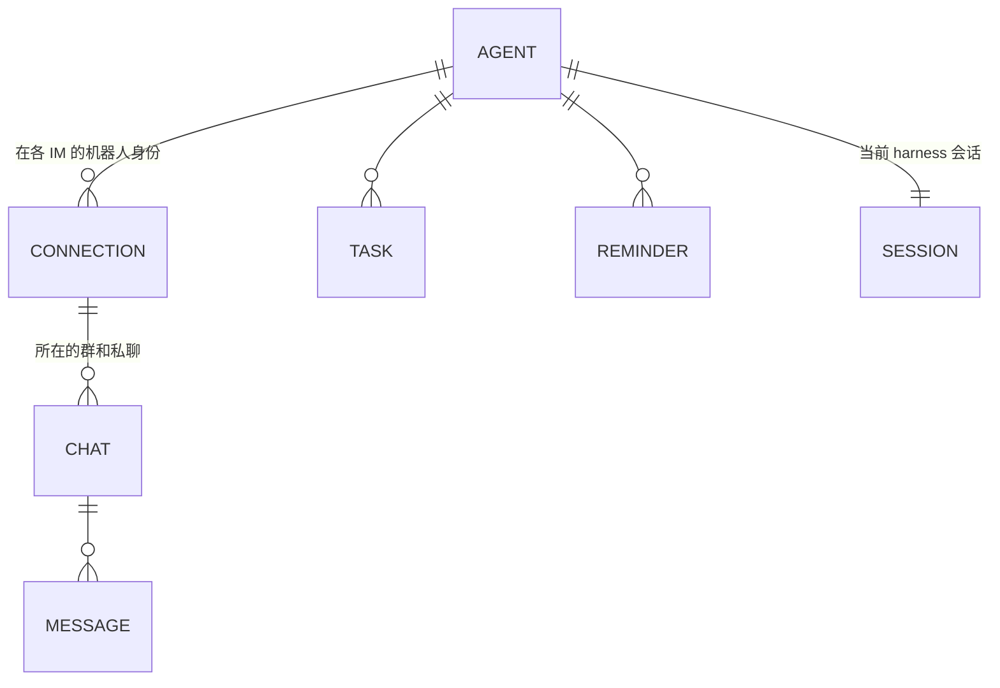
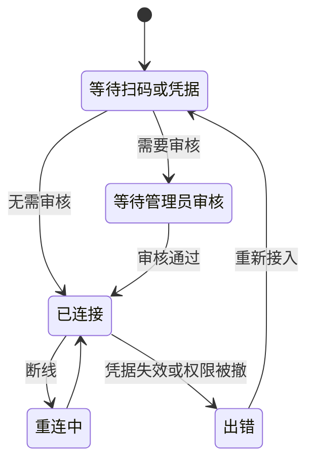
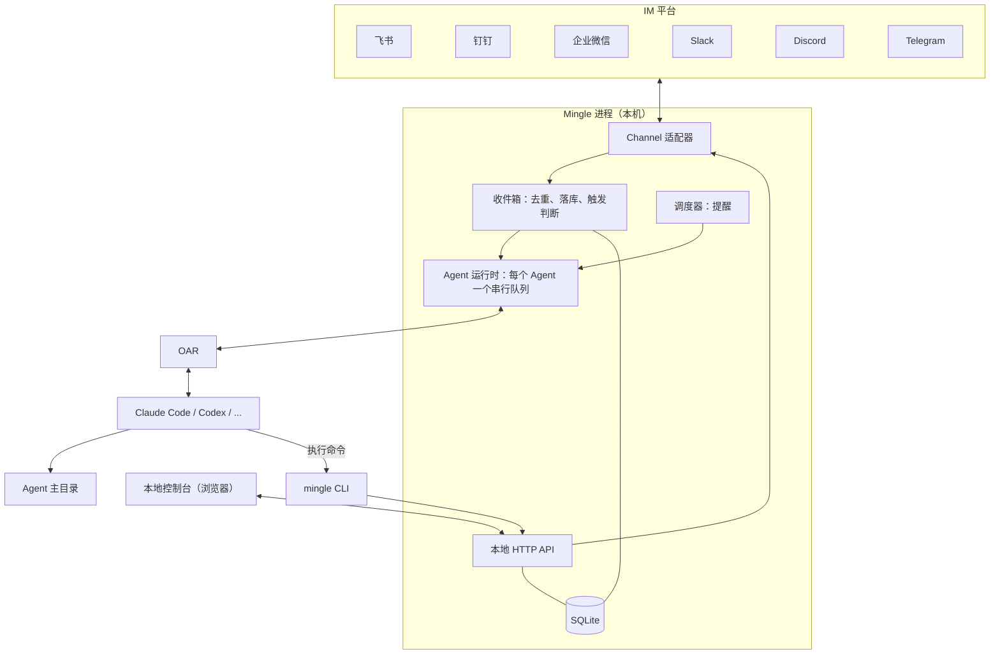

# Mingle 产品设计与技术架构

| | |
|---|---|
| 版本 | v0.2 |
| 日期 | 2026-11-11 |
| 状态 | 现行方案。代码尚未开始，文中"待验证"项以实测结果为准。 |

这是 Mingle 最核心的文档。产品范围、领域模型、架构、技术选型都以本文为准；改动这些内容时先改本文，再改代码。

## 1. Mingle 是什么

**把你的 Agent 伙伴请进你已经在用的 IM。本地运行，没有服务器。**

用户在自己的电脑上创建 Agent：有名字、头像、角色、记忆和自己的主目录，由本机已安装的 Claude Code、Codex 等 harness 驱动。Agent 以机器人身份出现在飞书、钉钉、企业微信、Slack、Discord、Telegram 的群聊和私聊里，可以被 @、接任务、主动回报。

Mingle 不预设使用场景。同一个 Agent 可以是私聊里的个人助理、朋友群里的成员、社区里的答疑者，也可以是工作群里的协作者。角色由用户写的一段描述决定。

### 1.1 两个核心点

1. **用自己习惯的 IM。** 不新建聊天平台，不要求任何人迁移。Agent 出现在你已经在用的群和私聊里。
2. **数据只在你的机器上。** Mingle 没有服务端、没有账号、没有遥测。配置、消息记录、记忆、产物全部在本机。

第二点对外的说法是"没有 Mingle 服务器"，不用 "zero data retention"：消息必然经过 IM 平台和模型厂商，这两者不在我们的承诺范围内。

### 1.2 一等对象是 Agent，不是会话

用户面对的是"Alex"，一个长期存在、记得事情的伙伴，不是"某个 IM 里的一个 Claude Code 会话"。harness 的会话、模型、上下文压缩都是内部实现，不出现在 IM 里，也不需要 `/new`、`/switch` 这类命令。

评判标准：用户的感受应该是"我有一个长期的 Agent 伙伴，它就在我常用的聊天软件里"，而不是"我在聊天软件里远程操控了一个终端"。

### 1.3 与同类产品的区别

| 产品 | 它是什么 | Mingle 的不同 |
|---|---|---|
| [Raft](https://raft.build/) | 人与 agent 协作的独立工作空间，有自己的服务端、频道和客户端 | Agent 模型和 CLI 向它学习，但不建聊天平台、不要服务端，Agent 住在现有 IM 里 |
| [dsh-im](https://github.com/xmanrui/dsh-im) | 把 IM 机器人接到 DeepSeek Harness 的插件，以会话和工作区为中心 | 接入层向它学习，但以 Agent 为中心，且不绑定单一 harness |
| [cc-connect](https://github.com/chenhg5/cc-connect) | 在 IM 里用命令操作 harness 会话 | 不暴露会话，自然语言交互 |

和 Raft、dsh-im 一样，Mingle 复用用户本机已登录的 harness 和订阅，这不是差异点。

### 1.4 不做的事

- 自建聊天界面或频道系统。
- 任何云端组件、账号体系、多设备同步。
- 自己实现 agent 循环或模型调用，这是 harness 的事。
- 用个人账号的非官方协议接入 IM。只走各平台的官方机器人通道。
- 跨群记忆隔离。已决定接受这个风险，见 8.3。

## 2. 用户旅程

1. 安装并启动 Mingle，浏览器打开本地控制台。
2. 控制台列出本机已安装并登录的 harness。
3. 创建 Agent：填名字、角色，选 harness 和模型。
4. 选择要加入的 IM 并接入：
   - 飞书、钉钉、企业微信：控制台显示二维码，手机扫码创建机器人。
   - Slack：按预置 App Manifest 创建应用，粘贴两个 token。
   - Telegram、Discord：粘贴 bot token。
5. 如果所在组织要求管理员审核，控制台显示"等待管理员审核"，通过后自动转为"已连接"。
6. 把机器人拉进群。群里 `@Alex 昨天那件事后来怎么样了`，Alex 回复。
7. 在另一个 IM 私聊 Alex 问同一件事，Alex 接得上。
8. Alex 做完一件事后回到最初提出的地方回报。

控制台的创建表单参考概念图：名字、角色、大脑（harness）、所在的 IM（多选）、行为方式。

## 3. 领域模型



| 对象 | 含义 |
|---|---|
| **Agent** | 名字、头像、角色、harness、模型、主目录。用户创建和管理的唯一主体。 |
| **Connection（连接）** | 一个 Agent 在一个 IM 上的机器人身份及其凭据。一个 Agent 可以有多个连接。 |
| **Chat（聊天）** | 一个群、一个私聊或一个话题。由连接加平台侧 ID 唯一确定。 |
| **Message（消息）** | 收到和发出的每条消息，带来源和平台消息 ID。 |
| **Task（任务）** | Agent 正在跟踪的事项，记录来源聊天，用于完成后回报。 |
| **Reminder（提醒）** | Agent 给自己设的定时唤醒，一次性或周期性。 |
| **Session（harness 会话）** | OAR 会话 ID。内部对象，可恢复、可压缩、可替换，用户不可见。 |

**一个 Agent 在每个 IM 上是一个独立的机器人。** 这样它在群里有自己的名字和头像，扫码创建的流程也天然是"一次扫码一个机器人"。不做"一个机器人背后路由多个 Agent"。

## 4. Agent 如何工作

### 4.1 一个 Agent，一个长期会话

每个 Agent 有一个长期存在的 harness 会话，工作目录是它的主目录。所有 IM 的消息都进入这同一个会话。跨群、跨 IM 的连续性由此而来，不需要额外的检索或任务匹配逻辑。

这是 Raft 的做法：agent 是一个长期进程，新消息到达时唤醒并恢复原会话，靠 `MEMORY.md` 在上下文压缩和重启后找回状态。

- 应用重启后用 OAR 的 `resume` 恢复同一会话。
- 上下文接近上限时由 harness 自身压缩；压缩前提示 Agent 更新 `MEMORY.md`。
- 会话损坏或更换 harness 时新建会话，Agent 靠 `MEMORY.md` 和消息记录恢复。会话可丢，Agent 不丢。

### 4.2 消息进入

触发规则：

- 私聊：每条消息都触发。
- 群聊：@ Agent，或回复它发出的消息时触发。

触发的消息包上来源信息后交给 Agent。每条消息和每个聊天都有 Mingle 分配的短 ID，Agent 用它们来回复和发送：

```text
[m8f2a] 飞书 · 群「周末徒步」(c12) · 张三 · 11-11 14:02
@Alex 上次说的那条路线，帮我查下周六的天气
```

- Agent 空闲时：开始新一轮。
- Agent 正在工作时：通过 OAR 的 `deliver` 送入当前轮（harness 支持则插话，不支持则排队）。Agent 自己决定先回一句还是做完再回。

每个 Agent 同一时刻只有一轮在跑，不做并发会话。消息是推给 Agent 的，Agent 不需要轮询收件箱。

### 4.3 启动时注入的内容

每次新建或恢复会话时，Mingle 向 harness 注入三样东西：

1. `ROLE.md` 的内容：它是谁。
2. `mingle` CLI 的操作指南：它怎么在 IM 里行动。与 `mingle manual` 的输出同源，不会不一致。
3. 提示它先读 `MEMORY.md`。

这样主目录里不需要再放 `AGENTS.md` 之类的指令文件。

### 4.4 记忆

记忆是主目录下的文件，Agent 用 harness 自带的文件工具读写，Mingle 不提供记忆命令。

- `MEMORY.md` 是恢复索引：自己是谁、进行中的事、指向详细笔记的链接。保持简短。
- `notes/` 放按主题展开的笔记。
- 消息原文不进记忆，需要时用 `mingle message search` 检索。

### 4.5 任务与提醒

- 任务是轻量记录：标题、状态（`todo` / `in_progress` / `done` / `closed`）、来源聊天。由 Agent 用 CLI 维护，控制台只读展示。完成时 Agent 回到来源聊天回报。
- 提醒到点后作为一条系统消息进入 Agent 的会话，和 IM 消息走同一条路。每日总结、定时检查都用它实现。

### 4.6 权限

- **谁能使唤 Agent**：默认是它所在群里的所有人，加上私聊白名单。创建者是 owner，始终可以。
- **Agent 能做什么**：默认在主目录内自主执行，不逐次审批，因为它需要无人值守地工作。可在控制台改为受限模式。把 harness 的审批请求转发到 owner 私聊放在后续版本。

### 4.7 状态

控制台显示：空闲、思考中、工作中、离线、出错，以及当前任务、所在的群、最近活动。电脑休眠或关机时 Agent 离线，这一点在界面上如实展示。

## 5. `mingle` CLI：Agent 的行动接口

### 5.1 为什么是 CLI

**Agent 通过 `mingle` 命令行在 IM 里行动，不用 MCP 工具。** 上一版写的是 MCP，这里改掉，理由：

- 所有 harness 都能跑 shell 命令，不需要逐个适配 MCP 配置，也不依赖 OAR 的工具挂载能力。
- Raft 完全用 CLI 作为 agent 的接口，已经验证可行。
- 用户可以在终端里敲同样的命令来调试，看到的和 Agent 看到的一样。
- 操作指南只有一份：注入的提示词和 `mingle manual` 同源。

Agent 说的话不会自动发到 IM。多个群的消息在同一会话里交错时，"最后一段文字发给谁"有歧义，显式调用命令则没有。

兜底：一轮由单条消息触发、结束时却没有发送任何消息，Mingle 把最后一段文字发回触发它的聊天，避免"已读不回"。

### 5.2 身份

Mingle 启动 harness 时在环境变量里放入本地 API 地址和一个每次启动重新生成的令牌。CLI 据此确定"我是哪个 Agent"，Agent 不需要登录，也不需要在命令里写自己的名字。令牌只在本机有效，只能操作该 Agent 自己的聊天。

没有令牌时，同一个 `mingle` 命令是用户的管理入口（启动、打开控制台、查看状态）。

### 5.3 命令

首版只有六组。命令少，Agent 才记得住。

**消息**

| 命令 | 作用 |
|---|---|
| `mingle message reply <消息ID>` | 回复某条消息，平台支持时显示为引用回复 |
| `mingle message send --to <聊天ID>` | 向某个聊天主动发消息 |
| `mingle message read <聊天ID>` | 读某个聊天最近的消息，`--limit`、`--before` 翻页 |
| `mingle message search <关键词>` | 全文检索消息记录，`--in <聊天ID>` 限定范围 |

`reply` 和 `send` 的正文从标准输入读取，用 heredoc 传入，避免引号、反引号和换行被 shell 解释。`--file <路径>` 附带文件，可重复：

```bash
mingle message reply m8f2a <<'MSG'
周六晴，气温 8–17℃，上午风小，适合走。
MSG
```

**聊天**

| 命令 | 作用 |
|---|---|
| `mingle chat list` | 列出自己所在的群和私聊，含 ID、平台、名称 |
| `mingle chat info <聊天ID>` | 聊天详情；平台支持时含成员 |

**文件**

| 命令 | 作用 |
|---|---|
| `mingle file get <文件ID>` | 把收到的附件下载到当前目录，`--out` 指定路径 |

收到的附件不会自动落盘。消息里只带文件 ID 和文件名，Agent 需要时再取，主目录不会被附件堆满。

**任务**

| 命令 | 作用 |
|---|---|
| `mingle task create <标题>` | 新建任务，`--from <消息ID>` 记录来源 |
| `mingle task list` | 列出未完成的任务，`--all` 含已完成 |
| `mingle task update <任务ID> --status <状态>` | 更新状态 |

**提醒**

| 命令 | 作用 |
|---|---|
| `mingle reminder set <内容>` | `--in 30m`、`--at <时间>` 或 `--every daily@09:00`；`--chat <聊天ID>` 记录相关聊天 |
| `mingle reminder list` | 列出提醒 |
| `mingle reminder cancel <提醒ID>` | 取消 |

**自身**

| 命令 | 作用 |
|---|---|
| `mingle whoami` | 自己的名字、各 IM 上的连接及状态 |
| `mingle manual` | 完整的操作指南 |

### 5.4 输出约定

- 默认输出给人和模型读的纯文本，消息的格式与 4.2 里收到的格式一致。`--json` 输出结构化数据。
- 成功时打印结果和新对象的 ID，例如发出消息的 ID。
- 失败时非零退出，打印稳定的错误码和一句"下一步怎么做"，例如 `chat_not_found：用 mingle chat list 查看可用的聊天`。
- 平台不支持某项能力时明确说明降级结果，例如"该平台不支持引用回复，已作为普通消息发送"。
- 发送结果不确定时如实报告，不自动重发。
- 每个命令支持 `--help`。

### 5.5 暂不提供

表情回应、编辑和撤回消息、管理群成员、创建群。这些在各平台差异大，等核心流程稳定后按需增加。

## 6. IM 接入

### 6.1 首批六个平台

全部使用平台官方的出站长连接，不需要公网地址。

| 平台 | 接入方式 | 连接方式 | 可能需要管理员审核 |
|---|---|---|---|
| 飞书 | 扫码创建机器人，或填 App ID / Secret | 官方 SDK 长连接 | 是 |
| 钉钉 | 扫码创建机器人，或填 Client ID / Secret | Stream 长连接 | 是 |
| 企业微信 | 扫码创建智能机器人，或填 Bot ID / Secret | 官方 WebSocket 长连接 | 是 |
| Slack | 预置 App Manifest 创建应用，填两个 token | Socket Mode | 视工作区设置 |
| Discord | Developer Portal 生成 bot token | Gateway | 否，需服务器管理权限拉入 |
| Telegram | @BotFather 生成 bot token | 长轮询 | 否 |

这张表的依据是 dsh-im 的现有实现，它已在这些平台上跑通同样的接入和连接方式。Mingle 自己尚未实测，见第 12 节。

### 6.2 不引入 IM 框架，自定义 `Channel` 接口

不使用 Chat SDK、Satori、Koishi 作为核心抽象。每个平台用官方 SDK 实现一个适配器，统一实现 Mingle 自己的 `Channel` 接口。

- Chat SDK 主仓库没有飞书、钉钉、企业微信适配器，国内三家无论如何都要自己接。
- 扫码创建、管理员审核这些接入流程是平台专属的，通用框架不覆盖。
- dsh-im 用的正是"官方 SDK + 自有语义层"，并在 ADR 里记录了放弃"最低公分母模型"的原因。

接口分三部分：

- **接入（onboarding）**：启动扫码或校验凭据，报告进度。
- **连接（lifecycle）**：连接、断线重连、状态上报。
- **消息（messaging）**：收消息事件；发送、回复、上传文件、显示"正在输入"。

### 6.3 统一语义，原生呈现

沿用 dsh-im 的原则：

- 核心层只处理语义：消息、引用、聊天、文件、进度。
- 适配器按平台习惯呈现：飞书用卡片，Telegram 用消息编辑，Discord 用 Thread。
- 能力按机器人实例实际拥有的权限判断，不按平台名称假定。不支持时明确降级。

### 6.4 连接状态



"等待管理员审核"是一等状态。控制台明确告诉用户正在等谁、等什么，并在通过后自动继续。

## 7. 整体架构



**单进程。** 一个 Node 进程包含全部模块，同时提供本地 HTTP API，只监听 `127.0.0.1`。harness 由 OAR 作为子进程拉起。控制台和 `mingle` CLI 都是这个本地 API 的客户端。

| 模块 | 职责 |
|---|---|
| Channel 适配器 | 平台接入、长连接、收发消息、原生呈现 |
| 收件箱 | 按平台消息 ID 去重，落库，判断是否触发，包装来源信息 |
| Agent 运行时 | 管理每个 Agent 的会话生命周期和消息队列，调用 OAR，观察事件并更新状态 |
| 调度器 | 到点触发提醒 |
| 本地 API | 两类调用方：控制台（管理）和 CLI（Agent 行动）。Agent 的所有对外发送和权限检查集中在这里 |
| `mingle` CLI | 第 5 节的命令，无状态，只做参数解析和输出格式化 |
| 控制台 | 创建和管理 Agent，接入 IM，查看状态 |

### 7.1 可靠性

- **去重**：`(connection_id, 平台消息 ID)` 唯一，平台重推不会重复触发。
- **重启**：进程启动时恢复所有连接和 Agent 会话。重启前未处理完的消息保留在收件箱，重新投递。
- **发送失败**：明确失败最多重试三次；结果不确定时不自动重试，避免重复发言。
- **离线期间的消息**：以各平台长连接的补推能力为准，不自行向平台回拉历史。

## 8. 数据与存储

### 8.1 本地目录

```text
~/.mingle/
├── mingle.db              运行状态
├── logs/
└── agents/<slug>/         Agent 的主目录，也是 harness 的工作目录
    ├── ROLE.md            它是谁，用户编写
    ├── MEMORY.md          恢复索引，Agent 维护
    └── notes/             Agent 的笔记
```

主目录里 Mingle 只约定这两个文件和一个目录。其余的文件和目录由 Agent 按需要自己建，Mingle 不预设结构。

**文件是 Agent 的内容，SQLite 是运行状态。** 角色、记忆和产物都是普通文件，用户可以直接打开、编辑、用 git 管理、整个目录拷走。

### 8.2 SQLite

使用 Node 24 自带的 `node:sqlite`，不引入原生依赖。

| 表 | 内容 |
|---|---|
| `agents` | 名字、slug、头像、harness、模型、权限模式、当前会话 ID、状态 |
| `connections` | 所属 Agent、平台、机器人身份、连接状态、凭据引用 |
| `chats` | 所属连接、平台侧 ID、类型（群 / 私聊 / 话题）、名称 |
| `messages` | 所属聊天、方向、发送者、内容、附件引用、平台消息 ID、时间、处理状态 |
| `tasks` | 所属 Agent、标题、状态、来源聊天 |
| `reminders` | 所属 Agent、内容、触发规则、下次触发时间 |

`messages` 上建 FTS5 全文索引供 `mingle message search` 使用。

### 8.3 密钥与隐私

- IM 凭据存入 macOS Keychain，数据库只存引用。API 响应和日志不回传任何密钥。
- harness 的登录态由 harness 自己管理，Mingle 不接触。
- **跨群记忆不隔离。** Agent 在私聊里得知的内容可能在群里被说出来。这是已接受的取舍，换来的是 4.1 的简单模型。`messages` 仍记录来源，将来需要隔离时有据可依。控制台在创建 Agent 时提示这一点。
- 使用个人 harness 订阅为群内其他人提供服务是否符合各厂商条款，本版不处理。

## 9. 技术选型

| 项 | 选择 | 理由 |
|---|---|---|
| 语言 | TypeScript，ESM | OAR 和各平台官方 SDK 都是 Node 生态 |
| 运行时 | Node.js 24+ | OAR 的要求，且自带 `node:sqlite` |
| harness 接入 | [OAR](https://github.com/botiverse/oar)，锁定版本，包一层薄接口 | 一个 API 驱动所有 harness；它更新很快，隔离其变化 |
| Agent 行动接口 | 自有 `mingle` CLI | 见 5.1 |
| IM 接入 | 各平台官方 SDK + 自有 `Channel` 接口 | 见 6.2 |
| 存储 | `node:sqlite` + 文件 | 见第 8 节 |
| 本地 API | Hono | 轻，无额外运行时要求 |
| 控制台 | React + Vite + Tailwind | 通用，将来可原样装进桌面壳 |
| 包管理 | pnpm | |
| 测试 | Vitest；harness 侧用 OAR 的 `testing` 脚本化运行时 | 不需要真实登录即可测试 Agent 运行时 |
| 代码检查 | Biome | 格式化和 lint 一个工具 |

### 9.1 界面形态

**有界面，形态是本机进程提供的网页控制台。** 扫码、创建 Agent、查看状态都在控制台完成。启动 Mingle 时自动打开浏览器。

**暂不采用 nsh 或 mygo。** 两者都创建不足两个月，且分别是 Rust 和 Go，而核心必须是 Node。等产品验证后需要"双击安装、菜单栏图标、开机自启、自动更新"时，用 mygo 的 webview 模式把同一个控制台包成桌面应用；nsh 的强项是跨移动端原生 UI，不是我们的需求。

### 9.2 平台

只承诺 macOS。Keychain、开机自启等系统相关能力放在接口后面，核心不写 macOS 专属代码，保留将来在 Linux 小主机上无界面运行的可能。

### 9.3 代码结构

```text
src/
├── core/         领域类型、Agent 运行时、收件箱、调度器
├── harness/      OAR 的薄封装
├── channels/     Channel 接口和各平台适配器，每个平台一个目录
├── store/        SQLite 访问和迁移
├── platform/     Keychain、自启等系统相关能力
├── api/          本地 HTTP API
└── cli/          mingle 命令和操作指南
web/              控制台
docs/             文档
```

单个包，不拆 monorepo。分发方式为 npm 包，`npx` 即可运行。

## 10. 参考项目

| 项目 | 借鉴 | 不借鉴 |
|---|---|---|
| [Raft](https://github.com/botiverse/raft-source) | agent 是长期参与者；`MEMORY.md` 加 `notes` 的记忆方式；CLI 作为 agent 接口，正文走标准输入，指南与注入提示同源，错误带下一步；任务和提醒 | 独立聊天平台、服务端、多机部署。其许可证为 FSL，只参考设计，不复制代码 |
| [dsh-im](https://github.com/xmanrui/dsh-im) | 扫码接入流程；各平台长连接；统一语义加原生呈现；按实例判断能力；发送失败处理 | 以会话和工作区为中心的命令体系。MIT 许可，移植代码时保留署名 |
| [OAR](https://github.com/botiverse/oar) | 直接作为依赖 | |

## 11. 里程碑

| 阶段 | 内容 | 完成标志 |
|---|---|---|
| **M0 技术验证** | 第 12 节的待验证项 | 每项有实测结论，本文据此修订 |
| **M1 跑通一个 Agent** | 进程骨架、SQLite、控制台、Agent 运行时、`mingle message` 和 `chat` 命令；Telegram 和飞书；Claude Code 和 Codex | 在控制台创建 Agent，扫码接入飞书，群里 @ 能回复，Telegram 私聊能接上同一件事 |
| **M2 六个平台与主动性** | 钉钉、企业微信、Slack、Discord；任务；提醒；文件收发 | 六个平台均可接入；Agent 能定时汇报、完成后主动回报 |
| **M3 桌面应用** | 桌面壳、菜单栏、开机自启、自动更新；更多 harness；审批转发 | 双击安装即可使用 |

六个平台都在初期范围内，先做 Telegram 和飞书是为了用最少的适配器把 Agent 模型打磨对，再横向铺开。

## 12. 待验证项

以下结论来自阅读文档和源码，尚未实测。M0 逐项验证。

| 项 | 要确认的事 |
|---|---|
| OAR 会话恢复 | 进程重启后 `resume` 能接上原会话，Claude Code 和 Codex 各自的表现 |
| OAR 运行中送入消息 | `deliver` 在各 harness 上是插话还是排队，Agent 能否在长任务中途回复 |
| OAR 注入提示词 | 能否在会话启动时追加系统提示；不能则退到把 4.3 的内容放进首条消息，并在压缩后重发 |
| OAR 传递环境变量 | 能否给 harness 进程设置 5.2 的环境变量；不能则退到按工作目录识别 Agent |
| harness 执行 `mingle` | 各 harness 在默认权限模式下能否直接运行 `mingle` 命令而不弹审批 |
| 长期单会话 | 持续数周的会话在压缩后的表现，`MEMORY.md` 恢复是否足够 |
| 飞书扫码创建 | 官方 SDK 的应用注册流程；哪些权限触发管理员审核；审核通过如何感知 |
| 钉钉、企业微信扫码创建 | 同上 |
| `node:sqlite` | FTS5 是否可用；不可用则退到 `better-sqlite3` |
| 离线补推 | 各平台长连接断开期间的消息是否补推、补推多久 |

## 13. 未决问题

- **开源许可证**：仓库已公开但未选许可证。
- **个人微信**：定位改为通用 Agent 伙伴后，个人微信的重要性上升。dsh-im 通过腾讯 iLink 扫码接入微信，是否纳入首批需要先确认该通道的性质和限制。
- **群内非 @ 消息**：是否让 Agent 读到群里没有 @ 它的消息作为背景。多数平台需要额外的敏感权限，本版不做。
- **多个 Agent 同在一个群**：互相 @ 时的防循环规则。
- **分发名称**：npm 包名和命令名是否就用 `mingle`。
