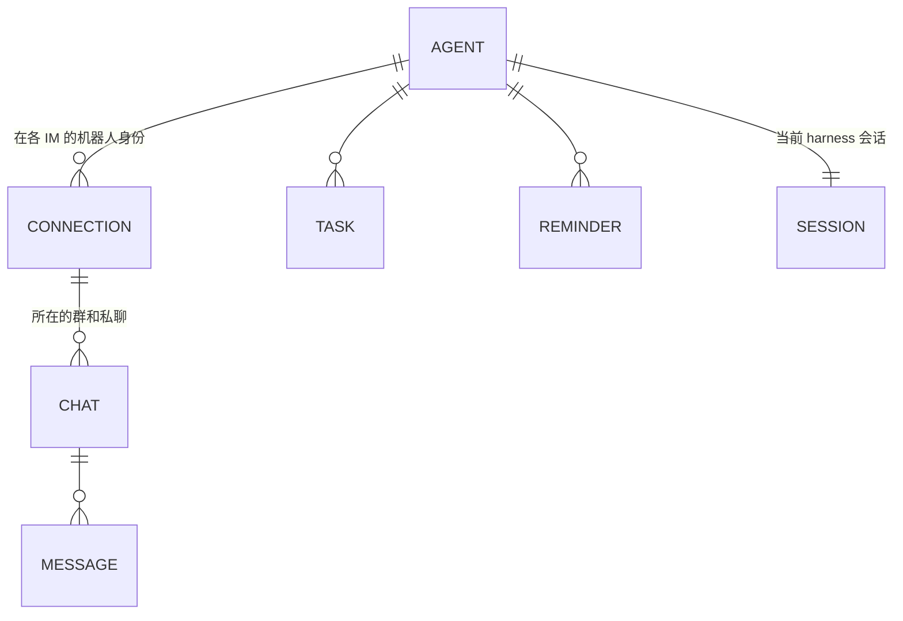
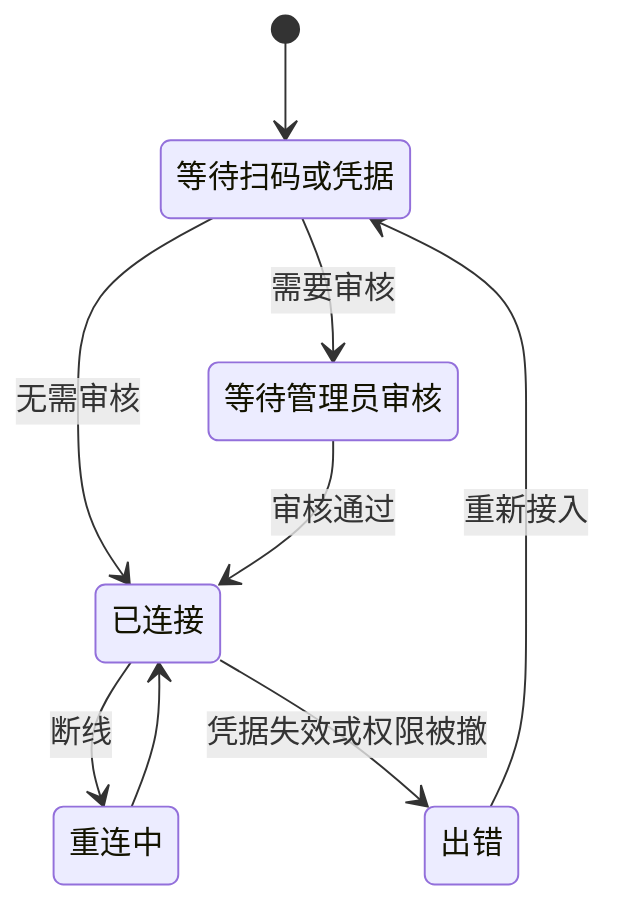
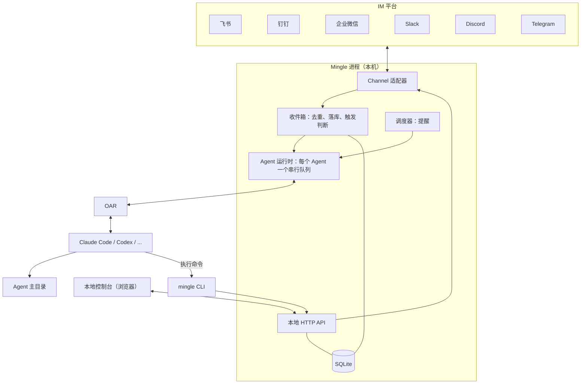

# Mingle 产品设计与技术架构

| | |
|---|---|
| 版本 | v0.4 |
| 日期 | 2026-11-11 |
| 状态 | 现行方案。M1 已完成（第 11 节）；M2 进行中。 |

这是 Mingle 最核心的文档。产品范围、领域模型、架构、技术选型都以本文为准；改动这些内容时先改本文，再改代码。界面和视觉规范见根目录的 [`DESIGN.md`](../DESIGN.md)。

## 1. Mingle 是什么

**把你的 Agent 伙伴请进你已经在用的 IM。本地运行，没有服务器。**

用户在自己的电脑上创建 Agent：有名字、头像、角色、记忆和自己的主目录，由本机已安装的 Claude Code、Codex 等 harness 驱动。Agent 以机器人身份出现在微信、企业微信、飞书、钉钉、QQ、Slack、Discord、Telegram 的群聊和私聊里，可以被 @、接任务、主动回报。

Mingle 不预设使用场景。同一个 Agent 可以是私聊里的个人助理、朋友群里的成员、社区里的答疑者，也可以是工作群里的协作者。角色由用户写的一段描述决定。

### 1.1 两个核心点

1. **用自己习惯的 IM。** 不新建聊天平台，不要求任何人迁移。Agent 出现在你已经在用的群和私聊里。
2. **数据只在你的机器上。** Mingle 没有服务端、没有账号、没有遥测。配置、消息记录、记忆、产物全部在本机。

第二点对外的说法是"没有 Mingle 服务器"，不用 "zero data retention"：消息必然经过 IM 平台和模型厂商，这两者不在我们的承诺范围内。

### 1.2 一等对象是 Agent，不是会话

用户面对的是"Alex"，一个长期存在、记得事情的伙伴，不是"某个 IM 里的一个 Claude Code 会话"。harness 的会话、模型、上下文压缩都是内部实现，不出现在 IM 里，也不需要 `/new`、`/switch` 这类命令。IM 里唯一的命令是 owner 用来叫停的 `/stop`。

评判标准：用户的感受应该是"我有一个长期的 Agent 伙伴，它就在我常用的聊天软件里"，而不是"我在聊天软件里远程操控了一个终端"。

### 1.3 与同类产品的区别

| 产品 | 它是什么 | Mingle 的不同 |
|---|---|---|
| [Raft](https://raft.build/) | 人与 agent 协作的独立工作空间，有自己的服务端、频道和客户端 | Agent 模型和 CLI 向它学习，但不建聊天平台、不要服务端，Agent 住在现有 IM 里 |
| [dsh-im](https://github.com/xmanrui/dsh-im) | 把 IM 机器人接到 DeepSeek Harness 的插件，以会话和工作区为中心 | 接入层向它学习，但以 Agent 为中心，且不绑定单一 harness |
| [cc-connect](https://github.com/chenhg5/cc-connect) | 在 IM 里用命令操作 harness 会话 | 不暴露会话，自然语言交互 |

和 Raft、dsh-im 一样，Mingle 复用用户本机已登录的 harness 和订阅，这不是差异点。

### 1.4 不做的事

- 自建聊天界面或频道系统。
- 任何云端组件、账号体系、多设备同步。
- 自己实现 agent 循环或模型调用，这是 harness 的事。
- 用个人账号的非官方协议接入 IM。只走各平台的官方机器人通道。
- 跨群记忆隔离。已决定接受这个风险，见 8.3。

## 2. 用户旅程

1. 安装并启动 Mingle，浏览器打开本地控制台。
2. 控制台列出本机已安装并登录的 harness。
3. 创建 Agent：填名字、角色，选 harness 和模型。
4. 选择要加入的 IM 并接入：
   - 飞书、钉钉、企业微信：控制台显示二维码，手机扫码创建机器人。
   - Slack：按预置 App Manifest 创建应用，粘贴两个 token。
   - Telegram、Discord：粘贴 bot token。
5. 如果所在组织要求管理员审核，控制台显示"等待管理员审核"，通过后自动转为"已连接"。
6. 把机器人拉进群。群里 `@Alex 昨天那件事后来怎么样了`，Alex 回复。
7. 在另一个 IM 私聊 Alex 问同一件事，Alex 接得上。
8. Alex 做完一件事后回到最初提出的地方回报。

控制台的创建表单参考概念图：名字、角色、大脑（harness）、所在的 IM（多选）、行为方式。

## 3. 领域模型



| 对象 | 含义 |
|---|---|
| **Agent** | 名字、头像、角色、harness、模型、主目录。用户创建和管理的唯一主体。 |
| **Connection（连接）** | 一个 Agent 在一个 IM 上的机器人身份及其凭据。一个 Agent 可以有多个连接。 |
| **Chat（聊天）** | 一个群、一个私聊或一个话题。由连接加平台侧 ID 唯一确定。 |
| **Message（消息）** | 收到和发出的每条消息，带来源和平台消息 ID。 |
| **Task（任务）** | Agent 正在跟踪的事项，记录来源聊天，用于完成后回报。 |
| **Reminder（提醒）** | Agent 给自己设的定时唤醒，一次性或周期性。 |
| **Session（harness 会话）** | OAR 会话 ID。内部对象，可恢复、可压缩、可替换，用户不可见。 |

**一个 Agent 在每个 IM 上是一个独立的机器人。** 这样它在群里有自己的名字和头像，扫码创建的流程也天然是"一次扫码一个机器人"。不做"一个机器人背后路由多个 Agent"。

## 4. Agent 如何工作

### 4.1 一个 Agent，一个长期会话

每个 Agent 有一个长期存在的 harness 会话，工作目录是它的主目录。所有 IM 的消息都进入这同一个会话。跨群、跨 IM 的连续性由此而来，不需要额外的检索或任务匹配逻辑。

这是 Raft 的做法：agent 是一个长期进程，新消息到达时唤醒并恢复原会话，靠 `MEMORY.md` 在上下文压缩和重启后找回状态。

- 应用重启后用 OAR 的 `resume` 恢复同一会话。
- 上下文接近上限时由 harness 自身压缩；压缩前提示 Agent 更新 `MEMORY.md`。
- 会话损坏或更换 harness 时新建会话，Agent 靠 `MEMORY.md` 和消息记录恢复。会话可丢，Agent 不丢。

### 4.2 消息进入

触发规则：

- 私聊：每条消息都触发。
- 群聊：@ Agent，或回复它发出的消息时触发。

触发的消息包上一行来源信息后交给 Agent。每条消息和每个聊天都有 Mingle 分配的短 ID，Agent 用它们来回复和发送：

```text
[msg=m8f2a chat=c12 im=feishu group="周末徒步" from="张三" time=2026-11-11T14:02+08:00]
@Alex 上次说的那条路线，帮我查下周六的天气
```

消息是推给 Agent 的，Agent 不需要轮询收件箱。每个 Agent 同一时刻只有一轮在跑，不做并发会话。

### 4.3 多人同时 @ 与插话

一个 Agent 只有一个会话，所以多人同时找它时不会各开一个分身，而是按下面的规则进入同一轮。

| 情况 | 处理 |
|---|---|
| Agent 空闲，1 秒内到达多条触发消息 | 合并成一次输入开始新一轮，每条保留自己的来源行 |
| Agent 正在工作，来了新消息 | 立即送入当前轮（插话）。实测 Claude Code 和 Codex 都接受；Agent 在下一个工具调用间隙读到 |
| harness 不支持插话 | 排队，本轮结束后合并成一次输入开始下一轮 |
| owner 发 `/stop` | 中止当前轮，排队的消息保留 |

实现上只用 OAR 的 `deliver`：空闲时它开始新一轮，工作中它插话，不支持插话时它排队。每条消息用自己的 `inputId` 投递，重复投递不会重复生效。

**收到即有回执，进度实时可见。** 这一步不经过 Agent，所以即使它正忙，发消息的人也立刻知道没有被漏掉、正在做什么：

- **表情**：消息落库后，Mingle 立刻在这条消息上加"处理中"的表情，回复后换成"完成"，出错时换成"出错"。飞书用 OnIt → DONE / ERROR；Telegram 用 👀，回复后清除，出错 👎；没有表情能力的平台（个人微信）改为显示"正在输入"。
- **实时回复**：平台能改写已发消息时，Mingle 同时以引用回复的形式开一条"实时回复"，先显示"正在思考 · 3 秒"，随后列出 Agent 正在做的事（运行命令、查看文件、查资料……），约每秒刷新一次。Agent 用 `mingle message reply` 回复这条消息时，答案直接写进这条实时回复，原地变成答案；群里会 @ 提问的人。飞书用流式卡片，Telegram 用可编辑的消息。
- **收尾**：Agent 若用 `message send` 而不是 `reply` 作答，实时回复收成"已回复，见下方消息"；未回复、被 `/stop` 叫停、出错时，各自收成一句说明，不会一直停在"正在思考"。飞书流式卡片约 10 分钟后不再接受更新，超过 9 分钟的任务改为另发一条消息作答。

**怎么回由 Agent 判断，规则写在操作指南里：**

- 每条触发消息都要有回应，用 `mingle message reply <消息ID>` 引用原消息，群里才看得出在回谁。
- 手头的事还要很久时，先回一句"收到，稍后回复"，再继续。
- 新消息是对当前工作的补充或更正时，并入当前工作。
- 新消息是另一件事时，不丢下手头的事，做完再处理，除非来自 owner 或明确更紧急。
- 多人要求互相冲突时，以 owner 为准；没有 owner 表态就在群里说明冲突并询问。

**没有回应时的兜底。** 一轮结束后，若有触发消息没有得到任何 `reply`，Mingle 追加一次提示，列出这些消息 ID，由 Agent 逐条回复或明确说明无需回复。只提示一次；仍未回复的在控制台标为"未回复"。Mingle 不会把 Agent 的自言自语自动发到群里。

**出错时的兜底。** 一轮以失败结束（harness 未登录、额度用完、欠费、模型不可用、服务繁忙、内容过长等，分类取自 OAR 的 `failure`），或者会话根本打不开（harness 没装、启动失败）时，Mingle 不再追加提示，而是把这一轮还没回复的触发消息标为"出错未回复"，并立刻告诉发消息的人：有实时回复的收成一句说明；没有实时回复、或实时回复已经收不了尾（例如 QQ 流式消息超出时间窗口）时，另发一条短消息，同一个聊天 60 秒内只发一次。说明用聊天的语言，讲清是什么问题、该怎么办，例如"Claude Code 没有登录，暂时回复不了。请在运行 Mingle 的电脑上登录 Claude Code，然后再发一次。"；额度用完且 harness 报告了恢复时间的，带上恢复时间。控制台把失败分类存为 `agents.status_failure`，在 Agent 页给出对应的标题和下一步，harness 的原话放在下面备查；"上手"卡片和"需要你处理"不会停在"正在回复"。失败的消息不自动重发。问题解决后，可以由发消息的人再发一次，也可以由 owner 在控制台点"重试"。

**重试。** 控制台"需要你处理"的"出错未回复"和"没有回复"两项各有"重试"，动态里每条这样的消息后面也有（`POST /v1/admin/agents/:id/messages/retry`，参数 `{ ids? }`，不传就重试全部）。重试只针对 `failed` 和 `unanswered` 的入站消息，其他状态直接忽略，所以重复点击没有副作用；聊天软件离线的消息不重试，因为 Agent 也回不了。被重试的消息回到 `received`，提示标记清零，像新消息一样走一遍投递：重新打上"处理中"的表情、开一条实时回复，投递时前面加一行 `[mingle] Retry: …`，告诉 Agent 这是一条迟到的消息，回复时简单说明晚了。Agent 还处在出错状态时，按钮旁边提示先解决问题，但不禁用按钮，因为状态可能已经过时。Agent 自己发出去失败的消息不提供重试：明确失败的已经重试过三次，并且把错误交给了 Agent；结果不确定的为了避免重复发言，本来就不重发（见 7.1）。

Raft 的做法更重。从它的源码和 agent 提示词看：忙碌时只给 agent 发"有新消息"的通知，由 agent 自己用命令去拉取；发送被拦下时消息会存为草稿，由 agent 决定修改后重发还是放弃。Mingle 直接把消息内容插进会话，省掉拉取和草稿这两层，等实际遇到"答非所问"的问题再考虑加新鲜度检查。

### 4.4 启动时注入的内容

每次新建或恢复会话时，Mingle 通过 OAR 的 `appendSystemPrompt` 向 harness 追加三样东西，保留 harness 自带的系统提示：

1. `ROLE.md` 的内容：它是谁。
2. `mingle` CLI 的操作指南：它怎么在 IM 里行动。源文件是 [`src/cli/manual.md`](../src/cli/manual.md)，`mingle manual` 打印的也是它，不会不一致。
3. 提示它先读 `MEMORY.md`。

这样主目录里不需要再放 `AGENTS.md` 之类的指令文件。每次打开会话都要重新提供这段内容，否则 harness 压缩上下文后会丢掉它。操作指南用英文写，Agent 按对方使用的语言回复。

**接入前检查兼容性。** 安装了 harness 不代表它具备 Mingle 所需能力。发现时检查 OAR 声明是否支持追加角色／操作指南和传递会话环境；不满足的仍显示在列表中，但不可选择，并说明下一步。OAR 0.97.0 的声明没有覆盖 OpenCode 的版本差异，因此当前只允许已识别的 OpenCode 1.x，2.x 和无法识别的版本暂不可用。创建和修改大脑的 API 同样检查，不能靠绕过界面启用。

新建 Agent、应用启动恢复 Agent，以及修改角色或大脑后，立即尝试打开真实会话，成功后复用它处理消息；检查阶段不投递输入、不调用模型、不发送 IM 消息。这样登录、配置和仅在打开会话时才能发现的能力问题会在第一条消息之前显示。失败时保留角色、记忆、连接和消息记录，不自动切换大脑。启动检查本身不处理消息；后续若消息投递仍失败，按 4.3 标为"出错未回复"并通知发送者，修复后由 owner 点击"重试"，不会自动重发。启动检查不能证明模型会正确执行回复、恢复或压缩后的行为，这些仍由真实 harness 的端到端验证覆盖。

### 4.5 记忆

记忆是主目录下的文件，Agent 用 harness 自带的文件工具读写，Mingle 不提供记忆命令。

- `MEMORY.md` 是恢复索引：自己是谁、进行中的事、指向详细笔记的链接。保持简短。
- `notes/` 放按主题展开的笔记。
- 消息原文不进记忆，需要时用 `mingle message search` 检索。

### 4.6 任务与提醒

- 任务是轻量记录：标题、状态（`todo` / `in_progress` / `done` / `closed`）、来源聊天。由 Agent 用 CLI 维护，控制台只读展示。完成时 Agent 回到来源聊天回报。
- 提醒到点后作为一条系统消息进入 Agent 的会话，和 IM 消息走同一条路。每日总结、定时检查都用它实现。

### 4.7 权限

- **谁能使唤 Agent**：所在群里的所有人和所有私聊对象。私聊白名单放在后续版本。
- **owner**：接入一个机器人后，第一个给它发私聊的人成为它在该 IM 上的 owner（已实现）。owner 可以用 `/stop` 中止当前工作，在冲突时拥有最终决定权，消息头里带 `owner` 标记。`/stop` 是 IM 里唯一的命令。
- **Agent 能做什么**：自主执行，不逐次审批，因为它需要无人值守地工作。这也是 OAR 的默认行为：它关闭了各 harness 的交互式审批和沙箱。也就是说 Agent 能做的事等同于用户本人在终端里能做的事，控制台在创建 Agent 时明确提示。受限模式和把审批转发到 owner 私聊放在后续版本。

### 4.8 状态

控制台显示：空闲、思考中、工作中、离线、出错，以及当前任务、所在的群、最近活动。电脑休眠或关机时 Agent 离线，这一点在界面上如实展示。上手完成状态保存在 Agent 的 has_replied 标记中：首次成功发出消息后永久完成，升级时从已有成功发送记录回填，不受最近活动条数、重启或移除连接影响；未成功回复时，只有聊天软件已连接且 Agent 正在思考或工作才显示"正在回复"。

## 5. `mingle` CLI：Agent 的行动接口

### 5.1 为什么是 CLI

**Agent 通过 `mingle` 命令行在 IM 里行动，不用 MCP 工具。** 上一版写的是 MCP，这里改掉，理由：

- 所有 harness 都能跑 shell 命令，不需要逐个适配 MCP 配置，也不依赖 OAR 的工具挂载能力。
- Raft 完全用 CLI 作为 agent 的接口，已经验证可行。
- 用户可以在终端里敲同样的命令来调试，看到的和 Agent 看到的一样。
- 操作指南只有一份：注入的提示词和 `mingle manual` 同源。

Agent 说的话不会自动发到 IM。多个群的消息在同一会话里交错时，"最后一段文字发给谁"有歧义，显式调用命令则没有。

没有回应时的兜底见 4.3。

### 5.2 身份

Mingle 启动 harness 时通过 OAR 的 `env` 放入三个环境变量：本地 API 地址、一个每次启动重新生成的令牌、`mingle` 可执行文件的绝对路径。CLI 据此确定"我是哪个 Agent"，Agent 不需要登录，也不需要在命令里写自己的名字。令牌只在本机有效，只能操作该 Agent 自己的聊天。

本文为了易读写作 `mingle ...`，注入给 Agent 的操作指南里写的是 `"$MINGLE_CLI" ...`。原因是有的 harness 通过登录 shell 执行命令，用户的 shell 配置会重排 `PATH`，按名字找可能找到别的程序或找不到。

没有令牌时，同一个 `mingle` 命令是用户的管理入口（启动、打开控制台、查看状态）。

### 5.3 命令

首版只有六组。命令少，Agent 才记得住。

**消息**

| 命令 | 作用 |
|---|---|
| `mingle message reply <消息ID>` | 回复某条消息，平台支持时显示为引用回复 |
| `mingle message send --to <聊天ID>` | 向某个聊天主动发消息 |
| `mingle message read <聊天ID>` | 读某个聊天最近的消息，`--limit`、`--before` 翻页 |
| `mingle message search <关键词>` | 全文检索消息记录，`--in <聊天ID>` 限定范围 |

`reply` 和 `send` 的正文从标准输入读取，用 heredoc 传入，避免引号、反引号和换行被 shell 解释。`--file <路径>` 附带文件，可重复：

```bash
mingle message reply m8f2a <<'MSG'
周六晴，气温 8–17℃，上午风小，适合走。
MSG
```

**聊天**

| 命令 | 作用 |
|---|---|
| `mingle chat list` | 列出自己所在的群和私聊，含 ID、平台、名称 |
| `mingle chat info <聊天ID>` | 聊天详情；平台支持时含成员 |

**文件**

| 命令 | 作用 |
|---|---|
| `mingle file get <文件ID>` | 把收到的附件下载到当前目录，`--out` 指定路径 |

收到的附件不会自动落盘。消息里只带文件 ID 和文件名，Agent 需要时再取，主目录不会被附件堆满。

**任务**

| 命令 | 作用 |
|---|---|
| `mingle task create <标题>` | 新建任务，`--from <消息ID>` 记录来源 |
| `mingle task list` | 列出未完成的任务，`--all` 含已完成 |
| `mingle task update <任务ID> --status <状态>` | 更新状态 |

**提醒**

| 命令 | 作用 |
|---|---|
| `mingle reminder set <内容>` | `--in 30m`、`--at <时间>` 或 `--every daily@09:00`；`--chat <聊天ID>` 记录相关聊天 |
| `mingle reminder list` | 列出提醒 |
| `mingle reminder cancel <提醒ID>` | 取消 |

**自身**

| 命令 | 作用 |
|---|---|
| `mingle whoami` | 自己的名字、各 IM 上的连接及状态 |
| `mingle manual` | 完整的操作指南 |

### 5.4 输出约定

- 默认输出给人和模型读的纯文本，消息的格式与 4.2 里收到的格式一致。输出一律英文。`--json` 输出结构化数据。
- 成功时打印结果和新对象的 ID，例如发出消息的 ID。
- 失败时非零退出，打印稳定的错误码和一句"下一步怎么做"，例如 `chat_not_found：用 mingle chat list 查看可用的聊天`。
- 平台不支持某项能力时明确说明降级结果，例如"该平台不支持引用回复，已作为普通消息发送"。
- 发送结果不确定时如实报告，不自动重发。
- 每个命令支持 `--help`。

### 5.5 暂不提供

表情回应、编辑和撤回消息、管理群成员、创建群。这些在各平台差异大，等核心流程稳定后按需增加。

## 6. IM 接入

### 6.1 首批八个平台

全部使用平台官方的出站长连接，不需要公网地址。

| 平台 | 接入方式 | 连接方式 | 可能需要管理员审核 |
|---|---|---|---|
| 飞书 | 扫码创建机器人（或在已登录的浏览器里打开授权链接），或填已有应用的 App ID / Secret | 官方 SDK 长连接 | 视租户设置 |
| 钉钉 | 扫码或在电脑上打开授权页创建应用，或填 Client ID / Secret | Stream 长连接 | 需要组织管理员创建应用 |
| 企业微信 | 扫码创建智能机器人，或填 Bot ID / Secret | 官方 WebSocket 长连接 | 是 |
| Slack | 预置 App Manifest 创建应用，填两个 token | Socket Mode | 视工作区设置 |
| Discord | Developer Portal 建应用，填 bot token；连上后用控制台给的邀请链接拉进服务器 | Gateway（直连 WebSocket，不引入 SDK） | 否，需服务器管理权限拉入 |
| Telegram | @BotFather 生成 bot token | 长轮询 | 否 |
| 个人微信 | 微信扫码绑定 | 腾讯 iLink 机器人服务（`ilinkai.weixin.qq.com`）长轮询 | 否 |
| QQ | 手机 QQ 扫码创建机器人，或填 AppID / AppSecret | 官方 WebSocket | 否 |

个人微信和 QQ 在定位改为通用 Agent 伙伴后加入首批。个人微信走的是腾讯官方的 iLink 机器人服务，不是逆向的个人号协议，符合"只走官方机器人通道"。从 dsh-im 的实现看它以私聊为主，群聊能力、频率限制和账号要求待实测。

这张表的依据是 dsh-im 的现有实现，它已在这些平台上跑通同样的接入和连接方式。飞书官方 SDK 确有扫码建应用的接口（`registerApp`，回调给出二维码，成功后返回应用凭据），并导出了一个 `LarkChannel`，从类型定义看它已包含消息归一化和流式卡片，实现飞书适配器时先评估能否直接建在它之上。真机扫码尚未实测，见第 12 节。

### 6.2 不引入 IM 框架，自定义 `Channel` 接口

不使用 Chat SDK、Satori、Koishi 作为核心抽象。每个平台用官方 SDK 实现一个适配器，统一实现 Mingle 自己的 `Channel` 接口。

- Chat SDK 主仓库没有飞书、钉钉、企业微信适配器，国内三家无论如何都要自己接。
- 扫码创建、管理员审核这些接入流程是平台专属的，通用框架不覆盖。
- dsh-im 用的正是"官方 SDK + 自有语义层"，并在 ADR 里记录了放弃"最低公分母模型"的原因。

接口定义在 [`src/channels/channel.ts`](../src/channels/channel.ts)，分三部分：

- **接入（onboarding）**：启动扫码或校验凭据，报告进度。
- **连接（lifecycle）**：连接、断线重连、状态上报。
- **消息（messaging）**：收消息事件；发送、回复、上传文件、表情回执、显示"正在输入"。

### 6.3 统一语义，原生呈现

沿用 dsh-im 的原则：

- 核心层只处理语义：消息、引用、聊天、文件、进度。
- 适配器按平台习惯呈现：飞书用卡片，Telegram、Slack、Discord 用消息编辑。Discord 在服务器频道里引用原消息回复（不另开 Thread，这是 Discord 机器人的常见做法）；用户自己开的 Thread 是一个独立的聊天。
- 能力按机器人实例实际拥有的权限判断，不按平台名称假定。不支持时明确降级。

### 6.4 连接状态



"等待管理员审核"是一等状态。控制台明确告诉用户正在等谁、等什么，并在通过后自动继续。

## 7. 整体架构



**单进程。** 一个 Node 进程包含全部模块，同时提供本地 HTTP API，只监听 `127.0.0.1`。harness 由 OAR 作为子进程拉起。控制台和 `mingle` CLI 都是这个本地 API 的客户端。

| 模块 | 职责 |
|---|---|
| Channel 适配器 | 平台接入、长连接、收发消息、原生呈现 |
| 收件箱 | 按平台消息 ID 去重，落库，判断是否触发，包装来源信息 |
| Agent 运行时 | 管理每个 Agent 的会话生命周期和消息队列，调用 OAR，观察事件并更新状态 |
| 调度器 | 到点触发提醒 |
| 本地 API | 两类调用方：控制台（管理）和 CLI（Agent 行动）。Agent 的所有对外发送和权限检查集中在这里 |
| `mingle` CLI | 第 5 节的命令，无状态，只做参数解析和输出格式化 |
| 控制台 | 创建和管理 Agent，接入 IM，查看状态 |

### 7.1 可靠性

- **去重**：`(connection_id, 平台消息 ID)` 唯一，平台重推不会重复触发。
- **重启**：进程启动时恢复所有连接和 Agent 会话。重启前未处理完的消息保留在收件箱，重新投递。
- **发送失败**：明确失败最多重试三次；结果不确定时不自动重试，避免重复发言。
- **离线期间的消息**：以各平台长连接的补推能力为准，不自行向平台回拉历史。
- **睡眠醒来**：定时器的间隔比预期长出一分钟以上，说明电脑睡过。此时立即关闭并重连所有聊天软件，不等各连接自己的心跳超时，然后补发期间到期的提醒（重复提醒只补一次，从当前时间算下一次）。

## 8. 数据与存储

### 8.1 本地目录

```text
~/.mingle/
├── mingle.db              运行状态
├── logs/
└── agents/<slug>/         Agent 的主目录，也是 harness 的工作目录
    ├── ROLE.md            它是谁，用户编写
    ├── MEMORY.md          恢复索引，Agent 维护
    └── notes/             Agent 的笔记
```

主目录里 Mingle 只约定这两个文件和一个目录。其余的文件和目录由 Agent 按需要自己建，Mingle 不预设结构。

**文件是 Agent 的内容，SQLite 是运行状态。** 角色、记忆和产物都是普通文件，用户可以直接打开、编辑、用 git 管理、整个目录拷走。

### 8.2 SQLite

使用 Node 24 自带的 `node:sqlite`，不引入原生依赖。建表语句在 [`src/store/migrations/001_init.sql`](../src/store/migrations/001_init.sql)。

| 表 | 内容 |
|---|---|
| `agents` | 名字、slug、头像、harness、模型、权限模式、当前会话 ID、状态 |
| `connections` | 所属 Agent、平台、机器人身份、连接状态、凭据引用 |
| `chats` | 所属连接、平台侧 ID、类型（群 / 私聊 / 话题）、名称 |
| `messages` | 所属聊天、方向、发送者、内容、附件引用、平台消息 ID、时间、处理状态 |
| `tasks` | 所属 Agent、标题、状态、来源聊天 |
| `reminders` | 所属 Agent、内容、触发规则、下次触发时间 |

`messages` 上建 FTS5 全文索引供 `mingle message search` 使用，分词器用 `trigram`，中文和英文都能搜（已实测）。三个字符以下的关键词退到 `LIKE`。

### 8.3 密钥与隐私

- IM 凭据存入系统的凭据存储（见 9.2），数据库只存引用。API 响应和日志不回传任何密钥。
- harness 的登录态由 harness 自己管理，Mingle 不接触。想用 API Key（包括其他兼容服务）的人在 harness 里自己配：shell 环境变量或 harness 的配置文件。Mingle 不保存模型服务的 Key，也不做协议转换（MING-11 的结论：接通容易，但第三方兼容接口质量不一，逐家适配和验证的成本与"完成度优先"不符）。Mingle 只负责两件事：桌面应用读到 shell 里配的变量（见 9.1），以及"没有登录"的提示里说明可以改用 API Key，附官方文档链接。
- **跨群记忆不隔离。** Agent 在私聊里得知的内容可能在群里被说出来。这是已接受的取舍，换来的是 4.1 的简单模型。`messages` 仍记录来源，将来需要隔离时有据可依。控制台在创建 Agent 时提示这一点。
- 使用个人 harness 订阅为群内其他人提供服务是否符合各厂商条款，本版不处理。

## 9. 技术选型

| 项 | 选择 | 理由 |
|---|---|---|
| 语言 | TypeScript，ESM | OAR 和各平台官方 SDK 都是 Node 生态 |
| 运行时 | Node.js 24+ | OAR 的要求，且自带 `node:sqlite` |
| harness 接入 | [OAR](https://github.com/botiverse/oar)，锁定版本，包一层薄接口 | 一个 API 驱动所有 harness；它更新很快，隔离其变化 |
| Agent 行动接口 | 自有 `mingle` CLI | 见 5.1 |
| IM 接入 | 各平台官方 SDK + 自有 `Channel` 接口 | 见 6.2 |
| 存储 | `node:sqlite` + 文件 | 见第 8 节 |
| 本地 API | Hono | 轻，无额外运行时要求 |
| 控制台 | React + Vite + Tailwind，视觉按 `DESIGN.md` | 通用，浏览器和桌面应用用同一套 |
| 桌面应用 | [mygo](https://github.com/egoist/mygo) 0.9 的 webview 模式（Go），内置 Node.js 24 | 见 9.1 |
| 包管理 | pnpm | |
| 测试 | Vitest；harness 侧用 OAR 的 `testing` 脚本化运行时 | 不需要真实登录即可测试 Agent 运行时 |
| 代码检查 | Biome | 格式化和 lint 一个工具 |

### 9.1 界面形态

**有界面，形态是本机进程提供的网页控制台。** 扫码、创建 Agent、查看状态都在控制台完成。启动 Mingle 时自动打开浏览器。

**桌面应用用 mygo 的 webview 模式包同一个控制台**（2026-11-13 决定，代码在 `desktop/`）。

- 应用是一个菜单栏程序：窗口里是 `mingle start` 提供的控制台。关掉窗口 Mingle 继续在后台运行，Dock 图标只在窗口显示时出现。
- **持续在线**（2026-11-13 决定，MING-18）：应用开着就等于 Agent 在线，不另做系统服务。系统级服务在登录前运行，读不到 harness 的登录态和 shell 里的 API Key；用户级服务的效果和"登录时打开"一样，却让"退出了 Agent 还在线"成为可能，更新时还要替换正在运行的内置 Node。要 7×24 在线的人，在不睡眠的机器上用 `mingle start` 无界面运行。让 Agent 掉线的是这几件事，各有对策：
  - 退出应用：有 Agent 在线时先确认，列出哪些 Agent 将不再回复（菜单栏和 Cmd-Q 都一样；系统注销、关机、更新重启不问）。
  - 没开"登录时打开"：某个 Agent 第一次有连上的聊天软件后，控制台 Agent 页出现"让 Agent 一直在线"卡片，可直接打开"登录时打开"和"插电时保持唤醒"，点"好了"后不再出现。设置页有同样的开关，外加通知开关。
  - 电脑睡眠："插电时保持唤醒"默认关。打开后，有 Agent 在线且接着电源时，阻止空闲睡眠（mygo `Power.KeepAwake`，不保持屏幕常亮）；用电池时不阻止。合上盖子仍会睡眠（Mac 接外接显示器时除外），界面如实说明。有 Agent 在线时应用还用 `Power.KeepRunning` 避免 macOS 的 App Nap。
  - 醒来后恢复慢：Mingle 每 15 秒检查一次时钟，间隔比预期长出一分钟以上就认为电脑睡过，立刻关闭并重连所有聊天软件，再补发期间到期的提醒（7.1）。这一条在核心里做，无界面运行时同样生效。
- **菜单栏 / 托盘**：图标只表达"是否需要你处理"，有三种状态：正常；有需要处理的事时右上角加一个点（macOS 模板图没法上色，点用形状表示；Windows、Linux 用琥珀色）；Mingle 停止时变淡。菜单第一行是总体状态（"Mingle 正在运行 · 2 个 Agent 在线"），然后每个 Agent 一行，带状态点和一行说明（空闲、思考中、工作中：任务标题、离线：飞书连接出错、还没有连接聊天软件），点击打开它的页面。超过 5 个 Agent 时，先列需要处理的和正在工作的，其余收进"其他 N 个"。有需要处理的事时出现"需要处理（N）"子菜单，各项点击直达对应 Agent。下面是打开 Mingle、登录时打开、插电时保持唤醒、检查更新（更新已装好时换成"重启以更新到 x.y.z"）、查看日志、退出。菜单里不显示消息内容和联系人：共享屏幕时别人也看得到菜单栏。数据来自 `GET /v1/admin/summary`，应用每 3 秒读一次，菜单有变化才重建。
- **平台差异**：macOS 点图标弹菜单；Windows 左键打开窗口、右键弹菜单，第一次关窗时发一条通知，说明 Mingle 仍在托盘里运行、怎样退出、怎样把图标固定到任务栏（Windows 用户习惯关窗即退出），只提示一次。
- **系统通知**只发需要人处理的事：连接出错、断开重连超过 5 分钟、管理员审核通过、Agent 有消息没能回复。应用启动时已经存在的问题不通知，只在菜单里显示。点通知打开对应 Agent 的页面。默认打开，设置页可关。回复本身由聊天软件通知，Mingle 不重复。
- 应用的偏好（保持唤醒、通知、卡片和提示是否已看过）存在应用数据目录的 `mingle-desktop.json`。控制台通过桌面壳绑定的 `Online` 服务（`desktop/online.go`）和 `mingle:online` 事件读写；菜单栏要打开某个页面时，发 `mingle:navigate` 事件给控制台。
- 应用内置 Node.js 24（版本和校验和锁定在 `desktop/scripts/prepare.mjs`）和 Mingle 的构建产物，启动时用它运行 `mingle start --no-open`，进程退出后自动重启，退出应用时先让它正常关闭。核心仍是同一个 Node 进程，桌面壳不碰业务逻辑。
- 从 Finder 打开的应用拿到的环境很少：`PATH` 找不到用户用 Homebrew、npm 装的 harness，用户在 `~/.zshrc` 里给 harness 配的 API Key、`ANTHROPIC_BASE_URL`、代理也都没有，harness 会表现为"没有登录"。所以应用用 `mingle start --login-shell-env` 启动 Mingle：Mingle 通过 OAR 的 `userShellEnvironment()` 读一次用户登录 shell 的完整环境并采用（`MINGLE_*` 以应用给的为准），内置的 Node.js 放在 `PATH` 最后兜底。读不到时照常启动，日志里只记原因，不记任何变量值。Windows 应用本来就拿到用户环境，不读。
- 已经有一个 Mingle 在跑（比如在终端里 `mingle start`），应用直接显示它，不另起一个。
- 选 mygo 而不是原生 SwiftUI 壳：控制台不用写第二套；托盘、登录项、DMG、签名、公证、带签名的增量自动更新都是现成的。代价是依赖一个年轻的单人项目（2026-09 创建，0.9.0），但壳只有约 1600 行 Go，业务逻辑都在 Node 进程里，将来换壳成本低。nsh 的强项是跨移动端原生 UI，不是我们的需求。
- 自动更新：mygo 的 updater 插件（类 Sparkle 的更新窗口），从本仓库的 GitHub Releases 读带签名的更新清单。签名私钥不在仓库里，在 CI 的 `MYGO_UPDATER_PRIVATE_KEY` secret 中。
- 更新不打扰用户（2026-11-13 决定）：应用每 6 小时和每次启动后检查一次；首次运行时默认打开"自动下载并安装"，新版本在后台下载安装，下次启动生效，不弹窗。装好后控制台侧栏底部出现"重启以更新"，点一下重启进新版本（Agent 自动重连）；用户关掉自动下载时，侧栏显示"更新到 x.y.z"，点了打开更新窗口看说明再装。设置页"关于"里有更新状态、检查更新和自动下载的开关。控制台通过桌面壳绑定的 `Updates` 服务（`desktop/updates.go`，`window.mygo.call`）和 `mingle:updates` 事件拿状态；浏览器里打开的控制台没有 `window.mygo`，不显示这些。包管理器装的应用不能自更新，设置页说明原因。

### 9.2 平台

macOS、Windows、Linux 都发桌面应用，每个系统都有 x64 和 ARM64 两种构建。macOS 是主力平台，测试版只发 macOS。核心不写某个系统专属的代码，系统相关的部分都在接口后面：

| 能力 | macOS | Windows | Linux |
|---|---|---|---|
| IM 凭据 | 钥匙串（`/usr/bin/security`） | DPAPI 按当前用户加密后存文件（Credential Manager 底层用的也是它），通过 PowerShell 调用，不需要原生模块 | Secret Service（`secret-tool`：GNOME Keyring、KWallet）；没有时（如无界面的服务器）退回 0600 文件 |
| Agent 调用的 `mingle` 命令 | sh 脚本 | `mingle.cmd` | sh 脚本 |
| 桌面应用停止 Mingle | 关闭它的标准输入（三个系统相同；Windows 没有 SIGTERM，而且应用崩溃时 Mingle 也会跟着退出） | 同左 | 同左 |
| 应用的环境 | 从登录 shell 读取完整环境，找得到 Homebrew、npm 装的 harness 和 shell 里配的 API Key | 系统给应用的就是用户环境 | 从登录 shell 读取完整环境 |
| 窗口 | 隐藏标题栏，红绿灯放在侧栏，半透明材质 | 系统标题栏，不透明 | 系统标题栏，不透明 |
| 托盘图标 | 菜单栏模板图，点击弹菜单 | 彩色小图标，左键打开窗口、右键弹菜单 | 彩色小图标，需要 AppIndicator（deb、rpm 已声明依赖） |
| 保持唤醒 | 阻止空闲睡眠；合盖仍睡眠（接外接显示器时除外） | 阻止空闲睡眠；合盖按电源设置 | 同 Windows |
| 安装包 | DMG | NSIS 安装包，装在当前用户目录，不需要管理员权限 | `.deb`、`.rpm`、`.tar.gz`（附 `install.sh`） |

Mingle 也可以不装桌面应用，在 Linux 小主机上用 `mingle start` 无界面运行。

### 9.3 代码结构

```text
src/
├── core/         领域类型、Agent 运行时、收件箱、调度器
├── harness/      OAR 的薄封装
├── channels/     Channel 接口和各平台适配器，每个平台一个目录
├── store/        SQLite 访问和迁移
├── platform/     Keychain、自启等系统相关能力
├── api/          本地 HTTP API
└── cli/          mingle 命令和操作指南
web/              控制台
docs/             文档
```

单个包，不拆 monorepo。

### 9.4 分发

- **首版**：npm 包，命令行启动，浏览器打开控制台。
- **桌面应用**：三个系统的安装包都带自动更新，由 `.github/workflows/release.yml` 构建。正式版（`v0.2.0`）构建全部平台，进草稿 Release，维护者装一遍后发布；测试版（`v0.2.0-beta.1`）只构建 macOS，自动发布为 Pre-release，已安装的应用不会更新到它。完整流程和签名所需的 secret 见 [发布流程](releasing.md)。正式标签要求 Developer ID 签名和公证，缺 secret 直接失败；只有手动构建和测试版允许 ad hoc 签名，Windows 安装包不签名，首次打开都需要用户放行。Homebrew cask 待有 Developer ID 后再加。
- **Mac App Store 上不了。** 上架要求应用沙箱，而沙箱内的进程及其子进程不能执行用户自己安装的 `claude`、`codex`，也读不到 `~/.claude` 之类的登录态和用户的代码目录。Mingle 的核心就是拉起这些 harness，这一点和 MiaoYan 这类只读写用户所选文件夹的应用不同。
- **官网与发布同源**：GitHub 上已发布的 Latest Release 是"当前正式版"的唯一事实来源。网站（`site/`，Cloudflare Worker 纯静态资源，没有后端、没有遥测）由 `.github/workflows/website.yml` 构建：先用 `scripts/releases.ts snapshot` 冻结 Latest 的完整元数据，再从这份快照渲染全部下载链接，部署前用 `check-latest` 复核 Latest 没有中途变掉。正式版在草稿里由 verify 作业校验全部安装包的大小、SHA256SUMS，以及更新清单中记录的更新包／增量包 Ed25519 签名，之后仍由维护者手动发布；测试版自动发布为 Pre-release，与正式渠道隔离，网站和已安装应用都不会看到它。桌面端实际的自动升级链路（已安装应用收到新版本）尚未实测。
- npm 包名 `mingle-app`（`mingle` 已被占用），命令名 `mingle`。
- 开源，MIT 许可。

### 9.5 国际化

- 界面文案全部走消息目录，不在组件里写死文字。首批 `en` 和 `zh-CN`。语言默认选「跟随系统」：桌面应用读取操作系统语言，浏览器控制台按浏览器的首选语言列表选择第一个支持的语言；中文变体使用简体中文，没有支持的语言时回退英文。设置里可切换为简体中文或 English，手动选择保留到下次启动，也可切回跟随系统。跟随模式下响应运行期间的语言变化，不把自动检测结果保存成手动选择。
- CLI 输出和给 Agent 的操作指南只用英文。它们的读者是模型，不需要翻译。
- Agent 说什么语言由 `ROLE.md` 和对话对象决定，Mingle 不干预。
- 仓库 `README.md` 用英文，另有 `README_CN.md`。

## 10. 参考项目

| 项目 | 借鉴 | 不借鉴 |
|---|---|---|
| [Raft](https://github.com/botiverse/raft-source) | agent 是长期参与者；`MEMORY.md` 加 `notes` 的记忆方式；CLI 作为 agent 接口，正文走标准输入，指南与注入提示同源，错误带下一步；任务和提醒 | 独立聊天平台、服务端、多机部署。其许可证为 FSL，只参考设计，不复制代码 |
| [dsh-im](https://github.com/xmanrui/dsh-im) | 扫码接入流程；各平台长连接；统一语义加原生呈现；按实例判断能力；发送失败处理 | 以会话和工作区为中心的命令体系。MIT 许可，移植代码时保留署名 |
| [OAR](https://github.com/botiverse/oar) | 直接作为依赖 | |

## 11. 里程碑

| 阶段 | 内容 | 完成标志 |
|---|---|---|
| **M0 技术验证** | 第 12 节 | OAR 和 SQLite 部分已完成；IM 接入部分随 M1 的适配器一起验证 |
| **M1 跑通一个 Agent** | 进程骨架、SQLite、控制台、Agent 运行时、`mingle` CLI；Telegram 和飞书；Claude Code 和 Codex | 在控制台创建 Agent，扫码接入飞书，群里 @ 能回复，Telegram 私聊能接上同一件事 |
| **M2 八个平台** | 个人微信、企业微信、钉钉、QQ、Slack、Discord；文件收发的平台差异 | 八个平台均可接入 |
| **M3 桌面应用** | 桌面壳、菜单栏、开机自启、自动更新；更多 harness；审批转发 | 双击安装即可使用 |

八个平台都在初期范围内，先做 Telegram 和飞书是为了用最少的适配器把 Agent 模型打磨对，再横向铺开。

### 11.1 M1 进度

| 项 | 状态 |
|---|---|
| SQLite 存储与迁移 | 完成 |
| Agent 运行时：合并、插话、未回复提醒、`/stop`、重启后补投 | 完成 |
| 本地 HTTP API 与 `mingle` CLI（第 5 节全部命令） | 完成 |
| 任务、提醒 | 完成（原计划 M2，顺带做了） |
| Telegram 适配器 | 完成，单元测试覆盖；未接真实 bot |
| Claude Code | 端到端实测通过 |
| Codex | 端到端实测通过（Codex 0.167.1） |
| 控制台 | 完成：首次空状态、创建 Agent、Agent 页面（状态、角色编辑、聊天软件、最近活动、任务、提醒、打开文件夹、叫停、删除）、Telegram 接入、中英文、明暗外观。由 `mingle start` 自动打开，`mingle open` 重新打开 |
| 飞书适配器 | 完成，真机验证通过：扫码建应用、等待审核状态、长连接收发、引用回复、👌 回执、新机器人主动私聊 owner |

### 11.2 M2 进度

| 项 | 状态 |
|---|---|
| 个人微信 | 完成：腾讯 iLink 扫码登录（含手机验证码）、长轮询收消息、带 context_token 回复、"正在输入"回执。只支持私聊。收发图片和文件：每个文件用新的 AES-128-ECB 密钥加密后传到腾讯 CDN，再以图片或文件消息发出（按扩展名区分，单个文件上限 100 MiB，这是 Mingle 自定的，不是平台文档里的限制）；收到的图片和文件按消息里的密钥下载解密。协议细节来自 dsh-im。待真机扫码验证 |
| 企业微信 | 完成：手机企业微信扫码创建智能机器人（或填 Bot ID / Secret），官方 SDK 的 WebSocket 收发；实时回复用智能机器人原生的流式回复；收发图片和文件。智能机器人没有表情能力。待真机扫码验证 |
| 钉钉 | 完成：扫码或在电脑上打开授权页创建应用（或填 Client ID / Secret），Stream 长连接收消息，机器人 OpenAPI 回复 Markdown，处理中在消息上挂"🤔思考中"标签，实时回复用钉钉 AI 卡片，收发图片和文件：先传到钉钉的媒体库（单个 20 MB 以内），jpg、png、gif、bmp 以图片消息发出，其余以文件消息发出，每个文件一条消息。待真机验证 |
| QQ | 完成：手机 QQ 扫码创建机器人（或填 AppID / AppSecret），官方 SDK 的 WebSocket 收私聊和群里 @ 机器人的消息，按消息 ID 被动回复（窗口过期时改为主动消息）；私聊里处理中显示"正在输入"，实时回复用 QQ 的流式消息；群聊没有流式和表情能力，直接回复。可收发图片和文件（发通用文件需要平台的文件权限，没有时只发文字并标注）。纯文本发送，Markdown 需平台审核后再开。待真机扫码验证 |
| Slack | 完成：Socket Mode 长连接（不需要公网地址），直接用 Web API，不引入 SDK。控制台给出预填好名称、权限、事件和 Socket Mode 的建应用链接，用户安装后粘贴 Bot token 和 App-level token。私聊直接回复；频道里 @ 它时在该消息下开线程，线程即一个会话，之后线程内不必再 @。回复用 Slack 的 `markdown` 块（标准 Markdown）。表情 👀 → ✅ / ❌，实时回复编辑同一条消息。收发文件（上传走 Slack 的外部上传流程）。待真机验证 |
| Discord | 完成：Gateway 直连（心跳、断线后 resume、按 Discord 要求重连），REST 直接调用，不引入 SDK。控制台给出开发者后台链接和步骤，用户粘贴 bot token；应用的所有者自动成为 owner；连上后连接旁有"添加到服务器"的邀请链接（权限已预填）。私聊直接回复；服务器频道里的消息都存作上下文，@ 它或回复它的消息时触发，回答引用原消息；用户开的 Thread 是独立的聊天。开了 Message Content Intent 才能看到没 @ 它的消息，没开时自动只用 @ 和私聊，不会连不上。表情 👀 → ✅ / ❌，实时回复编辑同一条消息，收发文件（单条消息最多 10 个、合计 10 MiB，超出的不发并标注）。待真机验证 |
| 各平台文件收发 | 飞书、Telegram、企业微信、QQ、Slack、Discord、个人微信、钉钉已支持，八个平台全部完成 |
| 实时回复与表情 | 飞书（流式卡片，真机验证通过）、Telegram（编辑消息）、企业微信（流式回复）、钉钉（AI 卡片）、QQ 私聊（流式消息）、Slack（编辑消息）、Discord（编辑消息）完成；个人微信和 QQ 用"正在输入"代替表情 |

### 11.3 M3 进度

| 项 | 状态 |
|---|---|
| 桌面壳 | 完成：mygo webview 窗口装控制台，菜单栏图标，关窗后留在后台，单实例，Mingle 进程退出后自动重启，退出应用时正常关闭它。本机实测：构建出的 DMG 约 54 MB；从应用启动内置 Node 跑起 Mingle、读到全部本机 harness；关窗隐藏、再次打开显示原窗口；手动杀掉 Mingle 进程后自动重启；Cmd-Q 后 Mingle 进程退出 |
| 开机自启 | 完成：菜单栏里的"登录时打开"，登录时启动不弹窗口 |
| 持续在线（MING-18） | 完成：菜单栏显示各 Agent 状态和需要处理的事、退出前确认、"让 Agent 一直在线"卡片和设置、插电时保持唤醒、睡眠醒来后立即重连、需要处理时发系统通知、Windows 左键开窗和首次关窗提示（9.1）。状态逻辑和通知规则有 Go 单元测试，醒来重连有集成测试，控制台用模拟的 `window.mygo` 截图检查过；本机启动过一次应用确认托盘创建无误，菜单的实际外观、通知、保持唤醒和 Windows 行为待真机检查 |
| 自动更新 | 已接好：mygo updater 插件和签名清单，发布流程见 9.4；默认后台下载，控制台侧栏"重启以更新"和设置页更新状态（9.1）。控制台各状态用模拟的 `window.mygo` 截图检查过；真实的下载和重启要等下一个发布版本实测 |
| 签名与公证 | 流程已写进 CI，需要维护者提供 Developer ID 证书和 Apple 账号的 secret；没有时是 ad hoc 签名 |
| 控制台改版（参照 Pinky） | 完成（2026-11-13）：新的视觉和引导，见 `DESIGN.md`。首次打开是欢迎页和三步新建流程；harness 显示本机已装的、带官方图标，模型从 harness 实时读出来选（OAR `listModels`，结果缓存 5 分钟），不再手填；创建后直接进入连接聊天软件；Agent 页分"动态"和"设置"，未回复过消息时有"上手"四步卡片，右侧"需要你处理"汇总出错的连接、等待审核和没回复的消息；harness 和模型可随时更改（`PATCH /v1/admin/agents/:id`，换 harness 时开新会话）。桌面应用隐藏标题栏，红绿灯在侧栏品牌行，侧栏用窗口毛玻璃 |
| 桌面应用端到端测试 | `desktop/automation_e2e.go`：带 `e2e` 标签构建的应用可由 `mygo-automation` 驱动。本轮用它在真实窗口里走完：欢迎 → 新建（模板、harness、模型）→ 选平台 → 飞书出码 → 返回 → 改模型 → 错误 token 提示 → 删除回到欢迎页，并修了途中发现的问题 |
| 全部 OAR harness | 完成（2026-11-13）：OAR 的 12 个 harness 都列出，已装的可直接选。设置里有完整列表：没装的可以一键安装（运行官方安装命令，先给人看要跑什么），没登录的可以用 harness 自己的登录流程登录（链接或设备码，需要时在控制台里输入回填）。Cursor 的 SDK 是 Cursor 自己的包，Mingle 不随包分发，按需用 npm 装到数据目录的 `vendor/`。不接受追加系统提示的 harness（Kimi、DeepSeek Harness、CodeBuddy、Cursor）改为在新会话第一条消息里带上操作指南；不接受环境变量的（Cursor）在指南里写明调用 CLI 的完整命令。实测：Claude Code、Codex、OpenCode、Kimi 端到端回复；DeepSeek Harness 和 Cursor 在控制台里装好，分别需要 DeepSeek API key 和 Cursor 登录才能回复；Grok 这台机器上 OAR 的 ACP 初始化超时（直接跑 `grok -p` 正常），待查 |
| 更多 harness、审批转发 | 未开始 |

## 12. 验证记录

### 12.1 已实测

2026-11-11，macOS，Node 24.15，OAR 0.97.0。脚本在 [`spikes/`](../spikes/)。

| 项 | 结果 |
|---|---|
| OAR 驱动 Claude Code 2.1.322 | 通过。会话正常开启和结束 |
| 传环境变量 | 通过。`env` 里的变量在 Agent 执行的 shell 命令里可见。名字像凭据的变量，OAR 会在自己的记录里打码 |
| 追加系统提示 | 通过。`appendSystemPrompt` 的内容对模型生效 |
| 工作中送入消息 | 通过。工具执行期间连续 `deliver` 两条，均返回 `steered`；工具结束后模型同时读到两条，并在同一轮里一并回答 |
| 跨进程恢复 | 通过。新进程用 `resume` 打开同一会话，模型记得之前的发送者和内容 |
| 无审批执行命令 | 通过。OAR 默认关闭 harness 的审批，shell 命令直接执行 |
| OAR 驱动 Codex 0.166.0 | 部分通过。开启会话、`deliver` 返回 `steered`、`resume` 打开原会话都正常；但本机 Codex 配置的模型服务连不上，直接运行 `codex exec` 同样失败，所以模型层面的行为没有验证到 |
| `node:sqlite` 的 FTS5 | 通过。SQLite 3.51.3，`trigram` 分词下中文和英文检索都命中 |
| 飞书接入与收发 | 通过（2026-11-12，`@larksuiteoapi/node-sdk` 1.76.0，Claude Code）。控制台生成的授权链接在已登录飞书的浏览器里打开即可完成，不必用手机扫：页面预填名称和权限，确认后 Mingle 拿到凭据并自动建立长连接，扫码人成为 owner。本租户无需管理员审核，应用即时发布。机器人私聊 owner 打招呼；owner 发来的消息收到 👌 回执，Agent 以引用回复作答 |
| 飞书实时卡片 | 通过（2026-11-12）。消息先得到 OnIt 表情；约 3 秒后出现引用该消息的卡片，显示"正在处理 · 10 秒"和步骤列表（运行命令、查看文件…）；Agent 回复后卡片原地变成答案，表情换成 DONE |
| 钉钉 | 接入流程实测到授权页：Mingle 用自己的来源标识 `MINGLE` 向钉钉申请到真实授权码；授权页在电脑浏览器里也能打开，会跳转到钉钉开发者后台登录，且只允许组织管理员创建应用。扫码与收发尚未真机验证 |
| 企业微信 | 接入流程实测到出码：Mingle 向企业微信申请到真实授权码；授权页只能在手机上打开（电脑上提示"请在手机上查看"），所以控制台不提供"在这台电脑上打开"。扫码与收发尚未真机验证 |
| QQ | 接入流程实测到出码（2026-11-12）：Mingle 以来源 `mingle` 向 QQ 申请到真实的绑定页（`q.qq.com/qqbot/openclaw/connect.html`），取消时连接器正确结束。扫码与收发尚未真机验证（需要手机 QQ 扫） |
| 个人微信 | 接入流程实测到出码：Mingle 向腾讯 iLink 申请到真实二维码，控制台正确显示。扫码、验证码、收发尚未真机验证（需要用手机微信扫） |
| 飞书管理员审核 | 用 `bot/v3/info` 的 `activate_status` 判断：不为 2 时连接显示"等待管理员审核"，每 30 秒检查一次，通过后自动连上。逻辑有测试覆盖；需要审核的租户尚未实测 |
| Mingle 端到端，Codex 0.167.1 | 通过。第二个人的问题在 Codex 执行命令期间插入，Codex 先回答了插入的问题，再回"On it."，最后给出第一个任务的结果；三条消息全部标为已回复 |
| Mingle 端到端，Claude Code | 通过（`test/e2e.test.ts`）。Agent 读了注入的指南，用 `mingle message reply` 引用回复；第二个人在它执行 15 秒命令期间发问，两件事分别回复，四条消息全部标为已回复 |
| Mingle 端到端，OpenCode 1.19.5 | 通过（2026-11-13，`MINGLE_E2E=opencode MINGLE_E2E_DEEP= pnpm vitest run test/e2e.test.ts`）。真实 OpenCode 在收到消息前开启会话，读取注入的指南后通过 CLI 引用回复 PONG；聊天通道为测试替身，未发送真实 IM 消息。OpenCode 2.x 的指令注入仍不受 OAR 0.97.0 支持，Mingle 在选择和打开会话前拦截 |
| 跨平台构建与 v0.1.0 发布 | 通过（2026-11-13）。CI 在 macOS、Ubuntu、Windows 上跑完整测试，桌面壳能交叉编译到六个目标。发布流水线一次产出：macOS 的 DMG（两种芯片）、Windows 的 NSIS 安装包（x64、ARM64）、Linux 的 deb、rpm 和 tar.gz，以及六个平台的更新清单。下载的 Apple 芯片 DMG 经 `spctl` 判定为 "Notarized Developer ID"，公证票据已装订，`codesign --verify --deep --strict` 通过，内置的 Mingle 报告版本 0.1.0 |

### 12.2 仍待验证

| 项 | 要确认的事 | 需要 |
|---|---|---|
| 长期单会话 | 持续数周的会话在压缩后的表现，`MEMORY.md` 恢复是否足够 | 实际使用一段时间 |
| 飞书管理员审核 | 需要审核的租户里的实际表现 | 一个开启了应用审核的飞书租户 |
| 个人微信端到端 | 扫码、验证码、私聊收发、"正在输入"、图片和文件收发 | 维护者用手机微信扫一次码 |
| 企业微信端到端 | 扫码建机器人、私聊与群聊收发、流式回复 | 维护者用手机企业微信扫一次码 |
| 钉钉端到端 | 建应用、私聊与群聊收发、AI 卡片 | 一个钉钉组织的管理员账号 |
| 钉钉、企业微信扫码创建 | 接入流程和审核 | 对应租户和真人扫码 |
| QQ 端到端 | 扫码建机器人、私聊流式回复、群聊 @ 回复、收发图片 | 维护者用手机 QQ 扫一次码 |
| Slack 端到端 | 预填建应用链接能否打开（该链接格式不在 Slack 官方文档里）、Socket Mode 收发、线程回复、`markdown` 块渲染、文件上传 | 一个 Slack 工作区 |
| Telegram 端到端 | 长轮询收发、引用回复、表情回执 | 一个 bot token |
| Discord 端到端 | Gateway 收发、resume、引用回复、表情、实时编辑、文件上传、邀请链接（假定应用 ID 等于机器人用户 ID，新建应用都是这样） | 一个 Discord bot token 和一个测试服务器 |
| Windows、Linux 实机 | 安装、托盘（左键开窗、右键菜单、首次关窗提示）、开机自启、保持唤醒、自动更新；凭据走 DPAPI、Secret Service；Codex 在 PowerShell 里按指南调用 `mingle` | 一台 Windows 和一台 Linux 桌面机 |
| 自动更新 | 已安装的 0.1.0 能收到下一个正式版并完成增量更新 | 发出 0.1.1 |
| 离线补推 | 各平台长连接断开期间的消息是否补推、补推多久 | 已接入的机器人 |

## 13. 未决问题

- **群内非 @ 消息**：是否让 Agent 读到群里没有 @ 它的消息作为背景。多数平台需要额外的敏感权限，本版不做。
- **多个 Agent 同在一个群**：互相 @ 时的防循环规则。
- **长任务末尾的插话**：消息恰好在一轮结束的瞬间插入时，harness 可能接受了却不处理。聊天消息由"未回复提醒"兜底；提醒和系统通知改为等到下一轮再投递。真实 harness 上是否会出现，待长期使用观察。
