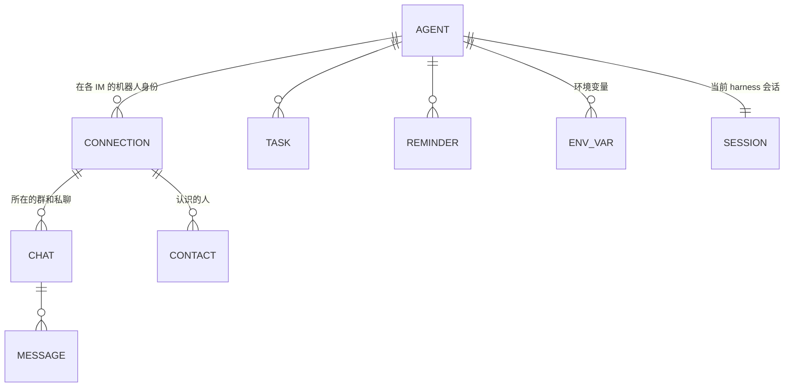
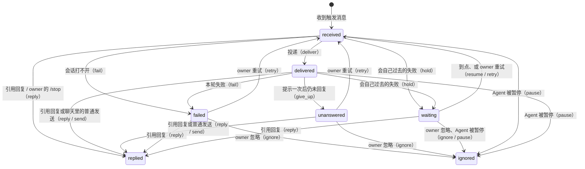
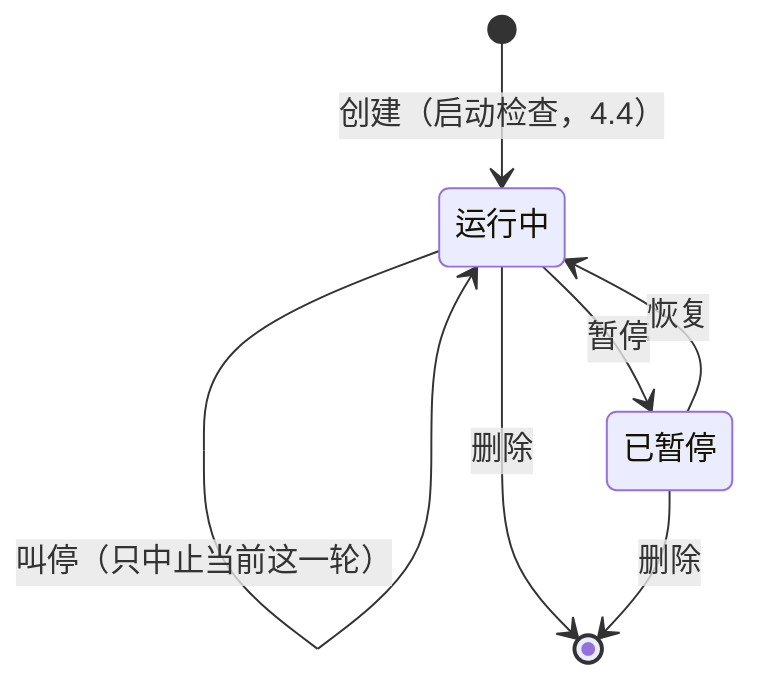
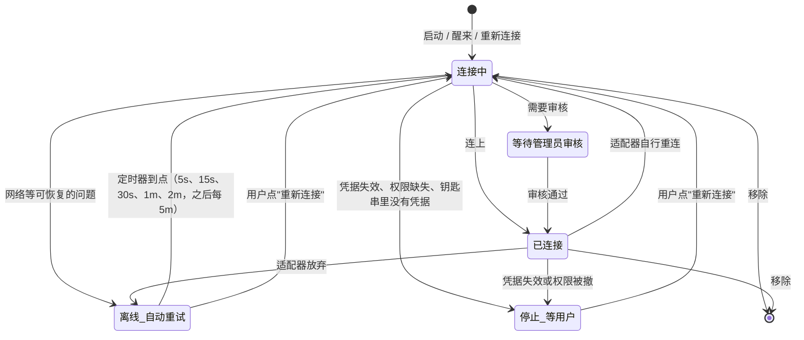
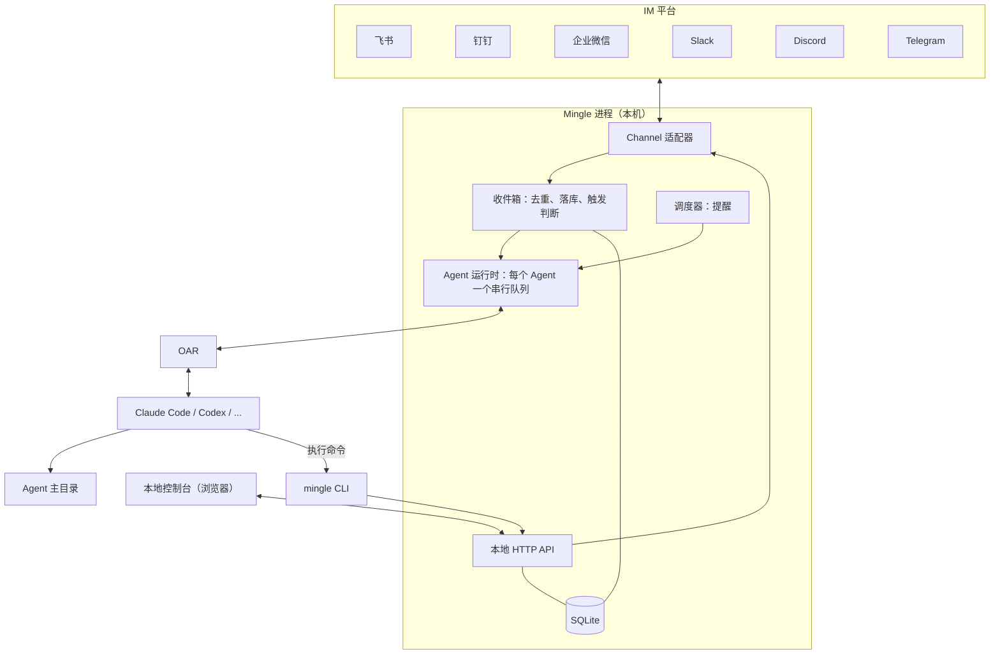

# Mingle 产品设计与技术架构

| | |
|---|---|
| 版本 | v0.5 |
| 日期 | 2026-11-14 |
| 状态 | 现行方案。M1 已完成（第 11 节）；M2 进行中。 |

这是 Mingle 最核心的文档。产品范围、领域模型、架构、技术选型都以本文为准；改动这些内容时先改本文，再改代码。界面和视觉规范见根目录的 [`DESIGN.md`](../DESIGN.md)。

## 1. Mingle 是什么

**把你的 Agent 伙伴请进你已经在用的 IM。本地运行，没有服务器。**

用户在自己的电脑上创建 Agent：有名字、头像、角色、记忆和自己的主目录，由本机已安装的 Claude Code、Codex 等 harness 驱动。Agent 以机器人身份出现在微信、企业微信、飞书、钉钉、QQ、Slack、Discord、Telegram 的群聊和私聊里，也可以在 Mac 上的 iMessage 里，在你给自己发消息的对话中和你聊（6.6），可以被 @、接任务、主动回报。

Mingle 不预设使用场景。同一个 Agent 可以是私聊里的个人助理、朋友群里的成员、社区里的答疑者，也可以是工作群里的协作者。角色由用户写的一段描述决定。

### 1.1 两个核心点

1. **用自己习惯的 IM。** 不新建聊天平台，不要求任何人迁移。Agent 出现在你已经在用的群和私聊里。
2. **数据只在你的机器上。** Mingle 没有服务端、没有账号、没有遥测。配置、消息记录、记忆、产物全部在本机。

第二点对外的说法是"没有 Mingle 服务器"，不用 "zero data retention"：消息必然经过 IM 平台和模型厂商，这两者不在我们的承诺范围内。

### 1.2 一等对象是 Agent，不是会话

用户面对的是"Alex"，一个长期存在、记得事情的伙伴，不是"某个 IM 里的一个 Claude Code 会话"。harness 的会话、模型、上下文压缩都是内部实现，不出现在 IM 里，也不需要 `/new`、`/switch` 这类命令。IM 里唯一的命令是 owner 用来叫停的 `/stop`。

评判标准：用户的感受应该是"我有一个长期的 Agent 伙伴，它就在我常用的聊天软件里"，而不是"我在聊天软件里远程操控了一个终端"。

### 1.3 与同类产品的区别

| 产品 | 它是什么 | Mingle 的不同 |
|---|---|---|
| [Raft](https://raft.build/) | 人与 agent 协作的独立工作空间，有自己的服务端、频道和客户端 | Agent 模型和 CLI 向它学习，但不建聊天平台、不要服务端，Agent 住在现有 IM 里 |
| [dsh-im](https://github.com/xmanrui/dsh-im) | 把 IM 机器人接到 DeepSeek Harness 的插件，以会话和工作区为中心 | 接入层向它学习，但以 Agent 为中心，且不绑定单一 harness |
| [cc-connect](https://github.com/chenhg5/cc-connect) | 在 IM 里用命令操作 harness 会话 | 不暴露会话，自然语言交互 |

和 Raft、dsh-im 一样，Mingle 复用用户本机已登录的 harness 和订阅，这不是差异点。

### 1.4 不做的事

- 自建聊天界面或频道系统。
- 任何云端组件、账号体系、多设备同步。
- 自己实现 agent 循环或模型调用，这是 harness 的事。
- 未经用户选择就用个人账号替用户说话。接入原则见 6.6：优先官方机器人通道；没有合适的机器人通道时，允许在本机用个人账号接入，怎么用由用户决定，Mingle 不加额外的限制。
- 云端桥接（Beeper 这类托管收件箱）。个人账号的连接也只在用户本机建立。
- 跨群记忆隔离。已决定接受这个风险，见 8.3。

## 2. 用户旅程

1. 安装并启动 Mingle，浏览器打开本地控制台。
2. 控制台列出本机已安装并登录的 harness。
3. 创建 Agent：填名字、角色，选 harness 和模型。
4. 选择要加入的 IM 并接入：
   - 飞书、钉钉、企业微信：控制台显示二维码，手机扫码创建机器人。
   - Slack：按预置 App Manifest 创建应用，粘贴两个 token。
   - Telegram、Discord：粘贴 bot token。
5. 如果所在组织要求管理员审核，控制台显示"等待管理员审核"，通过后自动转为"已连接"。
6. 把机器人拉进群。群里 `@Alex 昨天那件事后来怎么样了`，Alex 回复。
7. 在另一个 IM 私聊 Alex 问同一件事，Alex 接得上。
8. Alex 做完一件事后回到最初提出的地方回报。

控制台的创建表单参考概念图：名字、角色、大脑（harness）、所在的 IM（多选）、行为方式。

## 3. 领域模型



| 对象 | 含义 |
|---|---|
| **Agent** | 名字、头像、角色、harness、模型、主目录。用户创建和管理的唯一主体。 |
| **Connection（连接）** | 一个 Agent 在一个 IM 上的机器人身份及其凭据。一个 Agent 可以有多个连接。 |
| **Chat（聊天）** | 一个群、一个私聊或一个话题。由连接加平台侧 ID 唯一确定。 |
| **Contact（联系人）** | Agent 的通讯录：一个连接上认识的一个人，由连接加平台侧用户 ID 唯一确定，有 Mingle 分配的短 ID（`u7k2p`）。存平台最近给出的名字，和 owner 或 Agent 起的名字（后者优先）。见 4.2。 |
| **Message（消息）** | 收到和发出的每条消息，带来源和平台消息 ID。 |
| **Task（任务）** | Agent 正在跟踪的事项，记录来源聊天，用于完成后回报。 |
| **Reminder（提醒）** | Agent 给自己设的定时唤醒，一次性或周期性。 |
| **Env var（环境变量）** | owner 给某个 Agent 设的变量，例如日报 webhook 地址、API key。数据库只存名字，值只存在系统的凭据存储里，写入后不能再读出。见 4.9。 |
| **Session（harness 会话）** | OAR 会话 ID。内部对象，可恢复、可压缩、可替换，用户不可见。 |

**一个 Agent 在每个 IM 上是一个独立的机器人。** 这样它在群里有自己的名字和头像，扫码创建的流程也天然是"一次扫码一个机器人"。不做"一个机器人背后路由多个 Agent"。

## 4. Agent 如何工作

### 4.1 一个 Agent，一个长期会话

每个 Agent 有一个长期存在的 harness 会话，工作目录是它的主目录。所有 IM 的消息都进入这同一个会话。跨群、跨 IM 的连续性由此而来，不需要额外的检索或任务匹配逻辑。

这是 Raft 的做法：agent 是一个长期进程，新消息到达时唤醒并恢复原会话，靠 `MEMORY.md` 在上下文压缩和重启后找回状态。

- 应用重启后用 OAR 的 `resume` 恢复同一会话。
- 上下文接近上限时由 harness 自身压缩；压缩前提示 Agent 更新 `MEMORY.md`。
- 会话损坏或更换 harness 时新建会话，Agent 靠 `MEMORY.md` 和消息记录恢复。会话可丢，Agent 不丢。

**冷启动（借鉴 Raft 的 Constructed Initial Context，默认关闭，实测见 12.1、12.2）。** 会话长时间空闲后，harness 的提示缓存已经过期，下一轮要把整段历史重新写进缓存。会话很大时这一轮最贵。冷启动不再续用这个会话，而是新开一个，第一条输入由 Mingle 组装：

- **条件**：Agent 空闲超过 1 小时（从上一轮结束算），会话上下文超过 128K token（OAR 的 `contextUsage().tokens`），并且这次输入不是插话：正在工作时进来的消息照常送进当前一轮。Mingle 重启后、harness 还没报告上下文大小时不判断，照常续用。
- **第一条输入**：几块彼此独立的内容，之后才是这次的输入。`MEMORY.md` 开头约 4K token（16 KiB，按行截断，截断时注明还有后文）；跨聊天最近 25 条消息，带来源行（4.2），每条正文最多 1200 字，截断处注明原文还在，并给出读取它的 `message read … --around` 命令，已忽略的入站消息（包括群背景消息、暂停期间的消息和 owner 手动忽略的消息）及发送失败的消息不算；主目录里最近 2 小时改过的文件，只列路径，跳过 `.git`、`node_modules` 和 harness 自己的目录；最近 15 个动作（根 Agent 完成的工具调用，一行一个，如 `Bash: pnpm test`）；最后是触发这次的消息或提醒。不告诉模型会话换过，也不要求它写总结。
- **可撤回**：被替换的会话 ID 存在 `agents.previous_session_id`，出问题时可以切回去。新会话打开失败时，Agent 仍指向旧会话，下一条输入照常续用。
- **开关**：先用开发开关，不加界面：`MINGLE_COLD_START=rebuild` 对所有 Agent 生效，或者写逗号分隔的 Agent ID / slug，只对它们生效。不设时照常续用。
- **测量**：不管开没开，空闲超过 1 小时后的第一轮都会记一行日志：`cold turn mode=resume|rebuild idle=… context=… input=… cache_read=… cache_write=… output=…`，用来对比两种做法。

### 4.2 消息进入

触发规则：

- 私聊：每条消息都触发。
- 群聊：@ Agent，或回复它发出的消息时触发。

触发的消息包上一行来源信息后交给 Agent。每条消息和每个聊天都有 Mingle 分配的短 ID，Agent 用它们来回复和发送：

```text
[msg=m8f2a chat=c12 im=feishu group="周末徒步" from="张三" user=u7k2p time=2026-11-11T14:02+08:00]
@Alex 上次说的那条路线，帮我查下周六的天气
```

**认人靠通讯录（MING-55）。** 一个 Agent 同时在多个 IM、多个机器人上，必须分得清每条消息是谁发的。个人微信的 iLink 不给机器人发送者昵称，一个 Agent 扫两个微信号（各自是一个连接、各自有 owner）时，两边的人在 Agent 看来都只是 `owner`，在控制台都显示成"你"。所以：

- 每个发过消息的人在该连接上有一个联系人（`contacts` 表），接入时扫码的 owner 也提前建好。`from` 是联系人的名字：owner 或 Agent 起的优先，其次是平台给的；都没有时不写 `from`（平台 ID 不是名字）。`user=` 是联系人 ID，始终带上，同一个人在同一个连接上不变。
- Agent 用 `mingle contact list` 看通讯录，用 `mingle contact name <联系人ID> <名字>` 给人起名，`--clear` 清掉。操作指南让它在没有 `from` 且需要知道是谁时问一次对方，再记下来。owner 在控制台的连接行里给该连接的 owner 起名。两边改的是同一个字段，后写的生效，名字最长 64 个字符。
- 控制台的动态里，发送者显示联系人名字。只有一个 owner 能对上这个平台时，没名字的 owner 才显示"你"；同一平台有两个连接各有 owner 时，显示"未命名 · u7k2p"，连接行提示给每个 owner 起名。
- **不做跨 IM 合并。** 同一个人在微信和飞书上是两个联系人，Mingle 不推断、不合并成"一个人"，Agent 知道时记在 `MEMORY.md` 里。群也不进通讯录，群名已经在聊天上。等真的需要"一个人跨平台的权限或偏好"时再加人物层。

消息是推给 Agent 的，Agent 不需要轮询收件箱。每个 Agent 同一时刻只有一轮在跑，不做并发会话。

**群里没 @ 它的消息是背景，不推给它，但让它知道（MING-62）。** 群聊里大部分话不是对 Agent 说的，全推进会话既费上下文又让它分不清该回什么；完全看不到，被问"你怎么看"时又缺了前文。借鉴 Raft 的做法，由 Agent 自己决定要不要读：

- 平台把群消息给到机器人时，Mingle 照样存下来，标记为不触发（状态 `ignored`），`message read` 和 `message search` 都能查到。Telegram、Discord、飞书、钉钉本来如此；Slack 频道里没 @ 它、也不在它所在线程里的消息存进这个频道自己的聊天（不是每条消息一个线程聊天），别人线程里的回复带 `reply_to` 指向线程根消息。订阅的仍是原有的 `message.channels`、`message.groups`，不需要新权限。
- 触发消息的来源行带 `unseen=N`：这个群里，从 Agent 上次在这里发言到这条消息之间，有 N 条没 @ 它的消息。N 为 0 时不写。在投递时计算，之后再来的消息不改变已投递的来源行。
- **线程有所属的群。** Slack 的线程是一个独立聊天，背景却在频道里。适配器给线程聊天报上所属的群（`ChatRef.parent`，存为 `chats.parent_id`），来源行带 `in=<群聊天ID>`。线程的 `unseen` 同时数线程自己和所属的群，"上次发言"以这个频道里任一处为准：Agent 在频道的任一线程里说过话，之前的频道消息就不算没看到。
- 操作指南只给一条规则：`unseen` 不为 0 且问题依赖前文时，先 `message read`（线程读 `in=` 指向的聊天）；否则直接回答，不必每条都回读。
- **不新增敏感权限。** Telegram 的隐私模式、飞书的"获取群组中所有消息"保持原样，Mingle 不引导用户去开。没开的群里机器人只收到 @ 它的消息，`unseen` 一直是 0，行为和以前一样。

```text
[msg=m9c1d chat=c31 im=slack group="C0123:1731.42" in=c30 from="张三" user=u7k2p time=2026-11-15T10:20+08:00 unseen=7]
@Alex 你怎么看？
```

### 4.3 多人同时 @ 与插话

一个 Agent 只有一个会话，所以多人同时找它时不会各开一个分身，而是按下面的规则进入同一轮。

| 情况 | 处理 |
|---|---|
| Agent 空闲，1 秒内到达多条触发消息 | 合并成一次输入开始新一轮，每条保留自己的来源行 |
| Agent 正在工作，来了新消息 | 立即送入当前轮（插话）。实测 Claude Code 和 Codex 都接受；Agent 在下一个工具调用间隙读到 |
| harness 不支持插话 | 排队，本轮结束后合并成一次输入开始下一轮 |
| owner 发 `/stop` | 中止当前轮，并停掉它留在后台的命令和子任务；排队的消息保留 |

实现上只用 OAR 的 `deliver`：空闲时它开始新一轮，工作中它插话，不支持插话时它排队。每条消息用自己的 `inputId` 投递，重复投递不会重复生效。

**收到即有回执，进度实时可见。** 这一步不经过 Agent，所以即使它正忙，发消息的人也立刻知道没有被漏掉、正在做什么：

- **表情**：消息落库后，Mingle 立刻在这条消息上加"处理中"的表情，回复后换成"完成"，出错时换成"出错"。飞书用 OnIt → DONE / ERROR；Telegram 用 👀，回复后清除，出错 👎；没有表情能力的平台（个人微信）改为显示"正在输入"。
- **实时回复**：平台能改写已发消息时，Mingle 同时以引用回复的形式开一条"实时回复"，先显示"正在思考…"，满 3 秒后带上已用时间（"正在思考 · 5 秒"），随后列出 Agent 正在做的事（运行命令、查看文件、查资料……），约每秒刷新一次。Agent 用 `mingle message reply` 回复这条消息时，答案直接写进这条实时回复，原地变成答案；群里会 @ 提问的人。飞书用流式卡片，Telegram 用可编辑的消息。QQ 不开实时回复：实测它的流式消息只显示第一帧，进度会一直停在"正在思考 · 0 秒"，旁边再出现真正的答案；QQ 私聊改为处理期间持续显示"正在输入"（每 50 秒续一次，最多到被动回复窗口的 4.5 分钟），答案作为普通回复发出。
- **收尾**：Agent 若用 `message send` 而不是 `reply` 作答，实时回复收成"已回复，见下方消息"；未回复、被 `/stop` 叫停、出错时，各自收成一句说明，不会一直停在"正在思考"。飞书流式卡片约 10 分钟后不再接受更新，超过 9 分钟的任务改为另发一条消息作答。

**叫停管到后台工作（MING-43）。** Agent 可以把长命令放到后台、先结束这一轮，命令结束时 harness 自己开一轮让它接着回复（Claude Code 如此）。叫停的是"这件事"，不只是正在跑的那一轮：

- `/stop` 中止当前轮，同时用 OAR 的 `stopTask` 停掉会话里仍在运行的后台任务（Claude Code、Codex、Qoder 支持）。只剩后台任务、没有在跑的轮时也算叫停，回"已叫停"。
- Slack 客户端把 `/` 开头的文本当作斜杠命令拦截，不会当消息发出（MING-59）。应用清单为此注册了真正的 `/stop` 命令，经 Socket Mode 的 `slash_commands` 事件送达；私聊里直接发 `/stop` 即可。频道里没有线程上下文可答，仍用 ` /stop`（前加一个空格）作为普通文本发送，Mingle 去掉首尾空格后识别。2026-11-14 之前按旧清单创建的 Slack 应用没有这个命令，私聊里同样要写成 ` /stop`；把应用按新清单重建或在应用设置里补上该命令后即可直接发 `/stop`。
- 叫停后、Mingle 投递下一条输入之前，harness 自己开的轮（例如停不掉的后台任务结束后唤醒）立即中止；这段时间 Agent 的 `message reply` / `send` 被拒绝（`agent_stopped`），被叫停的工作不会再往聊天里发东西。
- 被叫停那一轮里没回复的消息不再追加"未回复"提示（提示会让 Agent 接着做被叫停的事），直接标为"未回复"，owner 可在控制台重试或忽略。
- 排队的消息、之后的新消息和到点的提醒照常投递，投递即解除上述限制。没有被叫停时，后台任务结束后 Agent 自己回复照常可用。

**怎么回由 Agent 判断，规则写在操作指南里：**

- 每条触发消息都要有回应，用 `mingle message reply <消息ID>` 引用原消息，群里才看得出在回谁。
- 手头的事还要很久时，先回一句"收到，稍后回复"，再继续。
- 新消息是对当前工作的补充或更正时，并入当前工作。
- 新消息是另一件事时，不丢下手头的事，做完再处理，除非来自 owner 或明确更紧急。
- 多人要求互相冲突时，以 owner 为准；没有 owner 表态就在群里说明冲突并询问。

**没有回应时的兜底。** 一轮结束后，若有触发消息没有得到任何 `reply`，Mingle 追加一次提示，列出这些消息 ID，由 Agent 逐条回复或明确说明无需回复。只提示一次；仍未回复的在控制台标为"未回复"。Mingle 不会把 Agent 的自言自语自动发到群里。

**出错时的兜底。** 一轮以失败结束（harness 未登录、额度用完、欠费、模型不可用、服务繁忙、内容过长等，分类取自 OAR 的 `failure`），或者会话根本打不开（harness 没装、启动失败）时，Mingle 不再追加提示，而是把这一轮还没回复的触发消息标为"出错未回复"，并立刻告诉发消息的人：有实时回复的收成一句说明；没有实时回复（例如 QQ）、或实时回复已经收不了尾时，另发一条短消息，同一个聊天 60 秒内只发一次。说明用聊天的语言，讲清是什么问题、该怎么办，例如"Claude Code 没有登录，暂时回复不了。请在运行 Mingle 的电脑上登录 Claude Code，然后再发一次。"；额度用完且 harness 报告了恢复时间的，带上恢复时间。控制台把失败分类存为 `agents.status_failure`，在 Agent 页给出对应的标题和下一步，harness 的原话放在下面备查；"上手"卡片和"需要你处理"不会停在"正在回复"。需要人处理的失败（未登录、欠费、模型不可用、内容过长、harness 没装等）不自动重发。问题解决后，可以由发消息的人再发一次，也可以由 owner 在控制台点"重试"。

**会自己过去的失败，等它过去再回（借鉴 Raft 的额度等待）。** 额度用完、被限流、服务繁忙或出错，过一会儿通常自己就好了。让 owner 一条条点重试没有必要，让发消息的人再发一遍也不对。这类失败让消息进入 `waiting`（等待中），到时间自动再投递一次：

| 失败分类 | 等到什么时候 | 何时放弃 |
|---|---|---|
| `quota`，harness 报告了恢复时间 | 恢复时间后 15 秒，一次最多等 1 小时；到点仍超额就再等一轮 | 连续等了 200 次 |
| `quota`，没有恢复时间（或报告的时间已过） | 依次 5 分钟、15 分钟、30 分钟，之后每小时一次（和 Raft 一样不直接放弃：额度总会恢复） | 连续等了 24 次（约一天） |
| `rate_limited`、`overloaded`、`provider` | 依次 1 分钟、5 分钟、15 分钟 | 等满三次仍失败 |

- **告诉发消息的人**：实时回复收成一句"Claude Code 的用量额度用完了，预计 15:00 恢复。这条消息会先等着，恢复后自动回复，不用再发。"或"Claude Code 那边暂时繁忙，1 分钟后自动重试，不用再发。"；没有实时回复时另发一条，同一个聊天 60 秒内只发一次，和出错说明相同。表情清除。
- **额度用完时后面的消息也先等着**：等待期间新来的消息不交给 harness（交过去也只会再失败一次），直接进入 `waiting`，到同一个时间一起投递；提醒和系统消息留在队列里，到点再投。这次面向整个 Agent 的等待单独存在 `agents.quota_wait_until` / `quota_resets_at`，进程或会话重建后仍然有效：到点的自动重试会尊重比它更晚出现的额度等待（回到 `waiting` 等到新到点），owner 手动点"重试"则取消这次等待、立刻试一次。
- **同一个登录共用一个额度（借鉴 Raft 的 provider limit ledger）。** 额度属于 harness 背后的账号，不属于某一个 Agent。同一台电脑上用同一个 harness、走这台电脑自己登录的 Agent 共用额度：一个 Agent 撞上额度，其他这样的 Agent 也立刻进入同样的等待（持久化到各自的 `quota_wait_until`），它们新来的消息不必各自再失败一次；之后才创建或启动的 Agent 也继承这个等待。Agent 在环境变量里有自己的凭据（名字以 `API_KEY`、`AUTH_TOKEN`、`ACCESS_TOKEN`、`BASE_URL`、`CONFIG_DIR` 或 `_HOME` 结尾）时，它用的是自己的账号，额度单独算。
- **提前结束**：这个登录上任何一个 Agent 有一轮在等待开始之后开始、并正常完成了，说明账号又能用了：所有共用它的 Agent 的等待立即结束，它们等待中的消息马上投递，不用等到原定时间。比等待更早开始的一轮完成不算（它可能是额度用完之前发出的）。
- **到点再投递**：Mingle 每 10 秒（和提醒同一个计时器，电脑睡醒后也会立即检查）把到点的 `waiting` 消息放回 `received`，像 owner 重试一样重新打上"处理中"、开实时回复，投递时加 `[mingle] Retry: …` 那一行。聊天软件离线的消息继续等，重连后的下一次检查再投。Mingle 重启后照样生效：等待时间存在 `messages.retry_at`，等待次数存在 `messages.holds`，owner 重试时清零。
- **控制台**：等待中的消息不进"需要你处理"（不需要人做什么），动态里那一条下面写"等待中，今天 15:00 自动重试"，后面是"重试"和"忽略"。Agent 的失败卡片区分等待中的自动重试与已经失败后的手动重试。
- **账号级账本**：共享等待的最终判定在 Mingle 的内存账本里，每个登录一条，Agent 运行时的"拦住投递"只是本地闸门。重启时先扫描全部 Agent（含暂停的）持久化的等待，按各自当前配置的登录归组、取最晚的截止时间和它的 `resetsAt` 恢复账本，再让任何会话打开；扫描结束前不写库，过期记录顺带清掉。账本每条记录带修订号：一轮只记下它开始时看到的修订，迟到完成的旧会话不能清掉更新的一次额度报告，被替换会话的事件整体作废。手动"重试"只绕过本 Agent 的闸门试探一次，不清账本；它成功完成、或其他共用该登录的 Agent 成功完成一轮，才把该登录的等待结束——结束条件成立时先把所有共用 Agent 的等待中消息 `retry_at` 提前到当下再尝试投递，所以聊天软件离线的消息在重连或重启后立即可投递，暂停与已忽略的消息不受影响。改凭据（含同名覆盖）或换 harness 影响的是下一次会话的归属：新会话落在新的额度范围上，回到共享范围的会继承账本里已有的等待；旧会话在它的整个存活期内仍报在原登录下，它的额度失败不会扩散到新范围。范围键只由 Agent id、序号与 harness 名组成，永不包含密钥值，也不进日志和数据库。

**重试。** 控制台"需要你处理"的"出错未回复"和"没有回复"两项各有"重试"，动态里每条这样的消息后面也有（`POST /v1/admin/agents/:id/messages/retry`，参数 `{ ids? }`，不传就重试全部）。重试只针对 `waiting`、`failed` 和 `unanswered` 的入站消息，其他状态直接忽略，所以重复点击没有副作用；聊天软件离线的消息不重试，因为 Agent 也回不了。被重试的消息回到 `received`，提示标记清零，像新消息一样走一遍投递：重新打上"处理中"的表情、开一条实时回复，投递时前面加一行 `[mingle] Retry: …`，告诉 Agent 这是一条迟到的消息，回复时简单说明晚了。Agent 还处在出错状态时，按钮旁边提示先解决问题，但不禁用按钮，因为状态可能已经过时。Agent 自己发出去失败的消息不提供重试：明确失败的已经重试过三次，并且把错误交给了 Agent；结果不确定的为了避免重复发言，本来就不重发（见 7.1）。

**忽略。** 不需要再回复的消息，可以在“需要你处理”的“出错未回复”和“没有回复”项里点“忽略”，也可以在动态里逐条忽略。批量操作只针对该项当前列出的消息。`POST /v1/admin/agents/:id/messages/ignore` 必须传 `{ ids: string[] }`，返回 `{ ignored: string[] }`；只处理属于该 Agent、状态为 `waiting`、`failed` 或 `unanswered` 的入站消息，重复、已处理、其他 Agent 或不存在的 ID 跳过，空数组不做任何事。消息持久化为已有的 `ignored` 状态，原文和附件保留，动态标为“已忽略”，不再计入需要处理的消息或提供重试；刷新和重启后保持。群里本就不触发 Agent 的背景消息不显示这个手动忽略标记。忽略只整理本机记录，不唤醒 Agent、不向聊天软件发送或修改消息，离线也可用；Agent 和连接本身的错误仍保留。

Raft 的做法更重。从它的源码和 agent 提示词看：忙碌时只给 agent 发"有新消息"的通知，由 agent 自己用命令去拉取；发送被拦下时消息会存为草稿，由 agent 决定修改后重发还是放弃。Mingle 直接把消息内容插进会话，省掉拉取和草稿这两层，等实际遇到"答非所问"的问题再考虑加新鲜度检查。

### 4.4 启动时注入的内容

每次新建或恢复会话时（包括 4.1 的冷启动），Mingle 通过 OAR 的 `appendSystemPrompt` 向 harness 追加三样东西，保留 harness 自带的系统提示：

1. `ROLE.md` 的内容：它是谁。
2. `mingle` CLI 的操作指南：它怎么在 IM 里行动。源文件是 [`src/cli/manual.md`](../src/cli/manual.md)，`mingle manual` 打印的也是它，不会不一致。
3. 提示它先读 `MEMORY.md`。

操作指南末尾列出 owner 给它设的环境变量的名字（"Environment variables set for you: …"），从不写值；harness 收不到环境变量时不列（见 4.9）。

冷启动新开的会话还会在第一条输入前带上 Mingle 组装的近况（4.1）。它只在第一条输入里出现一次，不进 `appendSystemPrompt`，也不写进主目录。

这样主目录里不需要再放 `AGENTS.md` 之类的指令文件。每次打开会话都要重新提供这段内容，否则 harness 压缩上下文后会丢掉它。操作指南用英文写，Agent 按对方使用的语言回复。

**接入前检查兼容性。** 安装了 harness 不代表它具备 Mingle 所需能力。发现时检查 OAR 声明是否支持追加角色／操作指南和传递会话环境；不满足的仍显示在列表中，但不可选择，并说明下一步。OAR 0.97.0 的声明没有覆盖 OpenCode 的版本差异，因此当前只允许已识别的 OpenCode 1.x，2.x 和无法识别的版本暂不可用。创建和修改大脑的 API 同样检查，不能靠绕过界面启用。

新建 Agent、应用启动恢复 Agent，以及修改角色或大脑后，立即尝试打开真实会话，成功后复用它处理消息；检查阶段不投递输入、不调用模型、不发送 IM 消息。这样登录、配置和仅在打开会话时才能发现的能力问题会在第一条消息之前显示。失败时保留角色、记忆、连接和消息记录，不自动切换大脑。启动检查本身不处理消息；后续若消息投递仍失败，按 4.3 标为"出错未回复"并通知发送者，修复后由 owner 点击"重试"，不会自动重发。启动检查不能证明模型会正确执行回复、恢复或压缩后的行为，这些仍由真实 harness 的端到端验证覆盖。

### 4.5 记忆

记忆是主目录下的文件，Agent 用 harness 自带的文件工具读写，Mingle 不提供记忆命令。

- `MEMORY.md` 是恢复索引：自己是谁、进行中的事、指向详细笔记的链接。保持简短。
- `notes/` 放按主题展开的笔记。
- 消息原文不进记忆，需要时用 `mingle message search` 检索。

**记忆体检（借鉴 Raft 的 Cleaner）。** `MEMORY.md` 每次开会话都会读入上下文，越长每一轮越慢、越贵，而 Agent 自己很少主动删。所以 Mingle 在它超过 64 KiB 时提醒一次：

- **时机**：只在一轮正常完成（`completed`）、没有被叫停、也没有排队的输入时检查，提醒作为一条 `[mingle]` 系统消息开始新的一轮。它不会打断正在做的事，不会和别的消息并成一轮，也不会唤醒没有在工作的 Agent。
- **频率**：一天最多一次；文件比上次提醒时又大了 25% 时可以提前再提醒。上次提醒的时间和大小存在 `agents.memory_hint_at`、`memory_hint_size`，重启后照样有效。Agent 把文件删回限额以内后，这条记录清掉：之后再超过就是新情况，立即提醒，不必等满一天。
- **内容**：说清现在多大、为什么要紧、怎么做（删掉已完成的事和被推翻的决定，保持索引形态，把细节挪到 `notes/`；删之前对照当前来源核实），并说明不需要在聊天里回复。删什么由 Agent 判断，Mingle 不替它改文件。

### 4.6 任务与提醒

- 任务是轻量记录：标题、状态（`todo` / `in_progress` / `done` / `closed`）、来源聊天。由 Agent 用 CLI 维护，控制台只读展示。完成时 Agent 回到来源聊天回报。
- 提醒到点后作为一条系统消息进入 Agent 的会话，和 IM 消息走同一条路。每日总结、定时检查都用它实现。
- 提醒可以挂在一条消息上（`--from <消息ID>`，存为 `reminders.source_message_id`），聊天由这条消息决定。到点时系统消息在正文下方用 `> ` 引用原消息（消息头加正文，正文超过 500 字截断），Agent 用 `message reply` 回到那条消息，群里看得出它在回哪件事。原消息被删除时只发提醒本身。
- 到点了但事情还没好（"天气还没出来"），Agent 用 `snooze` 推迟，而不是再建一个。推迟从现在算起：一次性提醒改 `next_fire_at`；周期提醒只把下一次改到那个时间，触发后照原规则继续。
- 每次触发记下 `last_fired_at`，控制台的提醒列表显示"上次触发"。
- 不提供修改提醒的命令，取消再新建即可，少一套参数校验。

### 4.7 权限

- **谁能使唤 Agent**：所在群里的所有人和所有私聊对象。私聊白名单放在后续版本。
- **owner**：接入一个机器人后，第一个给它发私聊的人成为它在该 IM 上的 owner（已实现）。iMessage（6.6）用的是 owner 自己的账号，owner 就是这个账号本身。owner 可以用 `/stop` 中止当前工作，在冲突时拥有最终决定权，消息头里带 `owner` 标记。owner 按连接算：同一个 Agent 在同一平台上接了两个机器人（例如两个人各扫一次微信），就有两个 owner，Agent 靠 `user=` 区分（4.2）。`/stop` 是 IM 里唯一的命令。
- **Agent 能做什么**：自主执行，不逐次审批，因为它需要无人值守地工作。这也是 OAR 的默认行为：它关闭了各 harness 的交互式审批和沙箱。也就是说 Agent 能做的事等同于用户本人在终端里能做的事，控制台在创建 Agent 时明确提示。它还能读到 owner 给它设的环境变量（4.9），因此也可能在回复里说出这些值。受限模式和把审批转发到 owner 私聊放在后续版本。

### 4.8 状态

控制台显示：空闲、思考中、工作中、离线、出错、已暂停（4.11），以及当前任务、所在的群、最近活动。电脑休眠或关机时 Agent 离线，这一点在界面上如实展示。上手完成状态保存在 Agent 的 has_replied 标记中：首次成功发出消息后永久完成，升级时从已有成功发送记录回填，不受最近活动条数、重启或移除连接影响；未成功回复时，只有聊天软件已连接且 Agent 正在思考或工作才显示"正在回复"。

### 4.9 环境变量

owner 想让 Agent 用 webhook 地址、API key 这类密钥（"每天早上把日报发到这个 webhook"）时，不要写进 `ROLE.md`，而是在 Agent 的"设置 → 环境变量"里给它设变量。变量按 Agent 区分；全局变量暂不提供，需要时可以继续用 shell 环境（见 8.3）。

- **存储**：值存入系统的凭据存储（9.2），键为 `env:<agent_id>:<名字>`，值以 JSON 字符串存放，多行内容（PEM 私钥）也能完整保存。SQLite 的 `agent_env` 只存名字和更新时间。删除 Agent 时一起删除。
- **名字**：限定为 `^[A-Z_][A-Z0-9_]*$`，最长 128 个字符。`MINGLE_*` 是 Mingle 自己的，返回 `env_name_reserved`；harness 和 shell 依赖的系统变量（`PATH`、`HOME`、`SHELL`、`LANG`、`TMPDIR`、`NODE_OPTIONS`、`LC_*`、`LD_*`、`DYLD_*`，以及 Windows 的 `SYSTEMROOT`、`USERPROFILE` 等）返回 `env_name_system`；格式不对返回 `env_name_invalid`。值不能为空（`env_value_required`），最大 32 KB（`env_value_too_large`）。
- **API**：`GET /v1/admin/agents/:id/env` 返回 `[{ name, updatedAt, missing }]`，`missing` 表示凭据存储里已经找不到这个值（例如用户在"钥匙串访问"里删掉了，或数据目录被拷到另一台电脑）；从不返回值。`PUT /v1/admin/agents/:id/env/:name`，参数 `{ value }`，新增或替换，只写不读。`DELETE /v1/admin/agents/:id/env/:name` 删除，不存在时返回 `env_not_found`。凭据存储写入失败时返回 `env_save_failed`，不带原始错误，因为原始错误里可能有值。
- **运行时**：打开会话时从凭据存储读出变量，并进 harness 的 `env`，`MINGLE_*` 始终以 Mingle 的为准。值找不到的变量跳过，不阻断会话。改了变量后，和改角色、大脑一样**从下一条消息起生效**：Agent 空闲时立即用 `resume` 重开 harness 进程（OAR 的 `env` 作用于会话启动的进程，`resume` 会启动新进程，所以新值生效，对话不丢）；Agent 正在工作时不打断，本轮用旧值做完，结束后再重开。
- **不接受环境变量的 harness**（目前是 Cursor，它的工具在 Mingle 进程里运行）：用户的变量不传，名字也不进指南，**值绝不写进提示词**，否则会进入 transcript 和模型厂商那边。控制台在环境变量一节标明"Cursor 读不到这些变量"；变量保留，换回其他 harness 后生效。
- **不泄露**：API 响应、日志、活动流和错误信息里都没有值。OAR 也会在自己的记录和错误里遮掉看起来像凭据的变量，但模型仍可能在回复里说出它们，所以控制台提示只放愿意交给 Agent 的密钥。
- **不做**：读取已保存的值、改名（删掉后新增）、`.env` 文件导入。

### 4.10 入站消息状态

触发 Agent 的入站消息有七种状态：`received`（已收到，待投递）、`delivered`（已交给 Agent）、`waiting`（等一个会自己过去的失败过去，到 `retry_at` 再投递，见 4.3）、`replied`（已回复）、`unanswered`（提示过一次仍未回复）、`failed`（出错未回复）、`ignored`（owner 忽略，或本就不触发 Agent 的背景消息）。它是一个显式状态机，规则集中在 [`src/core/inbound.ts`](../src/core/inbound.ts) 的转换表里，所有写入都经过 `Store.moveInbound`：事件只作用于处在它的来源状态的消息，其余消息原样不动，并返回实际变化的 ID，后续动作（实时回复收尾、通知发消息的人、重新投递）只对这些消息执行。



- **终态**：`replied` 和 `ignored`。之后到达的任何事件（迟到的失败、重复的重试、忽略后才到的回复）都不改变它。
- **非终态都有出路**：`received`、`delivered` 由投递和本轮结束自己推进；`waiting` 到 `retry_at` 自己回到 `received`，等满次数后变为 `failed`；`failed`、`unanswered` 由 owner 在控制台重试或忽略，Agent 之后回复也能把它们结束。
- **出错的消息被回复**：Agent 用 `message reply` 引用一条 `failed` 消息作答时，它变为 `replied`，因为发消息的人已经得到回答，不应再留在"出错未回复"里。`message send` 的普通发送只结束该聊天里 Agent 已经看到的消息（`delivered`、`unanswered`），不结束 `failed`：这条消息可能从未交到 Agent 手里，一条无关的发送不能把它从待处理里藏掉；也不结束还没投递的 `received`。
- **先到先得**：重试、忽略、迟到的回复以任意顺序到达，第一个生效，后一个只有在它是前者结果的合法下一步时才生效。例如重试后再忽略不生效（消息已回到 `received`）；重试后、重新投递前 Agent 已经回复，投递时发现它不再是 `received`，不再投递。
- 重试把消息放回 `received` 时清零提示标记，像新消息一样再走一遍。
- **暂停**：Agent 被暂停时，还没回复的 `received`、`delivered`、`waiting` 变为 `ignored`；暂停期间收到的触发消息直接变为 `ignored`。`failed`、`unanswered` 不动，恢复后由 owner 重试或忽略（4.11）。

### 4.11 Agent 生命周期

一个 Agent 从创建到删除，owner 能对它做的事。原则：**每个操作只做一件事，名字说清楚它做什么；能撤销的不确认，不能撤销的在原地确认。**



"运行中"包含 4.8 的空闲、思考中、工作中、出错、离线：这些由 Mingle 和 harness 决定，owner 不直接设置。"已暂停"是唯一由 owner 设置的状态，重启 Mingle 后保持。

**功能清单**

| 功能 | 做什么 | 入口 | 状态 |
|---|---|---|---|
| 创建 | 名字、角色、大脑，创建后立即做启动检查 | 侧栏"新建"、`mingle agent create` | 已有 |
| 叫停 | 中止当前这一轮和它留在后台的工作（4.3）。排队的消息保留，之后的新消息照常回复 | Agent 工作时页头的"叫停"、IM 里 owner 发 `/stop`、`mingle agent stop` | 已有 |
| 暂停 | 中止当前这一轮，并且不再接收、不再发送消息，直到恢复 | Agent 设置 → 运行、`mingle agent pause` | 本次新增 |
| 恢复 | 重新打开会话，开始接收新消息，补发暂停期间到点的提醒 | 暂停卡片和 Agent 设置 → 运行、`mingle agent resume` | 本次新增 |
| 删除 | 断开机器人，删除凭据和环境变量，保留文件夹 | Agent 设置 → 文件夹，原地确认、`mingle agent delete` | 已有 |
| 修改角色、大脑、环境变量 | 下一条消息起生效，不打断正在做的事 | Agent 设置 | 已有 |
| 重置会话 | 中止正在做的事，丢下当前 harness 会话，开一个新会话，Agent 从 `ROLE.md` 和 `MEMORY.md` 重新开始。主目录、消息记录、任务、提醒、连接都保留。用于会话卡住、上下文太乱或一再出错 | Agent 设置 → 运行，原地确认、`mingle agent reset` | 新增（MING-61） |
| 复制诊断信息 | 一段纯文本：时间、Mingle/Node/系统版本、Agent ID、状态和失败类别、大脑及版本、模型、会话 ID、`MEMORY.md` 大小、用的是这台电脑的登录还是自己的凭据、正在进行的额度等待（到何时、恢复时间）、最后一条触发消息和最后一次回复的时间、各连接的平台和状态、最近 7 天各状态的消息数、未完成任务和提醒数。不含消息内容、联系人名字、凭据和环境变量的值 | Agent 设置 → 运行、`mingle agent diagnostics` | 新增（MING-61） |

**排查顺序（借鉴 Raft 的恢复梯子）**：Agent 不回复时，先看"需要你处理"和状态；能叫停就叫停；仍不行再重置会话（重启 Mingle 等同于重开同一会话）；还不行就复制诊断信息贴给帮忙的人。重置不可撤销（旧会话不会再被恢复），所以在原地确认；Agent 正在工作时说明里多一句"重置会中止这件事"。重置同时作废旧会话的 CLI 授权（它留在后台的工作不能再发消息），旧会话之后再上报的事件一律丢弃，不会改动新会话的工作；已经投递未回复的消息标为"没有回复"，由 owner 在控制台重试或忽略；排队未投递的消息和提醒、系统消息留给新会话，额度等待也保留。暂停中的 Agent 重置只清掉会话 ID，恢复时开新会话。

暂不做，等有需求再加：复制 Agent、导出/导入、定时暂停（例如夜间免打扰）、只暂停某一个聊天软件（目前可以移除那个机器人）、IM 里的 `/pause` 命令（IM 里仍只有 `/stop`，4.7）。

**暂停的语义**

暂停是"让它先别干活"：保留一切，随时恢复。

- **正在做的事**：中止，同叫停。它正在处理的消息的实时回复收成"已暂停，这条消息不会再回复。"。
- **会话**：关闭 harness 进程，撤销它的 CLI token。旧会话留下的后台任务也不能再以它的名义发消息（返回 `unauthorized`）。恢复时用 `resume` 打开同一会话，对话不丢。
- **机器人**：保持连接。断开会让各平台行为不一（Telegram 会把离线期间的消息攒着，恢复后一股脑推过来；飞书不补推），而且发消息的人只看到机器人沉默。
- **暂停期间的消息**：照常记录，不交给 Agent，直接标为已忽略，恢复后也不补处理：暂停是 owner 的决定，攒下的旧消息恢复后一起涌进来，Agent 回的多半已经过时。发消息的人会在该聊天收到一次说明（"Alex 已暂停，暂时不回复消息。"，按聊天的语言），同一次暂停里每个聊天只说一次，不刷屏。owner 发 `/stop` 也按同样的规则处理，不另回"已叫停"。
- **还没处理完的消息**：暂停时已收到但未回复的（`received`、`delivered`）标为已忽略；出错未回复和没有回复的（`failed`、`unanswered`）保留在"需要你处理"里，恢复后再重试或忽略；暂停中点重试返回 `agent_paused`。
- **提醒**：暂停期间到点的不触发，恢复时补触发一次（和电脑睡眠醒来后一样，7.1）。周期提醒错过的多次只补一次。
- **任务、记忆、设置、环境变量**：不变，暂停期间也能改。
- **重启**：暂停状态存在 `agents.status = 'paused'`，Mingle 重启后不为它打开会话。
- **桌面应用**：菜单栏里它的那一行显示"已暂停"，不算在线，不计入"N 个 Agent 在线"，也不为它保持唤醒。

**接口**：`POST /v1/admin/agents/:id/pause`、`POST /v1/admin/agents/:id/resume`，返回 `{ changed }`，已经是目标状态时为 `false`，重复调用没有副作用。CLI：`mingle agent pause <agent>`、`mingle agent resume <agent>`。重置：`POST /v1/admin/agents/:id/reset`，返回 `{ ok: true }`；诊断：`GET /v1/admin/agents/:id/diagnostics`，返回 `{ text }`。

**界面**（视觉见 `DESIGN.md`）

- **叫停和暂停分开放。** 叫停是"现在别做这件事了"，频繁、即时，只在 Agent 工作时出现在页头；暂停是"这段时间别干活"，低频，放在 Agent 设置的"运行"分组里，左边一句说明，右边"暂停"按钮。两者都是带动作的文字按钮（"叫停"、"暂停"、"恢复"），暂停和恢复前面加一个暂停/播放的线条图标帮助辨认，不做只有图标的按钮：图标在两种"停"之间说不清区别。叫停按钮悬停时说明"中止它正在做的事，新消息照常回复"。
- **暂停不确认。** 它可以立即撤销；Agent 正在工作时，说明里多一句"它正在工作，暂停会中止这件事"。删除不可撤销，仍在原地确认。
- **暂停后到处都看得出来。** 动态和设置两个页签顶部都有一张中性色（不是琥珀色或红色：这是 owner 的选择，不是故障）的卡片："Alex 已暂停"，一句话说清对发消息的人意味着什么，右边是"恢复"主按钮。页头和侧栏的状态写"已暂停"，状态点是空心灰点，和离线的实心灰点区分。上手卡片的最后一步写"已暂停，恢复后才会回复"。

## 5. `mingle` CLI：Agent 的行动接口

### 5.1 为什么是 CLI

**Agent 通过 `mingle` 命令行在 IM 里行动，不用 MCP 工具。** 上一版写的是 MCP，这里改掉，理由：

- 所有 harness 都能跑 shell 命令，不需要逐个适配 MCP 配置，也不依赖 OAR 的工具挂载能力。
- Raft 完全用 CLI 作为 agent 的接口，已经验证可行。
- 用户可以在终端里敲同样的命令来调试，看到的和 Agent 看到的一样。
- 操作指南只有一份：注入的提示词和 `mingle manual` 同源。

Agent 说的话不会自动发到 IM。多个群的消息在同一会话里交错时，"最后一段文字发给谁"有歧义，显式调用命令则没有。

没有回应时的兜底见 4.3。

### 5.2 身份

Mingle 启动 harness 时通过 OAR 的 `env` 放入三个环境变量：本地 API 地址、一个每次启动重新生成的令牌、`mingle` 可执行文件的绝对路径。CLI 据此确定"我是哪个 Agent"，Agent 不需要登录，也不需要在命令里写自己的名字。令牌只在本机有效，只能操作该 Agent 自己的聊天。

本文为了易读写作 `mingle ...`，注入给 Agent 的操作指南里写的是 `"$MINGLE_CLI" ...`。原因是有的 harness 通过登录 shell 执行命令，用户的 shell 配置会重排 `PATH`，按名字找可能找到别的程序或找不到。

没有令牌时，同一个 `mingle` 命令是用户的管理入口（启动、打开控制台、查看状态）。

### 5.3 命令

首版只有七组。命令少，Agent 才记得住。

**消息**

| 命令 | 作用 |
|---|---|
| `mingle message reply <消息ID>` | 回复某条消息，平台支持时显示为引用回复 |
| `mingle message send --to <聊天ID>` | 向某个聊天主动发消息 |
| `mingle message read <聊天ID>` | 读某个聊天最近的消息，`--limit`、`--before` 翻页；`--since <消息ID>` 读某条消息之后的消息，从旧到新；`--around <消息ID>` 读某条消息前后的消息（默认共 11 条）。三者只能用一个 |
| `mingle message search <关键词>` | 全文检索消息记录，`--in <聊天ID>` 限定范围 |

**搜索结果是给 Agent 看的界面（借鉴 Raft 的 *A Comfortable AX for Agent Search*）。** 只给 ID，Agent 得逐条再查；给全文，几十条命中会挤满上下文；只给命中的那一条，又常常缺了推翻它的下一句。所以每条结果是消息头加上匹配处之前约 80、之后约 120 个字符（后文更常是对它的回应），命中处用 `<match></match>` 标出，被截掉的一侧标 `…`，让 Agent 知道这只是一个窗口；短消息整条返回。

- **按词匹配**：查询按空白拆成词，消息要包含每一个词（顺序不限）；`"引号里的短语"` 算一个词。三个字符及以上的词走 trigram 索引，更短的（例如两个汉字）用 `LIKE`，`%`、`_` 按字面匹配。只按整句匹配时，Agent 写的多词查询几乎总是查不到。
- **说清是否完整**：结果数达到 `--limit`（默认 20，最多 100）时，明说"这只是最新的 N 条，可能还有更早的"，并给出缩小范围的办法（加词、`--in`、提高 `--limit`），不让 Agent 把一页当成全部。
- **没有结果时给下一步**：说明是"没有消息同时包含这些词"，建议减少或换词、换成聊天里用的语言。
- **最后一行是下一步**：`message read <聊天ID> --around <消息ID>` 读这条前后的对话。

`reply` 和 `send` 的正文从标准输入读取，用 heredoc 传入，避免引号、反引号和换行被 shell 解释。`--file <路径>` 附带文件，可重复：

```bash
mingle message reply m8f2a <<'MSG'
周六晴，气温 8–17℃，上午风小，适合走。
MSG
```

**聊天**

| 命令 | 作用 |
|---|---|
| `mingle chat list` | 列出自己所在的群和私聊，含 ID、平台、名称 |
| `mingle chat info <聊天ID>` | 聊天详情；平台支持时含成员 |

**联系人**

| 命令 | 作用 |
|---|---|
| `mingle contact list` | 通讯录：联系人 ID、平台、名字、是否 owner |
| `mingle contact name <联系人ID> <名字>` | 给人起名，之后的消息头和控制台都用它；`--clear` 改回平台给的名字 |

**文件**

| 命令 | 作用 |
|---|---|
| `mingle file get <文件ID>` | 把收到的附件下载到当前目录，`--out` 指定路径 |

收到的附件不会自动落盘。消息里只带文件 ID 和文件名，Agent 需要时再取，主目录不会被附件堆满。

**任务**

| 命令 | 作用 |
|---|---|
| `mingle task create <标题>` | 新建任务，`--from <消息ID>` 记录来源 |
| `mingle task list` | 列出未完成的任务，`--all` 含已完成 |
| `mingle task update <任务ID> --status <状态>` | 更新状态 |

**提醒**

| 命令 | 作用 |
|---|---|
| `mingle reminder set <内容>` | `--in 30m`、`--at <时间>` 或 `--every daily@09:00`；`--from <消息ID>` 挂到一条消息上，到点时引用它；只记聊天时用 `--chat <聊天ID>` |
| `mingle reminder list` | 列出提醒 |
| `mingle reminder snooze <提醒ID> --by 2h` | 推迟到从现在起的 `--by` 之后；周期提醒只推迟下一次 |
| `mingle reminder cancel <提醒ID>` | 取消 |

**自身**

| 命令 | 作用 |
|---|---|
| `mingle whoami` | 自己的名字、各 IM 上的连接及状态 |
| `mingle manual` | 完整的操作指南 |

### 5.4 输出约定

- 默认输出给人和模型读的纯文本，消息的格式与 4.2 里收到的格式一致。输出一律英文。`--json` 输出结构化数据。
- 成功时打印结果和新对象的 ID，例如发出消息的 ID。
- 失败时非零退出，打印稳定的错误码和一句"下一步怎么做"，例如 `chat_not_found：用 mingle chat list 查看可用的聊天`。
- 平台不支持某项能力时明确说明降级结果，例如"该平台不支持引用回复，已作为普通消息发送"。
- 发送结果不确定时如实报告，不自动重发。
- 每个命令支持 `--help`。

### 5.5 暂不提供

表情回应、编辑和撤回消息、管理群成员、创建群。这些在各平台差异大，等核心流程稳定后按需增加。

## 6. IM 接入

### 6.1 首批八个平台

全部使用平台官方的出站长连接，不需要公网地址。

| 平台 | 接入方式 | 连接方式 | 可能需要管理员审核 |
|---|---|---|---|
| 飞书 | 扫码创建机器人（或在已登录的浏览器里打开授权链接），或填已有应用的 App ID / Secret | 官方 SDK 长连接 | 视租户设置 |
| 钉钉 | 扫码或在电脑上打开授权页创建应用，或填 Client ID / Secret | Stream 长连接 | 需要组织管理员创建应用 |
| 企业微信 | 扫码创建智能机器人，或填 Bot ID / Secret | 官方 WebSocket 长连接 | 是 |
| Slack | 预置 App Manifest 创建应用，填两个 token | Socket Mode | 视工作区设置 |
| Discord | Developer Portal 建应用，填 bot token；连上后用控制台给的邀请链接拉进服务器 | Gateway（直连 WebSocket，不引入 SDK） | 否，需服务器管理权限拉入 |
| Telegram | @BotFather 生成 bot token | 长轮询 | 否 |
| 个人微信 | 微信扫码绑定 | 腾讯 iLink 机器人服务（`ilinkai.weixin.qq.com`）长轮询 | 否 |
| QQ | 手机 QQ 扫码创建机器人，或填 AppID / AppSecret | 官方 WebSocket | 否 |

**一个 Agent 接多个微信号。** iLink 的机器人绑定在扫码的那个微信号上，所以一个 Agent 可以扫多次、接多个人（例如 owner 和家人各扫一次），每次是一个独立的连接，各自有 owner，已有的连接不会断开。控制台在已有微信连接时给扫码页加一句说明。请求二维码时，Mingle 像腾讯自己的客户端（openclaw-weixin 2.3.1 起）一样，在 `local_token_list` 里带上本机已接入的微信机器人 token（最新的 10 个），服务端据此认出本端已有的机器人：扫码的微信号已经接在这台电脑上时，它返回 `binded_redirect`，控制台提示"已经接入，不用再扫"（`already_connected`），不再误报成"绑定了别的机器人"。之前 Mingle 一直传空列表，用户反馈第二次扫码时手机提示第一个会断开，实际没有断开；传 token 后手机端提示是否消失待实测（12.2）。

个人微信和 QQ 在定位改为通用 Agent 伙伴后加入首批。个人微信走的是腾讯官方的 iLink 机器人服务，不是逆向的个人号协议，符合"只走官方机器人通道"。从 dsh-im 的实现看它以私聊为主，群聊能力、频率限制和账号要求待实测。

这张表的依据是 dsh-im 的现有实现，它已在这些平台上跑通同样的接入和连接方式。飞书官方 SDK 确有扫码建应用的接口（`registerApp`，回调给出二维码，成功后返回应用凭据），并导出了一个 `LarkChannel`，从类型定义看它已包含消息归一化和流式卡片，实现飞书适配器时先评估能否直接建在它之上。真机扫码尚未实测，见第 12 节。

### 6.2 不引入 IM 框架，自定义 `Channel` 接口

不使用 Chat SDK、Satori、Koishi 作为核心抽象。每个平台用官方 SDK 实现一个适配器，统一实现 Mingle 自己的 `Channel` 接口。

- Chat SDK 主仓库没有飞书、钉钉、企业微信适配器，国内三家无论如何都要自己接。
- 扫码创建、管理员审核这些接入流程是平台专属的，通用框架不覆盖。
- dsh-im 用的正是"官方 SDK + 自有语义层"，并在 ADR 里记录了放弃"最低公分母模型"的原因。

接口定义在 [`src/channels/channel.ts`](../src/channels/channel.ts)，分三部分：

- **接入（onboarding）**：启动扫码或校验凭据，报告进度。需要先在本机做好的事（iMessage 的 macOS 权限）由可选的 `setup` 提供：`check()` 每次读一遍当前状态（`ok` / `missing` / `denied` / `unknown`），绝不触发系统弹窗；`act(action)` 只执行固定列表里的动作（打开某个系统设置面板，或在用户点击后请求权限）。控制台通过 `GET /v1/admin/platforms/:platform/setup` 每 2 秒轮询，`POST …/setup/:action` 执行动作。
- **连接（lifecycle）**：连接、断线重连、状态上报。
- **消息（messaging）**：收消息事件；发送、回复、上传文件、表情回执、显示"正在输入"。

### 6.3 统一语义，原生呈现

沿用 dsh-im 的原则：

- 核心层只处理语义：消息、引用、聊天、文件、进度。
- 适配器按平台习惯呈现：飞书用卡片，Telegram、Slack、Discord 用消息编辑。Discord 在服务器频道里引用原消息回复（不另开 Thread，这是 Discord 机器人的常见做法）；用户自己开的 Thread 是一个独立的聊天。
- 能力按机器人实例实际拥有的权限判断，不按平台名称假定。不支持时明确降级。

### 6.4 连接状态

每个机器人的连接是一个显式状态机，规则集中在 [`src/core/link.ts`](../src/core/link.ts) 的纯函数 `step` 里，`Mingle` 只负责执行它返回的动作（发起连接、关闭、定时重试）并把结果写进 `connections` 表。所有会改变连接的事情都必须作为事件送进这台状态机：启动、睡眠醒来、用户点"重新连接"、一次连接尝试成功或失败、适配器上报状态、重试定时器到点、移除机器人。每次连接尝试有一个代号，被新尝试或移除取代后，它迟到的事件一律丢弃，不会把新状态改回旧的。



不变量：**离线时一定有出路。**要么 Mingle 自己会再试（`离线_自动重试`，带下次重试时间），要么界面明确告诉用户要做什么（`停止_等用户`，原因写明）；两种状态在控制台都有"重新连接"按钮。只有用户能解决的问题（凭据被拒、权限缺失）才停下等人，其余一律自动重试，适配器无法区分时按可恢复处理。两种离线在表里都存为 `error`，`state_detail` 是原因代码。

"等待管理员审核"是一等状态。控制台明确告诉用户正在等谁、等什么，并在通过后自动继续。

**重复绑定同一个机器人。** 再次扫码（或填凭据）得到的若是已经接入的机器人，平台可能已经发了新凭据并作废旧的：QQ 每次扫码都会给同一个应用换新的 AppSecret（用户反馈：第二次扫码失败后，第一次的连接也失效了）。所以 Mingle 先把新凭据写进已有连接的钥匙串条目并重新连接，再决定结果：同一个 Agent 重复绑定算成功，沿用原来的连接；绑到另一个 Agent 仍然拒绝（`bot_in_use`），但原来的连接继续可用。

### 6.5 暂不支持的平台

2026-11-14 评估过以下平台的官方机器人通道（MING-36），决定暂不支持，有明确需求时再议。同日放开个人账号接入（MING-52）后，iMessage 已经通过个人账号接入（6.6），WhatsApp 的个人账号方案见 6.6 的评估表。

| 平台 | 官方机器人通道 | 不支持的原因 |
|---|---|---|
| LINE | Messaging API，收消息只有 webhook（没有轮询或长连接） | 需要公网 HTTPS 地址，与"没有服务端、只走出站连接"冲突 |
| WhatsApp | Cloud API，收消息只有 webhook，要求公网 HTTPS 和有效证书 | 同上；另需 WhatsApp Business 号码，有 24 小时客服窗口限制。个人账号方案见 6.6 |
| KakaoTalk | Kakao i Open Builder 技能服务器（webhook），5 秒内回复或 5 分钟内一次性回调 | 同上；需要 Kakao 商业频道，机器人基本不能主动发消息，提醒和回报做不了 |

以后若要走 webhook 平台的官方通道，可行的方向是：在 127.0.0.1 的独立端口接收，公网地址由用户自备的隧道（Cloudflare Tunnel、Tailscale Funnel、ngrok）提供，先 LINE 后 WhatsApp。KakaoTalk 无论如何体验都差，不建议做。

适配器插件机制（让第三方以外部模块实现 `Channel`）同样暂不做：八个适配器多数尚未真机验证，`Channel` 接口还会变；插件是任意代码，会接触 Keychain 里的 IM 凭据，需要先有权限和信任模型。在此之前保持 `Channel` 接口不出现平台名称，内部适配器只经 `src/channels/registry.ts` 注册。以后开放插件时，把注册表扩展到外部模块，并把固定的 `Platform` 联合类型改为可扩展。

### 6.6 个人账号接入

**原则（2026-11-14，MING-50 / MING-52）。** Agent 不一定要是机器人身份，只要功能和体验做到同样的标准。

1. **优先官方机器人通道。** 一个平台有能用的机器人通道（只走出站连接，6.1），就用它。个人微信继续走 iLink，QQ 继续走官方机器人。
2. **没有合适的机器人通道时，允许在本机用个人账号接入。** 连接只在用户电脑上建立，不经过任何 Mingle 服务器或托管桥接，"没有服务端"不变。
3. **简单、一致，选择交给用户。** 不为个人账号另造一套权限和审批；体验尽量和机器人通道一致。只做能在真机上验证的形态，测不到的不放出去。

**各平台的本机个人账号方案。** 下表来自各项目的公开文档和社区经验，除 iMessage 外都没有在本机实测，稳定性和封号风险是定性判断。

| 平台 | 本机接入方式 | 稳定性 | 封号风险 | 群聊 | 主动发消息 | 协议与许可 | 结论 |
|---|---|---|---|---|---|---|---|
| iMessage | 系统「信息」App：轮询读 `~/Library/Messages/chat.db`（需要完全磁盘访问权限），用 AppleScript 发送（需要允许控制「信息」） | 高：系统自带客户端，不碰协议；macOS 大版本升级可能改 `chat.db` 结构 | 低：用的是 Apple 自己的客户端，且只在自聊里发 | 不做（见下） | 能，在自聊里 | 只用公开的 AppleScript 字典和本机文件，不引入第三方代码 | **首个落地**，自聊形态 |
| WhatsApp | Baileys（多设备协议，WebSocket），扫码绑定为"关联设备" | 中：逆向协议，WhatsApp 改协议时会断，要跟进库的更新 | 中到高：违反 WhatsApp 条款；新号、高频、群发更容易被封 | 能 | 能 | Baileys 为 MIT；WhatsApp 条款禁止非官方客户端 | 第二个候选：Node 原生，扫码体验和现有 QR 流程一致 |
| Signal | signal-cli 以独立进程运行（JSON-RPC），注册专用号码或关联为副设备 | 中高：基于官方 libsignal，服务端变动时要升级 | 低到中：条款不鼓励自动化，但少见封号 | 能 | 能 | signal-cli 为 GPL-3.0，作为独立进程调用、不链接；需要 Java 运行时或原生构建 | 可做，难点在分发 signal-cli |
| 个人微信 | 已有腾讯 iLink 官方机器人（6.1）。个人号方案：PC 微信 hook、iPad 协议（wechaty 各 puppet） | 低：个人号方案经常失效 | 高：腾讯严查 | iLink 以私聊为主（待实测） | iLink 能回复，主动发待实测 | 个人号方案多为闭源或付费 token | 保持 iLink，不做个人号 |
| QQ 个人号 | 已有 QQ 官方机器人（6.1）。个人号方案：NapCat、LLOneBot（注入 QQNT 客户端，OneBot 协议） | 中 | 高 | 能 | 能 | 注入客户端；部分项目限制商用和再分发 | 保持官方机器人 |
| Messenger、Instagram | mautrix-meta（Go，Matrix 桥接，模拟网页端） | 中 | 中到高：Meta 风控 | 能 | 能 | AGPL-3.0；必须有 Matrix homeserver | 不直接接入。等 Matrix 渠道上线后，由用户在自己的 homeserver 上跑桥接 |
| X 私信 | mautrix-twitter（Matrix 桥接） | 低到中：X 经常改接口 | 中 | 群私信能 | 能 | AGPL-3.0 | 同 Messenger |
| LinkedIn | mautrix-linkedin（Matrix 桥接） | 低 | 中到高：LinkedIn 严格限制自动化 | 能 | 能 | AGPL-3.0 | 同 Messenger，优先级最低 |
| LINE | 个人号没有在维护的本机方案（待确认） | — | 高 | — | — | — | 不做 |

建议顺序：iMessage（已做）→ WhatsApp（Baileys）→ Signal。Messenger、Instagram、X、LinkedIn 等 Matrix 渠道上线后，靠用户自己的桥接覆盖，Mingle 不分发 AGPL 桥接。

**iMessage：自聊形态**（`src/channels/imessage/`，只在 macOS 上注册）

在 Mac 上接 iMessage 有两种形态：A，Mac 的「信息」登录 owner 自己的 Apple ID，owner 在"给自己发消息"的对话里和 Agent 聊；B，给 Agent 一个专用 Apple ID，它是一个独立联系人，和机器人一样能被别人私聊、拉进群。同类产品里 Claude Code 官方 iMessage 插件默认就是 A（只认自聊），OpenClaw 两种都支持并建议 B 用单独的 macOS 用户（调研见 MING-52）。

**只做 A。** A 能在一台登录了自己 Apple ID 的 Mac 上完整实测，行为面窄，出问题只影响用户自己。B 需要第二个 Apple ID 加一个单独的 macOS 用户或一台 Mac，没有测试环境，按原则 3 不开放；A 和 B 共用收发和重连，以后有环境时只需补"别人私聊"和"群里 @"两块。

- **接入前检查**（MING-68）：连接页是一份实时清单，每 2 秒重读，做完的步骤自己打勾，每一步旁边是能直接带用户过去的按钮。三项检查都不需要任何权限、也不会让 macOS 弹窗：
  1. 「信息」已登录 iMessage：读 `defaults read com.apple.imservice.ids.iMessage ActiveAccounts`，非空即已登录；键或域不存在算未登录，读不出来算未知（未知不挡连接，连接时的 AppleScript 会再确认）。按钮"打开「信息」"。2026-11-15 在已登录的 Mac 上实测为一个账号；退出登录后该键是否清空待验证。
  2. 完全磁盘访问权限：尝试打开 `chat.db`，EPERM/EACCES 即缺少。按钮打开系统设置的对应面板（`x-apple.systempreferences:com.apple.preference.security?Privacy_AllFiles`），以及"在访达中显示"那个 App，方便拖进列表。
  3. 允许控制「信息」：有了完全磁盘访问权限后读用户的 `TCC.db`（`kTCCServiceAppleEvents`、目标 `com.apple.MobileSMS`），按负责本进程的 App（环境变量 `__CFBundleIdentifier`：桌面应用是 `io.github.earayu.mingle`，终端里运行时是终端）匹配：`auth_value = 2` 已允许，`0` 已拒绝，没有记录则未问过。未问过时显示"允许"按钮，用户点了才运行读账号的 AppleScript，macOS 此时弹窗；拒绝过则引导到"自动化"面板。
  权限给的是哪个 App 就写哪个 App 的名字（"Mingle"、"iTerm"），由 bundle id 经 Spotlight 找到 App 路径得出；不在任何 App 里运行时是 Node.js 可执行文件本身。
- **接入**：不用填任何东西。点连接时 Mingle 读一次 `chat.db`（没有完全磁盘访问权限 → `permission_missing`），再用 AppleScript 读「信息」里的 iMessage 账号（触发 macOS 的"允许控制「信息」"提示，被拒也是 `permission_missing`；没登录 → `not_signed_in`）。这个账号就是 owner。账号的所有地址（Apple ID 邮箱和手机号）都算自聊：iPhone 给自己发消息可能落在手机号那个对话里。接入成功后 Agent 在自聊里发一条问候。
- **只读自聊**：只看 `chat.style = 45` 且对方是本账号某个地址的对话，跳过点回应（`associated_message_type ≠ 0`）和系统行（`item_type ≠ 0`）。别人的私聊和群消息不读、不存、不回。正文在新版 macOS 上只放在 `attributedBody`（typedstream 格式的 NSAttributedString），从中取出文本。`date` 是 2001 年起的纳秒数，超出 JS 数字的精确范围，在 SQL 里先换成毫秒。
- **不读回自己的话**：自聊里 owner 和 Agent 的消息都是"我发的"。Agent 发出的每条消息末尾带一个看不见的标记（U+200B U+2060），读到带标记的一律跳过；另外记住最近 10 分钟发出的文本，标记万一丢了也能认出来，每条只抵消一次，owner 之后说同样的话仍然算数。Agent 发的文件按文件名记住，同样跳过。
- **去重**：同一条消息若同时以"发出"和"收到"出现在 60 秒内，只算一次；每份副本只配对一次，owner 连发两句一样的话仍是两条。
- **发消息**：AppleScript `send … to chat id <chat.guid>`；主动私聊 owner 用 `participant`。文件要先复制到 `~/Library/Messages/Attachments/mingle/` 下再发：实测「信息」只从自己的附件目录发文件，放在别处时会发出一个空气泡且不报错。发出后在 `chat.db` 里找到这条消息的 guid 作为 id。能力降级：不能引用回复（`quote_dropped`）、不能点回应、没有"正在输入"、Markdown 转纯文本。
- **补投和断线重连**：连上时补投最近 10 分钟（不早于接入时间）的自聊消息，核心按消息 id 去重，所以 Mingle 没运行时发的消息也会回复。每次轮询检查数据库文件是否还是原来那个；读失败或文件被替换时上报 `reconnecting` 并退避重开，从上次读到的行继续。权限被收回时上报 `permission_missing`，停下等用户（6.4）。

## 7. 整体架构



**单进程。** 一个 Node 进程包含全部模块，同时提供本地 HTTP API，只监听 `127.0.0.1`。harness 由 OAR 作为子进程拉起。控制台和 `mingle` CLI 都是这个本地 API 的客户端。

| 模块 | 职责 |
|---|---|
| Channel 适配器 | 平台接入、长连接、收发消息、原生呈现 |
| 收件箱 | 按平台消息 ID 去重，落库，判断是否触发，包装来源信息 |
| Agent 运行时 | 管理每个 Agent 的会话生命周期和消息队列，调用 OAR，观察事件并更新状态 |
| 调度器 | 到点触发提醒 |
| 本地 API | 两类调用方：控制台（管理）和 CLI（Agent 行动）。Agent 的所有对外发送和权限检查集中在这里 |
| `mingle` CLI | 第 5 节的命令，无状态，只做参数解析和输出格式化 |
| 控制台 | 创建和管理 Agent，接入 IM，查看状态 |

### 7.1 可靠性

- **去重**：`(connection_id, 平台消息 ID)` 唯一，平台重推不会重复触发。
- **重启**：进程启动时恢复所有连接和 Agent 会话。重启前未处理完的消息保留在收件箱，重新投递。
- **发送失败**：明确失败最多重试三次；结果不确定时不自动重试，避免重复发言。
- **离线期间的消息**：以各平台长连接的补推能力为准，不自行向平台回拉历史。
- **睡眠醒来**：定时器的间隔比预期长出一分钟以上，说明电脑睡过。此时立即关闭并重连所有聊天软件，不等各连接自己的心跳超时，然后补发期间到期的提醒（重复提醒只补一次，从当前时间算下一次）。
- **连不上时**：启动或醒来时网络可能还没恢复。连接尝试失败后不放弃，按 6.4 的退避时间自动重试，直到连上或遇到只有用户能解决的问题。
- **重试消息时机器人离线**：不重试，告诉用户是哪个机器人离线、Mingle 正在重连，连上后再试。

## 8. 数据与存储

### 8.1 本地目录

```text
~/.mingle/
├── mingle.db              运行状态
├── logs/
└── agents/<slug>/         Agent 的主目录，也是 harness 的工作目录
    ├── ROLE.md            它是谁，用户编写
    ├── MEMORY.md          恢复索引，Agent 维护
    └── notes/             Agent 的笔记
```

主目录里 Mingle 只约定这两个文件和一个目录。其余的文件和目录由 Agent 按需要自己建，Mingle 不预设结构。

**文件是 Agent 的内容，SQLite 是运行状态。** 角色、记忆和产物都是普通文件，用户可以直接打开、编辑、用 git 管理、整个目录拷走。

### 8.2 SQLite

使用 Node 24 自带的 `node:sqlite`，不引入原生依赖。建表语句在 [`src/store/migrations/001_init.sql`](../src/store/migrations/001_init.sql)。

| 表 | 内容 |
|---|---|
| `agents` | 名字、slug、头像、harness、模型、权限模式、当前会话 ID、冷启动替换掉的上一个会话 ID（4.1）、状态 |
| `connections` | 所属 Agent、平台、机器人身份、连接状态、凭据引用 |
| `chats` | 所属连接、平台侧 ID、类型（群 / 私聊 / 话题）、名称、线程所属的群（4.2） |
| `contacts` | 所属连接、平台侧用户 ID、平台给的名字、owner 或 Agent 起的名字。升级时从已有消息的发送者和 owner 补建 |
| `messages` | 所属聊天、方向、发送者、内容、附件引用、平台消息 ID、时间、处理状态 |
| `tasks` | 所属 Agent、标题、状态、来源聊天 |
| `reminders` | 所属 Agent、内容、触发规则、下次触发时间 |
| `agent_env` | 所属 Agent、变量名、更新时间。值不在这里，在凭据存储里（4.9） |

`messages` 上建 FTS5 全文索引供 `mingle message search` 使用，分词器用 `trigram`，中文和英文都能搜（已实测）。三个字符以下的关键词退到 `LIKE`。

### 8.3 密钥与隐私

- IM 凭据和 Agent 的环境变量值存入系统的凭据存储（见 9.2），数据库只存引用或名字。API 响应和日志不回传任何密钥。
- harness 的登录态由 harness 自己管理，Mingle 不接触。想用 API Key（包括其他兼容服务）的人在 harness 里自己配：shell 环境变量或 harness 的配置文件。Mingle 不保存模型服务的 Key，也不做协议转换（MING-11 的结论：接通容易，但第三方兼容接口质量不一，逐家适配和验证的成本与"完成度优先"不符）。Mingle 只负责两件事：桌面应用读到 shell 里配的变量（见 9.1），以及"没有登录"的提示里说明可以改用 API Key，附官方文档链接。
- **跨群记忆不隔离。** Agent 在私聊里得知的内容可能在群里被说出来。这是已接受的取舍，换来的是 4.1 的简单模型。`messages` 仍记录来源，将来需要隔离时有据可依。控制台在创建 Agent 时提示这一点。
- 使用个人 harness 订阅为群内其他人提供服务是否符合各厂商条款，本版不处理。

## 9. 技术选型

| 项 | 选择 | 理由 |
|---|---|---|
| 语言 | TypeScript，ESM | OAR 和各平台官方 SDK 都是 Node 生态 |
| 运行时 | Node.js 24+ | OAR 的要求，且自带 `node:sqlite` |
| harness 接入 | [OAR](https://github.com/botiverse/oar)，锁定版本，包一层薄接口 | 一个 API 驱动所有 harness；它更新很快，隔离其变化 |
| Agent 行动接口 | 自有 `mingle` CLI | 见 5.1 |
| IM 接入 | 各平台官方 SDK + 自有 `Channel` 接口 | 见 6.2 |
| 存储 | `node:sqlite` + 文件 | 见第 8 节 |
| 本地 API | Hono | 轻，无额外运行时要求 |
| 控制台 | React + Vite + Tailwind，视觉按 `DESIGN.md` | 通用，浏览器和桌面应用用同一套 |
| 桌面应用 | [mygo](https://github.com/egoist/mygo) 0.9 的 webview 模式（Go），内置 Node.js 24 | 见 9.1 |
| 包管理 | pnpm | |
| 测试 | Vitest；harness 侧用 OAR 的 `testing` 脚本化运行时 | 不需要真实登录即可测试 Agent 运行时 |
| 代码检查 | Biome | 格式化和 lint 一个工具 |

### 9.1 界面形态

**有界面，形态是本机进程提供的网页控制台。** 扫码、创建 Agent、查看状态都在控制台完成。启动 Mingle 时自动打开浏览器。

**桌面应用用 mygo 的 webview 模式包同一个控制台**（2026-11-13 决定，代码在 `desktop/`）。

- 应用是一个菜单栏程序：窗口里是 `mingle start` 提供的控制台。关掉窗口 Mingle 继续在后台运行，Dock 图标只在窗口显示时出现。
- **持续在线**（2026-11-13 决定，MING-18）：应用开着就等于 Agent 在线，不另做系统服务。系统级服务在登录前运行，读不到 harness 的登录态和 shell 里的 API Key；用户级服务的效果和"登录时打开"一样，却让"退出了 Agent 还在线"成为可能，更新时还要替换正在运行的内置 Node。要 7×24 在线的人，在不睡眠的机器上用 `mingle start` 无界面运行。让 Agent 掉线的是这几件事，各有对策：
  - 退出应用：有 Agent 在线时先确认，列出哪些 Agent 将不再回复（菜单栏和 Cmd-Q 都一样；系统注销、关机、更新重启不问）。
  - 没开"登录时打开"：某个 Agent 第一次有连上的聊天软件后，控制台 Agent 页出现"让 Agent 一直在线"卡片，可直接打开"登录时打开"和"插电时保持唤醒"，点"好了"后不再出现。设置页有同样的开关，外加通知开关。
  - 电脑睡眠："插电时保持唤醒"默认关。打开后，有 Agent 在线且接着电源时，阻止空闲睡眠（mygo `Power.KeepAwake`，不保持屏幕常亮）；用电池时不阻止。合上盖子仍会睡眠（Mac 接外接显示器时除外），界面如实说明。有 Agent 在线时应用还用 `Power.KeepRunning` 避免 macOS 的 App Nap。
  - 醒来后恢复慢：Mingle 每 15 秒检查一次时钟，间隔比预期长出一分钟以上就认为电脑睡过，立刻关闭并重连所有聊天软件，再补发期间到期的提醒（7.1）。这一条在核心里做，无界面运行时同样生效。
- **菜单栏 / 托盘**：图标只表达"是否需要你处理"，有三种状态：正常；有需要处理的事时右上角加一个点（macOS 模板图没法上色，点用形状表示；Windows、Linux 用琥珀色）；Mingle 停止时变淡。菜单第一行是总体状态（"Mingle 正在运行 · 2 个 Agent 在线"），然后每个 Agent 一行，带状态点和一行说明（空闲、思考中、工作中：任务标题、离线：飞书连接出错、还没有连接聊天软件），点击打开它的页面。超过 5 个 Agent 时，先列需要处理的和正在工作的，其余收进"其他 N 个"。有需要处理的事时出现"需要处理（N）"子菜单，各项点击直达对应 Agent。下面是打开 Mingle、登录时打开、插电时保持唤醒、检查更新（更新已装好时换成"重启以更新到 x.y.z"）、查看日志、退出。菜单里不显示消息内容和联系人：共享屏幕时别人也看得到菜单栏。数据来自 `GET /v1/admin/summary`，应用每 3 秒读一次，菜单有变化才重建。
- **平台差异**：macOS 点图标弹菜单；Windows 左键打开窗口、右键弹菜单，第一次关窗时发一条通知，说明 Mingle 仍在托盘里运行、怎样退出、怎样把图标固定到任务栏（Windows 用户习惯关窗即退出），只提示一次。
- **系统通知**只发需要人处理的事：连接出错、断开重连超过 5 分钟、管理员审核通过、Agent 有消息没能回复。应用启动时已经存在的问题不通知，只在菜单里显示。点通知打开对应 Agent 的页面。默认打开，设置页可关。回复本身由聊天软件通知，Mingle 不重复。
- 应用的偏好（保持唤醒、通知、卡片和提示是否已看过）存在应用数据目录的 `mingle-desktop.json`。控制台通过桌面壳绑定的 `Online` 服务（`desktop/online.go`）和 `mingle:online` 事件读写；菜单栏要打开某个页面时，发 `mingle:navigate` 事件给控制台。
- 外观偏好仍由控制台保存在本地；启动和切换时通过桌面壳的 `Appearance.SetTheme` 同步原生外观，让侧栏毛玻璃、窗口控件和页面使用同一明暗模式。选择“跟随系统”会清除手动外观覆盖。
- 应用内置 Node.js 24（版本和校验和锁定在 `desktop/scripts/prepare.mjs`）和 Mingle 的构建产物，启动时用它运行 `mingle start --no-open`，进程退出后自动重启，退出应用时先让它正常关闭。核心仍是同一个 Node 进程，桌面壳不碰业务逻辑。
- 从 Finder 打开的应用拿到的环境很少：`PATH` 找不到用户用 Homebrew、npm 装的 harness，用户在 `~/.zshrc` 里给 harness 配的 API Key、`ANTHROPIC_BASE_URL`、代理也都没有，harness 会表现为"没有登录"。所以应用用 `mingle start --login-shell-env` 启动 Mingle：Mingle 通过 OAR 的 `userShellEnvironment()` 读一次用户登录 shell 的完整环境并采用（`MINGLE_*` 以应用给的为准），内置的 Node.js 放在 `PATH` 最后兜底。读不到时照常启动，日志里只记原因，不记任何变量值。Windows 应用本来就拿到用户环境，不读。
- 已经有一个 Mingle 在跑（比如在终端里 `mingle start`），应用直接显示它，不另起一个。
- 选 mygo 而不是原生 SwiftUI 壳：控制台不用写第二套；托盘、登录项、DMG、签名、公证、带签名的增量自动更新都是现成的。代价是依赖一个年轻的单人项目（2026-09 创建，0.9.0），但壳只有约 1600 行 Go，业务逻辑都在 Node 进程里，将来换壳成本低。nsh 的强项是跨移动端原生 UI，不是我们的需求。
- 自动更新：mygo 的 updater 插件（类 Sparkle 的更新窗口），从本仓库的 GitHub Releases 读带签名的更新清单。签名私钥不在仓库里，在 CI 的 `MYGO_UPDATER_PRIVATE_KEY` secret 中。
- 更新不打扰用户（2026-11-13 决定）：应用每 6 小时和每次启动后检查一次；首次运行时默认打开"自动下载并安装"，新版本在后台下载安装，下次启动生效，不弹窗。装好后控制台侧栏底部出现"重启以更新"，点一下重启进新版本（Agent 自动重连）；用户关掉自动下载时，侧栏显示"更新到 x.y.z"，点了打开更新窗口看说明再装。设置页"关于"里有更新状态、检查更新和自动下载的开关。控制台通过桌面壳绑定的 `Updates` 服务（`desktop/updates.go`，`window.mygo.call`）和 `mingle:updates` 事件拿状态；浏览器里打开的控制台没有 `window.mygo`，不显示这些。包管理器装的应用不能自更新，设置页说明原因。

### 9.2 平台

macOS、Windows、Linux 都发桌面应用，每个系统都有 x64 和 ARM64 两种构建。macOS 是主力平台，测试版只发 macOS。核心不写某个系统专属的代码，系统相关的部分都在接口后面：

| 能力 | macOS | Windows | Linux |
|---|---|---|---|
| IM 凭据 | 钥匙串（`/usr/bin/security`）。写入走 `security -i` 的 stdin，凭据不进 argv；值按 base64 存（`-w` 会把非 ASCII 打印成十六进制），超过一行命令长度的拆成多条；写完读回比对。不能用 `add-generic-password -w` 的密码提示，它只保留前 128 个字符 | DPAPI 按当前用户加密后存文件（Credential Manager 底层用的也是它），通过 PowerShell 调用，不需要原生模块 | Secret Service（`secret-tool`：GNOME Keyring、KWallet）；没有时（如无界面的服务器）退回 0600 文件 |
| Agent 调用的 `mingle` 命令 | sh 脚本 | `mingle.cmd` | sh 脚本 |
| 桌面应用停止 Mingle | 关闭它的标准输入（三个系统相同；Windows 没有 SIGTERM，而且应用崩溃时 Mingle 也会跟着退出） | 同左 | 同左 |
| 应用的环境 | 从登录 shell 读取完整环境，找得到 Homebrew、npm 装的 harness 和 shell 里配的 API Key | 系统给应用的就是用户环境 | 从登录 shell 读取完整环境 |
| 窗口 | 隐藏标题栏，红绿灯放在侧栏，半透明材质 | 系统标题栏，不透明 | 系统标题栏，不透明 |
| 托盘图标 | 菜单栏模板图，点击弹菜单 | 彩色小图标，左键打开窗口、右键弹菜单 | 彩色小图标，需要 AppIndicator（deb、rpm 已声明依赖） |
| 保持唤醒 | 阻止空闲睡眠；合盖仍睡眠（接外接显示器时除外） | 阻止空闲睡眠；合盖按电源设置 | 同 Windows |
| 安装包 | DMG | NSIS 安装包，装在当前用户目录，不需要管理员权限 | `.deb`、`.rpm`、`.tar.gz`（附 `install.sh`） |

Mingle 也可以不装桌面应用，在 Linux 小主机上用 `mingle start` 无界面运行。

### 9.3 代码结构

```text
src/
├── core/         领域类型、Agent 运行时、收件箱、调度器
├── harness/      OAR 的薄封装
├── channels/     Channel 接口和各平台适配器，每个平台一个目录
├── store/        SQLite 访问和迁移
├── platform/     Keychain、自启等系统相关能力
├── api/          本地 HTTP API
└── cli/          mingle 命令和操作指南
web/              控制台
docs/             文档
```

单个包，不拆 monorepo。

### 9.4 分发

- **首版**：npm 包，命令行启动，浏览器打开控制台。
- **桌面应用**：三个系统的安装包都带自动更新，由 `.github/workflows/release.yml` 构建。正式版（`v0.2.0`）构建全部平台，进草稿 Release，维护者装一遍后发布；测试版（`v0.2.0-beta.1`）只构建 macOS，自动发布为 Pre-release，已安装的应用不会更新到它。完整流程和签名所需的 secret 见 [发布流程](releasing.md)。正式标签要求 Developer ID 签名和公证，缺 secret 直接失败；只有手动构建和测试版允许 ad hoc 签名，Windows 安装包不签名，首次打开都需要用户放行。Homebrew cask 待有 Developer ID 后再加。
- **Mac App Store 上不了。** 上架要求应用沙箱，而沙箱内的进程及其子进程不能执行用户自己安装的 `claude`、`codex`，也读不到 `~/.claude` 之类的登录态和用户的代码目录。Mingle 的核心就是拉起这些 harness，这一点和 MiaoYan 这类只读写用户所选文件夹的应用不同。
- **官网与发布同源**：GitHub 上已发布的 Latest Release 是"当前正式版"的唯一事实来源。网站（`site/`，Cloudflare Worker 纯静态资源，没有后端、没有遥测）由 `.github/workflows/website.yml` 构建：先用 `scripts/releases.ts snapshot` 冻结 Latest 的完整元数据，再从这份快照渲染全部下载链接，部署前用 `check-latest` 复核 Latest 没有中途变掉。正式版在草稿里由 verify 作业校验全部安装包的大小、SHA256SUMS，以及更新清单中记录的更新包／增量包 Ed25519 签名，之后仍由维护者手动发布；测试版自动发布为 Pre-release，与正式渠道隔离，网站和已安装应用都不会看到它。桌面端实际的自动升级链路（已安装应用收到新版本）尚未实测。
- npm 包名 `mingle-app`（`mingle` 已被占用），命令名 `mingle`。
- 开源，MIT 许可。

### 9.5 国际化

- 界面文案全部走消息目录，不在组件里写死文字。首批 `en` 和 `zh-CN`。语言默认选「跟随系统」：桌面应用读取操作系统语言，浏览器控制台按浏览器的首选语言列表选择第一个支持的语言；中文变体使用简体中文，没有支持的语言时回退英文。设置里可切换为简体中文或 English，手动选择保留到下次启动，也可切回跟随系统。跟随模式下响应运行期间的语言变化，不把自动检测结果保存成手动选择。
- CLI 输出和给 Agent 的操作指南只用英文。它们的读者是模型，不需要翻译。
- Agent 说什么语言由 `ROLE.md` 和对话对象决定，Mingle 不干预。
- 仓库 `README.md` 用英文，另有 `README_CN.md`。

## 10. 参考项目

| 项目 | 借鉴 | 不借鉴 |
|---|---|---|
| [Raft](https://github.com/botiverse/raft-source) | agent 是长期参与者；`MEMORY.md` 加 `notes` 的记忆方式；CLI 作为 agent 接口，正文走标准输入，指南与注入提示同源，错误带下一步；任务和提醒 | 独立聊天平台、服务端、多机部署。其许可证为 FSL，只参考设计，不复制代码 |
| [dsh-im](https://github.com/xmanrui/dsh-im) | 扫码接入流程；各平台长连接；统一语义加原生呈现；按实例判断能力；发送失败处理 | 以会话和工作区为中心的命令体系。MIT 许可，移植代码时保留署名 |
| [OAR](https://github.com/botiverse/oar) | 直接作为依赖 | |

## 11. 里程碑

| 阶段 | 内容 | 完成标志 |
|---|---|---|
| **M0 技术验证** | 第 12 节 | OAR 和 SQLite 部分已完成；IM 接入部分随 M1 的适配器一起验证 |
| **M1 跑通一个 Agent** | 进程骨架、SQLite、控制台、Agent 运行时、`mingle` CLI；Telegram 和飞书；Claude Code 和 Codex | 在控制台创建 Agent，扫码接入飞书，群里 @ 能回复，Telegram 私聊能接上同一件事 |
| **M2 八个平台** | 个人微信、企业微信、钉钉、QQ、Slack、Discord；文件收发的平台差异 | 八个平台均可接入 |
| **M3 桌面应用** | 桌面壳、菜单栏、开机自启、自动更新；更多 harness；审批转发 | 双击安装即可使用 |

八个平台都在初期范围内，先做 Telegram 和飞书是为了用最少的适配器把 Agent 模型打磨对，再横向铺开。

### 11.1 M1 进度

| 项 | 状态 |
|---|---|
| SQLite 存储与迁移 | 完成 |
| Agent 运行时：合并、插话、未回复提醒、`/stop`、重启后补投 | 完成 |
| 本地 HTTP API 与 `mingle` CLI（第 5 节全部命令） | 完成 |
| 任务、提醒 | 完成（原计划 M2，顺带做了） |
| Telegram 适配器 | 完成，单元测试覆盖；未接真实 bot |
| Claude Code | 端到端实测通过 |
| Codex | 端到端实测通过（Codex 0.167.1） |
| 控制台 | 完成：首次空状态、创建 Agent、Agent 页面（状态、角色编辑、聊天软件、最近活动、任务、提醒、打开文件夹、叫停、删除）、Telegram 接入、中英文、明暗外观。由 `mingle start` 自动打开，`mingle open` 重新打开 |
| 飞书适配器 | 完成，真机验证通过：扫码建应用、等待审核状态、长连接收发、引用回复、👌 回执、新机器人主动私聊 owner |

### 11.2 M2 进度

| 项 | 状态 |
|---|---|
| 个人微信 | 完成：腾讯 iLink 扫码登录（含手机验证码）、长轮询收消息、带 context_token 回复、"正在输入"回执。只支持私聊。收发图片和文件：每个文件用新的 AES-128-ECB 密钥加密后传到腾讯 CDN，再以图片或文件消息发出（按扩展名区分，单个文件上限 100 MiB，这是 Mingle 自定的，不是平台文档里的限制）；收到的图片和文件按消息里的密钥下载解密。协议细节来自 dsh-im。2026-11-14 已回归到出码；缺手机操作入口，扫码与收发仍待真机验证（12.2） |
| 企业微信 | 完成：手机企业微信扫码创建智能机器人（或填 Bot ID / Secret），官方 SDK 的 WebSocket 收发；实时回复用智能机器人原生的流式回复；收发图片和文件。智能机器人没有表情能力。2026-11-14 再次验证到出码；用户已登录桌面客户端，本轮仍缺手机扫码入口，未完成连接和收发（12.1–12.2） |
| 钉钉 | 完成：扫码或在电脑上打开授权页创建应用（或填 Client ID / Secret），Stream 长连接收消息，机器人 OpenAPI 回复 Markdown，处理中在消息上挂"🤔思考中"标签，实时回复用钉钉 AI 卡片，收发图片和文件：先传到钉钉的媒体库（单个 20 MB 以内），jpg、png、gif、bmp 以图片消息发出，其余以文件消息发出，每个文件一条消息。2026-11-14 本次官方开发者后台显示“该账号还未加入组织”；需要可用组织及创建应用权限，接入和收发仍待测（12.1–12.2） |
| QQ | 完成：手机 QQ 扫码创建机器人（或填 AppID / AppSecret），官方 SDK 的 WebSocket 收私聊和群里 @ 机器人的消息，按消息 ID 被动回复（窗口过期时改为主动消息）；私聊里处理中持续显示"正在输入"，不开实时回复（流式消息实测只显示第一帧），答案作为普通回复发出；群聊没有表情能力，直接回复。可收发图片和文件（发通用文件需要平台的文件权限，没有时只发文字并标注）。纯文本发送，Markdown 需平台审核后再开。2026-11-14 已回归到出码；缺手机操作入口，扫码与收发仍待真机验证（12.2） |
| Slack | 完成：Socket Mode 长连接（不需要公网地址），直接用 Web API，不引入 SDK。控制台给出预填好名称、权限、事件和 Socket Mode 的建应用链接，用户安装后粘贴 Bot token 和 App-level token。私聊直接回复；频道里 @ 它时在该消息下开线程，线程即一个会话，之后线程内不必再 @。回复用 Slack 的 `markdown` 块（标准 Markdown）。表情 👀 → ✅ / ❌，实时回复编辑同一条消息。收发文件（上传走 Slack 的外部上传流程）。2026-11-14 已通过官方网页版验证接入、owner、私聊文本、插话和群聊线程；后续补测观察到工作状态更新、👀 与完成后的 ✅，附件发送修复（MING-58）已通过真实文件及内容预览验证。收图片/PDF 仍受上传操作限制，原生呈现与引用待测；`/stop` 已注册为真正的 Slack 斜杠命令（4.3，MING-59），本轮测试提交不含该修复，真机复测待做；后台等待任务被 harness 拒绝，未验证长任务取消。此前离线消息在观察窗口内未补到，重启后新消息可正常回复。逐项见 12.1–12.2 |
| Discord | 完成：Gateway 直连（心跳、断线后 resume、按 Discord 要求重连），REST 直接调用，不引入 SDK。控制台给出开发者后台链接和步骤，用户粘贴 bot token；应用的所有者自动成为 owner；连上后连接旁有"添加到服务器"的邀请链接（权限已预填）。私聊直接回复；服务器频道里的消息都存作上下文，@ 它或回复它的消息时触发，回答引用原消息；用户开的 Thread 是独立的聊天。开了 Message Content Intent 才能看到没 @ 它的消息，没开时自动只用 @ 和私聊，不会连不上。表情 👀 → ✅ / ❌，实时回复编辑同一条消息，收发文件（单条消息最多 10 个、合计 10 MiB，超出的不发并标注）。2026-11-14 复用已登录 Discord 桌面客户端的浏览器上下文，已进入官方 Developer Portal；创建 Smoke 应用时触发 hCaptcha，待人工完成验证，尚未取得 bot token，接入和收发待测（12.1–12.2） |
| Telegram 验证 | 2026-11-14 已核对 BotFather 引导；网页版要求扫码、手机号或 Passkey 登录，未取得测试 bot token，长轮询收发仍待真机验证（12.2） |
| 飞书回归 | 2026-11-14，早前 Mingle 0.1.4 已有接入、owner、引用回复、插话、发文件、群聊触发和一次离线补推记录；本次使用正在运行的 Mingle 0.1.8，通过官方网页版补测收 PNG/PDF，均已收到并识别内容。实时卡片更新已观察到，完整 OnIt → DONE 转换未复查；`/stop` 后后台任务仍发完成回复（MING-43）已修复并用真实 Claude Code 复测，飞书真机待复测。逐项见 12.1 |
| 各平台文件收发 | 飞书、Telegram、企业微信、QQ、Slack、Discord、个人微信、钉钉已支持，八个平台的实现已完成；真机验证范围见 12.1–12.2 |
| 实时回复与表情 | 飞书（流式卡片，真机验证通过）、Telegram（编辑消息）、企业微信（流式回复）、钉钉（AI 卡片）、Slack（编辑消息）、Discord（编辑消息）完成；个人微信和 QQ 用"正在输入"代替表情，QQ 不开实时回复 |

### 11.3 M3 进度

| 项 | 状态 |
|---|---|
| 桌面壳 | 完成：mygo webview 窗口装控制台，菜单栏图标，关窗后留在后台，单实例，Mingle 进程退出后自动重启，退出应用时正常关闭它。本机实测：构建出的 DMG 约 54 MB；从应用启动内置 Node 跑起 Mingle、读到全部本机 harness；关窗隐藏、再次打开显示原窗口；手动杀掉 Mingle 进程后自动重启；Cmd-Q 后 Mingle 进程退出 |
| 开机自启 | 完成：菜单栏里的"登录时打开"，登录时启动不弹窗口 |
| 持续在线（MING-18） | 完成：菜单栏显示各 Agent 状态和需要处理的事、退出前确认、"让 Agent 一直在线"卡片和设置、插电时保持唤醒、睡眠醒来后立即重连、需要处理时发系统通知、Windows 左键开窗和首次关窗提示（9.1）。状态逻辑和通知规则有 Go 单元测试，醒来重连有集成测试，控制台用模拟的 `window.mygo` 截图检查过；本机启动过一次应用确认托盘创建无误，菜单的实际外观、通知、保持唤醒和 Windows 行为待真机检查 |
| 自动更新 | 已接好：mygo updater 插件和签名清单，发布流程见 9.4；默认后台下载，控制台侧栏“重启以更新”和设置页更新状态（9.1）。2026-11-14 在 macOS arm64 实测 0.1.6 → 0.1.7 后台下载、验签、退出时替换和重新启动，隔离测试数据保留（12.1）；按钮触发的重启、增量包路径及其他桌面平台仍待验证 |
| 签名与公证 | 流程已写进 CI，需要维护者提供 Developer ID 证书和 Apple 账号的 secret；没有时是 ad hoc 签名 |
| 控制台改版（参照 Pinky） | 完成（2026-11-13）：新的视觉和引导，见 `DESIGN.md`。首次打开是欢迎页和三步新建流程；harness 显示本机已装的、带官方图标，模型从 harness 实时读出来选（OAR `listModels`，结果缓存 5 分钟），不再手填；创建后直接进入连接聊天软件；Agent 页分"动态"和"设置"，未回复过消息时有"上手"四步卡片，右侧"需要你处理"汇总出错的连接、等待审核和没回复的消息；harness 和模型可随时更改（`PATCH /v1/admin/agents/:id`，换 harness 时开新会话）。桌面应用隐藏标题栏，红绿灯在侧栏品牌行，侧栏用窗口毛玻璃 |
| 桌面应用端到端测试 | `desktop/automation_e2e.go`：带 `e2e` 标签构建的应用可由 `mygo-automation` 驱动。本轮用它在真实窗口里走完：欢迎 → 新建（模板、harness、模型）→ 选平台 → 飞书出码 → 返回 → 改模型 → 错误 token 提示 → 删除回到欢迎页，并修了途中发现的问题 |
| 全部 OAR harness | 完成（2026-11-13）：OAR 的 12 个 harness 都列出，已装的可直接选。设置里有完整列表：没装的可以一键安装（运行官方安装命令，先给人看要跑什么），没登录的可以用 harness 自己的登录流程登录（链接或设备码，需要时在控制台里输入回填）。Cursor 的 SDK 是 Cursor 自己的包，Mingle 不随包分发，按需用 npm 装到数据目录的 `vendor/`。不接受追加系统提示的 harness（Kimi、DeepSeek Harness、CodeBuddy、Cursor）改为在新会话第一条消息里带上操作指南；不接受环境变量的（Cursor）在指南里写明调用 CLI 的完整命令。实测：Claude Code、Codex、OpenCode、Kimi 端到端回复；DeepSeek Harness 和 Cursor 在控制台里装好，分别需要 DeepSeek API key 和 Cursor 登录才能回复；Grok 这台机器上 OAR 的 ACP 初始化超时（直接跑 `grok -p` 正常），待查 |
| 每个 Agent 的环境变量（MING-39） | 完成（2026-11-14）：见 4.9。值只存凭据存储，API 只写不读；打开会话时并进 harness 的 `env`，改动从下一条消息起生效，Agent 工作中不打断；Cursor 不传、不进提示词。测试覆盖凭据存储替身、保留名、`MINGLE_*` 不被覆盖、工作中改动、Cursor 路径和日志；用 OAR 的脚本化运行时端到端验证了 Agent 在 shell 里 `echo $FOO` 拿到值 |
| Agent 暂停与恢复（MING-46） | 完成（2026-11-14）：见 4.11。功能清单从产品角度梳理了创建、叫停、暂停、恢复、删除；新增暂停/恢复的 API、CLI、控制台和菜单栏状态。测试覆盖暂停时中止当前轮、旧 token 失效、暂停期间消息忽略且每个聊天只说明一次、重试被拒、提醒顺延到恢复、重启后保持暂停、删除已暂停的 Agent；控制台用 `pnpm ui:review` 截图并点击走过暂停和恢复 |
| 个人账号接入（MING-52） | 完成（2026-11-14）：原则见 1.4、6.6，各平台评估见 6.6。iMessage 自聊形态在真机上跑通（12.1）；专用 Apple ID 形态没有测试环境，不开放 |
| 多微信号与通讯录（MING-55） | 完成（2026-11-14）：见 4.2、6.1。`contacts` 表和迁移 006，消息头带 `user=`，`mingle contact list / name`，控制台连接行给 owner 起名、动态按名字显示；请求微信二维码时带上本机已有的 token。测试覆盖迁移补建、名字优先级、两个 owner 在同一平台时不显示"你"、Agent 用 CLI 起名后消息头和动态更新、`local_token_list` 和 `already_connected`。手机端提示待实测（12.2） |
| 群聊背景消息（MING-62） | 完成（2026-11-15）：见 4.2。来源行的 `unseen` 和 `in`、`message read --since`、Slack 存下没 @ 它的频道消息，迁移 010 加 `chats.parent_id`。测试覆盖计数（含线程和所属频道）、`--since`、Slack 映射和不触发；Slack 真机未复测 |
| 更多 harness、审批转发 | 未开始 |

## 12. 验证记录

### 12.1 已实测

2026-11-11，macOS，Node 24.15，OAR 0.97.0。脚本在 [`spikes/`](../spikes/)。

| 项 | 结果 |
|---|---|
| OAR 驱动 Claude Code 2.1.322 | 通过。会话正常开启和结束 |
| 传环境变量 | 通过。`env` 里的变量在 Agent 执行的 shell 命令里可见。名字像凭据的变量，OAR 会在自己的记录里打码 |
| 追加系统提示 | 通过。`appendSystemPrompt` 的内容对模型生效 |
| 工作中送入消息 | 通过。工具执行期间连续 `deliver` 两条，均返回 `steered`；工具结束后模型同时读到两条，并在同一轮里一并回答 |
| 跨进程恢复 | 通过。新进程用 `resume` 打开同一会话，模型记得之前的发送者和内容 |
| 无审批执行命令 | 通过。OAR 默认关闭 harness 的审批，shell 命令直接执行 |
| OAR 驱动 Codex 0.166.0 | 部分通过。开启会话、`deliver` 返回 `steered`、`resume` 打开原会话都正常；但本机 Codex 配置的模型服务连不上，直接运行 `codex exec` 同样失败，所以模型层面的行为没有验证到 |
| `node:sqlite` 的 FTS5 | 通过。SQLite 3.51.3，`trigram` 分词下中文和英文检索都命中 |
| 飞书接入与收发 | 通过（2026-11-12，`@larksuiteoapi/node-sdk` 1.76.0，Claude Code）。控制台生成的授权链接在已登录飞书的浏览器里打开即可完成，不必用手机扫：页面预填名称和权限，确认后 Mingle 拿到凭据并自动建立长连接，扫码人成为 owner。本租户无需管理员审核，应用即时发布。机器人私聊 owner 打招呼；owner 发来的消息收到 👌 回执，Agent 以引用回复作答 |
| 飞书实时卡片 | 通过（2026-11-12）。消息先得到 OnIt 表情；约 3 秒后出现引用该消息的卡片，显示"正在处理 · 10 秒"和步骤列表（运行命令、查看文件…）；Agent 回复后卡片原地变成答案，表情换成 DONE |
| 钉钉 | 接入流程实测到授权页：Mingle 用自己的来源标识 `MINGLE` 向钉钉申请到真实授权码；授权页在电脑浏览器里也能打开，会跳转到钉钉开发者后台登录，且只允许组织管理员创建应用。扫码与收发尚未真机验证 |
| 企业微信 | 接入流程实测到出码：Mingle 向企业微信申请到真实授权码；授权页只能在手机上打开（电脑上提示"请在手机上查看"），所以控制台不提供"在这台电脑上打开"。扫码与收发尚未真机验证 |
| QQ | 接入流程实测到出码（2026-11-12）：Mingle 以来源 `mingle` 向 QQ 申请到真实的绑定页（`q.qq.com/qqbot/openclaw/connect.html`），取消时连接器正确结束。扫码与收发尚未真机验证（需要手机 QQ 扫） |
| 个人微信 | 接入流程实测到出码：Mingle 向腾讯 iLink 申请到真实二维码，控制台正确显示。扫码、验证码、收发尚未真机验证（需要用手机微信扫） |
| 飞书管理员审核 | 用 `bot/v3/info` 的 `activate_status` 判断：不为 2 时连接显示"等待管理员审核"，每 30 秒检查一次，通过后自动连上。逻辑有测试覆盖；需要审核的租户尚未实测 |
| Mingle 端到端，Codex 0.167.1 | 通过。第二个人的问题在 Codex 执行命令期间插入，Codex 先回答了插入的问题，再回"On it."，最后给出第一个任务的结果；三条消息全部标为已回复 |
| Mingle 端到端，Claude Code | 通过（`test/e2e.test.ts`）。Agent 读了注入的指南，用 `mingle message reply` 引用回复；第二个人在它执行 15 秒命令期间发问，两件事分别回复，四条消息全部标为已回复 |
| Mingle 端到端，OpenCode 1.19.5 | 通过（2026-11-13，`MINGLE_E2E=opencode MINGLE_E2E_DEEP= pnpm vitest run test/e2e.test.ts`）。真实 OpenCode 在收到消息前开启会话，读取注入的指南后通过 CLI 引用回复 PONG；聊天通道为测试替身，未发送真实 IM 消息。OpenCode 2.x 的指令注入仍不受 OAR 0.97.0 支持，Mingle 在选择和打开会话前拦截 |
| 跨平台构建与 v0.1.0 发布 | 通过（2026-11-13）。CI 在 macOS、Ubuntu、Windows 上跑完整测试，桌面壳能交叉编译到六个目标。发布流水线一次产出：macOS 的 DMG（两种芯片）、Windows 的 NSIS 安装包（x64、ARM64）、Linux 的 deb、rpm 和 tar.gz，以及六个平台的更新清单。下载的 Apple 芯片 DMG 经 `spctl` 判定为 "Notarized Developer ID"，公证票据已装订，`codesign --verify --deep --strict` 通过，内置的 Mingle 报告版本 0.1.0 |
| macOS 安装覆盖与自动更新 | 通过（2026-11-14，MING-49，macOS 14.5 arm64，0.1.6 → 0.1.7）。先用旧版创建隔离的测试 Agent、未配置凭据的连接及 ROLE.md / MEMORY.md；新版 DMG 覆盖安装后，原生应用能启动，控制台能加载，版本、Agent、连接标识与文件内容均核对通过。另用未改动的旧版正式应用从公开 Latest 后台下载更新，应用退出后由更新助手替换，再启动报告 0.1.7，原有测试数据仍在。两条路径的安装结果均通过 codesign 和 Gatekeeper 检查；自动更新后的可执行文件与新 DMG 内文件哈希一致。本轮使用受控退出后重新启动，没有点击“重启以更新”按钮，也未记录下载走增量还是全量；未验证真实 IM 凭据、连接收发或 Windows / Linux 桌面自动更新 |
| v0.1.8 安装包与增量更新包 | 通过（2026-11-14，MING-49，macOS arm64，0.1.7 → 0.1.8）。[发布流水线](https://github.com/earayu/Mingle/actions/runs/43574973116)的四个平台构建、三项安装包 smoke、上传与全部产物校验通过，主分支三系统 CI 通过。下载的 arm64 DMG 与 SHA256SUMS 一致，DMG 签名、公证票据和应用的 codesign / Gatekeeper 检查通过；内置 CLI 启动报告 0.1.8。先用旧版内置 CLI 启动隔离的合成 Agent、无凭据连接及 ROLE.md / MEMORY.md，再用新版启动同一数据目录，标识、配置和文件内容均保留，控制台及静态资源可加载。发布后从公开 Latest 获取 0.1.7 → 0.1.8 的 1,271,525 字节增量包，以应用内相同的 mygo 0.9.0 更新代码校验 Ed25519 签名并重建应用；重建结果通过 codesign / Gatekeeper，可执行文件与 DMG 版本一致，同一数据目录的验收通过。此轮没有运行原生应用的自动下载、退出替换和界面重启流程：本机真实 Mingle 正在运行，验收保留它及用户数据，仅运行隔离副本的内置 CLI；不把增量包重建等同于完整自动更新实测。 |
| v0.1.8 官网发布 | 通过（2026-11-14，MING-49）。[v0.1.8](https://github.com/earayu/Mingle/releases/tag/v0.1.8) 于北京时间 17:05 发布为 Latest（完成验收后，比计划晚约 28 分钟）；[官网部署](https://github.com/earayu/Mingle/actions/runs/43578862834)通过。英文首页、中文首页和 llms.txt 返回 200，两个页面的八种安装包链接均指向 v0.1.8，逐个跟随下载重定向均返回 200。iMessage 真实账号端到端仍待验证（12.2），发布说明已注明。 |
| v0.1.9 安装包、迁移与增量包 | 通过（2026-11-14，MING-60，macOS arm64，0.1.8 → 0.1.9）。[发布流水线](https://github.com/earayu/Mingle/actions/runs/43592812221)的四个平台构建、三项安装包 smoke、上传与全部资产校验通过，[主干 CI](https://github.com/earayu/Mingle/actions/runs/43592795226)通过。下载的 arm64 DMG 与 SHA256SUMS 一致，DMG 签名、公证票据及应用的 codesign / Gatekeeper 检查通过，内置 CLI 的版本与启动冒烟通过。用旧版内置 Store 创建隔离的合成 Agent、无凭据连接及 ROLE.md / MEMORY.md，旧版启动后由新版启动同一数据目录：数据库从 5 迁移至 6，owner 联系人回填，Agent、连接及文件保留，控制台和静态资源可加载；再次重启没有重复数据，标识不变。发布后从公开 Latest 获取 1,273,580 字节的 0.1.8 → 0.1.9 增量包，以 mygo 0.9.0 的更新代码验签并重建；结果通过 codesign / Gatekeeper，可执行文件与 DMG 版本哈希一致，重建包的内置 CLI 在同一数据目录启动并通过数据核对。本轮保留正在运行的用户应用，仅运行隔离副本的内置 CLI；未验证原生自动下载、退出替换和界面重启，也未覆盖真实 IM 凭据或 Windows / Linux 桌面安装。 |
| v0.1.9 官网发布 | 通过（2026-11-14，MING-60）。[发布准备 PR #54](https://github.com/earayu/Mingle/pull/54) 已合并；[v0.1.9](https://github.com/earayu/Mingle/releases/tag/v0.1.9) 于北京时间 20:46 发布为正式 Latest，[官网部署](https://github.com/earayu/Mingle/actions/runs/43596480076)通过。英文首页、中文首页和 llms.txt 返回 200，两种语言的八种安装包链接均指向 v0.1.9，逐个跟随下载重定向返回 200；公开 macOS arm64 更新清单报告 0.1.9。发布说明保留本版本的 Slack 文件发送、停止入口和后台任务迟到回复等已知限制。 |
| v0.1.10 安装包、迁移与增量包 | 通过（2026-11-14 UTC，MING-61，macOS arm64，0.1.9 → 0.1.10）。[发布流水线](https://github.com/earayu/Mingle/actions/runs/43607945095)四个平台构建、三项安装包 smoke、上传及全部 41 项资产校验通过，[最终 PR CI](https://github.com/earayu/Mingle/actions/runs/43607813298)与[合并主干 CI](https://github.com/earayu/Mingle/actions/runs/43607887364)通过。arm64 DMG 的 SHA256SUMS、codesign、公证票据及应用 Gatekeeper 检查通过，内置 CLI 报告 0.1.10。用 0.1.9 内置 Store 建立隔离的合成 Agent、无凭据连接、聊天、消息、任务、提醒、联系人及 ROLE.md / MEMORY.md / notes 文件，旧版启动后用新版启动同一目录：数据库从 6 迁移至 9，全部原字段及文件保留，再次重启无重复数据，控制台和静态资源可加载。发布后从公开 Latest 获取 1,290,237 字节的 0.1.9 → 0.1.10 增量包，以 mygo 0.9.0 的 Verify / ApplyDelta 验签并重建；结果通过 codesign / Gatekeeper，可执行文件与 DMG 版本哈希一致，同一数据目录启动及核对通过。本轮仅运行隔离副本的内置 CLI，保留正在运行的用户应用；原生自动下载、退出替换、界面重启、真实 IM 凭据以及 Windows / Linux 桌面安装仍未验证。 |
| v0.1.10 官网发布 | 通过（2026-11-14 UTC，MING-61）。四项 P0 与审查修复随 [PR #62](https://github.com/earayu/Mingle/pull/62) 合并；[v0.1.10](https://github.com/earayu/Mingle/releases/tag/v0.1.10) 于 16:05 UTC 发布为正式 Latest，[官网部署](https://github.com/earayu/Mingle/actions/runs/43613676820)通过。英文首页、中文首页和 llms.txt 返回 200，两个页面的八种安装包均指向 v0.1.10，逐个跟随下载重定向返回 200；公开 macOS arm64 更新清单报告 0.1.10。自动额度恢复使用脚本化故障验证，尚未用真实耗尽额度的账号实测。 |

**2026-11-14（UTC+8），MING-38 真机回归。** 源码启动 Mingle 0.1.4（`c4829f7`），macOS 14.5，Node 24.15.0，OAR 0.97.0，Claude Code 2.1.322，飞书 SDK 1.76.0。Agent 为 `Smoke`，模型选「默认」（`model: null`），实际模型未单独记录。本机原生客户端已安装，但本轮没有可用的 Pinky 工具，macOS 辅助功能自动化未启用；飞书收发使用已登录的官方网页版（Chrome 154），未验证原生桌面客户端的呈现。以下编号对应 MING-38 的十项用例，不代表八个平台全部通过。

| 平台 / 用例 | 本轮结果与边界 |
|---|---|
| 飞书 #1–2 接入、owner | 通过。控制台创建 Smoke 后，从电脑授权页创建官方应用，连接变为 `connected`，owner 已绑定；本租户即时可用，无需管理员审批。owner 来源为授权创建者，不是首个私聊者 |
| 飞书 #3 私聊 | 通过。真实私聊 `Reply with exactly: PONG`，约 8 秒内看到原生引用回复 `PONG`，入站状态为 `replied` |
| 飞书 #4 回执与实时回复 | 部分验证。`sleep 20` 用例的卡片显示处理中和命令步骤，随后原地变成答案；文件和离线消息可见 DONE 表情，但本轮没有完整观察 OnIt → DONE 转换，回执这一部分仍待复查 |
| 飞书 #5 插话 | 通过。另一个长任务运行中发送 `1+1 等于几`，日志记录 `steered`，两条输入分别收到回复。该次 `sleep 30` 被 harness 环境拦截，Agent 明确说明没有真正等待；没有把它当成完成了 30 秒等待 |
| 飞书 #6 `/stop` | 未完整通过。owner 收到「已叫停。」，卡片也结束，但约 87 秒后同一后台长任务仍发 `TASK-DONE`。复现、日志和截图在 MING-43；当前只确认了叫停反馈，不把后台任务取消记为通过 |
| 飞书 #7 收图片、PDF | 跳过。合成 PNG/PDF 已准备，但网页版上传进入原生文件选择器，当前自动化无法操作；没有把「已准备文件」计为已收文件 |
| 飞书 #8 发文件 | 通过。收到真实 `smoke-result.txt` 附件并下载打开，内容恰好为 `MINGLE-FILE-OK` |
| 飞书 #9 群聊 | 通过。在只有 owner 和 Smoke 的专用测试群中，普通无 @ 消息观察超过 120 秒无回复；选择真实 @ 提及后收到引用回答 `GROUP-PONG` |
| 飞书 #10 离线补推 | 本次观察到补推。停进程后发送 `OFFLINE-120-PONG` 用例，发送后约 5 分 10 秒才重启（超过要求的 2 分钟）；启动后约 7 秒投递给 harness、约 10 秒发送答案，客户端只见一次回复。恢复后新的编号消息也在 120 秒内收到引用回复。这是该次断连的观测，不代表平台保证任意时长补推 |
| 个人微信、QQ、企业微信、钉钉 | 仅出码阶段通过，未完成真实连接和收发；缺少手机操作入口，钉钉另缺可用组织管理员会话。未移出 12.2 |
| Telegram、Discord、Slack | 仅检查到接入引导和官方登录入口；缺少可用登录/token 条件，没有真实收发结果。未移出 12.2 |

本轮真实消息核对后，`node scripts/im-smoke-check.mjs --minutes 60` 输出 `Smoke: all inbound messages answered`（退出码 0）。它只作遗漏检查，不替代客户端证据，也不覆盖 `/stop` 后迟到回复等语义问题。截图已裁掉其他聊天、遮住 owner 名称，随 MING-38/MING-43 交付；凭据、授权码和二维码未写入本记录。测试机器人和专用群保留，测试进程已关闭。

**2026-11-14，MING-52 iMessage 自聊真机测试。** 源码启动 Mingle 0.1.7，macOS 14.5，Node 24.15.0，Claude Code 2.1.322；「信息」登录 owner 自己的 Apple ID，Mingle 有完全磁盘访问权限和控制「信息」的授权。owner 的消息一部分从这台 Mac 用 AppleScript 发到自聊（与 iPhone 同步过来的一样是"我发的"），一部分由 owner 在 iPhone 上发。

| 用例 | 结果 |
|---|---|
| 接入 | 通过。不填任何东西，连接为 `connected`，owner 是本账号；Agent 在自聊里发出问候，没有被读回 |
| 私聊 | 通过。`Reply with exactly: PONG` → `PONG`；连发两个问题分别回复 `2` 和 `Saturday` |
| iPhone 发的消息 | 通过。owner 在 iPhone 上发的一条落在手机号的自聊里（"发出"），另一条落在邮箱的自聊里（"收到"），各回复一次，没有重复 |
| 不读回自己 | 通过。全程没有一条 Agent 的消息被当成 owner 的再次交给 Agent，没有循环 |
| 收文件 | 通过。owner 发的 txt 文件被下载，Agent 读出内容 `MINGLE-FILE-OK` |
| 发文件 | 第一次失败：从 Agent 主目录直接发，「信息」发出空气泡且不报错。改为先复制到 `~/Library/Messages/Attachments/mingle/` 后通过，收到 `smoke-result.txt`（传输完成），且没有被读回 |
| 主动发消息 | 通过。让 Agent 设 1 分钟后的提醒，到点在自聊里收到 `REMINDER-PONG` |
| 断线补回复 | 通过。停掉 Mingle 后发 `OFFLINE-PONG` 用例，重新启动后约 3 秒交给 harness 并回复 |
| 收尾检查 | `node scripts/im-smoke-check.mjs --minutes 60` 输出 `all inbound messages answered`；日志无错误 |

未在真机上做：收回完全磁盘访问权限（会影响这台机器上的其他工作，由测试覆盖）、退出「信息」App 后的行为。

**2026-11-14（UTC+8），MING-38 桌面登录后重试。** 本轮源码运行 Mingle 0.1.8（主干 `01a9478`；重启补测更新至 `21eb930`，含 MING-56/PR #49 的 Keychain 修复），使用隔离数据目录和端口，未重启用户正在运行的桌面 Mingle。Agent 为 `Smoke`，harness 为 Claude Code，模型选「默认」，实际模型未另行记录。用户确认四个桌面客户端已登录；Slack 通过已有 Google 登录态进入官方网页版，在单人测试工作区中执行。以下 Slack 呈现结论仅适用于本次网页版观察，原生桌面呈现未验证。

| 平台 / 用例 | 本轮结果与边界 |
|---|---|
| Slack #1–2 接入、owner | 通过。官方 manifest 建应用、安装、配置 Bot/App-level token 后已连接；首个私聊确立 owner |
| Slack #3 私聊 | 文本收发通过：编号 PONG 约 9 秒可见。原生引用呈现未单独确认 |
| Slack #4 回执与实时回复 | 部分验证。处理中占位原地更新为答案；完整表情转换未记录 |
| Slack #5 插话 | 通过。运行中插话的两条编号输入均得到回复，日志记录 `steered` |
| Slack #6 `/stop` | 部分验证。精确 `/stop` 被 Slack 判为无效斜杠命令，未进入 Mingle（MING-59）；前加空格后可收到 `Stopped.`。MING-59 已修复：新应用清单注册 `/stop` 斜杠命令并处理 `slash_commands` 事件（4.3），旧应用与频道里仍写 ` /stop`；真机复测待做。原定长等待被 harness 拒绝，替代任务未证明覆盖原场景，不据此判定 MING-43 已修复 |
| Slack #7 收图片、PDF | 阻塞。合成文件已准备，但浏览器上传进入无法操作的原生文件选择器，未完成实际上传和识别 |
| Slack #8 发文件 | 失败。两次出站记录为 `failed`，客户端只有「见附件」文字，没有文件；随后收到 `send_unknown` 失败说明，跟踪 MING-58 |
| Slack #9 群聊 | 通过。仅 owner 和 Smoke 的测试频道内，真实 @ 提及收到线程回复；普通无 @、非回复消息观察 130 秒未触发 |
| Slack #10 离线与恢复 | `21eb930` 补测：11:42:14 UTC 停机期间消息已在客户端发送，11:44:15 左右启动，观察到 11:46:16 未收到该消息补推；11:46:17 发送的新消息约 4 秒后收到回复。只记录本次观察，不外推为 Slack 的补推保证。早先一次重启受 Keychain 凭据截断干扰，不用于判断补推 |
| Discord #1 | 阻塞。已安装且用户确认桌面已登录，但官方开发者后台仍要求网页登录；未取得 bot token，#2–10 未执行 |
| 企业微信 #1 | 阻塞。重新出码，仍需手机企业微信扫码确认；本轮无 Pinky 入口，#2–10 未执行 |
| 钉钉 #1 | 阻塞。电脑授权页要求登录或扫码；唤起桌面客户端后仍未完成授权，原生窗口缺辅助功能操作权限，#2–10 未执行；不据此判定账号没有管理员权限 |

本轮真实 Slack 消息已核对客户端与 activity。冒烟检查只检查已入站消息，不能发现未投递的离线消息，也不能将文本失败说明等同于附件发送成功。Keychain 的 128 字节截断在旧提交复现，已由 MING-56 修复；补测在修复后的主干完成。测试专用进程在收尾时关闭，测试应用与专用频道保留，凭据仅存 Keychain。

**2026-11-14（UTC+8），MING-38 Discord 已登录客户端接入复查。** 用 OpenCLI 的 CDP 连接复用 Discord 桌面客户端的已登录浏览器上下文，直接打开官方 Developer Portal，确认可进入 Applications 页面并操作 New Application。先前 Chrome 窗口未登录的观察仍成立，但不能据此认定必须由用户重新登录；本轮已找到可复用的桌面登录入口。

创建 `Smoke` 应用时，Discord 弹出 hCaptcha 人工验证，停在该步骤，验证窗口保留供用户操作。尚未完成应用创建、取得 bot token 或连接 Mingle，#1 接入仍阻塞，#2–10 未执行；本轮没有新增消息收发、文件或离线恢复结论。未启动测试 Mingle 进程，也未运行入站消息冒烟脚本。接下来需人工完成当前验证码，再继续官方机器人配置和真机用例。

**2026-11-14（UTC+8），MING-38 复用登录态继续补测。** Slack 使用官方网页版和隔离运行的 Mingle 0.1.9（源码 `9c30638`，含 MING-58 附件修复）；飞书复用已登录的官方网页版和正在运行的 Mingle 0.1.8（未重启共享实例，未确认该实例的源码提交）。两边均仅与测试机器人 `Smoke` 私聊；以下呈现结论限于本轮网页版。

| 平台 / 用例 | 本轮结果与边界 |
|---|---|
| Slack #3 私聊 | 通过。编号请求收到 `M38R3-SLACK-PONG` |
| Slack #4–5 进度、回执与插话 | 通过本次正常成功路径。观察到 `Working…` / `Running a command…`、输入上的 👀 和完成后的 ✅；运行中追加的 `1+1` 与报时请求均收到对应答案 |
| Slack #7 收图片、PDF | 仍阻塞于上传操作。Chrome 扩展设置文件输入时返回 `Not allowed` / 未收到文件选择事件；替代拖放未成功。桌面 Slack 拒绝在默认用户配置上开启远程调试，未取得可用上传入口。没有真正发出本轮附件，不能据此判定 Mingle 下载或识别失败 |
| Slack #8 发文件 | 通过。收到真实 `mingle-round3.txt` 附件，客户端展开内容为 `MINGLE-ROUND3-FILE-OK`；确认 MING-58 修复后的成功收发路径，不只依据文字“已发送” |
| Slack #6 停止与恢复 | 未完成取消验证。请求 `sleep 30` 后台任务被 harness 拒绝，没有可取消的运行中任务，本轮未发送停止命令；后续新请求正常收到 `M38R3-SLACK-RECOVERED`。测试提交早于 MING-59 斜杠命令修复，不将该项记为回归通过 |
| 飞书 #3 私聊 | 通过。收到 `M38R3-FEISHU-PONG` |
| 飞书 #7 收图片、PDF | 通过。网页版拖放实际发送 PNG 和一页 PDF，Mingle 入站记录包含附件，Agent 分别识别出 `MINGLE IMAGE 31415`、`MINGLE PDF 2718`。附件与文字问题分开发送，均有客户端回复和入站记录 |
| 冷启动重建上下文（MING-64，初步） | 2026-11-15，`spikes/cold-start-live.ts`，真实 Claude Code 2.1.322（本机默认模型 Haiku 5.5），一次成对对照，不替代数日观察。两个 Agent 历史相同：几轮聊天定下集合时间、地点和分工，再贴一份约 37 万字符的文档，上下文到 17.1 万 token。空闲 65 分钟后问同样两个问题。**成本**：冷轮 A（续用）cache_write 162,275、input 342,440；B（重建）cache_write 18,680、input 53,311，缓存写入少 88%。**质量**：问近期聊天里定下的事（集合时间地点、谁不来、谁带急救包），两边都答对。问只在那份长文档里的细节，A 答对；B 只看到截断的消息开头，回答"只看到前一部分"，请用户重贴，没有自己去读原文。据此改了截断写法：截断处注明原文还在，并给出 `message read <chat> --around <msg>`，这一改动还没有重测。结论：明显更省，但会丢掉只存在于旧上下文里的细节，保持默认关闭 |
| 本轮未重跑的项 | 保留此前结果；未重做离线补推、群聊和飞书停止回归，不扩大本轮通过范围 |

接入条件复查：钉钉官方开发者后台显示当前账号“还未加入组织”；企业微信管理后台要求扫码；QQ 开放平台显示 QQ 扫码登录，未提供现成账号快捷登录；Telegram 网页版要求扫码、手机号或 Passkey 登录。QQ 与企业微信桌面端各进行一次普通调试入口尝试，未取得可操作的 CDP 入口，不据此断言平台永远不支持。个人微信沿用此前 iLink 出码记录，仍缺手机扫码条件。Discord 已确认可以复用桌面登录态进入开发者后台，创建应用的 hCaptcha 仍需人工完成，本轮未再次尝试该验证码。

两套实例分别运行 `node scripts/im-smoke-check.mjs --minutes 60`（以各自 home 为目标），均输出 `Smoke: all inbound messages answered`。该检查只覆盖已入站消息，不能把 Slack 未成功上传的附件算作通过。补测截图及脱敏结果随 MING-38 交付；测试专用 Mingle 已关闭，共享实例及用户客户端保留。

### 12.2 仍待验证

| 项 | 要确认的事 | 需要 |
|---|---|---|
| 长期单会话 | 持续数周的会话在压缩后的表现，`MEMORY.md` 恢复是否足够 | 实际使用一段时间 |
| 飞书管理员审核 | 需要审核的租户里的实际表现 | 一个开启了应用审核的飞书租户 |
| 飞书回归：回执转换 | 完整 OnIt → DONE 转换 | 在可观察的客户端复测完整转换；收 PNG/PDF、实时卡片更新和发文件已有实测结论（12.1） |
| `/stop` 后后台任务仍回复 | 飞书真机上叫停后不再收到原任务的完成回复 | MING-43 已修复（4.3）。2026-11-14 用真实 Claude Code 2.1.322 + 模拟聊天复测：修复前叫停后约 30 秒仍发 `TASK-DONE`，修复后不再发送，之后的新消息照常回复（`test/e2e.test.ts`）。还需飞书真机按 12.1 的 #6 步骤复测 |
| 个人微信端到端 | 扫码、验证码、私聊收发、"正在输入"、图片和文件收发 | 手机微信扫码及可能的验证码；2026-11-14 出码成功，本轮未提供 Pinky 操作入口 |
| 个人微信多账号 | 带上 `local_token_list` 后，用第二个微信号扫码时手机是否还提示"之前的连接会断开"；同一微信号重扫是否返回 `binded_redirect` | 两个微信号和手机扫码（MING-55） |
| 企业微信端到端 | 扫码建机器人、私聊与群聊收发、流式回复 | 手机企业微信扫码；2026-11-14 重试已出码，桌面已登录但本轮无手机操作入口 |
| 钉钉端到端 | 建应用、私聊与群聊收发、AI 卡片 | 可用的组织及创建应用权限；2026-11-14 本次官方开发者后台显示当前账号“还未加入组织”（12.1） |
| 钉钉、企业微信扫码创建 | 接入流程和审核 | 钉钉需可用组织与授权；企业微信仍需手机扫码确认，本轮管理后台也停在扫码登录 |
| QQ 端到端 | 扫码建机器人、私聊"正在输入"与回复、群聊 @ 回复、收发图片 | 手机 QQ 扫码；2026-11-14 出码成功，本轮未提供 Pinky 操作入口 |
| Slack 剩余端到端项 | 原生桌面呈现、原生引用、收图片/PDF、长任务取消、更多离线条件；MING-59 `/stop` 斜杠命令真机复测 | 可操作的文件上传入口、能实际启动的长任务和包含斜杠命令修复的接入配置；MING-58 发文件已补测通过，其余已通过及离线观察见 12.1 |
| Telegram 端到端 | 长轮询收发、引用回复、表情回执 | 可用的 Telegram 登录和测试 bot token；2026-11-14 网页版停在登录页 |
| Discord 端到端 | Gateway 收发、resume、引用回复、表情、实时编辑、文件上传、邀请链接 | 2026-11-14 已复用桌面登录态进入官方 Developer Portal；需人工完成创建应用时的 hCaptcha，再继续 bot 配置、测试服务器邀请和真机用例（12.1） |
| iMessage 专用 Apple ID 形态 | 别人私聊、群聊 @ | 第二个 Apple ID 和一个单独的 macOS 用户或一台 Mac；开放前必须真机跑通 |
| Windows、Linux 实机 | 安装、托盘（左键开窗、右键菜单、首次关窗提示）、开机自启、保持唤醒、自动更新；凭据走 DPAPI、Secret Service；Codex 在 PowerShell 里按指南调用 `mingle` | 一台 Windows 和一台 Linux 桌面机 |
| 自动更新未覆盖路径 | 更早正式版（含 0.1.0）的升级、原生更新器实际选择增量包、界面“重启以更新”按钮；0.1.6 → 0.1.7 的 macOS 下载、验签、退出替换和数据保留已通过；0.1.7 → 0.1.8、0.1.8 → 0.1.9、0.1.9 → 0.1.10 的签名增量包重建与旧数据启动已通过，这三次原生自动更新流程未测（12.1） | 保留旧版的隔离安装和可操作原生窗口的测试环境 |
| 离线补推 | Telegram、Discord、个人微信、QQ、企业微信、钉钉断开期间是否补推；飞书和 Slack 的更多断连条件 | 各平台已接入的机器人；飞书一次约 5 分钟恢复补推、Slack 一次约 2 分钟断连未补推但恢复后新消息可回复，均见 12.1，不外推为平台保证 |
| 冷启动重建上下文（MING-64） | 一个真实 Agent 连续数日的冷轮 cache-write 与回答质量对照，以及实际触发的频率；截断提示改动后，Agent 是否会自己去读原文 | 用 `MINGLE_COLD_START=<agent>` 在日常使用的 Agent 上跑几天，按 `cold turn` 日志对比。一次短时对照见 12.1：缓存写入少 88%，但长文档里的细节会丢，所以保持默认关闭 |

## 13. 未决问题

- **多个 Agent 同在一个群**：互相 @ 时的防循环规则。
- **长任务末尾的插话**：消息恰好在一轮结束的瞬间插入时，harness 可能接受了却不处理。聊天消息由"未回复提醒"兜底；提醒和系统通知改为等到下一轮再投递。真实 harness 上是否会出现，待长期使用观察。
