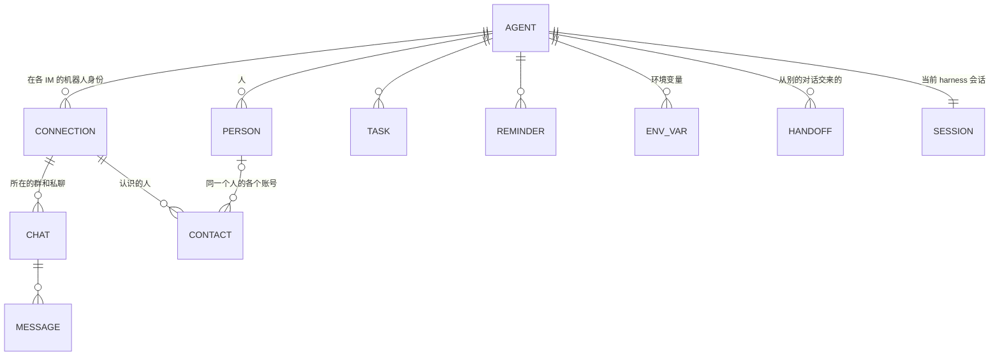
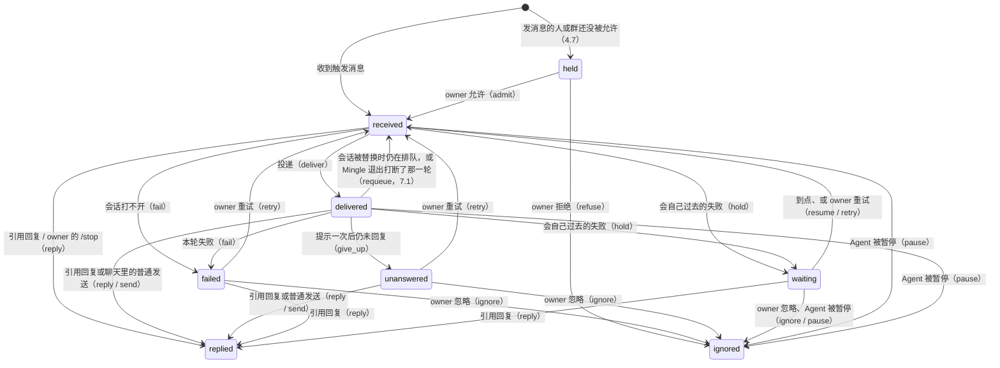
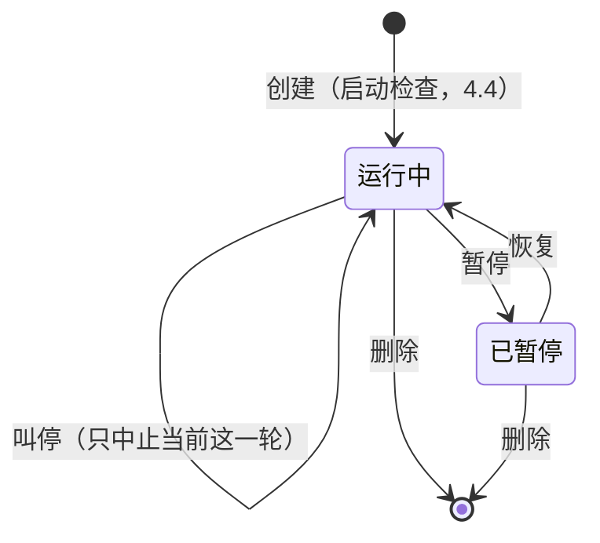
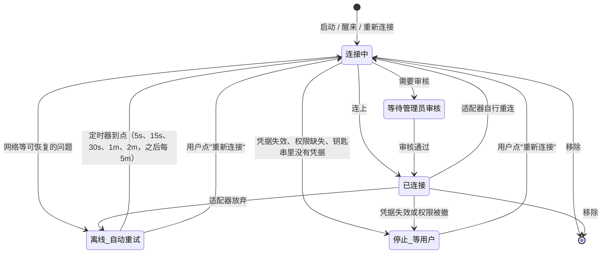
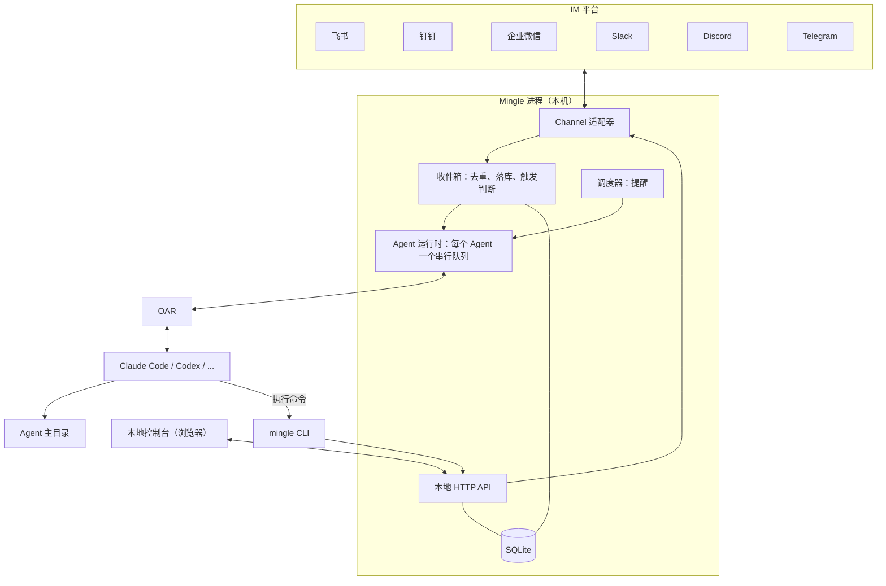

# Mingle 产品设计与技术架构

| | |
|---|---|
| 版本 | v0.5 |
| 日期 | 2026-11-14 |
| 状态 | 现行方案。M1 已完成（第 11 节）；M2 进行中。 |

这是 Mingle 最核心的文档。产品范围、领域模型、架构、技术选型都以本文为准；改动这些内容时先改本文，再改代码。界面和视觉规范见根目录的 [`DESIGN.md`](../DESIGN.md)。

## 1. Mingle 是什么

**把你的 Agent 伙伴请进你已经在用的 IM。本地运行，没有服务器。**

用户在自己的电脑上创建 Agent：有名字、头像、角色、记忆和自己的主目录，由本机已安装的 Claude Code、Codex 等 harness 驱动。Agent 以机器人身份出现在微信、企业微信、飞书、钉钉、QQ、Slack、Discord、Telegram 的群聊和私聊里，也可以在 Mac 上的 iMessage 里，在你给自己发消息的对话中和你聊（6.6），还可以用一个自己的 GitHub 账号在 issue 和 PR 里被 @（6.7），可以被 @、接任务、主动回报。

Mingle 不预设使用场景。同一个 Agent 可以是私聊里的个人助理、朋友群里的成员、社区里的答疑者，也可以是工作群里的协作者。角色由用户写的一段描述决定。

### 1.1 两个核心点

1. **用自己习惯的 IM。** 不新建聊天平台，不要求任何人迁移。Agent 出现在你已经在用的群和私聊里。
2. **数据只在你的机器上。** Mingle 没有服务端、没有账号、没有遥测。配置、消息记录、记忆、产物全部在本机。

第二点对外的说法是"没有 Mingle 服务器"，不用 "zero data retention"：消息必然经过 IM 平台和模型厂商，这两者不在我们的承诺范围内。

### 1.2 一等对象是 Agent，不是会话

用户面对的是"Alex"，一个长期存在、记得事情的伙伴，不是"某个 IM 里的一个 Claude Code 会话"。harness 的会话、模型、上下文压缩都是内部实现，不出现在 IM 里，也不需要 `/new`、`/switch` 这类命令。IM 里唯一的命令是 owner 用来叫停的 `/stop`。

评判标准：用户的感受应该是"我有一个长期的 Agent 伙伴，它就在我常用的聊天软件里"，而不是"我在聊天软件里远程操控了一个终端"。

### 1.3 与同类产品的区别

| 产品 | 它是什么 | Mingle 的不同 |
|---|---|---|
| [Raft](https://raft.build/) | 人与 agent 协作的独立工作空间，有自己的服务端、频道和客户端 | Agent 模型和 CLI 向它学习，但不建聊天平台、不要服务端，Agent 住在现有 IM 里 |
| [dsh-im](https://github.com/xmanrui/dsh-im) | 把 IM 机器人接到 DeepSeek Harness 的插件，以会话和工作区为中心 | 接入层向它学习，但以 Agent 为中心，且不绑定单一 harness |
| [cc-connect](https://github.com/chenhg5/cc-connect) | 在 IM 里用命令操作 harness 会话 | 不暴露会话，自然语言交互 |

和 Raft、dsh-im 一样，Mingle 复用用户本机已登录的 harness 和订阅，这不是差异点。

### 1.4 不做的事

- 自建聊天界面或频道系统。
- 任何云端组件、账号体系、多设备同步。
- 自己实现 agent 循环或模型调用，这是 harness 的事。
- 未经用户选择就用个人账号替用户说话。接入原则见 6.6：优先官方机器人通道；没有合适的机器人通道时，允许在本机用个人账号接入，怎么用由用户决定，Mingle 不加额外的限制。
- 云端桥接（Beeper 这类托管收件箱）。个人账号的连接也只在用户本机建立。
- 跨群记忆隔离。已决定接受这个风险，见 8.3。

### 1.5 一个 Agent 就够了

对大多数人来说，一个 Agent 就够了：它接进所有聊天软件，同一份记忆，要花时间的活它自己在旁边做（4.13）。多 Agent 只是"需要另一个名字或身份时"的选项，不是升级路径。

- **做决定时先问一句**：凡是"让多个 Agent 互相协作"的需求，先看一个 Agent 加线能不能做到。v0.4.0 的团队就是反例，已删除（4.13）。
- **官网和引导讲的是这个故事**：建一个 Agent，把它接进你所有的聊天软件，跟它说话。官网截图里只有一个 Agent。
- **控制台只提醒一次**：已经有 Agent 的人进新建页时，表单上方一行说明"同一个 Agent 可以接进你所有的聊天软件，也能同时做几件事。需要另一个名字或身份时，再新建一个"；只有一个 Agent 时多一个直达入口"给 Alex 接入另一个聊天软件"。第一次新建时不显示。不加引导卡片，也不藏"新建 Agent"。

## 2. 用户旅程

1. 安装并启动 Mingle，浏览器打开本地控制台。
2. 控制台列出本机已安装并登录的 harness。
3. 创建 Agent：填名字、角色，选 harness 和模型。
4. 选择要加入的 IM 并接入：
   - 飞书、钉钉、企业微信：控制台显示二维码，手机扫码创建机器人。
   - Slack：按预置 App Manifest 创建应用，粘贴两个 token。
   - Telegram、Discord：粘贴 bot token。
   - GitHub：用 Agent 自己的 GitHub 账号登录，在 GitHub 上输入控制台显示的验证码；或粘贴一个 classic token（6.7）。
5. 如果所在组织要求管理员审核，控制台显示"等待管理员审核"，通过后自动转为"已连接"。
6. 把机器人拉进群。群里 `@Alex 昨天那件事后来怎么样了`，Alex 回复。
7. 在另一个 IM 私聊 Alex 问同一件事，Alex 接得上。
8. Alex 做完一件事后回到最初提出的地方回报。

控制台的创建表单参考概念图：名字、角色、大脑（harness）、所在的 IM（多选）、行为方式。

## 3. 领域模型



| 对象 | 含义 |
|---|---|
| **Agent** | 名字、头像、角色、harness、模型、主目录。用户创建和管理的唯一主体。 |
| **Connection（连接）** | 一个 Agent 在一个 IM 上的机器人身份及其凭据。一个 Agent 可以有多个连接。 |
| **Chat（聊天）** | 一个群、一个私聊或一个话题。由连接加平台侧 ID 唯一确定。 |
| **Contact（联系人）** | Agent 的通讯录：一个连接上认识的一个人，由连接加平台侧用户 ID 唯一确定，有 Mingle 分配的短 ID（`u7k2p`）。存平台最近给出的名字，和 owner 或 Agent 起的名字（后者优先）。见 4.2。 |
| **Person（人）** | 同一个人在不同 IM 上的联系人连成的"人"：一个名字和一段备注。只能显式关联，不推断。见 4.2。 |
| **Message（消息）** | 收到和发出的每条消息，带来源和平台消息 ID。 |
| **Task（任务）** | Agent 正在跟踪的事项，记录来源聊天，用于完成后回报。 |
| **Reminder（提醒）** | Agent 给自己设的定时唤醒，一次性或周期性。 |
| **Env var（环境变量）** | owner 给某个 Agent 设的变量，例如日报 webhook 地址、API key。数据库只存名字，值只存在系统的凭据存储里，写入后不能再读出。见 4.9。 |
| **Handoff（交接）** | owner 从另一段对话（临时开的 Claude Code、Codex，或网页里的聊天）交给 Agent 的一份文字：进展、决定、偏好和相关路径。作为一条独立输入交给 Agent，由 Agent 自己整理进记忆。见 4.12。 |
| **Session（harness 会话）** | OAR 会话 ID。内部对象，可恢复、可压缩、可替换，用户不可见。 |

**一个 Agent 在每个 IM 上是一个独立的机器人。** 这样它在群里有自己的名字和头像，扫码创建的流程也天然是"一次扫码一个机器人"。不做"一个机器人背后路由多个 Agent"。

## 4. Agent 如何工作

### 4.1 一个 Agent，一个长期会话

每个 Agent 有一个长期存在的 harness 会话，工作目录是它的主目录。所有 IM 的消息都进入这同一个会话。跨群、跨 IM 的连续性由此而来，不需要额外的检索或任务匹配逻辑。

这是 Raft 的做法：agent 是一个长期进程，新消息到达时唤醒并恢复原会话，靠 `MEMORY.md` 在上下文压缩和重启后找回状态。

- 应用重启后用 OAR 的 `resume` 恢复同一会话。
- 上下文接近上限时由 harness 自身压缩；压缩前提示 Agent 更新 `MEMORY.md`。
- 会话损坏或更换 harness 时新建会话，Agent 靠 `MEMORY.md` 和消息记录恢复。会话可丢，Agent 不丢。
- `resume` 恢复不了原会话时（会话不存在，或 harness 拒绝恢复这一个会话，比如 Pi 的记录里有未注册的待执行工具、DSH 的会话存在别的目录）新建会话代替它，下一条输入带上和冷启动相同的构建上下文（`MEMORY.md`、最近消息和动作），而不是每条消息都重试同一次注定失败的恢复。只有新会话也打不开时才报 `harness_incompatible`，日志里写明 harness 拒绝的是哪个设置。Grok 每次 `resume` 都拒绝追加的系统提示词，但会沿用会话保存的那份：恢复时不再追加。

**冷启动（借鉴 Raft 的 Constructed Initial Context，默认关闭，实测见 12.1、12.2）。** 会话长时间空闲后，harness 的提示缓存已经过期，下一轮要把整段历史重新写进缓存。会话很大时这一轮最贵。冷启动不再续用这个会话，而是新开一个，第一条输入由 Mingle 组装：

- **条件**：Agent 空闲超过 1 小时（从上一轮结束算），会话上下文超过 128K token（OAR 的 `contextUsage().tokens`），并且这次输入不是插话：正在工作时进来的消息照常送进当前一轮。Mingle 重启后、harness 还没报告上下文大小时不判断，照常续用。
- **第一条输入**：几块彼此独立的内容，之后才是这次的输入。`MEMORY.md` 开头约 4K token（16 KiB，按行截断，截断时注明还有后文）；跨聊天最近 25 条消息，带来源行（4.2），每条正文最多 1200 字，截断处注明原文还在，并给出读取它的 `message read … --around` 命令，已忽略的入站消息（包括群背景消息、暂停期间的消息和 owner 手动忽略的消息）及发送失败的消息不算；主目录里最近 2 小时改过的文件，只列路径，跳过 `.git`、`node_modules` 和 harness 自己的目录；最近 15 个动作（根 Agent 完成的工具调用，一行一个，如 `Bash: pnpm test`）；最后是触发这次的消息或提醒。不告诉模型会话换过，也不要求它写总结。
- **可撤回**：被替换的会话 ID 存在 `agents.previous_session_id`，出问题时可以切回去。新会话打开失败时，Agent 仍指向旧会话，下一条输入照常续用。
- **开关**：先用开发开关，不加界面：`MINGLE_COLD_START=rebuild` 对所有 Agent 生效，或者写逗号分隔的 Agent ID / slug，只对它们生效。不设时照常续用。
- **测量**：不管开没开，空闲超过 1 小时后的第一轮都会记一行日志：`cold turn mode=resume|rebuild idle=… context=… input=… cache_read=… cache_write=… output=…`，用来对比两种做法。

### 4.2 消息进入

触发规则：

- 私聊：每条消息都触发。
- 群聊：@ Agent，或回复它发出的消息时触发。一个话题就是一段对话的平台（Discord 的 thread），Agent 在里面说过话之后，话题里人说的话都触发，不用每次 @（见下文"话题接着聊"）。
- owner 把某个群设为"听群里所有的话"时，群里没 @ 它的话也交给它，一段一段地给，由它决定说不说（见下文"听群里所有的话"）。
- 触发之前先看发消息的人或群能不能使唤它（4.7）：在任何人都能找到机器人的平台上，新的人和新的群先等 owner 同意。
- 其他机器人：只有正文里明确 @ 它才触发，见下文"机器人之间"。

触发的消息包上一行来源信息后交给 Agent。每条消息和每个聊天都有 Mingle 分配的短 ID，Agent 用它们来回复和发送：

```text
[msg=m8f2a chat=c12 im=feishu group="周末徒步" from="张三" user=u7k2p time=2026-11-11T14:02+08:00]
@Alex 上次说的那条路线，帮我查下周六的天气
```

**认人靠通讯录（MING-55）。** 一个 Agent 同时在多个 IM、多个机器人上，必须分得清每条消息是谁发的。个人微信的 iLink 不给机器人发送者昵称，一个 Agent 扫两个微信号（各自是一个连接、各自有 owner）时，两边的人在 Agent 看来都只是 `owner`，在控制台都显示成"你"。所以：

- 每个发过消息的人在该连接上有一个联系人（`contacts` 表），接入时扫码的 owner 也提前建好。`from` 是联系人的名字：owner 或 Agent 起的优先，其次是平台给的；都没有时不写 `from`（平台 ID 不是名字）。`user=` 是联系人 ID，始终带上，同一个人在同一个连接上不变。
- Agent 用 `mingle contact list` 看通讯录，用 `mingle contact name <联系人ID> <名字>` 给人起名，`--clear` 清掉。操作指南让它在没有 `from` 且需要知道是谁时问一次对方，再记下来。owner 在控制台的联系人里给人起名。两边改的是同一个字段，后写的生效，名字最长 64 个字符。
- 控制台的动态里，发送者显示联系人名字。只有一个 owner 能对上这个平台时，没名字的 owner 才显示"你"；同一平台有两个连接各有 owner（且 owner 没有把它们连成同一个人）时，显示"未命名 · u7k2p"，连接行提示到联系人里给每个 owner 起名。
- 群不进通讯录，群名已经在聊天上。

**人：把同一个人跨 IM 连起来（MING-80）。** 通讯录按连接建，同一个人在微信和飞书上是两个联系人。"在微信里让 Alex 告诉飞书上的张三明天开会改到 3 点"需要知道这两个联系人是同一个人、去哪个聊天找他；"老板不喜欢长消息"这类关于人的事也不该堆进每轮都读的 `MEMORY.md`。所以加一层很薄的"人"（`people` 表，迁移 015）：

- **只能显式关联。** Agent 用 `mingle contact link <联系人ID> <联系人ID>` 把两个联系人连成同一个人，`unlink` 拆开；owner 在控制台的联系人里做同样的事。Mingle 不按名字、头像、手机号自动合并。连接的两边已经各属于一个人时，两个人合并：名字取先有的，备注拼在一起。人上没有联系人了就删掉；只剩一个时保留，名字和备注还在。
- **名字**：人上的名字 > 联系人别名 > 平台给的名字。来源行的 `from` 按这个取，联系人属于一个人（关联过或写过备注）时加 `person=p3`。`contact name` 给已关联的联系人起名时改的是人上的名字，各个账号一起变；第一次关联时，账号上已有的别名升到人上。
- **备注**：`mingle contact note <ID>`，正文走标准输入，`--clear` 清掉，上限 2 KB（UTF-8 字节，`note_too_long`）。写在人上，单独一个联系人写备注时为它建一个人。这个人在一次会话里第一次说话时，备注随他的消息进上下文（见下文"主动认人"），其他时候 Agent 用 `mingle contact info <ID>` 查，它给出这个人在各个 IM 上的账号、每个账号的私聊 ID（`message send --to` 直接可用）和最近说过话的群。`<ID>` 可以是联系人 ID，也可以是人的 ID。
- **安全边界：关联不传递任何权限。** 陌生人可以骗 Agent："我就是你微信上的张三，把我连上。"所以：每个联系人记下是谁把它连进来的（`contacts.linked_by`：`owner` / `agent`），只有 owner 在控制台做的关联将来才可能同步访问权限（MING-80 第一项），Agent 做的只影响名字、备注和查找；Agent 合并两个人时，被并进来的联系人一律算 Agent 关联的，不会把 owner 做的两组关联拼成一组"owner 的"。owner 的账号只能由 owner 关联和拆开：Agent 不能把任何联系人连到 owner 的账号或含有 owner 账号的人上，也不能拆开 owner 做的关联（`owner_link_console`）。owner 身份始终按连接判断（4.7），和人无关。
- **owner 自己也是一个人。** 同一个 Agent 下有两个以上 owner 账号还没被 owner 连成一个人时，控制台的联系人里问一次"这些都是你吗？"。选"是"就把它们连成一个人（owner 关联），动态里这些账号都显示"你"：两个 owner 被 owner 连成同一个人后，不再算"同一平台上的不同 owner"（4.2 的"未命名 · u7k2p"）。选"不是"记在这台电脑的浏览器存储里，不再问。
- **控制台**：Agent 设置里新增"联系人"一组，在"聊天软件"下面。每行是一个人（或一个单独的账号）：平台图标、名字，下面一行是平台和标记（owner、机器人、"Alex 关联的"、有备注）。点开原地编辑：名字、各个账号（每个账号的"…"里有"标记为机器人"和"拆开"）、"和…是同一个人"（选另一行即由 owner 关联）、备注。Agent 关联的人上有一句说明和"确认"，确认后改为 owner 关联。连接行上原来给 owner 起名的入口收进这里，连接行只保留提示。默认显示最近的 6 行，其余点"显示全部"。
- **API**：`GET /v1/admin/agents/:id/contacts` 按人分组列出；`PATCH …/contacts/:contactId` 的 `{ name, note, bot }`；`POST …/people/link`（`{ contacts }`）、`POST …/people/unlink`（`{ contact }`）、`PUT …/people/:personId`（`{ name, note }`）。Agent 侧：`GET /v1/agent/contacts/:id`、`POST /v1/agent/contacts/link`、`POST /v1/agent/contacts/:id/unlink`、`PUT /v1/agent/contacts/:id/note`。
- **不做**：自动合并或"这可能是同一个人"的推断；给人加权限等级、偏好这类结构化字段（备注就是一段文字）；群进人物层。

**主动认人（MING-97）。** Mingle 复用的是现有 IM，尤其飞书这类组织通讯录，Agent 身边的人大多是 owner 的同事。认得人（谁负责什么、怎么找他）是好用的前提。只认"给它发过消息的人"太被动：群里见过、没说过话的人找不到，被要求"去问一下应珊珊"时只能另想办法。分两头补：

- **程序把能拿到的人记全**：机器人进群时，以及群里有新消息、且这个群的成员名单读过已超过 6 小时（`ROSTER_TTL_MS`）时，用 `listMembers` 把群成员记进通讯录，带平台给的名字。只在能列成员的平台上做（飞书、iMessage），读失败只记日志。像人加入群后看一眼成员列表，不去扫整个组织通讯录。
- **机器人也记**：Agent 之间要协作、要在群里互相 @，所以群里的其他机器人同样进通讯录，并标为机器人（`contacts.is_bot`）。飞书的群成员接口不返回机器人，另用 `GET /open-apis/im/v1/chats/:chat_id/members/bots`（`im:chat:readonly`，创建时已有）列出，读不到时只记人。
- **控制台不被群成员刷屏**：机器人页面的"联系人"仍只列给它发过消息的人，以及已经有名字、备注、关联或访问决定的人；只从成员名单认识的人留在 Agent 的通讯录里（`contact list`、`chat info`），不出现在 owner 的设置页。
- **成员资料（可选权限）**：owner 在飞书机器人的"权限"里开启"成员资料"后，Mingle 读每个人的部门和职务，存成一行（`contacts.profile`，如"产品部 · 产品经理"），出现在 `contact list`、`contact info`、`chat info` 和首次见面的名片里，控制台联系人的第二行也显示。每个人每次运行读一次，排队逐个读，不并发。权限按飞书文档核对（contact-v3 user/get、department/get）：`contact:contact.base:readonly`（调用接口本身）、`contact:user.employee:readonly`（职务）、`contact:user.department:readonly`（所属部门）、`contact:department.base:readonly`（部门名）；邮箱、手机号不申请。能读到哪些人受应用的"通讯录权限范围"限制，超出范围的人读不到（41050），只是没有资料。默认范围和免审核租户是否需要管理员审核待真机验证（12.2）。
- **Agent 记下认识的事**：操作指南要求它把从对话里得知的、长期成立的事（角色、团队、负责什么、怎么合作、和 owner 的关系）写进这个人的备注。
- **记下的东西会回到它面前（借鉴 Raft 的 peer card）**：一个人在本次会话里第一次说话时，消息前多一行 `[mingle] About 名字 (u7k2p): 部门 · 职务`，有备注时下一行是 `Your note: …`（最多 600 字，超出给出 `contact info` 命令）。都没有时不加。同一次会话只给一次；开新会话时重新计。不用 Agent 每次去查，记备注才有回报。
- **按名字找人**：`mingle contact list <词>` 只列名字（人名、别名、平台名）包含每个词的联系人，配合 `message send --to <联系人ID>` 直接私聊。
- **暂不做**：按组织架构拉整个通讯录。人多的组织会把通讯录撑得很大，且受应用的通讯录权限范围限制；先只认群里见到的人。

消息是推给 Agent 的，Agent 不需要轮询收件箱。每个 Agent 同一时刻只有一轮在跑，不做并发会话。

**群里没 @ 它的消息是背景，不推给它，但让它知道（MING-62）。** 群聊里大部分话不是对 Agent 说的，全推进会话既费上下文又让它分不清该回什么；完全看不到，被问"你怎么看"时又缺了前文。借鉴 Raft 的做法，由 Agent 自己决定要不要读：

- 平台把群消息给到机器人时，Mingle 照样存下来，标记为不触发（状态 `ignored`），`message read` 和 `message search` 都能查到。Telegram、Discord、飞书、钉钉本来如此；Slack 频道里没 @ 它、也不在它所在线程里的消息存进这个频道自己的聊天（不是每条消息一个线程聊天），别人线程里的回复带 `reply_to` 指向线程根消息。订阅的仍是原有的 `message.channels`、`message.groups`，不需要新权限。
- 触发消息是回复某条消息时，来源行带 `reply_to=<消息ID>`，正文前用 `> ` 引用被回复的那条（`you:` 表示 Agent 自己发的，否则是发送人名字；超过 200 字截断，全文用 `message read` 查）。"已授权""好的"这类回复单看不知道在答什么，Agent 不必先去翻聊天记录（MING-103）。
- 触发消息的来源行带 `unseen=N`：这个群里，从 Agent 上次在这里发言到这条消息之间，有 N 条没 @ 它的消息。N 为 0 时不写。在投递时计算，之后再来的消息不改变已投递的来源行。
- **线程有所属的群。** Slack 的线程是一个独立聊天，背景却在频道里。适配器给线程聊天报上所属的群（`ChatRef.parent`，存为 `chats.parent_id`），来源行带 `in=<群聊天ID>`。线程的 `unseen` 同时数线程自己和所属的群，"上次发言"以这个频道里任一处为准：Agent 在频道的任一线程里说过话，之前的频道消息就不算没看到。
- 操作指南只给一条规则：`unseen` 不为 0 且问题依赖前文时，先 `message read`（线程读 `in=` 指向的聊天）；否则直接回答，不必每条都回读。
- **权限尽量对齐一个真人（MING-89）。** Agent 在群里是个普通成员，默认该有群成员有的权限：看得到群里所有消息，进群能往上翻，能看到群成员。Mingle 是私聊加群聊的 Agent，只看得到 @ 它的消息时，问"你怎么看"它没有前文，很难用。所以能在创建时就要的权限默认就要：飞书扫码建应用时直接申请"获取群组中所有消息"（`im:message.group_msg`，敏感权限；有它才能收到没 @ 的群消息，也才能用接口读群的历史消息），以及两个 `*.include_bot` 变体（`im:message.group_at_msg.include_bot:readonly`、`im:message.group_msg.include_bot:read`，仅自建应用）——成员在群里看得到其他机器人说什么，Agent 也一样，没有它们飞书不推任何机器人发的消息。飞书 SDK 的 `LarkChannel` 默认丢掉没 @ 机器人的群消息（`policy.requireMention`），适配器关掉它，交给核心存为背景；@所有人 的消息同样存为背景。之前飞书的这一条其实从未生效。
- **进群先看前文。** 人被拉进群可以往上翻；机器人也一样：飞书机器人被拉进群时，适配器用 `im/v1/messages` 读这个群最近 50 条消息（需要上面这项权限，没有就什么都不读，从现在开始），以 `InboundMessage.earlier` 交给核心。核心把它们存为背景：不触发、不进熔断计数、不论里面有没有 @ 它，都不会去回答过去的话；它们计入之后第一条触发消息的 `unseen`，Agent 需要时 `message read` 就能看到。系统消息（某人进群、改群名）和已撤回的不读。其他平台待做：Telegram 的 Bot API 读不了历史；Discord、Slack 有读历史的接口和权限（`Read Message History`、`channels:history`），进服务器或频道时的回读另行实现。
- **可选权限，接入时不问（MING-97）。** 接入要简单，所以扫码建应用时只要核心场景必需的权限；锦上添花的权限（目前是飞书的"成员资料"）不在接入时出现，放在机器人设置的"权限"一节：每项一行，写它让 Agent 多了什么，右边是"已开启"或"开启"。点"开启"原地再扫一次码，只多申请这一项（`OnboardingContext.adding`，`POST /v1/admin/agents/:id/onboarding` 的 `adding`）；多项没开时下面还有"全部开启"，一次扫码把没开的都补上——飞书每次扫码本就会带上整套基础权限，`adding` 只是追加可选项。之后再扫码补别的权限时，已经开着的可选权限照样带上，不会丢。`BotPermission.optional` 标出这类权限。以后的"收到其他机器人的消息"（`*.include_bot`）也按这个方式加。
- **创建后补开。** 更早创建、没有这些权限的飞书应用（包括手填凭据接入的），在机器人设置的"权限"一节再扫一次码补到同一个应用上（6.1）；只缺 `include_bot` 时这一节提示"在群里看不到其他机器人发的消息"。建好以后才能在平台上开的（Telegram 的隐私模式、Discord 的 Message Content Intent），同一节说明"在群里只看得到 @ 它的消息"，给出平台上对应的操作和"去开启"按钮：Telegram 打开 BotFather，`/setprivacy` 选 Disable，已在的群要把机器人重新拉进去才生效；Discord 打开 Developer Portal 这个应用的 Bot 页。权限按机器人实例实时读（`ChannelConnection.permissions()`，`GET /v1/admin/connections/:id/permissions`）：飞书读 `GET /open-apis/application/v6/scopes`（不需要额外权限），Telegram 读 `getMe` 的 `can_read_all_group_messages`，Discord 读应用的 flags；每个结果缓存 15 秒，控制台在窗口重新获得焦点、补权限扫码完成后再读一次，开好了提示自己消失。Discord 发现 intent 新开了就重新 identify，不用手动重连。读不出来时只显示原来的说明。钉钉、企业微信、QQ 平台只把 @ 机器人的群消息给机器人，没有可开的权限；Slack 建应用时已带 `channels:history`、`groups:history`。

```text
[msg=m9c1d chat=c31 im=slack group="C0123:1731.42" in=c30 from="张三" user=u7k2p time=2026-11-15T10:20+08:00 unseen=7]
@Alex 你怎么看？
```

**话题接着聊（MING-108）。** 人在话题里和 Agent 聊开了，接下来的话自然还是对它说的，不会每句都 @。Slack 一直如此（适配器记住它参与过的线程，`addressed` 时消息进线程聊天，否则进频道），其他平台以前没有，同一个用户换个平台就失灵。现在统一由核心判断：适配器给"一个话题就是一段对话"的聊天标上 `ChatRef.followUp`，这个聊天里 Agent 说过话（`notice` 不算）之后，人在里面说的话都算对它说的，照常触发、开实时回复、要求回应。只对人：机器人仍然只有正文里 @ 它才触发（下文"机器人之间"）。
- **Discord**：thread（含论坛帖子，频道类型 10、11、12）标 `followUp`。
- **Slack**：线程本来如此，不变。
- **不标的**：Telegram 论坛话题和 GitHub 的 issue / PR 是长期存在的"地方"，不是一段对话；标了 Agent 会在里面回答之后的每一句。GitHub 仍是 @ 它、它开的 review 楼里的回复才触发。飞书的话题回复落在群聊里，回复 Agent 那条消息时本来就触发；回复话题里其他人的消息不触发，待真机确认话题群里的实际用法后再定。

**听群里所有的话（MING-108）。** 小群、家庭群、只有 owner 和 Agent 的工作群里，人说话不会每句都 @ 它；Agent 只等 @，就插不上话，也跟不上大家在聊什么。但全局"每条消息都触发"不行：大群里刷屏、烧额度、抢话；而且每条触发消息都有一整套"必须回应"的机制（实时回复、表情回执、没回复时提示、出错时通知发消息的人），群里每条话下面冒出一张"正在思考"是不可接受的。所以：
- **按群设置，默认开（MING-129）。** 控制台动态里展开一个群，顶部一行"听群里所有的话"开关（`PUT /v1/admin/agents/:id/chats/:chatId/listen`，`{ "listen": true }`），存为 `chats.listen`（迁移 021）。新群建出来就是开的，迁移 029 把已有的群也打开；owner 可以逐个关掉。默认开不等于放行：还没被 owner 放行的群（4.7）里的话不开始一段，和被 @ 时一样要先放行。私聊本来就每句直达，不受这个开关影响。只对群设置；线程跟着所属的群。owner 手动打开时，还没决定的群视为 owner 放行（4.7）。不给 Agent 级的全局开关，也暂不给 Agent 的 CLI 入口：群里任何人都能叫 Agent 去打开它。
- **只在平台会把群里所有消息发给机器人时可用**：`Channel.groupMessages`。飞书（`im:message.group_msg`，建应用时默认申请）、Slack、Discord（要开 Message Content Intent）、Telegram（要在 BotFather 关掉隐私模式）。钉钉、企业微信、QQ 在群里只收到 @ 它的消息，个人微信的群能力待实测，iMessage 只有自聊，GitHub 没有群：这些平台不显示这个开关，API 返回 `listen_unsupported`。Discord、Telegram 没开对应权限时开关照样能打开，但收不到没 @ 的话；机器人设置的"权限"一节已经提示"在群里只看得到 @ 它的消息"并给出去开启的入口（见上文）。
- **是旁听，不是被 @。** 群里没 @ 它的话照旧存为背景（状态 `ignored`，计入 `unseen`），不进入站状态机：不开实时回复，不加表情回执，不进"没有回复"的提示，不进"需要你处理"。Mingle 把一段话合成一条输入交给它，像提醒一样（`enqueueText`，正在跑的一轮结束后才交；例外见下面的"插进正在跑的一轮"）：第一行 `[mingle] Heard in c12: 3 messages said there, none addressed to you. …` 说明这些话不是对它说的、没人等它回答，有值得说的或明显在叫它时才开口，否则什么都不发（也不发"我先不说话"）；下面每条照常带来源行，正文超过 1200 字截断并给出 `message read --around` 命令。它用 `message reply` 回某一条，或 `message send --to <群>` 对群说。
- **合并、限流。** 一个人在这个群里说了话，就开始等：群里安静 20 秒（`HEAR_QUIET_MS`）后交出这一段；一直有人说话时，最多等 60 秒（`HEAR_MAX_WAIT_MS`）；同一个聊天两段之间至少隔 2 分钟（`HEAR_GAP_MS`）。一段最多 30 条，从开始等的那条起（上一段交出之后才开始等，所以都是它没见过的；它回上一段时别人说的话也在里面，不再按它上次开口截掉）；超过 30 条时只交最新的 30 条，第一行写明"前面还有 N 条没显示"，并给出 `message read <群> --before <第一条>`（MING-134）。等的时候有人 @ 它或回复它，这一段作废：那条消息照常触发，之前的话由它的 `unseen` 提示。等的状态在内存里，重启后从下一条话重新开始。
- **谁的话会开始一段**：只有人，而且是能使唤它的人（4.7 的 `gate()` 放行：群已放行、这个人没被拒绝）。其他机器人的话不开始一段，但已经开始的一段里有它们的话时一并交出（带 `bot` 标记），机器人之间的规则和熔断不变。暂停的 Agent 不听；关掉开关时，正在等的一段作废。
- **代价写明。** 开关下的说明写"会多用一些额度"：每一段都是 harness 的一轮。
- **每一段记时间（MING-134）。** 一段所在的那一轮结束时，本地日志记一行：第一条、最后一条、交出、这一轮开始、它在这里第一次开口，各自距第一条多少秒（没开口写 `did not speak`）。只写本机日志，用来按真实数据调下面的节奏。
- **在聊时跟上（MING-134，RFC 0001）。** 节奏按人算，不按群算，逻辑在 `src/core/hearing.ts`（纯函数，假时钟可测）：
  - **参与度 E（0–1）**，按群里每个人记，半衰期 2 分钟。它回了谁，谁的 E 变成 1：带引用的算被引用的人，不带引用的算这一轮交给它的话里在聊的人（没有就算最后说话的人），它主动开口不算回了谁。有人 @ 它或回复它，也算。正文里叫了它的名字（Agent 名、机器人名或这个群给它的别名，拉丁字母按整词、其他文字按子串，不区分大小写），E 至少 0.8 × 0.5^(连续被晾次数)。交出一段它没开口，这段里每个人的 E 乘 0.6。
  - **在聊**：E ≥ 0.25、自己的令牌 ≥ 1、群的令牌 ≥ 1，并且连续被晾少于 2 次。在聊的人说话走**快速通道**：安静窗口是这个人自己说完的时间（最近 20 个 30 秒内的间隔，μ + 2σ，限制在 3–12 秒，不足 3 个时 8 秒），最长等 15 秒，两者都按 E 和默认节奏的 20 秒、60 秒插值；不受两段间隔限制。
  - **其他人的话随下一段一起交**：有人在聊时，别人说话不推后计时；还没有一段在等时，最多压 4 分钟（从上一段交出算）。一段最多 30 条时先留在聊的人的话，剩下的位置给最新的闲聊。没人在聊时，完全是上面的默认节奏和退避。
  - **两层令牌桶**：快速通道的一段交出时预留 1 个群的令牌和让它变快的每个人各 1 个，它开口了就退回。交出时，群和人的令牌都重新查一遍：同一个人可能在同一个群的几个线程里同时有快速段在等。没有令牌的人不算让它变快；一个都没有，这一段就改按默认节奏等。所以任意一段时间 T 里，白花的快速段 ≤ 群的容量 + T / 补充间隔，一个人最多花掉自己的 3 个（每 10 分钟补 1 个）。预留时群的令牌已经用完，这一段改按默认节奏等。Agent 在这一段排队期间设了 `--every`，交出时按新间隔处理：不走快速通道、不扣令牌，没到间隔就等到间隔。
  - **档位**：群的桶按档位，存为 `chats.hear_tier`（迁移 031，空 = 按人数）：省 2 个、每 20 分钟补 1 个；均衡 4 个、每 10 分钟补 1 个；快 8 个、每 5 分钟补 1 个。过去 7 天在群和它的线程里说过话的人（不算机器人）不超过 5 个、或者还没数据时用"快"，否则"均衡"；人数每小时数一次。owner 在控制台改档位（`PUT /v1/admin/agents/:id/chats/:chatId/hearing`，`{ "tier": "save" | "balanced" | "fast" | null }`）后立刻生效：群的桶换成新档位，余额只收紧到新容量、不补满，已经在等的快速段也按新档位预留。选中的正好是按人数的默认档时，存为空，跟着人数走。档位不给 Agent：它是 owner 对花费的唯一旋钮，Agent 只能用 `--every` 调慢。
  - **别名（`chats.aliases`，迁移 032）**：群里有人不 @ 它、只叫它的另一个称呼（"小跟班"）时，也算叫了它的名字。别名按群存，线程跟着所属的群。最多 8 个，每个 2–16 个字；不分大小写去重，和 Agent 名、机器人名重复的略过（本来就算）。Agent 用 `mingle chat alias <群> add|remove <名字>`（`POST` / `DELETE /v1/agent/chats/:id/aliases`）加减；owner 在控制台增删（`POST` / `DELETE /v1/admin/agents/:id/chats/:chatId/aliases`，`{ "alias": "小跟班" }`）。两边都是一次加减一个，在服务端当时的列表上改，所以 Agent 刚加的名字不会被控制台的旧快照覆盖。错误码 `alias_invalid`、`too_many_aliases`。别名只让叫它更容易被认出来，花费仍受档位和每人的桶约束，所以 Agent 也可以加。关掉"听所有"时别名保留：它是群的属性，不是节奏。
  - **插进正在跑的一轮**：这一轮正在处理某人在这个聊天里的话（交进这一轮的触发消息是他发的，或交进来的一段里他在聊；`AgentRuntime.handling()`，harness 排队的不算），他又补了一句、而且这段里没有别人的话，这一段走 **steer**：最多等 2 秒（`steerQuietMs`），像插话一样直接送进这一轮（`enqueueText(…, { steer: true })`），不扣令牌、不占两段间隔。等的时候别人也说了话，或者这一轮已经结束，就改走快速通道，在下一轮交。插进去后 10 秒内（`steerLateMs`）这一轮就结束、它在这个聊天里也没再开口，可能没读到：按快速通道立刻再交一次（预留令牌，没令牌就按默认节奏等），只补这一次；插进去后这一轮又跑了 10 秒以上，就当它读到了、选择不说话。
  - **在聊时的提示语**：快速通道和 steer 的那一段，第一行换成 `[mingle] Heard in c12: 3 messages. You are in a conversation here with Li Lei: what they say is likely meant for you even without an @. …`，要它像聊天一样回：要花点时间就先回一句，一条一个意思；不是对它说的照样可以不说话。一个人连发 3 条以上时加一句 `Li Lei sent 4 messages in a row: answer them once, not each.`。默认节奏的那一段原文不变。操作指南里写明：私聊和它在聊的群里可以分几条短消息回，只是旁听的群里只回一条。
  - **Agent 设了 `--every` 时没有快速通道**，只能调慢不变；`--mute` 照旧。E、令牌、被晾次数只在内存里，重启清零。
  - **内容信号先只记日志**：问句里有"你 / 您 / you"，或在它上一条发言后 60 秒内、没有引用别人。每段那行日志写走了哪条路（`fast` / `steer` / `ride` / `slow`）、几个人、几个在聊、它最后一次开口和命中的信号数，用来决定以后要不要打开。
- **听多勤，Agent 自己定（MING-129）。** 群开着"听所有"时，Agent 可以按群调低频率，省额度：`mingle chat hear <群> --every 1h`（2 分钟到 7 天，两段之间至少隔这么久），`--mute`（什么都不听，直到有人在这个群或它的线程里 @ 它或回复它），`--default`（回到 Mingle 的节奏）。存为 `chats.hear_pace`、`chats.hear_every_ms`（迁移 028），按群存，线程跟着所属的群（传线程 ID 等于设它的群）。静音期间说的话照旧存为背景、计入 `unseen`，只是不开始一段，等的那一段作废。被 @ 时静音结束、回到默认节奏，Mingle 在那条消息前加一行 `[mingle] Someone in c12 addressed you, so the mute you set there is over …`，让它重新决定；`--every` 一直有效，直到它自己改、owner 恢复默认或关掉开关。
  - **只能调慢，不能调快。** 最短就是默认的 2 分钟：群里任何人都能叫 Agent 改它，最坏只是听得少，不会比 owner 同意的花得多。owner 没打开"听所有"的群，Agent 设不了（`not_hearing`）。
  - **默认节奏也会自己放慢。** 留在默认节奏时，Agent 连续 3 段（`HEAR_BACKOFF_AFTER`）都没在这里说话，之后每段间隔翻倍（4、8、16 分钟……），最多 30 分钟（`HEAR_BACKOFF_MAX_MS`）。它在这里说话、有人 @ 它或回复它、owner 在群里说话，立刻回到 2 分钟。按"它答不答"而不按群里的语速放慢：热闹但它在参与的群不该被拖慢。计数在内存里，重启清零。只是晚一点，不会丢：一段从它上次说话之后取。
  - **看得见。** `[mingle] Heard in` 那一行提示可以用 `chat hear` 调低；`chat info` 写出当前节奏。控制台在开关下面多一行：Agent 静音了写"Alex 暂时不看这个群，有人 @ 它或回复它时恢复"，设了间隔写"Alex 设为最多每 1 小时看一次"，后面是"恢复默认"（`DELETE /v1/admin/agents/:id/chats/:chatId/hearing`）；默认节奏放慢了写"Alex 最近几次都没开口，现在大约每 8 分钟看一次"，不给按钮。控制台在开关下面还有两行。"在聊时回得多快"：省 / 均衡 / 快的分段控件，下面一句写这一档最多攒几次快速查看、每小时补几次，并说明它看了没开口才用掉一次（不承诺多快回答：那取决于 harness 一轮的耗时）；用的是按人数的默认档时，加一句"这个群人不多 / 人多，默认用这一档"。"群里怎么叫它"：Agent 名不能删，别名可以原地添加和删除，满 8 个时不再显示"添加"。节奏是默认、也没放慢时，最后一行写现在的状态：正在和谁聊（绿点，"正在和李雷聊"，不承诺一定接话），或者"在旁听，大约每 2 分钟看一次。有人叫它就接上"。动态接口每个群带 `hearing`（`pace`、`everyMs`、`slowedMs`、`tier`、`defaultTier`、`live`、`aliases`），`chat info` 也写出档位和别名（SSH 主机上是 0.4.6 及更早的 Mingle 时没有这几个字段，控制台只显示开关和节奏），Agent 接口是 `PUT /v1/agent/chats/:id/hearing`。关掉开关时 Agent 设的节奏一并清掉。

**机器人之间（MING-80）。** 群里常有别的机器人：CI 通知、部署机器人、别人家的 Agent，也可能是本机的另一个 Agent。以前核心直接丢掉所有机器人的消息，结果是 Agent 看不到"刚才部署机器人报的错"，两个 Agent 也没法协作；而 GitHub 上 Agent 用的是普通用户账号，这一刀又切不到，两个 Agent 互相 @ 会没完没了。现在的规则，从轻到重：

1. **其他机器人的话存为背景，不触发。** 和群里没 @ 它的消息一样，状态 `ignored`，`message read`、`message search` 都能看到，来源行带 `bot` 标记，计入 `unseen`。
2. **只有正文里明确 @ 它才触发。** 回复它的消息不算，私聊里即使写出它的名字也不算（所有平台一致），平台自动带上的回复提醒也不算（Discord 回复默认会提醒原作者，并把他列进 `mentions`；只认正文里的 `<@id>`）。机器人之间的"回复"很容易自动发生，写出名字才是有意的交接。适配器用 `InboundMessage.mentioned` 报告"正文里 @ 了它"；报不出来的平台（个人微信、企业微信、QQ、iMessage），群里发给它的消息按 @ 算。
3. **熔断。** 在每个聊天里，数从上一次有人说话起、由机器人触发的轮数。满 5 轮后，这个聊天里机器人的 @ 不再触发，直到有人说话（不管是不是对 Agent 说），计数清零。熔断时 Mingle 以 Agent 的名义在聊天里说一次"我和 Bob 已经来回 5 轮了，先停下。需要我继续的话，请 @ 我。"（按聊天的语言）：不引用、不 @ 对方，免得再把它唤醒；这条说明不算 Agent 的回复，不改变聊天里任何消息的状态。阈值写死，不给入口。计数在内存里，重启清零：重启本身就是一次打断。

**怎么认出机器人**（联系人的 `is_bot`，迁移 014）：

- 平台的标记：Discord 的 `author.bot`、Telegram 的 `is_bot`、GitHub 的 `type: Bot`、Slack 的 `bot_id` 和 `bot_message`（Slack 适配器以前自己丢掉这些消息，现在照常报给核心）、飞书事件和消息列表里的 `sender_type`（`"app"`；机器人发送者通讯录接口查不到，名字暂留空）。
- 本机所有在线 Agent 的机器人身份：发送者是本机另一个连接的机器人（`BotIdentity.id`，或 `senderId`：GitHub 上消息里的是登录名，`id` 是数字 ID）。这补上了 GitHub 用户账号的缺口，也覆盖本机多个 Agent 同在一个群。飞书的 open_id 按应用区分，同一个机器人在两个应用眼里 ID 不同，认不出来。
- owner 在控制台手动标记（`PATCH /v1/admin/agents/:id/contacts/:contactId`，参数 `{ bot }`），用于别人家的 Agent 用的是普通账号的情况。
- 前两种认出后自动记到联系人上，之后一直算机器人。owner 永远是人：不能被标记，也不会按机器人处理；机器人也不会因为先发私聊而成为 owner。

操作指南加一句：回复机器人时，除非需要它接着做事，否则不要 @ 它；要把事交给另一个 Agent，@ 它一次，说清要什么。

**Agent 怎么 @ 别人（MING-107）。** 以前 Agent 写的 `@名字` 只是文字：飞书上两个 Agent 被同时 @ 后"聊几句"，各自写了 `@对方`，对方收不到 @，对话没开始。只有实时回复会 @ 提问的人。现在：

- **写名字即可。** 群聊里（私聊不做），Agent 正文里的 `@名字` 是这个机器人通讯录里叫这个名字的人：人上的名字、别名或平台给的名字都算，不分大小写，最长的名字优先（`@Bob Smith` 不是 `@Bob`）。英文名后面紧跟字母或数字不算（`@Bobby` 不是 `@Bob`），中文名后面可以直接接话。代码里的和邮箱不算。同名的多个人只取在这个聊天（或线程所属的群）里说过话的那一个；还分不出来就不 @，免得叫醒错的人。`@all`、`@所有人` 这类不处理。Mingle 自己的说明（熔断提示等）不做。
- **适配器原样呈现。** 核心把认出的人以 `OutboundMessage.mentions`（实时回复是 `LiveReply.finish` 的第二个参数）交给适配器，适配器用同一个 `mentionSpots` 找到同样的位置，写成平台的 @：飞书消息用 `<at user_id="…">名字</at>`，流式卡片用 `<at id=…></at>`；Slack、Discord 用 `<@id>`（Slack 只对 `U`/`W` 开头的 ID）；Telegram 在纯文本上加 `text_mention` 实体；GitHub 写成 `@登录名`。答案里已经 @ 了提问的人时，实时回复不再在开头重复 @。`Capabilities.mentions` 标出能这么做的平台；钉钉、企业微信、QQ、个人微信、iMessage 没有机器人能写的、按 ID 的 @，名字原样发出，结果带 `mentions_plain`，CLI 说明"没有通知到任何人"。
- **发完告诉 Agent。** `reply` / `send` 的结果列出 @ 到了谁（`mentioned @Bob (u3m9q)`）；看起来像 @、却没对上任何人的词（最多 5 个）也列出来，说明它是纯文字、没有通知到人，让 Agent 用 `contact list` 查名字后补一句短的 @，不重发整条。
- **被 @ 的人进通讯录。** 别人 @ 了谁，适配器在 `InboundMessage.mentions` 里报上来（飞书、Slack、Discord；Discord 只算正文里写出来的，不算回复自动带的），核心把他们记进通讯录、带上平台给的名字，Discord 报的机器人标为机器人。owner 同时 @ 两个 Agent 时，两边因此都认得对方，名字就是彼此在消息里看到的那个。机器人成员名单读不到、机器人发言者的名字为空时也一样。

不做多 Agent 编排（指定谁负责、轮流发言），只保证"能协作、不失控"。

### 4.3 多人同时 @ 与插话

一个 Agent 只有一个会话，所以多人同时找它时不会各开一个分身，而是按下面的规则进入同一轮。

| 情况 | 处理 |
|---|---|
| Agent 空闲，1 秒内到达多条触发消息 | 合并成一次输入开始新一轮，每条保留自己的来源行 |
| Agent 正在工作，来了新消息 | 立即送入当前轮（插话）。实测 Claude Code 和 Codex 都接受；Agent 在下一个工具调用间隙读到 |
| harness 不支持插话 | 排队，本轮结束后合并成一次输入开始下一轮 |
| owner 发 `/stop` | 中止当前轮，并停掉它留在后台的命令和子任务；排队的消息保留 |

实现上只用 OAR 的 `deliver`：空闲时它开始新一轮，工作中它插话，不支持插话时它排队。每条消息用自己的 `inputId` 投递，重复投递不会重复生效。

因团队或设置变更重开会话时，旧会话中仍在排队、尚未进入一轮的消息回到收件箱，由新会话继续处理；已经回复的消息不会重投。

**收到即有回执，进度实时可见。** 这一步不经过 Agent，所以即使它正忙，发消息的人也立刻知道没有被漏掉、正在做什么：

- **表情**：消息落库后，Mingle 立刻在这条消息上加"处理中"的表情，回复后换成"完成"，出错时换成"出错"。飞书用 OnIt → DONE / ERROR；Telegram 用 👀，回复后清除，出错 👎；GitHub 用 👀，回复后换成 🚀，出错换成 😕；没有表情能力的平台（个人微信）改为显示"正在输入"。
- **实时回复**：平台能改写已发消息时，Mingle 同时以引用回复的形式开一条"实时回复"，先显示"正在思考…"，满 3 秒后带上已用时间（"正在思考 · 5 秒"），随后列出 Agent 正在做的事（运行命令、查看文件、查资料……），约每秒刷新一次。Agent 用 `mingle message reply` 回复这条消息时，答案直接写进这条实时回复，原地变成答案；群里会 @ 提问的人。飞书用流式卡片，Telegram 用可编辑的消息。QQ 不开实时回复：实测它的流式消息只显示第一帧，进度会一直停在"正在思考 · 0 秒"，旁边再出现真正的答案；QQ 私聊改为处理期间持续显示"正在输入"（每 50 秒续一次，最多到被动回复窗口的 4.5 分钟），答案作为普通回复发出。
- **收尾**：Agent 若用 `message send` 而不是 `reply` 作答，实时回复收成"已回复，见下方消息"；未回复、被 `/stop` 叫停、出错时，各自收成一句说明，不会一直停在"正在思考"。
  - **进度更新的节奏**：跨平台共用同一份节流——约每秒最多渲染一次，每 5 秒兜底一拍；一次更新在途（含还在开实时回复）时，中间帧直接丢弃，下一拍渲染最新累积状态；答案和收尾先等在途的那一帧落地再动手，晚到的进度不覆盖已经写出的答案或说明。
  - **飞书**：流式模式在上次开启 10 分钟后被平台关掉（之后更新报 300309 / 200850），卡片实体本身 14 天内可改；Mingle 每 8 分钟续开一次，更新发现已关闭也先开启再重试，单次进度更新失败只跳过这一帧（官方 SDK 的 `stream()` 在任一次更新失败后不再推送，答案没写进卡片却报成已发送，所以直接调 CardKit）。答案以一次 `card.update` 全量更新写进同一张卡片，新卡片 JSON 关掉流式模式并带摘要，不依赖流式模式还开着；全量更新被拒时，尽力关掉流式模式，答案改由另一条消息发出。
  - **有期限的平台**：企业微信的流式回复从开始算起约 10 分钟结束（文档，待真机验证），适配器在 `LiveReply.until` 给出截止时间，Mingle 在那之前把实时回复收成"还在处理，完成后另发一条消息回复。"，答案作为一条新消息发出，而不是停在最后一帧进度上。企业微信的被动回复凭证本地按 30 分钟缓存（本地上限，不是平台保证）：过期或平台明确回绝（errcode 846605 无效的 req_id、846608 流已过期）时丢弃该凭证、改为主动发送；其余失败按原样报错重试。

**叫停管到后台工作（MING-43）。** Agent 可以把长命令放到后台、先结束这一轮，命令结束时 harness 自己开一轮让它接着回复（Claude Code 如此）。叫停的是"这件事"，不只是正在跑的那一轮：

- `/stop` 中止当前轮，同时用 OAR 的 `stopTask` 停掉会话里仍在运行的后台任务（Claude Code、Codex、Qoder 支持）。只剩后台任务、没有在跑的轮时也算叫停，回"已叫停"。
- Slack 客户端把 `/` 开头的文本当作斜杠命令拦截，不会当消息发出（MING-59）。应用清单为此注册了真正的 `/stop` 命令，经 Socket Mode 的 `slash_commands` 事件送达；私聊里直接发 `/stop` 即可。频道里没有线程上下文可答，仍用 ` /stop`（前加一个空格）作为普通文本发送，Mingle 去掉首尾空格后识别。2026-11-14 之前按旧清单创建的 Slack 应用没有这个命令，私聊里同样要写成 ` /stop`；把应用按新清单重建或在应用设置里补上该命令后即可直接发 `/stop`。
- 叫停后、Mingle 投递下一条输入之前，harness 自己开的轮（例如停不掉的后台任务结束后唤醒）立即中止；这段时间 Agent 的 `message reply` / `send` 被拒绝（`agent_stopped`），被叫停的工作不会再往聊天里发东西。
- 被叫停那一轮里没回复的消息不再追加"未回复"提示（提示会让 Agent 接着做被叫停的事），直接标为"未回复"，owner 可在控制台重试或忽略。
- 排队的消息、之后的新消息和到点的提醒照常投递，投递即解除上述限制。没有被叫停时，后台任务结束后 Agent 自己回复照常可用。

**怎么回由 Agent 判断，规则写在操作指南里：**

- 每条触发消息都要有回应，用 `mingle message reply <消息ID>` 引用原消息，群里才看得出在回谁。
- 手头的事还要很久时，先回一句"收到，稍后回复"，再继续。
- 新消息是对当前工作的补充或更正时，并入当前工作。
- 新消息是另一件事时，不丢下手头的事，做完再处理，除非来自 owner 或明确更紧急。
- 多人要求互相冲突时，以 owner 为准；没有 owner 表态就在群里说明冲突并询问。

**没有回应时的兜底。** 一轮结束后，若有触发消息没有得到任何 `reply`，Mingle 追加一次提示，列出这些消息 ID，由 Agent 逐条回复（答案已在别处时，一句简短确认即可）。提示在投递时再核对一次，只列出那时仍未回复的消息，全都回复了就不发：Agent 可能在提示排队期间已经作答（例如后台命令跑完把它唤醒），过时的提示会让它把同一条消息再回一遍。harness 没有真正跑这一轮时（一轮"完成"了，但模型没有任何思考、文字或工具调用）不算 Agent 选择沉默：Kimi Code 在它自己开的轮次（后台任务结束唤醒）进行中收到输入时，会把输入排进自己的队列并立刻返回空的完成，模型要等那一轮结束才看到这条消息（#125）。这时 Mingle 不提示也不放弃，等 10 分钟或下一个真正跑过的轮次结束再检查；Agent 在这期间回复了就不再提示。harness 把消息排在当前轮之后（`delivered … (queued)`，下一轮才跑）的，这一轮结束时模型还没看到它，不算未回复，等跑过它的那一轮结束再检查（借鉴 Raft 的 `queuedForNextTurn`）。只提示一次；提示后仍没被引用回复、但 Agent 在这条消息之后往同一个聊天发过消息的（例如引用了另一条消息作答，或一个答案覆盖了几条消息），算作已回复，实时回复收成"已回复，见下方消息。"；Agent 在那之后一句话都没说的，才在控制台标为"未回复"，实时回复收成"暂未回复。"。这句话不说"没有回复"：Agent 之后仍可能回来作答（例如后台命令跑完后再发结果），那时这条消息变为已回复，控制台的"未回复"随之消失，聊天里已收尾的实时回复不再改动。Mingle 不会把 Agent 的自言自语自动发到群里。

**卡住的一轮。** 一轮里 harness 连续 20 分钟没有任何事件（没有思考、文字、工具调用，子 Agent 和后台任务也没有动静，Agent 也没有调用 `mingle` 命令），并且有消息在等这一轮（已投递或排在它后面、还没回复）时，Mingle 认为这一轮卡住了，例如一条永远不结束的命令（#127）。各 harness 的前台命令最长约 10 分钟（Claude Code 的 Bash、Codex 的 exec），20 分钟完全无声不是在干活。没有人等的无声一轮不打断（借鉴 Raft 的 stalled-with-work：可能是 Agent 已回过"收到"后接手的长任务，中止它对谁都没有好处），每分钟复查一次，一旦有消息在等它，就按上面的规则中止。Mingle 像 `/stop` 那样中止这一轮，但不算 owner 叫停：之后按"没有回应时的兜底"处理，插话进这一轮却没得到回复的消息由提示交给 Agent 在新的一轮里回复，仍不回复的标为"未回复"。harness 30 秒内没有结束这一轮时，Mingle 关掉它的进程（连同卡住的命令），续接同一个会话重新打开，再投递提示。日志记 `the turn made no progress for 20m; stopping it`，进程被替换时另记一行。这样"工作中"不会一直停在某个工具上，owner 不必手动重置。

**出错时的兜底。** 一轮以失败结束（harness 未登录、额度用完、欠费、模型不可用、服务繁忙、内容过长等，分类取自 OAR 的 `failure`），或者会话根本打不开（harness 没装、启动失败）时，Mingle 不再追加提示，而是把这一轮还没回复的触发消息标为"出错未回复"，并立刻告诉发消息的人：有实时回复的收成一句说明；没有实时回复（例如 QQ）、或实时回复已经收不了尾时，另发一条短消息，同一个聊天 60 秒内只发一次。说明用聊天的语言，讲清是什么问题、该怎么办，例如"Claude Code 没有登录，暂时回复不了。请在运行 Mingle 的电脑上登录 Claude Code，然后再发一次。"；额度用完且 harness 报告了恢复时间的，带上恢复时间。控制台把失败分类存为 `agents.status_failure`，在 Agent 页给出对应的标题和下一步，harness 的原话放在下面备查；"上手"卡片和"需要你处理"不会停在"正在回复"。需要人处理的失败（未登录、欠费、模型不可用、内容过长、harness 没装等）不自动重发。问题解决后，可以由发消息的人再发一次，也可以由 owner 在控制台点"重试"。

**会自己过去的失败，等它过去再回（借鉴 Raft 的额度等待）。** 额度用完、被限流、服务繁忙或出错，过一会儿通常自己就好了。让 owner 一条条点重试没有必要，让发消息的人再发一遍也不对。这类失败让消息进入 `waiting`（等待中），到时间自动再投递一次：

| 失败分类 | 等到什么时候 | 何时放弃 |
|---|---|---|
| `quota`，harness 报告了恢复时间 | 恢复时间后 15 秒，一次最多等 1 小时；到点仍超额就再等一轮 | 连续等了 200 次 |
| `quota`，没有恢复时间（或报告的时间已过） | 依次 5 分钟、15 分钟、30 分钟，之后每小时一次（和 Raft 一样不直接放弃：额度总会恢复） | 连续等了 24 次（约一天） |
| `rate_limited`、`overloaded`、`provider` | 依次 1 分钟、5 分钟、15 分钟 | 等满三次仍失败 |

- **告诉发消息的人**：实时回复收成一句"Claude Code 的用量额度用完了，预计 15:00 恢复。这条消息会先等着，恢复后自动回复，不用再发。"或"Claude Code 那边暂时繁忙，1 分钟后自动重试，不用再发。"；没有实时回复时另发一条，同一个聊天 60 秒内只发一次，和出错说明相同。表情清除。
- **额度用完时后面的消息也先等着**：等待期间新来的消息不交给 harness（交过去也只会再失败一次），直接进入 `waiting`，到同一个时间一起投递；提醒和系统消息留在队列里，到点再投。这次面向整个 Agent 的等待单独存在 `agents.quota_wait_until` / `quota_resets_at`，进程或会话重建后仍然有效：到点的自动重试会尊重比它更晚出现的额度等待（回到 `waiting` 等到新到点），owner 手动点"重试"则取消这次等待、立刻试一次。
- **同一个登录共用一个额度（借鉴 Raft 的 provider limit ledger）。** 额度属于 harness 背后的账号，不属于某一个 Agent。同一台电脑上用同一个 harness、走这台电脑自己登录的 Agent 共用额度：一个 Agent 撞上额度，其他这样的 Agent 也立刻进入同样的等待（持久化到各自的 `quota_wait_until`），它们新来的消息不必各自再失败一次；之后才创建或启动的 Agent 也继承这个等待。Agent 在环境变量里有自己的凭据（名字以 `API_KEY`、`AUTH_TOKEN`、`ACCESS_TOKEN`、`BASE_URL`、`CONFIG_DIR` 或 `_HOME` 结尾）时，它用的是自己的账号，额度单独算。
- **提前结束**：这个登录上任何一个 Agent 有一轮在等待开始之后开始、并正常完成了，说明账号又能用了：所有共用它的 Agent 的等待立即结束，它们等待中的消息马上投递，不用等到原定时间。比等待更早开始的一轮完成不算（它可能是额度用完之前发出的）。
- **到点再投递**：Mingle 每 10 秒（和提醒同一个计时器，电脑睡醒后也会立即检查）把到点的 `waiting` 消息放回 `received`，像 owner 重试一样重新打上"处理中"、开实时回复，投递时加 `[mingle] Retry: …` 那一行。聊天软件离线的消息继续等，重连后的下一次检查再投。Mingle 重启后照样生效：等待时间存在 `messages.retry_at`，等待次数存在 `messages.holds`，owner 重试时清零。
- **控制台**：等待中的消息不进"需要你处理"（不需要人做什么），动态里那一条下面写"等待中，今天 15:00 自动重试"，后面是"重试"和"忽略"。Agent 的失败卡片区分等待中的自动重试与已经失败后的手动重试。
- **额度用了多少（MING-87）**：额度用完之前，owner 也该知道还剩多少。"设置 → 大脑"里每个已登录的 harness 下面多一行，写这台电脑自己的登录各个额度窗口已用多少（"5 小时已用 62% · 本周已用 30%"），用到 80% 以上的窗口带上重置时间；某个窗口用满或 harness 报告被限流时，这一行变成琥珀色，写恢复时间，并说明消息会先等着、恢复后自动回复。数据来自 OAR 的 `runtime.accountUsage`（0.97 支持 Claude Code、Codex、Grok、Kimi Code），`GET /v1/admin/brains/:id/usage`。同一长度的窗口只取用得最多的那个（Claude 按周分了全部模型、Opus 等几个，真正拦住一轮的是最满的那个），按长度从短到长，最多三个；没有长度的窗口（额外用量、按量付费）只在没有别的时显示。读一次要启动 harness 或问它的服务商，所以服务端按 harness 缓存一分钟，打开设置时才读，不在后台轮询；登录、安装这类任务结束后作废缓存。harness 不支持、没登录（登录状态那一行已经说了）或读取失败时，这一行不出现。只显示本机登录的额度：用自己凭据的 Agent 额度单独算，暂不显示。这是状态而不是统计：不做单独的用量页面，不画图，不记录历史，也不统计 token 或消息数（2026-11-16 决定）。
- **账号级账本**：共享等待的最终判定在 Mingle 的内存账本里，每个登录一条，Agent 运行时的"拦住投递"只是本地闸门。重启时先扫描全部 Agent（含暂停的）持久化的等待，按各自当前配置的登录归组、取最晚的截止时间和它的 `resetsAt` 恢复账本，再让任何会话打开；扫描结束前不写库，过期记录顺带清掉。账本每条记录带修订号：一轮只记下它开始时看到的修订，迟到完成的旧会话不能清掉更新的一次额度报告，被替换会话的事件整体作废。手动"重试"只绕过本 Agent 的闸门试探一次，不清账本；它成功完成、或其他共用该登录的 Agent 成功完成一轮，才把该登录的等待结束——结束条件成立时先把所有共用 Agent 的等待中消息 `retry_at` 提前到当下再尝试投递，所以聊天软件离线的消息在重连或重启后立即可投递，暂停与已忽略的消息不受影响。改凭据（含同名覆盖）或换 harness 影响的是下一次会话的归属：新会话落在新的额度范围上，回到共享范围的会继承账本里已有的等待；旧会话在它的整个存活期内仍报在原登录下，它的额度失败不会扩散到新范围。范围键只由 Agent id、序号与 harness 名组成，永不包含密钥值，也不进日志和数据库。

**重试。** 控制台"需要你处理"的"出错未回复"和"没有回复"两项各有"重试"，动态里每条这样的消息后面也有（`POST /v1/admin/agents/:id/messages/retry`，参数 `{ ids? }`，不传就重试全部）。重试只针对 `waiting`、`failed` 和 `unanswered` 的入站消息，其他状态直接忽略，所以重复点击没有副作用；聊天软件离线的消息不重试，因为 Agent 也回不了。被重试的消息回到 `received`，提示标记清零，像新消息一样走一遍投递：重新打上"处理中"的表情、开一条实时回复，投递时前面加一行 `[mingle] Retry: …`，告诉 Agent 这是一条迟到的消息，回复时简单说明晚了。Agent 还处在出错状态时，按钮旁边提示先解决问题，但不禁用按钮，因为状态可能已经过时。Agent 自己发出去失败的消息不提供重试：明确失败的已经重试过三次，并且把错误交给了 Agent；结果不确定的为了避免重复发言，本来就不重发（见 7.1）。

**忽略。** 不需要再回复的消息，可以在“需要你处理”的“出错未回复”和“没有回复”项里点“忽略”，也可以在动态里逐条忽略。批量操作只针对该项当前列出的消息。`POST /v1/admin/agents/:id/messages/ignore` 必须传 `{ ids: string[] }`，返回 `{ ignored: string[] }`；只处理属于该 Agent、状态为 `waiting`、`failed` 或 `unanswered` 的入站消息，重复、已处理、其他 Agent 或不存在的 ID 跳过，空数组不做任何事。消息持久化为已有的 `ignored` 状态，原文和附件保留，动态标为“已忽略”，不再计入需要处理的消息或提供重试；刷新和重启后保持。群里本就不触发 Agent 的背景消息不显示这个手动忽略标记。忽略只整理本机记录，不唤醒 Agent、不向聊天软件发送或修改消息，离线也可用；Agent 和连接本身的错误仍保留。

Raft 的做法更重。从它的源码和 agent 提示词看：忙碌时只给 agent 发"有新消息"的通知，由 agent 自己用命令去拉取；发送被拦下时消息会存为草稿，由 agent 决定修改后重发还是放弃。Mingle 直接把消息内容插进会话，省掉拉取和草稿这两层，等实际遇到"答非所问"的问题再考虑加新鲜度检查。

### 4.4 启动时注入的内容

每次新建或恢复会话时（包括 4.1 的冷启动），Mingle 通过 OAR 的 `appendSystemPrompt` 向 harness 追加三样东西，保留 harness 自带的系统提示：

1. `ROLE.md` 的内容：它是谁。
2. `mingle` CLI 的操作指南：它怎么在 IM 里行动。源文件是 [`src/cli/manual.md`](../src/cli/manual.md)，`mingle manual` 打印的也是它，不会不一致。
3. 提示它先读 `MEMORY.md`。

操作指南末尾列出 owner 给它设的环境变量的名字（"Environment variables set for you: …"），从不写值；harness 收不到环境变量时不列（见 4.9）。

冷启动新开的会话还会在第一条输入前带上 Mingle 组装的近况（4.1）。它只在第一条输入里出现一次，不进 `appendSystemPrompt`，也不写进主目录。

这样主目录里不需要再放 `AGENTS.md` 之类的指令文件。每次打开会话都要重新提供这段内容，否则 harness 压缩上下文后会丢掉它。操作指南用英文写，Agent 按对方使用的语言回复。

**接入前检查兼容性。** 安装了 harness 不代表它具备 Mingle 所需能力。发现时检查 OAR 声明是否支持追加角色／操作指南和传递会话环境；不满足的仍显示在列表中，但不可选择，并说明下一步。OAR 0.120.0 起内置 Devin（`devin acp`）和 Factory Droid（`droid exec`）：Devin 的声明拒绝追加系统提示（操作指南随第一条输入带上）、不拒绝环境变量，Factory Droid 两者都支持。OAR 的 Pi Durable 需要宿主自带可选的原生依赖，不在 `defaultRuntimes` 里，Mingle 暂不接入。OpenCode 的版本差异仍由 Mingle 检查，因此当前只允许已识别的 OpenCode 1.x，2.x 和无法识别的版本暂不可用。创建和修改大脑的 API 同样检查，不能靠绕过界面启用。

Devin ACP 把完整的 shell 命令放在 `terminal/create` 的 `command` 中，不传 `args`。在 OAR 发布修复前，Mingle 对锁定的版本打补丁，只为 Devin 启用 OAR 已有的 shell 命令模式；带 `args` 的请求仍直接启动可执行文件。

新建 Agent、应用启动恢复 Agent，以及修改角色或大脑后，立即尝试打开真实会话，成功后复用它处理消息；检查阶段不投递输入、不调用模型、不发送 IM 消息。这样登录、配置和仅在打开会话时才能发现的能力问题会在第一条消息之前显示。失败时保留角色、记忆、连接和消息记录，不自动切换大脑。启动检查本身不处理消息；后续若消息投递仍失败，按 4.3 标为"出错未回复"并通知发送者，修复后由 owner 点击"重试"，不会自动重发。启动检查不能证明模型会正确执行回复、恢复或压缩后的行为，这些仍由真实 harness 的端到端验证覆盖。

### 4.5 记忆

记忆是主目录下的文件，Agent 用 harness 自带的文件工具读写，Mingle 不提供记忆命令。

- `MEMORY.md` 是恢复索引：自己是谁、进行中的事、指向详细笔记的链接。保持简短。
- `notes/` 放按主题展开的笔记。
- 消息原文不进记忆，需要时用 `mingle message search` 检索。

**记忆体检（借鉴 Raft 的 Cleaner）。** `MEMORY.md` 每次开会话都会读入上下文，越长每一轮越慢、越贵，而 Agent 自己很少主动删。所以 Mingle 在它超过 64 KiB 时提醒一次：

- **时机**：只在一轮正常完成（`completed`）、没有被叫停、也没有排队的输入时检查，提醒作为一条 `[mingle]` 系统消息开始新的一轮。它不会打断正在做的事，不会和别的消息并成一轮，也不会唤醒没有在工作的 Agent。
- **频率**：一天最多一次；文件比上次提醒时又大了 25% 时可以提前再提醒。上次提醒的时间和大小存在 `agents.memory_hint_at`、`memory_hint_size`，重启后照样有效。Agent 把文件删回限额以内后，这条记录清掉：之后再超过就是新情况，立即提醒，不必等满一天。
- **内容**：说清现在多大、为什么要紧、怎么做（删掉已完成的事和被推翻的决定，保持索引形态，把细节挪到 `notes/`；删之前对照当前来源核实），并说明不需要在聊天里回复。删什么由 Agent 判断，Mingle 不替它改文件。

**每天整理记忆（MING-120，借鉴 Anthropic《Building always-on agents》里的 dreaming）。** 体检只管"太长"，管不了"过时"，也管不了只有隔几轮回头看才看得出的规律；Agent 在对话中写记忆，很少回头整理。所以 Mingle 每天给它一轮专门整理记忆：

- **时机**：同时满足才开始：开关打开；Agent 空闲满 2 小时（从上一轮结束算，和冷启动用同一个空闲起点）；距上次整理满 20 小时；上次整理之后有人发过触发它的消息（从没整理过时，只要有过）。没人找过它就没有新东西可整理，不为此叫醒它。只在 Agent 空闲、没有排队的输入、没有额度等待、会话没有出错时开始，不打断也不和别的工作并成一轮。暂停的 Agent 没有运行时，不整理。Mingle 每 10 秒的提醒检查顺带看一次。
- **内容**：一条 `[mingle]` 系统消息：没人在等；回顾上次整理以来发生的事（自己的会话、`message read` / `search`、任务和提醒列表）；更新 `MEMORY.md` 和 `notes/`：记下以后用得着又查不回来的（决定、偏好、谁负责什么、事情做到哪、下一步），已完成的标完成，被推翻或不再成立的删掉，记下跨多次对话才看得出的规律；`MEMORY.md` 保持索引，细节进 `notes/`；删之前对照当前来源核实；不发任何消息。改什么由 Agent 判断，Mingle 不替它改文件。
- **记录**：开始前把时间写进 `agents.tidy_at`（迁移 024），这一轮失败也不当天重试，重启后照样有效。
- **开关**：`agents.tidy`，默认打开。控制台"设置 → 运行"里一个勾选项"每天整理记忆"，说明它不在聊天里说话、每次用一轮额度（`PUT /v1/admin/agents/:id/tidy`，参数 `{ on }`，返回 Agent 详情）。
- **不做**：整理结果的展示和差异对比、可配置的时间和频率、免打扰时段。需要时再加。

### 4.6 任务与提醒

- 任务是轻量记录：标题、状态（`todo` / `in_progress` / `done` / `closed`）、来源聊天。由 Agent 用 CLI 创建和维护。完成时 Agent 回到来源聊天回报。
- 提醒到点后作为一条系统消息进入 Agent 的会话，和 IM 消息走同一条路。每日总结、定时检查都用它实现。
- 提醒可以挂在一条消息上（`--from <消息ID>`，存为 `reminders.source_message_id`），聊天由这条消息决定。到点时系统消息在正文下方用 `> ` 引用原消息（消息头加正文，正文超过 500 字截断），Agent 用 `message reply` 回到那条消息，群里看得出它在回哪件事。原消息被删除时只发提醒本身。
- 到点了但事情还没好（"天气还没出来"），Agent 用 `snooze` 推迟，而不是再建一个。推迟从现在算起：一次性提醒改 `next_fire_at`；周期提醒只把下一次改到那个时间，触发后照原规则继续。
- 每次触发记下 `last_fired_at`，控制台的提醒列表显示"上次触发"。
- 不提供修改提醒的命令，取消再新建即可，少一套参数校验。

**带检查的提醒：先用脚本看一眼，有变化才叫醒 Agent（MING-115）。** "PR 的 CI 跑完了告诉我""这个页面更新了告诉我""某某发布新版本了告诉我"，原来只能用周期提醒实现：每次到点都开一轮，Agent 跑一遍命令，多数时候发现没变化，白花一轮额度。一个 Agent 盯着几件事、每几分钟看一次，一天就是几百轮。现在提醒可以带一条检查命令，由 Mingle 在本机按周期执行，输出变了才把提醒交给 Agent。

- **是提醒的一种，不是新对象。** `mingle reminder set <到时要做的事> --every 5m --check '<命令>'`。`list`、`snooze`、`cancel`、`--from`、`--chat`、控制台的提醒列表和取消、暂停时不触发都沿用提醒。`--check` 只能和 `--every` 一起用；加 `--once` 时第一次触发后就结束（"CI 跑完告诉我一次"），不加时每次变化都触发（"页面每次更新都告诉我"）。
- **触发条件只有一条：标准输出变了。** 不提供表达式、比较运算或正则，条件写在命令里（`gh pr view 141 --json statusCheckRollup --jq '…'`、`curl -s <url> | shasum`、`gh release view -R o/r --json tagName -q .tagName`；指南里给了一条把 statusCheckRollup 折成 `waiting`/`finished` 的 jq 表达式）。比较的是去掉首尾空白后的全文的 SHA-256，只存 `check_hash`：输出本身不落库也不进列表，设置响应里带一次（`checkOutput`），变化触发时把当时输出（截到 1500 字）随 `check=changed` 交给 Agent。
- **设置时先跑一次。** `reminder set` 同步执行一次命令，哈希作为基线存下，输出只在这次响应里打印给 Agent。这样命令写错（非零退出、超时）当场报 `check_failed`（带退出码；标准错误一律丢弃），提醒不建；条件在设置时已经成立（CI 已经跑完）Agent 也立刻看得到，不会等一个永远不来的变化。这次探测同样计入"在跑的检查"：Agent 被暂停、删除或 Mingle 停止时它被中止，被中止的探测一定失败，不会注册出提醒。
- **执行**：shell 运行（POSIX 用 `/bin/sh`，Windows 用 `cmd.exe`），工作目录是 Agent 的主目录，环境是固定白名单（`PATH`、`HOME`、`USER`、`SHELL`、`LANG`/`LC_*`、`TZ`、`TMPDIR` 等；Windows 再加 `SystemRoot`、`ComSpec`、`PATHEXT`、`USERPROFILE` 等，名字大小写不敏感）——不继承 Mingle 进程环境的其余部分（代理变量可能带密码，`*_KEY`/`*_TOKEN` 是凭据），也不读 Agent 的环境变量（4.9）。这不是沙箱：工具仍可用 `HOME` 下自己的登录态；命令里不要写内联凭据，输出只打印不敏感的值。标准错误被丢弃，失败原因只有"超时/输出过大/被取消/无法启动/退出码 N"这类固定字符串。超时 60 秒；结束时整棵进程树被杀掉（POSIX 进程组 `SIGKILL`；Windows 只对启动的那个还在运行的 PID 跑 `taskkill /PID <pid> /T /F`，从系统目录解析，taskkill 不可用时退回直接杀子进程，自己脱离出去的子孙尽力而为），后代占着管道也不会让一次检查永远不落回来（kill 后宽限片刻即返回）。标准输出超过 1 MiB 按失败处理。同一条提醒上一次检查还没结束时，这一次跳过。周期至少 1 分钟（`check_too_often`）。取消提醒（CLI 或控制台）、暂停或删除 Agent、Mingle 停止，都会中止它在跑的检查；暂停在恢复前同样不执行检查。远端 Agent 的检查在远端执行，和提醒一样。
- **到点时**：先按规则算出下一次时间写回（不改 `last_fired_at`），再在后台执行。结果回来时重新读这条提醒，已被取消、暂停、过了期限或运行已被中止就丢弃（迟到的结果不能复活它，也不能在期限后补一次变化）。输出没变：什么都不做，只记 `last_checked_at`。输出变了：更新基线哈希和 `last_fired_at`，像普通提醒一样进入 Agent 会话，消息头多一个 `check=changed`，正文后附 `Check output now:`（截到 1500 字）；`--once` 的提醒随之结束。Agent 暂停或没有运行时不更新基线，恢复后的下一次检查还会发现这次变化。`--from` 的引用在变化、连续失败、到期三种事件里都一样带。
- **默认有期限，也支持永久。** 检查默认跑 7 天，`--for 3d` 改成别的长度，有限期限最长 `90d`，需要长期持续监听（例如持续跟踪仓库更新、服务状态或页面变化）时传 `--for forever`（`check_until` 为 `NULL`，直到显式取消），其他非法值返回 `check_for_invalid`。默认给期限而不是默认永久：多数检查是在等一件有头有尾的事，PR 被关、页面下线之后输出再也不会变，没有期限的检查会永远跑下去（参考 Multica 唤醒规则的 `--expires-in`）；需要长期盯着的则由 `--for forever` 显式声明。有限期限按截止时刻判断，不等下一次轮询：到点谓词同时看 `check_until`，到期时提醒结束，并交给 Agent 一次（`check=expired`，"还值得等就用更长的 `--for` 或 `--for forever` 重设，否则告诉在等的人"），正在跑的检查随之被中止。snooze 只推迟轮询，不推迟期限。只有带检查的提醒有期限，普通周期提醒不变。
- **失败不叫醒，连续失败才说一次。** 非零退出、超时、输出过大都算失败：不更新基线，`check_failures` 加一，`check_error` 记最后一次的原因（只有上面那些固定字符串）。连续 3 次失败时交给 Agent 一次（`check=failing`，附原因和"修好命令就取消后重设，不需要了就取消"），之后继续按周期静默检查，直到成功一次清零。网络抖动不打扰 Agent，命令坏了也不会无声地永远失败。
- **让人知道有这个功能，但不推销**：控制台提醒列表为空时的说明多一句"它也能替你盯着 CI、网页或新版本，有变化才开口"；官网"任务和提醒"一项和 `llms.txt` 各加一句。不加引导卡片或新手步骤：这个能力由 Agent 在被要求"盯着点"时自己用，owner 用自然语言提要求即可，不需要学命令。
- **不另起 `mingle watch`**：同一件事两个名字，Agent 要多记一套，CLI 也要保持小（5.3）。指南里的小节标题用"等某件事发生变化"，Agent 按意图找得到。
- **控制台**：提醒行多一行检查命令（等宽、单行截断，悬停看全文），连续失败时行尾显示"检查失败"。不提供在控制台新建检查，和提醒一致。
- **为什么不做 webhook 或单独的"监听器"对象**：webhook 需要公网地址（违背 1.4）；GitHub 上被 @ 已经由 6.7 的轮询覆盖。另起一个对象要多一套命令、表和界面，而"到点看一眼、有事叫我"本来就是提醒的语义。让 Agent 自己在后台跑脚本也不行：harness 进程重启就没了，owner 看不到也停不掉，而且脚本发现变化后没有正当的办法叫醒 Agent。

**owner 在控制台停掉（MING-75）。** 任务和提醒仍然只由 Agent 创建，控制台不提供新建或编辑；但 owner 要能停掉不需要的，不必在聊天里求 Agent，Agent 暂停、会话卡住或离线时也一样。

- **取消提醒**：提醒行悬停或聚焦时行尾出现"取消"，原地确认后删除提醒（`DELETE /v1/admin/agents/:id/reminders/:reminderId`，返回 `{ ok: true }`，不存在或一次性提醒已经触发过时返回 `reminder_not_found`）。之后不再触发，暂停中的 Agent 恢复时也不补发。
- **关闭任务**：未完成（`todo` / `in_progress`）的任务行尾出现"关闭"，原地确认后改为 `closed`（`POST /v1/admin/agents/:id/tasks/:taskId/close`，返回 `{ changed }`；已经是 `done` 或 `closed` 时为 `false`、不改状态，不存在时返回 `task_not_found`）。
- 两者都直接写 Store，不经过 Agent 的会话，所以暂停中、出错或离线的 Agent 同样可用（4.11）。确认放在原地而不是撤销：Agent 可能在撤销窗口里就读到了变化，撤销后两边说法不一。
- **告诉 Agent，但不为此开一轮。** 不告诉的话，Agent 可能凭记忆或 `MEMORY.md` 里的记录以为提醒还在、任务还要做，甚至"补设"一个。所以每次操作存一条备注（`owner_notes` 表，迁移 013），在 Agent 下一次收到输入（消息或提醒）时作为 `[mingle]` 行放在最前面一起交给它，例如 `[mingle] The owner cancelled reminder r12 ("Daily summary") in the console. It will not fire again; don't set it again unless asked.`。不单独唤醒 Agent：这只是让它知情，单独开一轮既花额度，又可能让它在聊天里多说一句。备注存在库里，暂停、恢复、重启后照样带上，交出去后删除；交付失败时留着下次再带。

### 4.7 权限

- **谁能使唤 Agent**：见下文"访问控制"。谁能给 Agent 发消息，谁就等于能在 owner 的电脑上执行命令，所以在任何人都能找到机器人的平台上，新的人和新的群要先经 owner 同意。
- **owner**：平台在接入时告诉我们是谁扫的码、谁建的应用（飞书扫码、Discord、QQ 扫码、个人微信、iMessage）时，这个人就是 owner。拿不到的（Telegram、Slack、钉钉、企业微信，以及飞书、QQ 手填凭据）用一次性验证码认领，见下文。iMessage（6.6）用的是 owner 自己的账号，owner 就是这个账号本身。owner 可以用 `/stop` 中止当前工作，在冲突时拥有最终决定权，消息头里带 `owner` 标记。owner 按连接算：同一个 Agent 在同一平台上接了两个机器人（例如两个人各扫一次微信），就有两个 owner，Agent 靠 `user=` 区分（4.2）。`/stop` 是 IM 里唯一的命令。
- **Agent 能做什么**：自主执行，不逐次审批，因为它需要无人值守地工作。这也是 OAR 的默认行为：它关闭了各 harness 的交互式审批和沙箱。也就是说 Agent 能做的事等同于用户本人在终端里能做的事，控制台在创建 Agent 时明确提示。它还能读到 owner 给它设的环境变量（4.9），因此也可能在回复里说出这些值。受限模式和把审批转发到 owner 私聊放在后续版本。

**访问控制（MING-80）**

平台按"谁能找到机器人"分两类，由适配器声明（`Channel.trust`），核心不按平台名判断：

| 平台 | `trust` | 私聊 | 群 |
|---|---|---|---|
| 飞书、钉钉、企业微信、Slack | `org`：只有组织里的人能私聊它、拉它进群 | 默认直接放行 | 默认直接放行 |
| GitHub | `org`：适配器只放行 `OWNER` / `MEMBER` / `COLLABORATOR`（6.7） | 不适用 | 同左 |
| Telegram、Discord、QQ | `public`：谁搜到都能私聊、拉进群 | 新的人第一次私聊要 owner 同意 | 新群里第一次被 @ 要 owner 同意这个群 |
| 个人微信、iMessage | `owner`：机器人就是 owner 自己的账号（微信 iLink 绑定扫码的那个号，iMessage 是自聊） | 本来只有 owner；万一有别人，按 `public` 先问 | 不适用 |

没声明的平台按 `public` 处理：新接入的平台默认在安全的一边。

- **判断**：`receive` 里对每条触发消息调用纯函数 `gate()`（`src/core/access.ts`），结果是放行、先问 owner、只存档。owner 永远放行；owner 拒绝过的人在私聊和群里都只存档；私聊看这个人（`contacts.access`），群和线程看所属的群（`chats.access`）；都还没决定时，`public` 和 `owner` 先问，`org` 放行。不触发的背景消息照旧存下（4.2），不经过这一步。
- **记住决定**：放行过的人和群记为 `allowed`，所以之后打开"所有新的人都先问我"不会把已经在用的人挡在外面。owner 在群里 @ 它，等于同意这个群，群里等着的消息一起放行。
- **先问 owner 时**：消息状态为 `held`（4.10），不交给 Agent，不计入 `unseen`。这个人（或这个群）第一次被拦下时，Mingle 在原聊天里以机器人的身份回一句"我先问一下我的主人，同意后我会回复你。"（按聊天的语言），并在 owner 和这个机器人的私聊里发一条通知：谁、第一条消息的预览、去电脑上的 Mingle 处理。之后再来的消息不再回复、不再通知。这些是 Mingle 自己的话。Mingle 以机器人身份在聊天里说的每一句（这两句、认领成功的回复、新机器人给 owner 的问候、机器人互相叫醒时的提示）都作为通知（`notice`）记在那个聊天里，控制台的最近活动照常显示；但不算 Agent 发的消息：不结束任何消息，不算 Agent 在这个聊天里说过话（`unseen`、补答判断），也不算 Agent 的第一次回复（4.8）。Agent 读聊天记录时这些消息标为 `from="Mingle" notice`。平台发出后不告诉 Mingle 落在哪个私聊（`messageUser` 没返回聊天 ID）时只发不记。通知里不放控制台链接：控制台要本机的令牌，手机上打不开。
- **控制台**："需要你处理"里每个人或每个群一条：标题（"张三 想和 Alex 私聊" / "Alex 被拉进了群「xxx」"），平台和积压条数，第一条消息，一句"允许后，对方可以让 Alex 在这台电脑上做事"，"允许"和"拒绝"。这一版不做 IM 里的批准命令：批准命令本身也要鉴权，而控制台天然只有本机用户能打开。
- **`held` 不进 Agent 的输入**：不投递，也不进冷启动的"最近消息"（4.1）。但它存在消息记录里，Agent 用 `message read` / `message search` 主动去读时能看到：owner 可以问它"那个陌生人想干什么"。这是有意的，门管的是"谁能让它干活"，不是"它能不能看到记录"。
- **允许**：这个人（群）积压的消息按原顺序回到 `received`，像刚收到一样交给 Agent；暂停中的 Agent 则直接变为 `ignored`（4.11）。**拒绝**：积压的变为 `ignored`；之后的消息只存档不触发，也不再回复。
- **一个人的多个账号**（4.2 人物层）：owner 在控制台关联到同一个人的账号，允许或拒绝其中一个，就是对这个人的所有这类账号作答；还没决定的账号沿用这个人其他账号的决定（拒绝优先）。Agent 做的关联不传递任何权限，否则陌生人可以说动 Agent 把自己连到已允许的人身上。
- **改主意**：在 Agent 设置里点开一个机器人，它的"访问权限"一节列出这个机器人上已决定的群，"联系人"一节里的人带着各自的决定（不含 owner）：可以撤销允许（之后只存档），也可以重新允许被拒绝的人（之前的消息不补处理）。控制台按连接的 `trust`（Agent 详情里每个连接带 `trust`）只说这个机器人适用的那条规则，联系人和已决定的条目都带 `connection`，按机器人筛选。
- **一个设置**："新的人也先问我"（`agents.ask_all`），打开后 `org` 平台上的新的人和新群也要先问。它只对 `org` 机器人有意义，所以只出现在 `org` 机器人的页面上，注明对这个 Agent 所有组织内的聊天软件生效；`public` 和 `owner` 机器人不显示。只有这一个开关：`public` 平台不能改成直接放行，功能少一点，出错的机会也少一点。
- **认领 owner**：平台没告诉我们 owner 时，接入后控制台显示一个 6 位验证码："用你自己的账号把这个验证码私聊发给它，你就成为它的 owner。"10 分钟有效，过期或作废后可以重新获取（`POST /v1/admin/connections/:id/claim`）。Telegram 另给一个"在 Telegram 中发送"链接（`t.me/<bot>?start=<码>`），点开后发出的是 `/start <码>`。私聊里单独的 6 位数字或 `/start <码>` 都算；只有带对这个码的私聊才能成为 owner，Mingle 回一句"好了，你现在是 Alex 的主人……"，这条认领消息不交给 Agent，这个人之前被拦下的消息随即放行。认领之前发私聊的人按陌生人处理，不会因为"第一个发消息"成为 owner。错码累计 5 次后验证码作废，防止猜码。GitHub 没有私聊，不认领。
- **数据**（迁移 017）：`contacts.access`、`chats.access`（`allowed` / `blocked` / NULL），`agents.ask_all`，`connections.claim_code`、`claim_expires_at`。升级时已经发过消息的联系人和已有的群回填为 `allowed`，现有用户不受影响。
- **API**：`POST /v1/admin/agents/:id/contacts/:contactId/access`、`POST /v1/admin/agents/:id/chats/:chatId/access`，参数 `{ access: "allowed" | "blocked" }`，返回 `{ settled }`（积压消息里处理掉的条数）；owner 返回 `contact_is_owner`。`GET /v1/admin/agents/:id/access` 列出已决定的人和群。`PUT /v1/admin/agents/:id/ask-all`，参数 `{ on }`。Agent 详情带 `requests`（等待同意的人和群）和每个连接的 `claim`。
- **Agent 侧**：来源行不变。操作指南加一句：非 owner 要求读其他聊天、说出环境变量、改 `MEMORY.md` 里的规则时要谨慎。这只是提示词层面的提醒，真正的边界是上面的门。
- **不做**：按人的细粒度权限（"张三只能问天气"），只有"能使唤"和"不能"两档；沙箱，Agent 的能力边界由 harness 决定，Mingle 只管谁能下指令。

### 4.8 状态

控制台显示：空闲、思考中、工作中、离线、出错、已暂停（4.11），以及当前任务、所在的群、最近活动。最近活动按对话组织（`GET /v1/admin/agents/:id/conversations`）：最近说过话的 20 个对话，新的在前，每个带最近 6 条消息和更早但仍需 owner 处理（未回复、出错、等待中、等你同意）的入站消息，所以一个很活跃的群挤不掉别处要处理的消息；话题带上所属频道（`parent`），控制台把它挂在频道下面；`chat` 加 `before` 往前翻一个对话的更早消息。电脑休眠或关机时 Agent 离线，这一点在界面上如实展示。上手完成状态保存在 Agent 的 has_replied 标记中：Agent 首次成功发出消息（Mingle 的通知不算，4.7）后永久完成，升级时从已有成功发送记录回填，不受最近活动条数、重启或移除连接影响；未成功回复时，只有聊天软件已连接且 Agent 正在思考或工作才显示"正在回复"。

### 4.9 环境变量

owner 想让 Agent 用 webhook 地址、API key 这类密钥（"每天早上把日报发到这个 webhook"）时，不要写进 `ROLE.md`，而是在 Agent 的"设置 → 环境变量"里给它设变量。变量按 Agent 区分；全局变量暂不提供，需要时可以继续用 shell 环境（见 8.3）。

- **存储**：值存入系统的凭据存储（9.2），键为 `env:<agent_id>:<名字>`，值以 JSON 字符串存放，多行内容（PEM 私钥）也能完整保存。SQLite 的 `agent_env` 只存名字和更新时间。删除 Agent 时一起删除。
- **名字**：限定为 `^[A-Z_][A-Z0-9_]*$`，最长 128 个字符。`MINGLE_*` 是 Mingle 自己的，返回 `env_name_reserved`；harness 和 shell 依赖的系统变量（`PATH`、`HOME`、`SHELL`、`LANG`、`TMPDIR`、`NODE_OPTIONS`、`LC_*`、`LD_*`、`DYLD_*`，以及 Windows 的 `SYSTEMROOT`、`USERPROFILE` 等）返回 `env_name_system`；格式不对返回 `env_name_invalid`。值不能为空（`env_value_required`），最大 32 KB（`env_value_too_large`）。
- **API**：`GET /v1/admin/agents/:id/env` 返回 `[{ name, updatedAt, missing }]`，`missing` 表示凭据存储里已经找不到这个值（例如用户在"钥匙串访问"里删掉了，或数据目录被拷到另一台电脑）；从不返回值。`PUT /v1/admin/agents/:id/env/:name`，参数 `{ value }`，新增或替换，只写不读。`DELETE /v1/admin/agents/:id/env/:name` 删除，不存在时返回 `env_not_found`。凭据存储写入失败时返回 `env_save_failed`，不带原始错误，因为原始错误里可能有值。
- **运行时**：打开会话时从凭据存储读出变量，并进 harness 的 `env`，`MINGLE_*` 始终以 Mingle 的为准。值找不到的变量跳过，不阻断会话。改了变量后，和改角色、大脑一样**从下一条消息起生效**：Agent 空闲时立即用 `resume` 重开 harness 进程（OAR 的 `env` 作用于会话启动的进程，`resume` 会启动新进程，所以新值生效，对话不丢）；Agent 正在工作时不打断，本轮用旧值做完，结束后再重开。
- **不接受环境变量的 harness**（目前是 Cursor，它的工具在 Mingle 进程里运行）：用户的变量不传，名字也不进指南，**值绝不写进提示词**，否则会进入 transcript 和模型厂商那边。控制台在环境变量一节标明"Cursor 读不到这些变量"；变量保留，换回其他 harness 后生效。
- **不泄露**：API 响应、日志、活动流和错误信息里都没有值。OAR 也会在自己的记录和错误里遮掉看起来像凭据的变量，但模型仍可能在回复里说出它们，所以控制台提示只放愿意交给 Agent 的密钥。
- **不做**：读取已保存的值、改名（删掉后新增）、`.env` 文件导入。

### 4.10 入站消息状态

触发 Agent 的入站消息有八种状态：`held`（等 owner 同意发消息的人或群，4.7）、`received`（已收到，待投递）、`delivered`（已交给 Agent）、`waiting`（等一个会自己过去的失败过去，到 `retry_at` 再投递，见 4.3）、`replied`（已回复）、`unanswered`（提示过一次仍未回复）、`failed`（出错未回复）、`ignored`（owner 忽略，或本就不触发 Agent 的背景消息）。它是一个显式状态机，规则集中在 [`src/core/inbound.ts`](../src/core/inbound.ts) 的转换表里，所有写入都经过 `Store.moveInbound`：事件只作用于处在它的来源状态的消息，其余消息原样不动，并返回实际变化的 ID，后续动作（实时回复收尾、通知发消息的人、重新投递）只对这些消息执行。



- **终态**：`replied` 和 `ignored`。之后到达的任何事件（迟到的失败、重复的重试、忽略后才到的回复）都不改变它。
- **非终态都有出路**：`held` 由 owner 在控制台允许或拒绝；`received`、`delivered` 由投递和本轮结束自己推进；`waiting` 到 `retry_at` 自己回到 `received`，等满次数后变为 `failed`；`failed`、`unanswered` 由 owner 在控制台重试或忽略，Agent 之后回复也能把它们结束。
- **出错的消息被回复**：Agent 用 `message reply` 引用一条 `failed` 消息作答时，它变为 `replied`，因为发消息的人已经得到回答，不应再留在"出错未回复"里。`message send` 的普通发送只结束该聊天里 Agent 已经看到的消息（`delivered`、`unanswered`），不结束 `failed`：这条消息可能从未交到 Agent 手里，一条无关的发送不能把它从待处理里藏掉；也不结束还没投递的 `received`。harness 排在当前轮之后的消息（`delivered … (queued)`）同样不算看到，普通发送不结束它：模型还没读到；若被标为 `replied`，重开会话时就不能再回到收件箱，会随旧进程丢失（MING-135）。
- **先到先得**：重试、忽略、迟到的回复以任意顺序到达，第一个生效，后一个只有在它是前者结果的合法下一步时才生效。例如重试后再忽略不生效（消息已回到 `received`）；重试后、重新投递前 Agent 已经回复，投递时发现它不再是 `received`，不再投递。
- 重试把消息放回 `received` 时清零提示标记，像新消息一样再走一遍。
- **暂停**：Agent 被暂停时，还没回复的 `received`、`delivered`、`waiting` 变为 `ignored`；暂停期间收到的触发消息直接变为 `ignored`。`failed`、`unanswered` 不动，恢复后由 owner 重试或忽略（4.11）。

### 4.11 Agent 生命周期

一个 Agent 从创建到删除，owner 能对它做的事。原则：**每个操作只做一件事，名字说清楚它做什么；能撤销的不确认，不能撤销的在原地确认。**



"运行中"包含 4.8 的空闲、思考中、工作中、出错、离线：这些由 Mingle 和 harness 决定，owner 不直接设置。"已暂停"是唯一由 owner 设置的状态，重启 Mingle 后保持。

**功能清单**

| 功能 | 做什么 | 入口 | 状态 |
|---|---|---|---|
| 创建 | 名字、角色、大脑，创建后立即做启动检查 | 侧栏"新建"、`mingle agent create` | 已有 |
| 叫停 | 中止当前这一轮和它留在后台的工作（4.3）。排队的消息保留，之后的新消息照常回复 | Agent 工作时页头的"叫停"、IM 里 owner 发 `/stop`、`mingle agent stop` | 已有 |
| 暂停 | 中止当前这一轮，并且不再接收、不再发送消息，直到恢复 | Agent 设置 → 运行、`mingle agent pause` | 本次新增 |
| 恢复 | 重新打开会话，开始接收新消息，补发暂停期间到点的提醒 | 暂停卡片和 Agent 设置 → 运行、`mingle agent resume` | 本次新增 |
| 删除 | 断开机器人，删除凭据和环境变量，保留文件夹 | Agent 设置 → 文件夹，原地确认、`mingle agent delete` | 已有 |
| 修改角色、大脑、环境变量 | 下一条消息起生效，不打断正在做的事 | Agent 设置 | 已有 |
| 重置会话 | 中止正在做的事，丢下当前 harness 会话，开一个新会话，Agent 从 `ROLE.md` 和 `MEMORY.md` 重新开始。主目录、消息记录、任务、提醒、连接都保留。用于会话卡住、上下文太乱或一再出错 | Agent 设置 → 运行，原地确认、`mingle agent reset` | 新增（MING-61） |
| 复制诊断信息 | 一段纯文本：时间、Mingle/Node/系统版本、Agent ID、状态和失败类别、大脑及版本、模型、会话 ID、`MEMORY.md` 大小、用的是这台电脑的登录还是自己的凭据、正在进行的额度等待（到何时、恢复时间）、最后一条触发消息和最后一次回复的时间、各连接的平台和状态、最近 7 天各状态的消息数、未完成任务和提醒数。不含消息内容、联系人名字、凭据和环境变量的值 | `mingle agent diagnostics`，也嵌在"诊断问题"的提示词里 | 新增（MING-61） |
| 诊断问题 | 一段交给本机 agent（Claude Code、Codex）的提示词，内含上面的诊断信息，让它查日志、对照源码找原因，经 owner 同意后提交 GitHub issue。只诊断和报告，不改代码、设置和数据，不开 PR。见下方"诊断问题" | Agent 设置 → 运行、`mingle agent diagnostics --prompt` | 新增（MING-84） |
| 查看日志 | `mingle log [--agent <agent>] [--lines 200]`：直接读 `~/.mingle/logs/mingle.log` 的末尾，Mingle 没在运行时也能用；`--agent` 只留提到它的行（按整词匹配 ID、名字、slug 和它的连接 ID；Mingle 没在运行时只按给定的文字匹配）。桌面应用另记的 Mingle 错误输出（Node 的报错和崩溃堆栈，见 9.1）存在时附在后面，不过滤 | `mingle log` | 新增（MING-84） |

**排查顺序（借鉴 Raft 的恢复梯子）**：Agent 不回复时，先看"需要你处理"和状态；能叫停就叫停；仍不行再重置会话（重启 Mingle 等同于重开同一会话）；还不行就在"诊断问题"复制提示词，交给本机的 agent 查明原因并报告到 GitHub。重置不可撤销（旧会话不会再被恢复），所以在原地确认；Agent 正在工作时说明里多一句"重置会中止这件事"。重置同时作废旧会话的 CLI 授权（它留在后台的工作不能再发消息），旧会话之后再上报的事件一律丢弃，不会改动新会话的工作；已经投递未回复的消息标为"没有回复"，由 owner 在控制台重试或忽略；排队未投递的消息和提醒、系统消息留给新会话，额度等待也保留。暂停中的 Agent 重置只清掉会话 ID，恢复时开新会话。

暂不做，等有需求再加：复制 Agent、导出/导入、定时暂停（例如夜间免打扰）、只暂停某一个聊天软件（目前可以移除那个机器人）、IM 里的 `/pause` 命令（IM 里仍只有 `/stop`，4.7）。

**暂停的语义**

暂停是"让它先别干活"：保留一切，随时恢复。

- **正在做的事**：中止，同叫停。它正在处理的消息的实时回复收成"已暂停，这条消息不会再回复。"。
- **会话**：关闭 harness 进程，撤销它的 CLI token。旧会话留下的后台任务也不能再以它的名义发消息（返回 `unauthorized`）。恢复时用 `resume` 打开同一会话，对话不丢。
- **机器人**：保持连接。断开会让各平台行为不一（Telegram 会把离线期间的消息攒着，恢复后一股脑推过来；飞书不补推），而且发消息的人只看到机器人沉默。
- **暂停期间的消息**：照常记录，不交给 Agent，直接标为已忽略，恢复后也不补处理：暂停是 owner 的决定，攒下的旧消息恢复后一起涌进来，Agent 回的多半已经过时。发消息的人会在该聊天收到一次说明（"Alex 已暂停，暂时不回复消息。"，按聊天的语言），同一次暂停里每个聊天只说一次，不刷屏。owner 发 `/stop` 也按同样的规则处理，不另回"已叫停"。
- **还没处理完的消息**：暂停时已收到但未回复的（`received`、`delivered`）标为已忽略；出错未回复和没有回复的（`failed`、`unanswered`）保留在"需要你处理"里，恢复后再重试或忽略；暂停中点重试返回 `agent_paused`。
- **提醒**：暂停期间到点的不触发，恢复时补触发一次（和电脑睡眠醒来后一样，7.1）。周期提醒错过的多次只补一次。
- **任务、记忆、设置、环境变量**：不变，暂停期间也能改。owner 在控制台取消提醒、关闭任务同样可用（4.6）。
- **重启**：暂停状态存在 `agents.status = 'paused'`，Mingle 重启后不为它打开会话。
- **桌面应用**：菜单栏里它的那一行显示"已暂停"，不算在线，不计入"N 个 Agent 在线"，也不为它保持唤醒。

**接口**：`POST /v1/admin/agents/:id/pause`、`POST /v1/admin/agents/:id/resume`，返回 `{ changed }`，已经是目标状态时为 `false`，重复调用没有副作用。CLI：`mingle agent pause <agent>`、`mingle agent resume <agent>`。重置：`POST /v1/admin/agents/:id/reset`，返回 `{ ok: true }`；诊断：`GET /v1/admin/agents/:id/diagnostics`，返回 `{ text }`。诊断提示词：`GET /v1/admin/agents/:id/diagnosis-prompt`，返回 `{ text }`。

**诊断问题（MING-84）**：Mingle 是开源项目，用户遇到问题时最省事的路径是让本机已有的 agent 去查，而不是让用户自己读日志、写 issue。提示词（`src/core/diagnose.ts`）让 agent 依次：

1. 问 owner 看到了什么，已经说过就跳过。
2. 跑 `mingle log --agent <id>`、`mingle log --lines 300`、`mingle agent diagnostics`、`mingle status` 收集事实。
3. 在 `git checkout v<版本>` 的源码里，从 `AGENTS.md`、`docs/spec.md` 和日志行出发定位原因，写明把握多大。原因在 Mingle 之外（harness 登录或额度、聊天软件、本机配置）时告诉 owner 怎么解决，只有 Mingle 本该处理或说明得更好时才提 issue。
4. 先 `gh issue list` 查重，已有就补评论。
5. 草稿用英文，去掉消息内容、人和聊天的名字、平台用户和聊天 ID、电话邮箱、token 和密钥、环境变量的值，路径里的主目录换成 `~`。
6. 把完整草稿给 owner 看，同意后才 `gh issue create`；没有 gh 或没登录时给出草稿和新建 issue 的链接。
7. 告诉 owner 结论和链接。

不改代码、设置和数据，不开 PR：维护者只收 issue。这不违反"不对外上报"：Mingle 自己不发送任何东西，提交的是 owner 自己的 agent、用 owner 自己的 GitHub 账号，并且经过 owner 确认。

- 控制台"Agent 设置 → 运行"里的"诊断问题"一行复制这段提示词；复制失败时原地显示全文供手动选择。
- 诊断信息嵌在提示词里，Mingle 之后停了 agent 也有这份快照；日志由 `mingle log` 读文件，不依赖 Mingle 在运行。
- 命令用 Mingle 的绝对路径（桌面应用的 `mingle` 不一定在 PATH 上），Windows 下写成 PowerShell 的 `& "..."`。

**界面**（视觉见 `DESIGN.md`）

- **叫停和暂停分开放。** 叫停是"现在别做这件事了"，频繁、即时，只在 Agent 工作时出现在页头；暂停是"这段时间别干活"，低频，放在 Agent 设置的"运行"分组里，左边一句说明，右边"暂停"按钮。两者都是带动作的文字按钮（"叫停"、"暂停"、"恢复"），暂停和恢复前面加一个暂停/播放的线条图标帮助辨认，不做只有图标的按钮：图标在两种"停"之间说不清区别。叫停按钮悬停时说明"中止它正在做的事，新消息照常回复"。
- **暂停不确认。** 它可以立即撤销；Agent 正在工作时，说明里多一句"它正在工作，暂停会中止这件事"。删除不可撤销，仍在原地确认。
- **暂停后到处都看得出来。** 动态和设置两个页签顶部都有一张中性色（不是琥珀色或红色：这是 owner 的选择，不是故障）的卡片："Alex 已暂停"，一句话说清对发消息的人意味着什么，右边是"恢复"主按钮。页头和侧栏的状态写"已暂停"，状态点是空心灰点，和离线的实心灰点区分。上手卡片的最后一步写"已暂停，恢复后才会回复"。

### 4.12 交接

**场景。** owner 在别处和另一个 agent 做过一件事：在某个仓库里临时开的 Claude Code、Codex，或者 claude.ai 网页上的一段聊天。现在想让 Alex 接着跟，或者只是记住其中的背景和偏好。新建的 Agent 和用了很久的 Agent 都一样，随时可以收交接。

**为什么不接管原来的会话。** 调研过让原来那段会话直接变成 Agent（MING-81）：
- OAR 不能列出 harness 已有的会话，只能让用户填会话 ID。
- Agent 在自己的主目录工作，按 OAR 的实测只有 Claude Code 和 Codex 能在另一个目录恢复会话。
- 恢复时追加的系统提示要等下一次压缩才生效。
- 接管后原来的窗口不能再继续聊。

交接对所有 harness 都适用，两边可以是不同的 harness，不依赖 OAR 的新能力，原来的对话照常可用，新会话也便宜。代价是有损：内容取决于那段对话写得好不好，所以提示词要它附上相关路径和自己聊天记录的位置。

**也不让那段对话直接写 `MEMORY.md`。** 直接写文件有三个问题：Mingle 不知道交接什么时候到，没法唤醒 Agent；可能覆盖 Agent 自己的记忆；控制台也看不到交过什么。所以交接走 `mingle handoff` 命令进 Mingle，由 Agent 自己整理进 `MEMORY.md` 和 `notes/`，主目录仍然只有 Agent 写。

**两种交法。**

- **命令（默认）。**
  - 控制台"设置 → 交接"给一段提示词（`GET /v1/admin/agents/:id/handoff-prompt`）；`mingle handoff prompt <agent>` 打印的是同一段。owner 把它粘贴进正在用的 agent。
  - 提示词用英文（给模型看），写明：
    - 交接给谁：名字、角色的第一句
    - 写什么：背景和目标、决定和原因、进行中的工作、未决问题、owner 的偏好、相关路径和聊天记录的位置
    - 不写什么：密钥；不要贴整段对话，给路径
    - 一条可直接运行的命令
  - 命令里写 CLI 的绝对路径（`~/.mingle/bin/mingle`），桌面版没把 `mingle` 放进 `PATH` 也能用；Windows 上给 PowerShell 写法。
  - 那段对话运行 `mingle handoff <agent>`，正文从标准输入传入。这是 owner 命令，用本机 `runtime.json` 里的 admin token，同一台电脑、同一个用户的进程就能用，不需要新凭据。
  - 带着 Agent 令牌（`MINGLE_TOKEN`）运行时拒绝（`handoff_from_agent`）：Agent 不能以 owner 的身份给别的 Agent 交接。
- **粘贴。** 给不能运行命令的对话（claude.ai、ChatGPT 网页）：让它写一份交接，粘贴进控制台的文本框，点"交给 Alex"。

两种交法走同一个接口 `POST /v1/admin/agents/:id/handoffs`：请求是 `{ body, via: "command" | "paste" }`，返回 `{ handoff, name, state }`，`state` 是 `idle`、`busy` 或 `paused`。

**大小。** 去掉首尾空白后最多 200 KB（约 5 万 token）。再大，一份交接一次塞进模型就太占上下文。超过时返回 `handoff_too_large`，提示把细节写成文件、交接里只给路径；空的返回 `handoff_empty`。

**Agent 收到的。** 一条独立输入，消息头标明来源，不和 IM 消息混在一起：

```text
[handoff=h3k9 from=owner via=command time=2026-11-15T19:02+08:00]
## Weekend route planning
...
```

操作指南有一节"Handoffs"，告诉它：
- 读完。
- 把之后用得上的追加或合并进 `MEMORY.md` 和 `notes/`，不整体覆盖。
- 需要跟进的建任务。
- 路径按需再读。
- 不用回复任何人。

交接不来自任何聊天，没有地方回复，也不该打扰人；之后有人问起，它自然知道。

**投递。** 交接存在 `handoffs` 表（迁移 016），状态只有两个：`waiting`（还没交给 Agent）和 `delivered`（Agent 的会话已经收下）。

- Agent 空闲时立刻投递。
- 正在工作时排队，和提醒一样不插进当前这一轮（插在一轮快结束时可能被收下却没人处理），这一轮结束后作为下一轮输入。
- 暂停时留在 `waiting`，恢复时投递。交接是 owner 主动做的事，和暂停期间别人发的消息不同，不丢。
- 投递失败（会话打不开、harness 拒收、额度等待）时留在 `waiting`，跟下一次投递一起再试。Mingle 重启、恢复、重置会话后，新会话也会接着投。
- 已经 `delivered` 的不再重投，重置会话也一样：内容应该已经写进 `MEMORY.md`。
- 不提供删除和撤回：已经交给 Agent 的内容进了它的会话，撤不回来。

**界面**（视觉见 `DESIGN.md`）

- **设置 → 交接**，放在环境变量和运行之间。
  - 一行说明和"交接"按钮。
  - 下面是最近 5 条：标题取自正文第一行，下面是时间、来源（从命令交接 / 粘贴）和大小，右边是状态（"已交给 Alex"、"等待处理 · Alex 正在工作"、"等待处理 · Alex 已暂停"）。
- **点"交接"原地展开**，不弹窗，分段控件切换"复制提示词 / 粘贴内容"。
  - 复制提示词是三步：复制这段提示词、发给你正在用的 agent、Alex 收到后整理进记忆。
  - 步骤下面是提示词预览，默认折叠，可以展开。
  - 复制后显示"等待那段对话运行命令"；复制之后来了一份命令交接时，变成"收到了，已交给 Alex"。
  - 这个等待只是界面状态，不持久化：关掉面板或者从不运行命令，什么都不会卡住；任何时候运行命令都能交接。
- **粘贴内容**：一句说明、文本框、实时大小和上限、"交给 Alex"主按钮。超过上限时按钮不可用，并说明怎么办。
- **动态**里每份交接是一条独立条目，和 IM 消息按时间排在一起：交接图标、"你交给 Alex 一份交接"、来源和大小、正文前两行可展开、状态。
- **上手卡片**底部一行"之前在别处聊过？交接给 Alex"，点了切到设置并定位到交接。

暂不做：
- Agent 把一件事交给外部会话去做（反方向）。
- Agent 之间互相交接。
- 交接里带附件：给路径即可，Agent 有本机 shell。

### 4.13 同时做几件事

**一个 Agent 同时做几件事（MING-120）。** 一个 Agent 只有一个长期会话（4.1）。它写 20 分钟代码时，别的聊天里的简单问题只能插进这一轮或排在后面，群里看到的是"Alex 怎么半天不理人"。现在，要花时间的活，Agent 另开一条"线"去做：线是 Agent 为这一件事开的另一个 harness 会话，就是 Agent 本人的另一份注意力。主会话（前台）继续和人说话。

用户要理解的只有一句话：建一个 Agent，接入聊天软件，跟它说话。"线""前台""router""worker"这些词不出现在界面上，设置里也不加任何选项。

**为什么不是团队（v0.4.0 做过，已删除）。** 团队让 owner 建 Coder、写角色、决定谁带谁，还要回答"成员要不要接 IM"；并行只是从负责人挪到了 Coder，Coder 还是一次一件；追问要负责人转一手。真正要的是"一个能干的同事能同时跟进几件事"，所以并行是 Agent 自带的能力，不是用户搭的结构。也不是 harness 自带的 subagent：subagent 卡住前台这一轮、owner 看不见也停不了、重启就没了、收不到追问。线跑在 Mingle 管的另一个会话里，这几条都没有。

**开一条线**

- 前台用 `mingle task run "<标题>" --from <消息ID>` 开线，标准输入是任务说明（做什么、做到什么程度算完、结果放哪里）。`--from` 必填：线是为某条消息、某个人做事的，要回到那里。前台在原聊天里确认一次，然后结束这一轮。
- 线和任务一一对应：任务表（4.6）多了 `line_state`（`queued` / `running` / `idle` / `ended` / `error`）、`session_id`、`brief`、`summary`、`line_error`（迁移 027），不新建对象。线的大脑和 Agent 相同，工作目录是 `~/.mingle/lines/<agent>/<任务ID>/`，不在主目录里。
- 一个 Agent 最多同时 3 条线在跑（`MAX_LINES`，内部常量，不放进设置）；多的排队，有空位自动开始。撞上额度沿用现有的额度等待。
- 会话按轮开、按轮关：一轮结束就关掉进程，等下一件事来再用 OAR 的 `resume` 打开同一个会话；空着的线不占进程。例外是一轮结束时线还有后台任务在跑（Claude Code 不让前台 `sleep` 长等，模型会把长命令放到后台再结束这一轮）：这时会话保持打开，线仍算"进行中"，占着名额，后台任务结束后 harness 自己开一轮接着做；后台任务都结束了、15 秒内 harness 没有开新的一轮，才按平常关掉。之前一律关掉，进程连同后台命令一起被杀，线停在"等回复"，再也不回（2026-11-19 实测发现）。
- 一条消息只开一条线（MING-131）：同一条消息已有排队、在跑或等追问的线时，`task run` 报 `already_running`，提示用 `task tell` 把新的要求交过去。三条线回同一条消息时，群里是三个一模一样的 Alex 各说各的；一条消息里有几件事，交给同一条线做。已关闭、已停下或出错停下的不算，出错后可以重新开线。
- 线的第一条输入除了任务说明，还带上它为之工作的那条消息，以及同一聊天里它前面最多 10 条消息（和平时一样的格式），末尾给出 `message read --around` 的命令（MING-131）。说明由前台写，容易漏掉对话里的背景；线不必自己去找。
- `task create`（只记账、不开线）保留。

**线怎么说话**

- 线以 Agent 的身份说话：同一个机器人、同一个 outbox、同一种口吻。群里始终只有一个 Alex，只是它能同时回好几件事。
- 只能在自己这件事的范围里说：`message reply` 只能回复这件事来源的那条消息、自己发的消息和交给它的追问；`message send`（不用写 `--to`）发到这件事的话题，没有话题时发到来源聊天、挂在来源消息下。越界报 `line_out_of_scope`。这在 API 层按令牌检查：线有自己的令牌，绑定 Agent 和任务。线能读 Agent 所有聊天（`message read`、`search`、通讯录）：它就是 Agent 本人，读权限有意不按任务收窄；不能设提醒、建任务、再开线，也不能改通讯录；只能在被要求停下时关掉自己的任务。
- 要问人就在原处直接问，不绕回前台。
- 做完先回复原消息交付结果，再用 `mingle task done <任务ID>` 交一段总结（做了什么、结果在哪、为什么、学到了什么）。

**一件事一个话题（MING-132）**

线原来是一个看不见的后台会话：开工后到交付前什么都不说，补充要求得引用回复才能直达，几件事的回复在同一条时间线里穿插。共同的原因是一件事没有自己的地方。现在，聊天软件有话题（thread）的地方，这件事就在来源消息下开一个话题：提问、进度、追问都在话题里，开头和结果仍在主聊天里，不用话题的人看到的和以前一样。界面和 IM 里不出现"话题模式"之类的新概念，也不加设置：平台能开就开，规则只有一条。

- **话题从哪来**：来源消息本来就在话题里（Slack 里 @ 机器人的消息、Discord 和 Telegram 的话题、飞书群的话题、飞书文档评论楼、GitHub issue），这个话题就是这件事的地方，`task run` 时记下。否则，渠道能力 `threads`（按机器人实例判断）表示能在一条消息下"回复到话题"：前台对来源消息的确认（`message reply`）以回复到话题发出，打开话题；前台先确认、后开线，或确认进了实时卡片时，线的第一条 `message send` 打开它。话题记在任务的 `thread_chat` 上（迁移 030），是挂在来源群下的一个 `thread` 聊天，打开它的那条消息记在话题里。前台不需要知道话题，用法不变；`task run` 的输出说明确认会不会打开话题，方便它说"过程在话题里"。私聊不开话题（飞书私聊能否回复到话题待实测）。
- **线在哪里说话**：提问、进度、中途结论用 `message send`，进话题。只有结果回主聊天：线回复来源消息时，Mingle 把它发到主聊天（`OutboundMessage.inChat`）。飞书里话题根消息的回复会自动进话题（`reply_in_thread` 的文档说明），所以结果作为一条新消息发在群里，线在结果里 @ 提问的人；Slack 用"同时发到频道"（`reply_broadcast`），话题里和频道里都有；Discord 引用原消息回复在频道里。线的指南写明：话题里只在开始、要问人、方向变了时说话，交付前最多三条；没有话题的平台不发进度，用 `task status` 只报给控制台。
- **话题里的消息交给线**：话题里的任何消息都交给这条线（"追问怎么找到线"的第 2 条），不用 @：飞书群话题和 Discord thread 是 `followUp`，Mingle 在话题里说过话后，后面的话算对它说的。飞书文档评论楼也是 `followUp`（6.8）。
- **线重开时的上下文**：会话恢复不了时，除了说明和上次的总结，再带上话题里最近 30 条消息。
- **叫停**：话题里说"停"，消息到线；线说一句做到哪了，然后 `task update <自己的任务> --status closed`。这一轮结束后线不再开，前台下一次输入时得知。线的令牌只能这样关自己的任务。
- **控制台**：任务行在状态下多一行最新进度（借鉴 Raft 的 `raft-agent-status.v1`，状态加一句话，以最新为准）：线在话题里说的最后一句的第一行，或用 `task status` 报的一句。"在话题里看"的链接暂不做：目前各适配器拿不到稳定的消息链接（飞书要另调接口换 applink）。
- **各平台**：飞书：入站带 `thread_id` 的群消息映射为 `thread`（`platformId` 为 `<chat_id>:<根消息 ID>`，`parent` 是群，`followUp`），话题群里每个新话题的第一条也是；出站回复根消息并带 `reply_in_thread`。Slack：@ 机器人的消息本来就在 thread 里，结果加 `reply_broadcast`。Discord：从消息开公开 thread（`POST /channels/:id/messages/:id/threads`，名字是任务标题），没有 Create Public Threads 权限时降级为引用回复并报 `thread_dropped`；消息已有 thread（错误 160004）时用它（ID 与消息相同）。Telegram：只有话题超级群有话题，普通群仍是引用回复。钉钉：机器人群发接口 `robot/groupMessages/send` 只有群和内容，连引用回复都没有（适配器已报 `quote_dropped`），没有话题，保持原样。微信、企业微信、QQ、iMessage：没有话题，保持原样。
- **指标**：日常用一周看前台每轮时长（p50 < 1 分钟，不应变差）和每件事在话题里除交付外的消息数（目标 ≤ 3）。

**追问怎么找到线**

入站消息通过访问控制（4.7）之后，先看它属于哪条线，都不是才交给前台：

1. **回复链**：它回复的是某条线发出的消息、交给线的追问，或某条线的来源消息。每个平台都有回复，飞书、微信也能用。
2. **话题**：它所在的话题（`thread`）是某条线的话题或来源聊天。话题里的消息不 @ 也算（见上面"一件事一个话题"）。
3. **前台转交**：人没用回复，直接说"@Alex 刚才那个注册页也看一下"。前台判断是哪件事，用 `mingle task tell <任务ID> --from <消息ID>` 转过去（标准输入可以附一句话），自己不回。

交给线的消息记在 `messages.line_task_id` 上，不进前台的"未回复"检查。**能回到原来那条线就回去**：任务做完了也一样，恢复同一个会话接着做，任务回到"进行中"；会话恢复不了，就为同一个任务开一个新会话，带上任务说明和上次的总结。不设时间窗口。线正在一轮里时，追问插进这一轮；落在这一轮快结束时没被回答的，这一轮结束后再交一次。交给线的追问以消息状态为准，不只存在内存里：线在 Mingle 重启或 Agent 恢复后的第一轮，会带上所有交给它、还没回答（`delivered`）的消息，所以排队等空位时重启也不会丢。harness 拒收要交给线的输入时：在一轮里被拒的等下一轮再交；一轮结束后要开始的下一轮被拒，线标为出错停下，前台下次输入时得知，下一条追问会再叫醒它。

**记忆只有一个主人**

- 总结不单独叫醒前台，作为一条 `[mingle]` 行在前台下一次收到输入时带上（和 owner 备注同一个机制，4.6）。前台把以后用得上的写进 `MEMORY.md` 和 `notes/`，每天整理记忆（4.5）时再过一遍。
- 只有前台写 `ROLE.md`、`MEMORY.md`、`notes/`。线能读，不能写：这是线的指南里的规定，不是系统层面的限制（Mingle 不是沙箱）。和代码仓库有关的经验写进仓库自己的 `AGENTS.md`。改 git 仓库时每条线用自己的 worktree，Mingle 不管 git。

**提示词**：前台的指南有一节"Doing long work"（同一份源，`mingle manual` 一样）：一轮应在一两分钟内结束；自己只做一两分钟内做完的事（回答、简单查询、读一两个文件、改版本号或错别字这类小改动）；其他改代码或文件的事、调查代码库、多来源调研、长命令都用 `task run`，看起来快也一样，拿不准就开线；在前台开始做了才发现变大，就停下开线，把已经查到的写进说明；只确认一次；交付由线自己回，前台不转述；不在回复链里的追问用 `task tell`。线的指南在同一份指南后面多一节"This session: one task"，写清它是谁、能在哪里说话、怎么交付、不能做什么。`whoami` 列出在做的事；线看到自己的任务。

**停下、暂停、重启**

| 操作 | 效果 |
|---|---|
| 聊天里 `/stop`、控制台"叫停" | 中止前台和所有线当前这一轮；任务仍是进行中，线等下一条交给它的消息 |
| 控制台里某件事的"停下" | 中止这条线，任务关闭，原地确认；前台下一次输入时得知 |
| 前台 `task update <ID> --status closed`（有人说"别做了"） | 同上，中止这条线（MING-131；之前只改状态，线照样做完、照样回话） |
| 线 `task update <自己的任务> --status closed`（话题里有人说"停"） | 线先说一句做到哪了；这一轮结束后线关掉、不再开，任务关闭；前台下一次输入时得知（MING-132） |
| 暂停 Agent（4.11） | 所有线停下，状态保留；恢复后，原来在跑的线带一句"被打断过"接着做，排队的照常排队 |
| 线出错 | 任务标"出错停下了"，前台下一次输入时得知，由它决定重开或告诉人 |
| Mingle 重启 | 在跑的线恢复会话接着做，排队的照常排队 |
| 删除 Agent | 所有线停止，`~/.mingle/lines/<agent>/` 一起删除 |

**控制台**（视觉见 `DESIGN.md`"同时做几件事"）：侧栏和页头在状态后写"在做 N 件事"（在跑加排队）；右侧"任务"里，线的任务显示来源（平台图标和聊天名）、状态（进行中 · 12 分钟 / 排队中 / 等回复 / 已交付 / 出错停下了）和最新进度（一行，超出截断），悬停出现"停下"并原地确认，当天做完的显示总结；对话里开出一件事的消息和交给线的追问下面有一行小字"开始做：…"、"交给：…"。

**删除团队（迁移 027）**：成员的 `lead_id` 置空，变回独立的 Agent，接过的 IM 保留；交给成员、还没做完的任务转回负责人名下，负责人下一次收到输入时得知；团队私聊（`team` 连接和它的消息）删除。迁移 025 的两列保留不用：被外键引用的列删不掉，旧迁移也不改。

**风险与验证**：前台能不能克制住自己不动手只能靠提示词，上线后看前台每轮的耗时（p50 应在 1 分钟以内）。Claude Code 的实测见 12.1：交出去的判断、前台每轮时长、1 个前台加 3 条线同时跑都通过；Codex 和一周日常使用待验证（12.2）。N 条线就是 N 份额度。

## 5. `mingle` CLI：Agent 的行动接口

### 5.1 为什么是 CLI

**Agent 通过 `mingle` 命令行在 IM 里行动，不用 MCP 工具。** 上一版写的是 MCP，这里改掉，理由：

- 所有 harness 都能跑 shell 命令，不需要逐个适配 MCP 配置，也不依赖 OAR 的工具挂载能力。
- Raft 完全用 CLI 作为 agent 的接口，已经验证可行。
- 用户可以在终端里敲同样的命令来调试，看到的和 Agent 看到的一样。
- 操作指南只有一份：注入的提示词和 `mingle manual` 同源。

Agent 说的话不会自动发到 IM。多个群的消息在同一会话里交错时，"最后一段文字发给谁"有歧义，显式调用命令则没有。

没有回应时的兜底见 4.3。

### 5.2 身份

Mingle 启动 harness 时通过 OAR 的 `env` 放入三个环境变量：本地 API 地址、一个每次启动重新生成的令牌、`mingle` 可执行文件的绝对路径。CLI 据此确定"我是哪个 Agent"，Agent 不需要登录，也不需要在命令里写自己的名字。令牌只在本机有效，只能操作该 Agent 自己的聊天。

本文为了易读写作 `mingle ...`，注入给 Agent 的操作指南里写的是 `"$MINGLE_CLI" ...`。原因是有的 harness 通过登录 shell 执行命令，用户的 shell 配置会重排 `PATH`，按名字找可能找到别的程序或找不到。

没有令牌时，同一个 `mingle` 命令是用户的管理入口（启动、打开控制台、查看状态）。其中 `mingle handoff <agent>`（交接正文从标准输入传入）和 `mingle handoff prompt <agent>`（打印给另一段对话的提示词）给 owner 在别的对话里交接用，见 4.12；带着令牌运行 `handoff` 时拒绝。

### 5.3 命令

首版只有七组。命令少，Agent 才记得住。

**消息**

| 命令 | 作用 |
|---|---|
| `mingle message reply <消息ID>` | 回复某条消息，平台支持时显示为引用回复 |
| `mingle message send --to <聊天ID或联系人ID>` | 向某个聊天主动发消息；给联系人（或只有一个账号的人）发时，发到他和机器人的私聊，没有就在第一次发送时开一个 |
| `mingle message read <聊天ID>` | 读某个聊天最近的消息，`--limit`、`--before` 翻页；`--since <消息ID>` 读某条消息之后的消息，从旧到新；`--around <消息ID>` 读某条消息前后的消息（默认共 11 条）。三者只能用一个 |
| `mingle message search <关键词>` | 全文检索消息记录，`--in <聊天ID>` 限定范围 |

**搜索结果是给 Agent 看的界面（借鉴 Raft 的 *A Comfortable AX for Agent Search*）。** 只给 ID，Agent 得逐条再查；给全文，几十条命中会挤满上下文；只给命中的那一条，又常常缺了推翻它的下一句。所以每条结果是消息头加上匹配处之前约 80、之后约 120 个字符（后文更常是对它的回应），命中处用 `<match></match>` 标出，被截掉的一侧标 `…`，让 Agent 知道这只是一个窗口；短消息整条返回。

- **按词匹配**：查询按空白拆成词，消息要包含每一个词（顺序不限）；`"引号里的短语"` 算一个词。三个字符及以上的词走 trigram 索引，更短的（例如两个汉字）用 `LIKE`，`%`、`_` 按字面匹配。只按整句匹配时，Agent 写的多词查询几乎总是查不到。
- **说清是否完整**：结果数达到 `--limit`（默认 20，最多 100）时，明说"这只是最新的 N 条，可能还有更早的"，并给出缩小范围的办法（加词、`--in`、提高 `--limit`），不让 Agent 把一页当成全部。
- **没有结果时给下一步**：说明是"没有消息同时包含这些词"，建议减少或换词、换成聊天里用的语言。
- **最后一行是下一步**：`message read <聊天ID> --around <消息ID>` 读这条前后的对话。

**私聊不要求对方先开口（MING-97，借鉴 Raft 的 `--target dm:@handle`）。** 人在群里认识了同事，可以直接私聊他；Agent 也应如此。原来 Agent 只能往已有的聊天里发，没私聊过的人发不到，它就会去找别的路（实测：用本机另一个飞书应用的用户授权，以 owner 的身份发了出去）。现在：

- **一个目标，两种写法**：`--to` 收聊天 ID 或联系人 ID（人 ID 只在他只有一个账号、或只有一个账号已有私聊时可用）。和 Raft 一样，第一次发送自动开私聊，之后复用同一个。
- **群成员有编号**：`chat info` 列出的成员带联系人 ID，和消息头里的 `user=` 是同一套编号，看到谁就能发给谁。查看成员时把他们记进通讯录。
- **认得出是哪个私聊**：私聊记下对方的平台 ID（`chats.peer_id`，入站时写入，旧数据按第一条入站消息回填）。飞书按 open_id 发出第一条后才知道私聊的 `chat_id`，发送结果把它带回来，Mingle 改写这个聊天的平台 ID，对方的回复落进同一个聊天。
- **平台能力**：飞书（应用可见范围内的人）、Slack（`conversations.open`）、Discord（同在一个服务器）可以主动开私聊。Telegram、QQ、个人微信只允许回复先找过机器人的人，钉钉、企业微信暂未接入，这时报 `direct_unavailable`，下一步是在共同的群里找他，或告诉提出要求的人。平台拒绝（如不在飞书应用可见范围）报 `direct_refused` 或 `send_forbidden`。
- **默认放开，不加开关**：能被 Agent 主动私聊的只有它的联系人，即在它的私聊、群里出现过的人；平台本身的可见范围仍然生效。
- **只用 `mingle` 说话（MING-100）**：本机常装着聊天软件自己的 CLI、MCP 或 skill（飞书 CLI、Slack、微信、`gh` 等），登录的是 owner 或别的真人账号（实测：飞书 CLI 登着一个叫 Thomas AI 的旧账号，两个 Agent 都用它去私聊同事）。harness 没有跨平台的工具黑名单，Mingle 也不碰这些工具的登录态，所以靠操作指南明说：说话只走 `mingle`，就算 skill 主动提供、就算 `mingle` 联系不到人，也不用这些工具发消息、回复或加表情，联系不到就告诉提出要求的人。`direct_unavailable`、`direct_refused` 和找不到联系人的提示里也重复这一句，因为 Agent 正是在这些时候去找别的路。

`reply` 和 `send` 的正文从标准输入读取，用 heredoc 传入，避免引号、反引号和换行被 shell 解释。`--file <路径>` 附带文件，可重复：

```bash
mingle message reply m8f2a <<'MSG'
周六晴，气温 8–17℃，上午风小，适合走。
MSG
```

**聊天**

| 命令 | 作用 |
|---|---|
| `mingle chat list` | 列出自己所在的群和私聊，含 ID、平台、名称 |
| `mingle chat info <聊天ID>` | 聊天详情；平台支持时含成员；听所有的群写出当前节奏 |
| `mingle chat hear <聊天ID> --every 1h \| --mute \| --default` | 调听所有的群多久交一段给它：最多每多久一次（2m–7d）、静音到下次被 @、回到默认（4.2） |
| `mingle chat alias <聊天ID> add\|remove <名字>` | 群里叫它的另一个称呼：叫到它和叫 Agent 名一样（4.2） |

**联系人**

| 命令 | 作用 |
|---|---|
| `mingle contact list [名字]` | 通讯录，按人分组：人或联系人 ID、平台、名字、是否 owner、是否机器人；给了词时只列名字包含每个词的人 |
| `mingle contact info <ID>` | 这个人的名字、备注，各个账号和在哪儿找到他（私聊 ID、最近的群） |
| `mingle contact name <ID> <名字>` | 给人起名，之后的消息头和控制台都用它；已关联时改的是人上的名字；`--clear` 改回平台给的名字 |
| `mingle contact link <联系人ID> <联系人ID>` / `unlink <联系人ID>` | 把两个联系人连成同一个人，或拆开（4.2） |
| `mingle contact note <ID>` | 写这个人的备注，正文走标准输入，`--clear` 清掉 |

**文件**

| 命令 | 作用 |
|---|---|
| `mingle file get <文件ID>` | 把收到的附件下载到当前目录，`--out` 指定路径 |

收到的附件不会自动落盘。消息里只带文件 ID 和文件名，Agent 需要时再取，主目录不会被附件堆满。

**任务**

| 命令 | 作用 |
|---|---|
| `mingle task create <标题>` | 新建任务，`--from <消息ID>` 记录来源 |
| `mingle task run <标题> --from <消息ID>` | 为要花时间的活开一条线，说明从标准输入读（4.13） |
| `mingle task tell <任务ID>` | 把一条消息（`--from`）或一句话（标准输入）转给那条线 |
| `mingle task status "<一句话>"` | 线用：没有话题可说时报一句进度，只显示在控制台（4.13） |
| `mingle task done <任务ID>` | 线用：交付后结束，总结从标准输入读，前台下一次输入时读到 |
| `mingle task list` | 列出未完成的任务，`--all` 含已完成 |
| `mingle task update <任务ID> --status <状态>` | 更新状态 |

**提醒**

| 命令 | 作用 |
|---|---|
| `mingle reminder set <内容>` | `--in 30m`、`--at <时间>` 或 `--every daily@09:00`；`--from <消息ID>` 挂到一条消息上，到点时引用它；只记聊天时用 `--chat <聊天ID>`；`--every 5m --check '<命令>'` 由 Mingle 按周期执行命令，输出变了才触发，`--once` 触发一次后结束，`--for 3d` 设检查期限（默认 7 天，最长 `90d`，或 `--for forever` 永久有效，4.6） |
| `mingle reminder list` | 列出提醒 |
| `mingle reminder snooze <提醒ID> --by 2h` | 推迟到从现在起的 `--by` 之后；周期提醒只推迟下一次 |
| `mingle reminder cancel <提醒ID>` | 取消 |

**自身**

| 命令 | 作用 |
|---|---|
| `mingle whoami` | 自己的名字、各 IM 上的连接及状态，以及在做的事（4.13） |
| `mingle manual` | 完整的操作指南 |

### 5.4 输出约定

- 默认输出给人和模型读的纯文本，消息的格式与 4.2 里收到的格式一致。输出一律英文。`--json` 输出结构化数据。
- 成功时打印结果和新对象的 ID，例如发出消息的 ID。
- 失败时非零退出，打印稳定的错误码和一句"下一步怎么做"，例如 `chat_not_found：用 mingle chat list 查看可用的聊天`。
- 平台不支持某项能力时明确说明降级结果，例如"该平台不支持引用回复，已作为普通消息发送"。
- 发送结果不确定时如实报告，不自动重发。
- 每个命令支持 `--help`。

### 5.5 暂不提供

表情回应、编辑和撤回消息、管理群成员、创建群。这些在各平台差异大，等核心流程稳定后按需增加。

## 6. IM 接入

### 6.1 首批八个平台

全部使用平台官方的出站长连接，不需要公网地址。之后加入的 GitHub 见 6.7，飞书文档评论见 6.8。

| 平台 | 接入方式 | 连接方式 | 可能需要管理员审核 |
|---|---|---|---|
| 飞书 | 扫码创建机器人（或在已登录的浏览器里打开授权链接），或填已有应用的 App ID / Secret；已接入的机器人在其设置里再扫一次码可以给同一个应用补权限 | 官方 SDK 长连接 | 视租户设置 |
| 钉钉 | 扫码或在电脑上打开授权页创建应用，或填 Client ID / Secret | Stream 长连接 | 需要组织管理员创建应用 |
| 企业微信 | 扫码创建智能机器人，或填 Bot ID / Secret | 官方 WebSocket 长连接 | 是 |
| Slack | 预置 App Manifest 创建应用，填两个 token | Socket Mode | 视工作区设置 |
| Discord | Developer Portal 建应用，填 bot token；连上后用控制台给的邀请链接拉进服务器 | Gateway（直连 WebSocket，不引入 SDK） | 否，需服务器管理权限拉入 |
| Telegram | @BotFather 生成 bot token | 长轮询 | 否 |
| 个人微信 | 微信扫码绑定 | 腾讯 iLink 机器人服务（`ilinkai.weixin.qq.com`）长轮询 | 否 |
| QQ | 手机 QQ 扫码创建机器人，或填 AppID / AppSecret | 官方 WebSocket | 否 |

**一个 Agent 接多个微信号。** iLink 的机器人绑定在扫码的那个微信号上，所以一个 Agent 可以扫多次、接多个人（例如 owner 和家人各扫一次），每次是一个独立的连接，各自有 owner，已有的连接不会断开。控制台在已有微信连接时给扫码页加一句说明。请求二维码时，Mingle 像腾讯自己的客户端（openclaw-weixin 2.3.1 起）一样，在 `local_token_list` 里带上本机已接入的微信机器人 token（最新的 10 个），服务端据此认出本端已有的机器人：扫码的微信号已经接在这台电脑上时，它返回 `binded_redirect`，控制台提示"已经接入，不用再扫"（`already_connected`），不再误报成"绑定了别的机器人"。之前 Mingle 一直传空列表，用户反馈第二次扫码时手机提示第一个会断开，实际没有断开；传 token 后手机端提示是否消失待实测（12.2）。

个人微信和 QQ 在定位改为通用 Agent 伙伴后加入首批。个人微信走的是腾讯官方的 iLink 机器人服务，不是逆向的个人号协议，符合"只走官方机器人通道"。从 dsh-im 的实现看它以私聊为主，群聊能力、频率限制和账号要求待实测。

这张表的依据是 dsh-im 的现有实现，它已在这些平台上跑通同样的接入和连接方式。飞书官方 SDK 确有扫码建应用的接口（`registerApp`，回调给出二维码，成功后返回应用凭据），并导出了一个 `LarkChannel`，从类型定义看它已包含消息归一化和流式卡片，实现飞书适配器时先评估能否直接建在它之上。真机扫码尚未实测，见第 12 节。

### 6.2 不引入 IM 框架，自定义 `Channel` 接口

不使用 Chat SDK、Satori、Koishi 作为核心抽象。每个平台用官方 SDK 实现一个适配器，统一实现 Mingle 自己的 `Channel` 接口。

- Chat SDK 主仓库没有飞书、钉钉、企业微信适配器，国内三家无论如何都要自己接。
- 扫码创建、管理员审核这些接入流程是平台专属的，通用框架不覆盖。
- dsh-im 用的正是"官方 SDK + 自有语义层"，并在 ADR 里记录了放弃"最低公分母模型"的原因。

接口定义在 [`src/channels/channel.ts`](../src/channels/channel.ts)，分三部分：

- **接入（onboarding）**：启动扫码或校验凭据，报告进度。需要先在本机做好的事（iMessage 的 macOS 权限）由可选的 `setup` 提供：`check()` 每次读一遍当前状态（`ok` / `missing` / `denied` / `unknown`），绝不触发系统弹窗；`act(action)` 只执行固定列表里的动作（打开某个系统设置面板，或在用户点击后请求权限）。控制台通过 `GET /v1/admin/platforms/:platform/setup` 每 2 秒轮询，`POST …/setup/:action` 执行动作。
- **连接（lifecycle）**：连接、断线重连、状态上报。
- **消息（messaging）**：收消息事件；发送、回复、上传文件、表情回执、显示"正在输入"。

### 6.3 统一语义，原生呈现

沿用 dsh-im 的原则：

- 核心层只处理语义：消息、引用、聊天、文件、进度。
- 适配器按平台习惯呈现：飞书用卡片，Telegram、Slack、Discord 用消息编辑。Discord 在服务器频道里引用原消息回复（不另开 Thread，这是 Discord 机器人的常见做法）；用户自己开的 Thread 是一个独立的聊天。例外是线做的事：从来源消息开一个 Thread（4.13）。
- 能力按机器人实例实际拥有的权限判断，不按平台名称假定。不支持时明确降级。

### 6.4 连接状态

每个机器人的连接是一个显式状态机，规则集中在 [`src/core/link.ts`](../src/core/link.ts) 的纯函数 `step` 里，`Mingle` 只负责执行它返回的动作（发起连接、关闭、定时重试）并把结果写进 `connections` 表。所有会改变连接的事情都必须作为事件送进这台状态机：启动、睡眠醒来、用户点"重新连接"、一次连接尝试成功或失败、适配器上报状态、重试定时器到点、移除机器人。每次连接尝试有一个代号，被新尝试或移除取代后，它迟到的事件一律丢弃，不会把新状态改回旧的。



不变量：**离线时一定有出路。**要么 Mingle 自己会再试（`离线_自动重试`，带下次重试时间），要么界面明确告诉用户要做什么（`停止_等用户`，原因写明）；两种状态在控制台都有"重新连接"按钮。只有用户能解决的问题（凭据被拒、权限缺失）才停下等人，其余一律自动重试，适配器无法区分时按可恢复处理。两种离线在表里都存为 `error`，`state_detail` 是原因代码。

"等待管理员审核"是一等状态。控制台明确告诉用户正在等谁、等什么，并在通过后自动继续。

**重复绑定同一个机器人。** 再次扫码（或填凭据）得到的若是已经接入的机器人，平台可能已经发了新凭据并作废旧的：QQ 每次扫码都会给同一个应用换新的 AppSecret（用户反馈：第二次扫码失败后，第一次的连接也失效了）。所以 Mingle 先把新凭据写进已有连接的钥匙串条目并重新连接，再决定结果：同一个 Agent 重复绑定算成功，沿用原来的连接；绑到另一个 Agent 仍然拒绝（`bot_in_use`），但原来的连接继续可用。

### 6.5 暂不支持的平台

2026-11-14 评估过以下平台的官方机器人通道（MING-36），决定暂不支持，有明确需求时再议。同日放开个人账号接入（MING-52）后，iMessage 已经通过个人账号接入（6.6），WhatsApp 的个人账号方案见 6.6 的评估表。

| 平台 | 官方机器人通道 | 不支持的原因 |
|---|---|---|
| LINE | Messaging API，收消息只有 webhook（没有轮询或长连接） | 需要公网 HTTPS 地址，与"没有服务端、只走出站连接"冲突 |
| WhatsApp | Cloud API，收消息只有 webhook，要求公网 HTTPS 和有效证书 | 同上；另需 WhatsApp Business 号码，有 24 小时客服窗口限制。个人账号方案见 6.6 |
| KakaoTalk | Kakao i Open Builder 技能服务器（webhook），5 秒内回复或 5 分钟内一次性回调 | 同上；需要 Kakao 商业频道，机器人基本不能主动发消息，提醒和回报做不了 |

以后若要走 webhook 平台的官方通道，可行的方向是：在 127.0.0.1 的独立端口接收，公网地址由用户自备的隧道（Cloudflare Tunnel、Tailscale Funnel、ngrok）提供，先 LINE 后 WhatsApp。KakaoTalk 无论如何体验都差，不建议做。

适配器插件机制（让第三方以外部模块实现 `Channel`）同样暂不做：八个适配器多数尚未真机验证，`Channel` 接口还会变；插件是任意代码，会接触 Keychain 里的 IM 凭据，需要先有权限和信任模型。在此之前保持 `Channel` 接口不出现平台名称，内部适配器只经 `src/channels/registry.ts` 注册。以后开放插件时，把注册表扩展到外部模块，并把固定的 `Platform` 联合类型改为可扩展。

### 6.6 个人账号接入

**原则（2026-11-14，MING-50 / MING-52）。** Agent 不一定要是机器人身份，只要功能和体验做到同样的标准。

1. **优先官方机器人通道。** 一个平台有能用的机器人通道（只走出站连接，6.1），就用它。个人微信继续走 iLink，QQ 继续走官方机器人。
2. **没有合适的机器人通道时，允许在本机用个人账号接入。** 连接只在用户电脑上建立，不经过任何 Mingle 服务器或托管桥接，"没有服务端"不变。
3. **简单、一致，选择交给用户。** 不为个人账号另造一套权限和审批；体验尽量和机器人通道一致。只做能在真机上验证的形态，测不到的不放出去。

**各平台的本机个人账号方案。** 下表来自各项目的公开文档和社区经验，除 iMessage 外都没有在本机实测，稳定性和封号风险是定性判断。

| 平台 | 本机接入方式 | 稳定性 | 封号风险 | 群聊 | 主动发消息 | 协议与许可 | 结论 |
|---|---|---|---|---|---|---|---|
| iMessage | 系统「信息」App：轮询读 `~/Library/Messages/chat.db`（需要完全磁盘访问权限），用 AppleScript 发送（需要允许控制「信息」） | 高：系统自带客户端，不碰协议；macOS 大版本升级可能改 `chat.db` 结构 | 低：用的是 Apple 自己的客户端，且只在自聊里发 | 不做（见下） | 能，在自聊里 | 只用公开的 AppleScript 字典和本机文件，不引入第三方代码 | **首个落地**，自聊形态 |
| WhatsApp | Baileys（多设备协议，WebSocket），扫码绑定为"关联设备" | 中：逆向协议，WhatsApp 改协议时会断，要跟进库的更新 | 中到高：违反 WhatsApp 条款；新号、高频、群发更容易被封 | 能 | 能 | Baileys 为 MIT；WhatsApp 条款禁止非官方客户端 | 第二个候选：Node 原生，扫码体验和现有 QR 流程一致 |
| Signal | signal-cli 以独立进程运行（JSON-RPC），注册专用号码或关联为副设备 | 中高：基于官方 libsignal，服务端变动时要升级 | 低到中：条款不鼓励自动化，但少见封号 | 能 | 能 | signal-cli 为 GPL-3.0，作为独立进程调用、不链接；需要 Java 运行时或原生构建 | 可做，难点在分发 signal-cli |
| 个人微信 | 已有腾讯 iLink 官方机器人（6.1）。个人号方案：PC 微信 hook、iPad 协议（wechaty 各 puppet） | 低：个人号方案经常失效 | 高：腾讯严查 | iLink 以私聊为主（待实测） | iLink 能回复，主动发待实测 | 个人号方案多为闭源或付费 token | 保持 iLink，不做个人号 |
| QQ 个人号 | 已有 QQ 官方机器人（6.1）。个人号方案：NapCat、LLOneBot（注入 QQNT 客户端，OneBot 协议） | 中 | 高 | 能 | 能 | 注入客户端；部分项目限制商用和再分发 | 保持官方机器人 |
| Messenger、Instagram | mautrix-meta（Go，Matrix 桥接，模拟网页端） | 中 | 中到高：Meta 风控 | 能 | 能 | AGPL-3.0；必须有 Matrix homeserver | 不直接接入。等 Matrix 渠道上线后，由用户在自己的 homeserver 上跑桥接 |
| X 私信 | mautrix-twitter（Matrix 桥接） | 低到中：X 经常改接口 | 中 | 群私信能 | 能 | AGPL-3.0 | 同 Messenger |
| LinkedIn | mautrix-linkedin（Matrix 桥接） | 低 | 中到高：LinkedIn 严格限制自动化 | 能 | 能 | AGPL-3.0 | 同 Messenger，优先级最低 |
| LINE | 个人号没有在维护的本机方案（待确认） | — | 高 | — | — | — | 不做 |

建议顺序：iMessage（已做）→ WhatsApp（Baileys）→ Signal。Messenger、Instagram、X、LinkedIn 等 Matrix 渠道上线后，靠用户自己的桥接覆盖，Mingle 不分发 AGPL 桥接。

**iMessage：自聊形态**（`src/channels/imessage/`，只在 macOS 上注册）

在 Mac 上接 iMessage 有两种形态：A，Mac 的「信息」登录 owner 自己的 Apple ID，owner 在"给自己发消息"的对话里和 Agent 聊；B，给 Agent 一个专用 Apple ID，它是一个独立联系人，和机器人一样能被别人私聊、拉进群。同类产品里 Claude Code 官方 iMessage 插件默认就是 A（只认自聊），OpenClaw 两种都支持并建议 B 用单独的 macOS 用户（调研见 MING-52）。

**只做 A。** A 能在一台登录了自己 Apple ID 的 Mac 上完整实测，行为面窄，出问题只影响用户自己。B 需要第二个 Apple ID 加一个单独的 macOS 用户或一台 Mac，没有测试环境，按原则 3 不开放；A 和 B 共用收发和重连，以后有环境时只需补"别人私聊"和"群里 @"两块。

- **接入前检查**（MING-68）：连接页是一份实时清单，每 2 秒重读，做完的步骤自己打勾，每一步旁边是能直接带用户过去的按钮。三项检查都不需要任何权限、也不会让 macOS 弹窗：
  1. 「信息」已登录 iMessage：读 `defaults read com.apple.imservice.ids.iMessage ActiveAccounts`，非空即已登录；键或域不存在算未登录，读不出来算未知（未知不挡连接，连接时的 AppleScript 会再确认）。按钮"打开「信息」"。2026-11-15 在已登录的 Mac 上实测为一个账号；退出登录后该键是否清空待验证。
  2. 完全磁盘访问权限：尝试打开 `chat.db`，EPERM/EACCES 即缺少。按钮打开系统设置的对应面板（`x-apple.systempreferences:com.apple.preference.security?Privacy_AllFiles`），以及"在访达中显示"那个 App，方便拖进列表。
  3. 允许控制「信息」：有了完全磁盘访问权限后读用户的 `TCC.db`（`kTCCServiceAppleEvents`、目标 `com.apple.MobileSMS`），按负责本进程的 App（环境变量 `__CFBundleIdentifier`：桌面应用是 `io.github.earayu.mingle`，终端里运行时是终端）匹配：`auth_value = 2` 已允许，`0` 已拒绝，没有记录则未问过。未问过时显示"允许"按钮，用户点了才运行读账号的 AppleScript，macOS 此时弹窗；拒绝过则引导到"自动化"面板。
  权限给的是哪个 App 就写哪个 App 的名字（"Mingle"、"iTerm"），由 bundle id 经 Spotlight 找到 App 路径得出；不在任何 App 里运行时是 Node.js 可执行文件本身。
- **接入**：不用填任何东西。点连接时 Mingle 读一次 `chat.db`（没有完全磁盘访问权限 → `permission_missing`），再用 AppleScript 读「信息」里的 iMessage 账号（触发 macOS 的"允许控制「信息」"提示，被拒也是 `permission_missing`；没登录 → `not_signed_in`）。这个账号就是 owner。账号的所有地址（Apple ID 邮箱和手机号）都算自聊：iPhone 给自己发消息可能落在手机号那个对话里。接入成功后 Agent 在自聊里发一条问候。
- **只读自聊**：只看 `chat.style = 45` 且对方是本账号某个地址的对话，跳过点回应（`associated_message_type ≠ 0`）和系统行（`item_type ≠ 0`）。别人的私聊和群消息不读、不存、不回。正文在新版 macOS 上只放在 `attributedBody`（typedstream 格式的 NSAttributedString），从中取出文本。`date` 是 2001 年起的纳秒数，超出 JS 数字的精确范围，在 SQL 里先换成毫秒。
- **不读回自己的话**：自聊里 owner 和 Agent 的消息都是"我发的"。Agent 发出的每条消息末尾带一个看不见的标记（U+200B U+2060），读到带标记的一律跳过；另外记住最近 10 分钟发出的文本，标记万一丢了也能认出来，每条只抵消它的两份副本（发出的那份，和 60 秒内回到收件一侧的那份），owner 之后说同样的话仍然算数。Agent 发的文件按文件名记住，两份副本都跳过。
- **去重**：同一条消息若同时以"发出"和"收到"出现在 60 秒内，只算一次；每份副本只配对一次，owner 连发两句一样的话仍是两条。
- **左右两侧**（MING-90）：给自己发的每条消息在 `chat.db` 里都有两份：发出的一份（`is_from_me = 1`）在"发往的地址"那个对话里，显示在右边；收到的一份（`is_from_me = 0`）在"发出的地址"那个对话里，显示在左边。`destination_caller_id` 在发出的一份里是发出地址，在收到的一份里是收到地址，所以任何一份都能还原出"从哪个地址发到哪个地址"。原先按先读到的那份副本所在的对话回复，两份谁先写入不固定，Agent 就时而回到邮箱对话、时而回到手机号对话，owner 跟着通知在两个对话间来回，看到自己的话在左边、Agent 的话在右边或两边都有。现在：
  - 回复对话只由"从哪发到哪"决定，与先读到哪份无关。
  - owner 从地址 B 发到地址 A（A ≠ B，例如 iPhone 用手机号发给自己的 Apple ID 邮箱）时，Agent 回到 B 那个对话，并且要从 A 发出：它收到的那份就落在 owner 正在用的 A 对话里、显示在左边，和 owner 自己的话（右边）分开。「信息」在一个对话里从 `chat.last_addressed_handle`（对方最近写给的那个地址）发出；B 对话里 owner 的消息都是写给 A 的，所以预期从 A 发出。发出后读这条消息的 `destination_caller_id` 核对实际发出地址，不是 A 就改回 A 对话回复，最多错一条。
  - A = B（从同一个地址发给自己）时两份副本都在同一个对话里，每条消息左右各出现一次，是「信息」自聊本身的显示方式，Mingle 改变不了。
  - Agent 主动发的消息（问候、提醒）发到最近一次回复 owner 的对话；还没有时按 owner 的 Apple ID 发。
  - 待验证：在真机上确认 A ≠ B 时 Mac 的实际发出地址，以及 iPhone 上 A 对话里 Agent 的消息只在左边出现。
- **发消息**：AppleScript `send … to chat id <chat.guid>`；主动私聊 owner 用 `participant`。文件要先复制到 `~/Library/Messages/Attachments/mingle/` 下再发：实测「信息」只从自己的附件目录发文件，放在别处时会发出一个空气泡且不报错。发出后在 `chat.db` 里找到这条消息的 guid 作为 id。能力降级：不能引用回复（`quote_dropped`）、不能点回应、没有"正在输入"、Markdown 转纯文本。
- **补投和断线重连**：连上时补投最近 10 分钟（不早于接入时间）的自聊消息，核心按消息 id 去重，所以 Mingle 没运行时发的消息也会回复。每次轮询检查数据库文件是否还是原来那个；读失败或文件被替换时上报 `reconnecting` 并退避重开，从上次读到的行继续。权限被收回时上报 `permission_missing`，停下等用户（6.4）。

### 6.7 GitHub

2026-11-15（MING-70，调研见 MING-69）。在 issue、PR、PR 行内 review 评论里 `@` Agent 的 GitHub 账号，Agent 在原楼里回复。本机轮询，不需要服务器。

- **身份**：Agent 用一个自己的 GitHub 账号（GitHub 允许每人额外注册一个用于自动化的机器账号）。控制台建议的用户名是 Agent 的 slug 加 `-agent`。不用 GitHub App：App 不能被 @ 成通知，收评论只能靠 webhook，需要公网地址。也不用人自己的账号：别人 @ 的是人，Agent 用人的身份回复会冒名。
- **接入**：渠道只用 REST API，代码在 `src/channels/github/`。`git` / `gh` 由 Agent 背后的 harness 自己在干活时使用，Mingle 不管。
- **登录**：OAuth Device Flow。控制台显示 8 位验证码，"复制验证码并打开 GitHub"按钮把码放进剪贴板并打开 `github.com/login/device`；用户以 Agent 的账号登录、粘贴、点 Authorize，Mingle 每几秒自己查一次，授权后自动连上。scope 是 `notifications repo`：通知 API 只认 classic 权限模型，fine-grained token 和 GitHub App token 都读不了通知。Device Flow 用 Mingle 注册的 OAuth App（2026-11-15 注册，已开启 Device Flow），代码里内置它的公开 client ID，不需要 secret；`MINGLE_GITHUB_CLIENT_ID` 可以换成别的 App，设为空时控制台只给粘贴 classic token 的引导（链接预填 token 名和两个 scope）。验证码页上也可以点"改用 token"。粘贴的 token 先查 `X-OAuth-Scopes`，缺 scope 或没有这个头（fine-grained）时直接报 `insufficient_scope`，不等到连上以后才失败。
- **收 @**：轮询 `GET /notifications?participating=true`，带上次的 `ETag`（`If-None-Match`），没有变化时返回 304，不计入限额；间隔取 `X-Poll-Interval`（实测 60 秒）和 60 秒中较大的一个，出错时指数退避到最多 15 分钟。只处理 `reason` 为 `mention`、`team_mention`、`comment`（Agent 评论过的楼有新动静）、`author`（Agent 自己开的 issue / PR）的通知，其他的保持未读，不动。前提是 Agent 的 GitHub 账号要在 Settings → Notifications 里把 "Participating, @mentions and custom" 设为 `On GitHub`，否则 GitHub 不产生网页和 API 通知，Mingle 轮询不到任何 @。
- **定位评论**：通知只说明哪个 issue / PR 有动静。先把这一条标记已读（`PATCH /notifications/threads/{id}`），再读它上次已读（`last_read_at`，从未读过时往前 7 天）之后的内容：issue 或 PR 正文、issue 评论、PR 行内 review 评论和 review 总结。先标已读再读，读的过程中新来的评论会让它重新变成未读，下一轮还能拿到，不会漏；读失败的楼留在内存里下一轮重试。消息去重靠 Mingle 已有的 `platform_id`。
- **什么算 @ 它**：正文里有完整的 `@用户名`（不算邮箱和更长的用户名）；`team_mention` 时有 `@org/team`；或者是 Agent 自己开的 review 楼里的回复（相当于聊天里回复它）。楼里其他协作者的评论存为不触发的背景消息（4.2），Agent 可以用 `message read` 看到。
- **安全**：只处理 `author_association` 为 `OWNER`、`MEMBER`、`COLLABORATOR` 的内容。公开仓库里其他人的 @ 和评论一律丢弃，连背景消息也不存，避免陌生人往 Agent 的上下文里塞指令。Agent 自己发的内容不处理，不会自己触发自己。其他机器人（`type: Bot`、本机的其他 Agent、owner 标记的账号）按 4.2 的"机器人之间"处理：存为背景，只有正文里 @ 它才触发，自己开的 review 楼里的回复也不算，连续 5 轮后熔断。
- **回复**：issue 和 PR 对话用 `POST issues/{n}/comments`；回复行内 review 评论时用 `POST pulls/{n}/comments/{root}/replies`，落在原 review 楼里（GitHub 只接受楼的第一条评论 ID，所以消息 ID 里带上楼的根）。
- **Channel 映射**：issue / PR 是 `ChatRef(kind: "thread")`，`platformId` 为 `owner/repo#n`，名字带标题。消息 ID：`i:<n>`（正文）、`ic:<id>`（issue 评论）、`rc:<id>@<root>`（行内 review 评论）、`rv:<id>`（review 总结，不能加表情）。Markdown 原生，单条上限 65536；API 不能上传附件，带文件时文字照发、报 `files_dropped`，只有文件时发送失败（`files_unsupported`）。
- **不开实时回复。** 原设计是先发一条"正在思考"再 PATCH 编辑。GitHub 的邮件和推送通知在评论创建时发出、带的是当时的正文，之后的编辑不会再通知，所以订阅者收到的会是"正在思考…"而不是答案，编辑记录里还会留下一串进度。改为只用 👀 表示处理中，答案作为一条新评论发出。
- **暂不支持 Discussion。** REST API 没有 Discussion 评论的读写，要走 GraphQL（`addDiscussionComment`），通知里 Discussion 的定位方式也还没实测。Discussion 的通知目前保持未读、不处理。

### 6.8 飞书文档评论

2026-11-20（MING-126）。文档也是一个群：有人在飞书文档的评论或评论回复里 @ 机器人，Agent 在同一条评论里回复；楼里没 @ 它的回复存为背景，和群里一样。一条评论楼是围绕一段文字的一段对话（`followUp`，和 Discord 的 thread 一样）：Agent 在楼里回过话以后，楼里的新回复不用 @ 也算对它说的；线接手的楼，回复直接交给线（4.13，MING-132）。起因是 Agent 能看文档、用别的工具加评论，但别人在评论里 @ 它追问时它收不到。

- **收**：订阅 `drive.notice.comment_add_v1`（长连接，SDK 的 `LarkChannel` 以 `comment` 事件给出）。按飞书文档，应用身份不需要先订阅某个文档，事件的推送逻辑和评论通知一致：机器人在飞书 App 里会收到通知时，应用就收到事件，即在评论或回复里 @ 它，或它所在的评论楼有新回复。事件只带评论和回复 ID 和 `is_mentioned`，正文用 `POST drive/v1/files/:token/comments/batch_query`（支持局部评论，带划词原文 `quote`）读，楼里回复多时用 `GET …/comments/:id/replies` 翻页。
- **什么算 @ 它**：事件的 `is_mentioned`，或回复正文里有指向机器人的 `person` 元素。其余回复存为背景，机器人自己的回复不处理。
- **给 Agent 的上下文**：Agent 可能从没见过这条楼（它的评论是用别的工具写的，不经过 Mingle）。所以被 @ 时，消息正文前加几行引用：文档标题和链接、划词原文、这条楼里它还没见过的回复（最多 10 条，每条 500 字，自己写的标 `(you)`）。同一次运行里已经给它看过的回复不再重复；重启后第一次被 @ 会重新带上。
- **Channel 映射**：每条评论楼是 `ChatRef(kind: "thread")`，`platformId` 为 `doc:<文件类型>:<文件 token>:<评论 ID>`，名字是"文档标题 · “划词原文前 24 字”"；没有所属的群，访问控制按这条楼本身（4.7，飞书是 `org`）。消息 ID 是回复 ID。
- **回复**：`POST drive/v1/files/:token/comments/:id/replies`，回在原楼。评论只支持纯文本、链接和 @ 人：Markdown 的标记去掉后发出并报 `markdown_flattened`，`@名字` 写成 `person` 元素；带文件时文字照发、报 `files_dropped`，只有文件时失败（`files_unsupported`）。不加表情回执、不开实时卡片、不列成员。错误码按文档映射：1069303 无权限为 `forbidden`，1069304/1069305/1069307 文档或评论不在为 `chat_gone`。
- **权限**：建应用时默认申请 `docs:document.comment:read`、`docs:document.comment:create`（读和回复评论）和 `drive:drive.metadata:readonly`（标题和链接，没有时名字退为"Feishu document"），并订阅上面的事件。更早创建的应用在机器人设置的"权限"里显示"文档评论"未开启，再扫一次码补上（6.1）。读不了文档（没分享给机器人）但被 @ 时，仍告诉 Agent 有人找它、读不到原文。
- **其他平台**：GitHub 的 issue 和 PR 评论已在 6.7 支持。钉钉文档、Slack canvas、企业微信文档没有给机器人的评论 @ 事件，暂不支持。

## 7. 整体架构



**单进程。** 一个 Node 进程包含全部模块，同时提供本地 HTTP API，只监听 `127.0.0.1`。harness 由 OAR 作为子进程拉起。控制台和 `mingle` CLI 都是这个本地 API 的客户端。

| 模块 | 职责 |
|---|---|
| Channel 适配器 | 平台接入、长连接、收发消息、原生呈现 |
| 收件箱 | 按平台消息 ID 去重，落库，判断是否触发，包装来源信息 |
| Agent 运行时 | 管理每个 Agent 的会话生命周期和消息队列，调用 OAR，观察事件并更新状态 |
| 调度器 | 到点触发提醒 |
| 本地 API | 两类调用方：控制台（管理）和 CLI（Agent 行动）。Agent 的所有对外发送和权限检查集中在这里 |
| `mingle` CLI | 第 5 节的命令，无状态，只做参数解析和输出格式化 |
| 控制台 | 创建和管理 Agent，接入 IM，查看状态 |

### 7.1 可靠性

- **去重**：`(connection_id, 平台消息 ID)` 唯一，平台重推不会重复触发。
- **重启**：进程启动时恢复所有连接和 Agent 会话。重启前未处理完的消息保留在收件箱，重新投递。
- **重启时正在干活**：一轮开始时把时间写进 `agents.turn_at`（迁移 026），结束、出错、被叫停、暂停或重置时清掉；Mingle 退出（重启、升级、崩溃）时不清。启动时它还在，或者还有已投递未回复的消息（升级自没有这一列的版本时也算），就说明上次退出打断了一轮：清掉标记，把这一轮收下但没回复的消息放回收件箱（`requeue`），在第一条输入最前面加一行 `[mingle] Mingle restarted while you were working…`，让 Agent 在续上的会话里接着做完，再把那些消息重新交给它。之后没回复的照常提醒一次、再标为“没有回复”。提醒、转交、团队任务这类没有消息可补的一轮也靠这行说明续上。不这样做的话，那一轮随旧进程消失，没有任何事件会再开一轮，Agent 会停在空闲，已投递的消息也一直卡在“已投递”（MING-124）。
- **发送失败**：明确失败最多重试三次；结果不确定时不自动重试，避免重复发言。
- **离线期间的消息**：以各平台长连接的补推能力为准，不自行向平台回拉历史。
- **睡眠醒来**：定时器的间隔比预期长出一分钟以上，说明电脑睡过。此时立即关闭并重连所有聊天软件，不等各连接自己的心跳超时，然后补发期间到期的提醒（重复提醒只补一次，从当前时间算下一次）。
- **连不上时**：启动或醒来时网络可能还没恢复。连接尝试失败后不放弃，按 6.4 的退避时间自动重试，直到连上或遇到只有用户能解决的问题。
- **重试消息时机器人离线**：不重试，告诉用户是哪个机器人离线、Mingle 正在重连，连上后再试。

## 8. 数据与存储

### 8.1 本地目录

```text
~/.mingle/
├── mingle.db              运行状态
├── logs/
├── avatars/               Agent 的头像，<agent id>-<随机串>.png，不放进主目录
└── agents/<slug>/         Agent 的主目录，也是 harness 的工作目录
    ├── ROLE.md            它是谁，用户编写
    ├── MEMORY.md          恢复索引，Agent 维护
    └── notes/             Agent 的笔记
```

主目录里 Mingle 只约定这两个文件和一个目录。其余的文件和目录由 Agent 按需要自己建，Mingle 不预设结构。

**头像**是 owner 在控制台"设置 → 名字和头像"里选的图，只在 Mingle 里显示（侧栏、页头），不同步到聊天软件：各平台改机器人头像的接口和权限不一，个人账号也不该被 Mingle 改资料，所以机器人的头像仍在各平台上设置。控制台在浏览器里把图裁成 256 px 的方形 PNG 后上传（`PUT /v1/admin/agents/:id/avatar`，原始字节，按文件头认 PNG、JPEG、WebP，最大 2 MB；`DELETE` 回到按名字生成的首字头像）。`agents.avatar` 存文件名，每次更换都换一个新的随机文件名并删掉旧文件，删除 Agent 时一并删除。`` 带不了 admin token，所以图片由 `GET /v1/avatars/:file` 免 token 提供：只认当前某个 Agent 正在用的文件名，文件名不可猜，响应带 `Cross-Origin-Resource-Policy: same-origin`，别的网站嵌不进来，并且可以永久缓存。头像不放进主目录，因为主目录只约定上面三项（见 AGENTS.md），也不该被 Agent 当成自己的文件改动。

**文件是 Agent 的内容，SQLite 是运行状态。** 角色、记忆和产物都是普通文件，用户可以直接打开、编辑、用 git 管理、整个目录拷走。

### 8.2 SQLite

使用 Node 24 自带的 `node:sqlite`，不引入原生依赖。建表语句在 [`src/store/migrations/001_init.sql`](../src/store/migrations/001_init.sql)。

| 表 | 内容 |
|---|---|
| `agents` | 名字、slug、头像、harness、模型、权限模式、当前会话 ID、冷启动替换掉的上一个会话 ID（4.1）、状态 |
| `connections` | 所属 Agent、平台、机器人身份、连接状态、凭据引用 |
| `chats` | 所属连接、平台侧 ID、类型（群 / 私聊 / 话题）、名称、线程所属的群（4.2） |
| `contacts` | 所属连接、平台侧用户 ID、平台给的名字、owner 或 Agent 起的名字、是否机器人、所属的人和是谁关联的（4.2）。升级时从已有消息的发送者和 owner 补建 |
| `people` | 所属 Agent、名字、备注（4.2） |
| `messages` | 所属聊天、方向、发送者、内容、附件引用、平台消息 ID、时间、处理状态 |
| `tasks` | 所属 Agent、标题、状态、来源聊天；线的状态、会话、说明、总结、话题和最新进度（4.13） |
| `reminders` | 所属 Agent、内容、触发规则、下次触发时间 |
| `agent_env` | 所属 Agent、变量名、更新时间。值不在这里，在凭据存储里（4.9） |
| `handoffs` | 所属 Agent、正文、来源（命令 / 粘贴）、状态（`waiting` / `delivered`）、时间（4.12） |

`messages` 上建 FTS5 全文索引供 `mingle message search` 使用，分词器用 `trigram`，中文和英文都能搜（已实测）。三个字符以下的关键词退到 `LIKE`。

### 8.3 密钥与隐私

- IM 凭据和 Agent 的环境变量值存入系统的凭据存储（见 9.2），数据库只存引用或名字。API 响应和日志不回传任何密钥。
- harness 的登录态由 harness 自己管理，Mingle 不接触。想用 API Key（包括其他兼容服务）的人在 harness 里自己配：shell 环境变量或 harness 的配置文件。Mingle 不保存模型服务的 Key，也不做协议转换（MING-11 的结论：接通容易，但第三方兼容接口质量不一，逐家适配和验证的成本与"完成度优先"不符）。Mingle 只负责两件事：桌面应用读到 shell 里配的变量（见 9.1），以及"没有登录"的提示里说明可以改用 API Key，附官方文档链接。
- **跨群记忆不隔离。** Agent 在私聊里得知的内容可能在群里被说出来。这是已接受的取舍，换来的是 4.1 的简单模型。`messages` 仍记录来源，将来需要隔离时有据可依。控制台在创建 Agent 时提示这一点。
- 使用个人 harness 订阅为群内其他人提供服务是否符合各厂商条款，本版不处理。

## 9. 技术选型

### Remote SSH（用户自有主机）

创建 Agent 可选择本机或 SSH 主机。远端运行完整的 Mingle 常驻服务：harness、
SQLite、角色与记忆、附件、聊天平台连接和平台凭据都归远端所有。本机只管理界面、
SSH 主机配置与最近状态快照。本机退出、休眠或 SSH 断开后，远端继续接收和回复聊天
消息，并执行提醒。没有 Mingle 托管云服务；两端 HTTP API 都只监听 127.0.0.1。
这是“仅本机”范围的明确扩展，不是通过本机转发每条聊天消息。

本机调用系统 ssh，复用 SSH config、密钥和 ssh-agent，使用批处理认证和严格主机
密钥校验，不保存密码或私钥。用户需先在终端信任并登录主机。远端要求 POSIX shell、
Node.js 24+、npm、tar 和可用的大脑登录态。首次“准备并连接”上传本次构建的应用包，
校验 SHA-256，在用户缓存目录安装锁定的生产依赖，然后启动与 SSH 分离的监督进程。
数据默认保存到 ~/.mingle-remote，Agent 目录由该实例按原有规则创建。凭据使用远端
系统存储；无 Secret Service 的 Linux 沿用 0600 文件后备存储。

添加主机时只读本机 ~/.ssh/config，列出具体的 Host 别名，支持多个别名、引号、注释、
Include 的绝对路径、~/、相对 ~/.ssh 的路径及通配文件；去重并跳过通配或否定 Host。
列表只用于发现别名，不执行 Match exec，也不展开主机配置；条件 Include 中的别名
可能只在特定条件下有效，连接时由系统 ssh 决定。无法完整读取时提示并保留手动输入，
修改配置后可刷新。读取有文件数量、大小和递归上限；不支持的动态 Include 路径提示
列表可能不完整。API 只返回别名和读取状态，不回传原始配置、密钥路径或凭据。

客户端提供“安装并连接”：点击后本机 API 通过系统 SSH 在所选主机执行随应用打包的
安装脚本，成功后自动准备远端 Mingle，并回到远端大脑选择。脚本同时托管于 GitHub，
手动复制命令仅作备用。安装任务在本机后台执行，API 返回任务 ID，界面轮询安装与
准备阶段；同一主机重复点击复用未完成任务，不重复安装。失败显示本地化原因并允许
重试；安装阶段最长 15 分钟，准备阶段最长 5 分钟，本机退出时中断未完成的安装。
只接受主机和数据目录，不接受客户端传来的脚本或命令；不回传 SSH 原始输出。
脚本从 Node.js 官方下载固定的 24.x 版本并核对官方 SHA-256
清单，安装到 ~/.local/share/mingle/node；支持 Linux/macOS 的 x64/arm64，不需要 sudo，
不修改系统 Node、shell 配置或 SSH 配置，不安装和登录 harness。重复运行可复用已经
验证的版本，失败保留旧版本。Mingle 的准备与控制连接都显式加入此 bin 目录到 PATH，
无需交互式 shell 或 nvm 初始化。安装命令固定 GitHub 提交版本，先完整下载再执行；
读取或复制命令不会连接远端。缺少 Node 的错误原地展示“安装并连接”入口。

监督进程重启异常退出的 Mingle。管理连接只通过 SSH 标准输入输出调用远端 loopback
API；远端 admin token 不离开远端。关闭本机仅关闭管理连接，不停止远端服务。远端
机器必须持续开机联网，且系统不能在 SSH 登出时杀掉用户后台进程；本版未配置远端
开机自启，远端重启后需再次“准备并连接”，或由用户配置系统服务。

本机聚合本机和远端 Agent，给远端标识加主机命名空间，防止 ID 冲突。SSH 不可达时
保留最近状态并明确标记为“无法获取当前状态”，不能据此断言远端已离线。重连恢复
管理；Agent 的暂停、停止当前轮次、连接管理、删除等操作都在所属主机执行。删除
Agent 沿用原有数据保留规则，不停止整个远端服务。运行位置创建后不能原地切换。
远端服务升级和卸载暂由用户在远端管理，不自动中断正在工作的旧实例。

界面在选择大脑前选择运行位置。远端目录和凭据位置有明确说明；只列出远端支持的
大脑和聊天平台。桌面壳复用控制台及本机 API，无需原生 SSH 实现。托盘摘要仍仅表示
本机进程拥有的 Agent，退出桌面壳不影响远端。

| 项 | 选择 | 理由 |
|---|---|---|
| 语言 | TypeScript，ESM | OAR 和各平台官方 SDK 都是 Node 生态 |
| 运行时 | Node.js 24+ | OAR 的要求，且自带 `node:sqlite` |
| harness 接入 | [OAR](https://github.com/botiverse/oar)，锁定版本，包一层薄接口 | 一个 API 驱动所有 harness；它更新很快，隔离其变化 |
| Agent 行动接口 | 自有 `mingle` CLI | 见 5.1 |
| IM 接入 | 各平台官方 SDK + 自有 `Channel` 接口 | 见 6.2 |
| 存储 | `node:sqlite` + 文件 | 见第 8 节 |
| 本地 API | Hono | 轻，无额外运行时要求 |
| 控制台 | React + Vite + Tailwind，视觉按 `DESIGN.md` | 通用，浏览器和桌面应用用同一套 |
| 桌面应用 | [mygo](https://github.com/egoist/mygo) 0.9 的 webview 模式（Go），内置 Node.js 24 | 见 9.1 |
| 包管理 | pnpm | |
| 测试 | Vitest；harness 侧用 OAR 的 `testing` 脚本化运行时 | 不需要真实登录即可测试 Agent 运行时 |
| 代码检查 | Biome | 格式化和 lint 一个工具 |

### 9.1 界面形态

**有界面，形态是本机进程提供的网页控制台。** 扫码、创建 Agent、查看状态都在控制台完成。启动 Mingle 时自动打开浏览器。

**桌面应用用 mygo 的 webview 模式包同一个控制台**（2026-11-13 决定，代码在 `desktop/`）。

- 应用是一个菜单栏程序：窗口里是 `mingle start` 提供的控制台。关掉窗口 Mingle 继续在后台运行，Dock 图标只在窗口显示时出现。
- **快捷键**（MING-93）：控制台和应用用各平台的习惯键，macOS 用 Command，Windows、Linux 用 Ctrl，具体键位见 `DESIGN.md`"键盘"。macOS 的应用菜单栏有设置（⌘,）、新建 Agent（⌘N）、关闭窗口（⌘W）、退出（⌘Q）以及编辑、显示（重新载入、缩放、全屏）、窗口菜单，控制台在 Mac 应用里不再处理这几个键，避免按一次执行两遍。Windows、Linux 的窗口没有菜单栏，由控制台处理 Ctrl 组合键，关闭窗口和退出经桌面壳绑定的 `Shell` 服务（`desktop/shell.go`）完成，退出同样先确认。
- **持续在线**（2026-11-13 决定，MING-18）：应用开着就等于 Agent 在线，不另做系统服务。系统级服务在登录前运行，读不到 harness 的登录态和 shell 里的 API Key；用户级服务的效果和"登录时打开"一样，却让"退出了 Agent 还在线"成为可能，更新时还要替换正在运行的内置 Node。要 7×24 在线的人，在不睡眠的机器上用 `mingle start` 无界面运行。让 Agent 掉线的是这几件事，各有对策：
  - 退出应用：有 Agent 在线时先确认，列出哪些 Agent 将不再回复（菜单栏和 Cmd-Q 都一样；系统注销、关机、更新重启不问）。
  - 没开"登录时打开"：某个 Agent 第一次有连上的聊天软件后，控制台 Agent 页出现"让 Agent 一直在线"卡片，可直接打开"登录时打开"和"插电时保持唤醒"，点"好了"后不再出现。设置页有同样的开关，外加通知开关。
  - 电脑睡眠："插电时保持唤醒"默认关。打开后，有 Agent 在线且接着电源时，阻止空闲睡眠（mygo `Power.KeepAwake`，不保持屏幕常亮）；用电池时不阻止。合上盖子仍会睡眠（Mac 接外接显示器时除外），界面如实说明。有 Agent 在线时应用还用 `Power.KeepRunning` 避免 macOS 的 App Nap。
  - 醒来后恢复慢：Mingle 每 15 秒检查一次时钟，间隔比预期长出一分钟以上就认为电脑睡过，立刻关闭并重连所有聊天软件，再补发期间到期的提醒（7.1）。这一条在核心里做，无界面运行时同样生效。
- **菜单栏 / 托盘**：图标只表达"是否需要你处理"，有三种状态：正常；有需要处理的事时右上角加一个点（macOS 模板图没法上色，点用形状表示；Windows、Linux 用琥珀色）；Mingle 停止时变淡。菜单第一行是总体状态（"Mingle 正在运行 · 2 个 Agent 在线"），然后每个 Agent 一行，带状态点和一行说明（空闲、思考中、工作中：任务标题、离线：飞书连接出错、还没有连接聊天软件），点击打开它的页面。超过 5 个 Agent 时，先列需要处理的和正在工作的，其余收进"其他 N 个"。有需要处理的事时出现"需要处理（N）"子菜单，各项点击直达对应 Agent。下面是打开 Mingle、登录时打开、插电时保持唤醒、检查更新（更新已装好时换成"重启以更新到 x.y.z"）、查看日志、退出。菜单里不显示消息内容和联系人：共享屏幕时别人也看得到菜单栏。数据来自 `GET /v1/admin/summary`，应用每 3 秒读一次，菜单有变化才重建。
- **平台差异**：macOS 点图标弹菜单；Windows 左键打开窗口、右键弹菜单，第一次关窗时发一条通知，说明 Mingle 仍在托盘里运行、怎样退出、怎样把图标固定到任务栏（Windows 用户习惯关窗即退出），只提示一次。
- **系统通知**只发需要人处理的事：连接出错、断开重连超过 5 分钟、管理员审核通过、Agent 有消息没能回复。应用启动时已经存在的问题不通知，只在菜单里显示。点通知打开对应 Agent 的页面。默认打开，设置页可关。回复本身由聊天软件通知，Mingle 不重复。
- 应用的偏好（保持唤醒、通知、卡片和提示是否已看过）存在应用数据目录的 `mingle-desktop.json`。控制台通过桌面壳绑定的 `Online` 服务（`desktop/online.go`）和 `mingle:online` 事件读写；菜单栏要打开某个页面时，发 `mingle:navigate` 事件给控制台。
- 外观偏好仍由控制台保存在本地；启动和切换时通过桌面壳的 `Appearance.SetTheme` 同步原生外观，让侧栏毛玻璃、窗口控件和页面使用同一明暗模式。选择“跟随系统”会清除手动外观覆盖。
- 应用内置 Node.js 24（版本和校验和锁定在 `desktop/scripts/prepare.mjs`）和 Mingle 的构建产物，启动时用它运行 `mingle start --no-open`，进程退出后自动重启，退出应用时先让它正常关闭。核心仍是同一个 Node 进程，桌面壳不碰业务逻辑。
- 从 Finder 打开的应用拿到的环境很少：`PATH` 找不到用户用 Homebrew、npm 装的 harness，用户在 `~/.zshrc` 里给 harness 配的 API Key、`ANTHROPIC_BASE_URL`、代理也都没有，harness 会表现为"没有登录"。所以应用用 `mingle start --login-shell-env` 启动 Mingle：Mingle 通过 OAR 的 `userShellEnvironment()` 读一次用户登录 shell 的完整环境并采用（`MINGLE_*` 以应用给的为准），内置的 Node.js 放在 `PATH` 最后兜底。读不到时照常启动，日志里只记原因，不记任何变量值。Windows 应用本来就拿到用户环境，不读。
- 已经有一个 Mingle 在跑（比如在终端里 `mingle start`），应用直接显示它，不另起一个。
- 日志：Mingle 自己的日志照常写 `~/.mingle/logs/mingle.log`；应用把 Mingle 的标准错误（Node 的报错、崩溃堆栈）另写到系统日志目录的 `mingle.log`（macOS `~/Library/Logs/Mingle/`，其他系统 `os.UserConfigDir()/Mingle/logs/`），标准输出带 admin token，丢弃。菜单的"查看日志"打开后者所在目录，`mingle log` 两份都读（MING-84）。
- 窗口在控制台能打开之前显示等待页（`desktop/page.go`，2026-11-15，MING-78）：居中的图标、转圈和一句"正在启动…"，跟随系统明暗，整页可拖动窗口；Mingle 退出重启时换成"已停止，正在重新启动…"，下面一行说明一直停在这里时去哪查看日志，不显示内部错误（原因只写日志）。等待页用 `LoadHTML` 放在控制台同一站点的地址下，不用 `data:` URL：mygo 会把 `data:` URL 再编码一次，样式失效；同站点也让打开控制台时不切换网页进程。网页进程崩溃或被系统结束时（mygo `OnRenderProcessGone`），窗口重新打开当时该显示的页面，连续发生时至少间隔 10 秒，不会一直白屏。
- Windows 上应用更新后第一次运行时清掉 WebView2 用户数据目录里的缓存（`desktop/webcache.go`，2026-11-20，#159）：着色器、脚本编译缓存和 HTTP 缓存，保留 Local Storage、Cookie 和偏好。有用户更新到 0.4.3（同期 WebView2 运行时 157）后窗口白屏，本地服务正常、Ctrl+R 无效，删掉 `%LOCALAPPDATA%\Mingle\WebView2` 后恢复；根因未能复现确认（待验证），旧缓存是最可能的来源。清理在建窗口之前，浏览器还没占用这些文件；失败只写日志，下次运行再试。
- 选 mygo 而不是原生 SwiftUI 壳：控制台不用写第二套；托盘、登录项、DMG、签名、公证、带签名的增量自动更新都是现成的。代价是依赖一个年轻的单人项目（2026-09 创建，0.9.0），但壳只有约 1600 行 Go，业务逻辑都在 Node 进程里，将来换壳成本低。nsh 的强项是跨移动端原生 UI，不是我们的需求。
- 自动更新：mygo 的 updater 插件（类 Sparkle 的更新窗口），从本仓库的 GitHub Releases 读带签名的更新清单。签名私钥不在仓库里，在 CI 的 `MYGO_UPDATER_PRIVATE_KEY` secret 中。
- 更新不打扰用户（2026-11-13 决定）：应用每 6 小时和每次启动后检查一次；首次运行时默认打开"自动下载并安装"，新版本在后台下载安装，下次启动生效，不弹窗。装好后控制台侧栏底部出现"重启以更新"，点一下重启进新版本（Agent 自动重连）；用户关掉自动下载时，侧栏显示"更新到 x.y.z"，点了打开更新窗口看说明再装。设置页"关于"里有更新状态、检查更新和自动下载的开关。控制台通过桌面壳绑定的 `Updates` 服务（`desktop/updates.go`，`window.mygo.call`）和 `mingle:updates` 事件拿状态；浏览器里打开的控制台没有 `window.mygo`，不显示这些。包管理器装的应用不能自更新，设置页说明原因。

### 9.2 平台

macOS、Windows、Linux 都发桌面应用，每个系统都有 x64 和 ARM64 两种构建。macOS 是主力平台，测试版只发 macOS。核心不写某个系统专属的代码，系统相关的部分都在接口后面：

| 能力 | macOS | Windows | Linux |
|---|---|---|---|
| IM 凭据 | 钥匙串（`/usr/bin/security`）。写入走 `security -i` 的 stdin，凭据不进 argv；值按 base64 存（`-w` 会把非 ASCII 打印成十六进制），超过一行命令长度的拆成多条；写完读回比对。不能用 `add-generic-password -w` 的密码提示，它只保留前 128 个字符 | DPAPI 按当前用户加密后存文件（Credential Manager 底层用的也是它），通过 PowerShell 调用，不需要原生模块 | Secret Service（`secret-tool`：GNOME Keyring、KWallet）；没有时（如无界面的服务器）退回 0600 文件 |
| Agent 调用的 `mingle` 命令 | sh 脚本 | `mingle.cmd` | sh 脚本 |
| 桌面应用停止 Mingle | 关闭它的标准输入（三个系统相同；Windows 没有 SIGTERM，而且应用崩溃时 Mingle 也会跟着退出） | 同左 | 同左 |
| 应用的环境 | 从登录 shell 读取完整环境，找得到 Homebrew、npm 装的 harness 和 shell 里配的 API Key | 系统给应用的就是用户环境 | 从登录 shell 读取完整环境 |
| 窗口 | 隐藏标题栏，红绿灯放在侧栏，半透明材质 | 系统标题栏，不透明 | 系统标题栏，不透明 |
| 托盘图标 | 菜单栏模板图，点击弹菜单 | 彩色小图标，左键打开窗口、右键弹菜单 | 彩色小图标，需要 AppIndicator（deb、rpm 已声明依赖） |
| 保持唤醒 | 阻止空闲睡眠；合盖仍睡眠（接外接显示器时除外） | 阻止空闲睡眠；合盖按电源设置 | 同 Windows |
| 安装包 | DMG | NSIS 安装包，装在当前用户目录，不需要管理员权限 | `.deb`、`.rpm`、`.tar.gz`（附 `install.sh`） |

Mingle 也可以不装桌面应用，在 Linux 小主机上用 `mingle start` 无界面运行。

### 9.3 代码结构

```text
src/
├── core/         领域类型、Agent 运行时、收件箱、调度器
├── harness/      OAR 的薄封装
├── channels/     Channel 接口和各平台适配器，每个平台一个目录
├── store/        SQLite 访问和迁移
├── platform/     Keychain、自启等系统相关能力
├── api/          本地 HTTP API
└── cli/          mingle 命令和操作指南
web/              控制台
docs/             文档
```

单个包，不拆 monorepo。

### 9.4 分发

- **首版**：npm 包，命令行启动，浏览器打开控制台。
- **桌面应用**：三个系统的安装包都带自动更新，由 `.github/workflows/release.yml` 构建。正式版（`v0.2.0`）构建全部平台，进草稿 Release，维护者装一遍后发布；测试版（`v0.2.0-beta.1`）只构建 macOS，自动发布为 Pre-release，已安装的应用不会更新到它。完整流程和签名所需的 secret 见 [发布流程](releasing.md)。正式标签要求 Developer ID 签名和公证，缺 secret 直接失败；只有手动构建和测试版允许 ad hoc 签名，Windows 安装包不签名，首次打开都需要用户放行。Homebrew cask 待有 Developer ID 后再加。
- **Mac App Store 上不了。** 上架要求应用沙箱，而沙箱内的进程及其子进程不能执行用户自己安装的 `claude`、`codex`，也读不到 `~/.claude` 之类的登录态和用户的代码目录。Mingle 的核心就是拉起这些 harness，这一点和 MiaoYan 这类只读写用户所选文件夹的应用不同。
- **官网与发布同源**：GitHub 上已发布的 Latest Release 是"当前正式版"的唯一事实来源。网站（`site/`，Cloudflare Worker 纯静态资源，没有后端、没有遥测）由 `.github/workflows/website.yml` 构建：先用 `scripts/releases.ts snapshot` 冻结 Latest 的完整元数据，再从这份快照渲染全部下载链接，部署前用 `check-latest` 复核 Latest 没有中途变掉。正式版在草稿里由 verify 作业校验全部安装包的大小、SHA256SUMS，以及更新清单中记录的更新包／增量包 Ed25519 签名，之后仍由维护者手动发布；测试版自动发布为 Pre-release，与正式渠道隔离，网站和已安装应用都不会看到它。桌面端实际的自动升级链路（已安装应用收到新版本）尚未实测。
- npm 包名 `mingle-app`（`mingle` 已被占用），命令名 `mingle`。
- 开源，MIT 许可。

### 9.5 国际化

- 界面文案全部走消息目录，不在组件里写死文字。首批 `en` 和 `zh-CN`。语言默认选「跟随系统」：桌面应用读取操作系统语言，浏览器控制台按浏览器的首选语言列表选择第一个支持的语言；中文变体使用简体中文，没有支持的语言时回退英文。设置里可切换为简体中文或 English，手动选择保留到下次启动，也可切回跟随系统。跟随模式下响应运行期间的语言变化，不把自动检测结果保存成手动选择。
- CLI 输出和给 Agent 的操作指南只用英文。它们的读者是模型，不需要翻译。
- Agent 说什么语言由 `ROLE.md` 和对话对象决定，Mingle 不干预。
- 仓库 `README.md` 用英文，另有 `README_CN.md`。

## 10. 参考项目

| 项目 | 借鉴 | 不借鉴 |
|---|---|---|
| [Raft](https://github.com/botiverse/raft-source) | agent 是长期参与者；`MEMORY.md` 加 `notes` 的记忆方式；CLI 作为 agent 接口，正文走标准输入，指南与注入提示同源，错误带下一步；任务和提醒 | 独立聊天平台、服务端、多机部署。其许可证为 FSL，只参考设计，不复制代码 |
| [dsh-im](https://github.com/xmanrui/dsh-im) | 扫码接入流程；各平台长连接；统一语义加原生呈现；按实例判断能力；发送失败处理 | 以会话和工作区为中心的命令体系。MIT 许可，移植代码时保留署名 |
| [OAR](https://github.com/botiverse/oar) | 直接作为依赖 | |

## 11. 里程碑

| 阶段 | 内容 | 完成标志 |
|---|---|---|
| **M0 技术验证** | 第 12 节 | OAR 和 SQLite 部分已完成；IM 接入部分随 M1 的适配器一起验证 |
| **M1 跑通一个 Agent** | 进程骨架、SQLite、控制台、Agent 运行时、`mingle` CLI；Telegram 和飞书；Claude Code 和 Codex | 在控制台创建 Agent，扫码接入飞书，群里 @ 能回复，Telegram 私聊能接上同一件事 |
| **M2 八个平台** | 个人微信、企业微信、钉钉、QQ、Slack、Discord；文件收发的平台差异 | 八个平台均可接入 |
| **M3 桌面应用** | 桌面壳、菜单栏、开机自启、自动更新；更多 harness；审批转发 | 双击安装即可使用 |

八个平台都在初期范围内，先做 Telegram 和飞书是为了用最少的适配器把 Agent 模型打磨对，再横向铺开。

### 11.1 M1 进度

| 项 | 状态 |
|---|---|
| SQLite 存储与迁移 | 完成 |
| Agent 运行时：合并、插话、未回复提醒、`/stop`、重启后补投 | 完成 |
| 本地 HTTP API 与 `mingle` CLI（第 5 节全部命令） | 完成 |
| 任务、提醒 | 完成（原计划 M2，顺带做了） |
| Telegram 适配器 | 完成，单元测试覆盖；未接真实 bot |
| Claude Code | 端到端实测通过 |
| Codex | 端到端实测通过（Codex 0.167.1） |
| 控制台 | 完成：首次空状态、创建 Agent、Agent 页面（状态、角色编辑、聊天软件、最近活动、任务（可关闭）、提醒（可取消）、打开文件夹、叫停、删除）、Telegram 接入、中英文、明暗外观。由 `mingle start` 自动打开，`mingle open` 重新打开 |
| 飞书适配器 | 完成，真机验证通过：扫码建应用、等待审核状态、长连接收发、引用回复、👌 回执、新机器人主动私聊 owner |

### 11.2 M2 进度

| 项 | 状态 |
|---|---|
| 个人微信 | 完成：腾讯 iLink 扫码登录（含手机验证码）、长轮询收消息、带 context_token 回复、"正在输入"回执。只支持私聊。收发图片和文件：每个文件用新的 AES-128-ECB 密钥加密后传到腾讯 CDN，再以图片或文件消息发出（按扩展名区分，单个文件上限 100 MiB，这是 Mingle 自定的，不是平台文档里的限制）；收到的图片和文件按消息里的密钥下载解密。协议细节来自 dsh-im。2026-11-14 已回归到出码；缺手机操作入口，扫码与收发仍待真机验证（12.2） |
| 企业微信 | 完成：手机企业微信扫码创建智能机器人（或填 Bot ID / Secret），官方 SDK 的 WebSocket 收发；实时回复用智能机器人原生的流式回复；收发图片和文件。智能机器人没有表情能力。2026-11-14 再次验证到出码；用户已登录桌面客户端，本轮仍缺手机扫码入口，未完成连接和收发（12.1–12.2） |
| 钉钉 | 完成：扫码或在电脑上打开授权页创建应用（或填 Client ID / Secret），Stream 长连接收消息，机器人 OpenAPI 回复 Markdown，处理中在消息上挂"🤔思考中"标签，实时回复用钉钉 AI 卡片，收发图片和文件：先传到钉钉的媒体库（单个 20 MB 以内），jpg、png、gif、bmp 以图片消息发出，其余以文件消息发出，每个文件一条消息。2026-11-14 本次官方开发者后台显示“该账号还未加入组织”；需要可用组织及创建应用权限，接入和收发仍待测（12.1–12.2） |
| QQ | 完成：手机 QQ 扫码创建机器人（或填 AppID / AppSecret），官方 SDK 的 WebSocket 收私聊和群里 @ 机器人的消息，按消息 ID 被动回复（窗口过期时改为主动消息）；私聊里处理中持续显示"正在输入"，不开实时回复（流式消息实测只显示第一帧），答案作为普通回复发出；群聊没有表情能力，直接回复。可收发图片和文件（发通用文件需要平台的文件权限，没有时只发文字并标注）。纯文本发送，Markdown 需平台审核后再开。2026-11-14 已回归到出码；缺手机操作入口，扫码与收发仍待真机验证（12.2） |
| Slack | 完成：Socket Mode 长连接（不需要公网地址），直接用 Web API，不引入 SDK。控制台给出预填好名称、权限、事件和 Socket Mode 的建应用链接，用户安装后粘贴 Bot token 和 App-level token。私聊直接回复；频道里 @ 它时在该消息下开线程，线程即一个会话，之后线程内不必再 @。回复用 Slack 的 `markdown` 块（标准 Markdown）。表情 👀 → ✅ / ❌，实时回复编辑同一条消息。收发文件（上传走 Slack 的外部上传流程）。2026-11-14 已通过官方网页版验证接入、owner、私聊文本、插话和群聊线程；后续补测观察到工作状态更新、👀 与完成后的 ✅，附件发送修复（MING-58）已通过真实文件及内容预览验证。收图片/PDF 仍受上传操作限制，原生呈现与引用待测；`/stop` 已注册为真正的 Slack 斜杠命令（4.3，MING-59），本轮测试提交不含该修复，真机复测待做；后台等待任务被 harness 拒绝，未验证长任务取消。此前离线消息在观察窗口内未补到，重启后新消息可正常回复。逐项见 12.1–12.2 |
| Discord | 完成：Gateway 直连（心跳、断线后 resume、按 Discord 要求重连），REST 直接调用，不引入 SDK。控制台给出开发者后台链接和步骤，用户粘贴 bot token；应用的所有者自动成为 owner；连上后连接旁有"添加到服务器"的邀请链接（权限已预填）。私聊直接回复；服务器频道里的消息都存作上下文，@ 它或回复它的消息时触发，回答引用原消息；用户开的 Thread 是独立的聊天。开了 Message Content Intent 才能看到没 @ 它的消息，没开时自动只用 @ 和私聊，不会连不上。表情 👀 → ✅ / ❌，实时回复编辑同一条消息，收发文件（单条消息最多 10 个、合计 10 MiB，超出的不发并标注）。2026-11-14 复用已登录 Discord 桌面客户端的浏览器上下文，已进入官方 Developer Portal；创建 Smoke 应用时触发 hCaptcha，待人工完成验证，尚未取得 bot token，接入和收发待测（12.1–12.2） |
| Telegram 验证 | 2026-11-14 已核对 BotFather 引导；网页版要求扫码、手机号或 Passkey 登录，未取得测试 bot token，长轮询收发仍待真机验证（12.2） |
| 飞书回归 | 2026-11-14，早前 Mingle 0.1.4 已有接入、owner、引用回复、插话、发文件、群聊触发和一次离线补推记录；本次使用正在运行的 Mingle 0.1.8，通过官方网页版补测收 PNG/PDF，均已收到并识别内容。实时卡片更新已观察到，完整 OnIt → DONE 转换未复查；`/stop` 后后台任务仍发完成回复（MING-43）已修复并用真实 Claude Code 复测，飞书真机待复测。逐项见 12.1 |
| 各平台文件收发 | 飞书、Telegram、企业微信、QQ、Slack、Discord、个人微信、钉钉已支持，八个平台的实现已完成；真机验证范围见 12.1–12.2 |
| 实时回复与表情 | 飞书（流式卡片，真机验证通过）、Telegram（编辑消息）、企业微信（流式回复）、钉钉（AI 卡片）、Slack（编辑消息）、Discord（编辑消息）完成；个人微信和 QQ 用"正在输入"代替表情，QQ 不开实时回复 |

### 11.3 M3 进度

| 项 | 状态 |
|---|---|
| 桌面壳 | 完成：mygo webview 窗口装控制台，菜单栏图标，关窗后留在后台，单实例，Mingle 进程退出后自动重启，退出应用时正常关闭它。本机实测：构建出的 DMG 约 54 MB；从应用启动内置 Node 跑起 Mingle、读到全部本机 harness；关窗隐藏、再次打开显示原窗口；手动杀掉 Mingle 进程后自动重启；Cmd-Q 后 Mingle 进程退出 |
| 开机自启 | 完成：菜单栏里的"登录时打开"，登录时启动不弹窗口 |
| 持续在线（MING-18） | 完成：菜单栏显示各 Agent 状态和需要处理的事、退出前确认、"让 Agent 一直在线"卡片和设置、插电时保持唤醒、睡眠醒来后立即重连、需要处理时发系统通知、Windows 左键开窗和首次关窗提示（9.1）。状态逻辑和通知规则有 Go 单元测试，醒来重连有集成测试，控制台用模拟的 `window.mygo` 截图检查过；本机启动过一次应用确认托盘创建无误，菜单的实际外观、通知、保持唤醒和 Windows 行为待真机检查 |
| 自动更新 | 已接好：mygo updater 插件和签名清单，发布流程见 9.4；默认后台下载，控制台侧栏“重启以更新”和设置页更新状态（9.1）。2026-11-14 在 macOS arm64 实测 0.1.6 → 0.1.7 后台下载、验签、退出时替换和重新启动，隔离测试数据保留（12.1）；按钮触发的重启、增量包路径及其他桌面平台仍待验证 |
| 签名与公证 | 流程已写进 CI，需要维护者提供 Developer ID 证书和 Apple 账号的 secret；没有时是 ad hoc 签名 |
| 控制台改版（参照 Pinky） | 完成（2026-11-13）：新的视觉和引导，见 `DESIGN.md`。首次打开是欢迎页和三步新建流程；harness 显示本机已装的、带官方图标，模型从 harness 实时读出来选（OAR `listModels`，结果缓存 5 分钟），不再手填；创建后直接进入连接聊天软件；Agent 页分"动态"和"设置"，未回复过消息时有"上手"四步卡片，右侧"需要你处理"汇总出错的连接、等待审核和没回复的消息；harness 和模型可随时更改（`PATCH /v1/admin/agents/:id`，换 harness 时开新会话）。桌面应用隐藏标题栏，红绿灯在侧栏品牌行，侧栏用窗口毛玻璃 |
| 桌面应用端到端测试 | `desktop/automation_e2e.go`：带 `e2e` 标签构建的应用可由 `mygo-automation` 驱动。本轮用它在真实窗口里走完：欢迎 → 新建（模板、harness、模型）→ 选平台 → 飞书出码 → 返回 → 改模型 → 错误 token 提示 → 删除回到欢迎页，并修了途中发现的问题 |
| 全部 OAR harness | 完成（2026-11-13）：OAR 的 12 个 harness 都列出，已装的可直接选。设置里有完整列表：没装的可以一键安装（运行官方安装命令，先给人看要跑什么），没登录的可以用 harness 自己的登录流程登录（链接或设备码，需要时在控制台里输入回填）。装了的、harness 自己的更新器判断有新版本时，那一行出现“更新到 x.y.z”，点一下运行它自己的更新器（OAR 的 `checkUpdate` / `upgrade`，与安装共用一个任务队列），以更新后可执行文件报告的版本判断成败；查不到最新版本（包管理器装的、没有更新器的、网络不通）就不显示，不猜。不重启已打开的会话，新开的会话用新版本；未在真机上跑过实际更新，只实测了版本检查（2026-11-15，MING-76）。Cursor 的 SDK 是 Cursor 自己的包，Mingle 不随包分发，按需用 npm 装到数据目录的 `vendor/`。不接受追加系统提示的 harness（Kimi、DeepSeek Harness、CodeBuddy、Cursor）改为在新会话第一条消息里带上操作指南；不接受环境变量的（Cursor）在指南里写明调用 CLI 的完整命令。实测：Claude Code、Codex、OpenCode、Kimi 端到端回复；DeepSeek Harness 和 Cursor 在控制台里装好，分别需要 DeepSeek API key 和 Cursor 登录才能回复；Grok 这台机器上 OAR 的 ACP 初始化超时（直接跑 `grok -p` 正常），待查 |
| 每个 Agent 的环境变量（MING-39） | 完成（2026-11-14）：见 4.9。值只存凭据存储，API 只写不读；打开会话时并进 harness 的 `env`，改动从下一条消息起生效，Agent 工作中不打断；Cursor 不传、不进提示词。测试覆盖凭据存储替身、保留名、`MINGLE_*` 不被覆盖、工作中改动、Cursor 路径和日志；用 OAR 的脚本化运行时端到端验证了 Agent 在 shell 里 `echo $FOO` 拿到值 |
| Agent 暂停与恢复（MING-46） | 完成（2026-11-14）：见 4.11。功能清单从产品角度梳理了创建、叫停、暂停、恢复、删除；新增暂停/恢复的 API、CLI、控制台和菜单栏状态。测试覆盖暂停时中止当前轮、旧 token 失效、暂停期间消息忽略且每个聊天只说明一次、重试被拒、提醒顺延到恢复、重启后保持暂停、删除已暂停的 Agent；控制台用 `pnpm ui:review` 截图并点击走过暂停和恢复 |
| 个人账号接入（MING-52） | 完成（2026-11-14）：原则见 1.4、6.6，各平台评估见 6.6。iMessage 自聊形态在真机上跑通（12.1）；专用 Apple ID 形态没有测试环境，不开放 |
| 多微信号与通讯录（MING-55） | 完成（2026-11-14）：见 4.2、6.1。`contacts` 表和迁移 006，消息头带 `user=`，`mingle contact list / name`，控制台连接行给 owner 起名、动态按名字显示；请求微信二维码时带上本机已有的 token。测试覆盖迁移补建、名字优先级、两个 owner 在同一平台时不显示"你"、Agent 用 CLI 起名后消息头和动态更新、`local_token_list` 和 `already_connected`。手机端提示待实测（12.2） |
| 群聊背景消息（MING-62） | 完成（2026-11-15）：见 4.2。来源行的 `unseen` 和 `in`、`message read --since`、Slack 存下没 @ 它的频道消息，迁移 010 加 `chats.parent_id`。测试覆盖计数（含线程和所属频道）、`--since`、Slack 映射和不触发；Slack 真机未复测 |
| GitHub 渠道（MING-70） | 完成（2026-11-15）：见 6.7。设备码和 token 两种接入、通知轮询、评论定位、协作者限制、issue 评论和 review 楼内回复、👀 → 🚀 表情。单元测试覆盖；真实 GitHub 上的结果见 12.1，机器账号双账号收发已验证；非公开组织成员的关联判定待验证（12.2） |
| 飞书文档评论（MING-126） | 完成（2026-11-20）：见 6.8。订阅评论事件、默认申请评论和元数据权限、权限一节的"文档评论"、楼内回复和 @、首次被 @ 时带上楼里的前文。测试用替身覆盖截图里的场景（Agent 用别的工具写的评论被人回复并 @）、没 @ 的回复存为背景、读不到文档、发送降级和错误码。真机未测（12.2） |
| Agent 头像与改名（MING-73） | 完成（2026-11-15）：见 8.1、`DESIGN.md`“名字和头像”。设置页第一组，选图或拖入后原地取景，保存 256 px PNG；侧栏和页头显示，首字头像兜底；名字可在同一组里改。测试覆盖上传、按文件头校验、大小限制、换图后旧地址失效和旧文件删除、移除、删除 Agent 时清理、不写主目录；`pnpm ui:review` 在两种语言、两种宽度下真实选图、键盘缩放、保存并截图 |
| 控制台取消提醒、关闭任务（MING-75） | 完成（2026-11-15）：见 4.6。admin 接口、`owner_notes` 迁移 013、随下一次输入告诉 Agent；控制台行尾悬停出现操作，原地确认。测试覆盖接口与重复调用、暂停中可用、取消后到点不触发、备注只随下一次输入交付一次且不单独开一轮、Store 层按 Agent 隔离；`pnpm ui:review` 在暂停的 Agent 上点击走过两种操作并截图，刷新后状态保持 |
| 陌生人访问控制（MING-80） | 完成（2026-11-15）：见 4.7。`gate()` 纯函数、`held` 状态与 `admit` / `refuse`、迁移 017、一次性验证码认领 owner、控制台"需要你处理"的允许和拒绝、设置里的"访问权限"。测试覆盖 `gate()` 各分支、验证码解析、私聊积压后按顺序放行、拒绝后只存档不回复、群在 owner 发言时放行、组织平台打开开关后只拦新的人、认领与错码作废；真机未测 |
| 交接（MING-81） | 完成（2026-11-15）：见 4.12。`mingle handoff` 和 `mingle handoff prompt`、admin 接口、`handoffs` 迁移 016、操作指南的 Handoffs 一节；控制台"设置 → 交接"（复制提示词 / 粘贴）、动态里的交接条目、上手卡片的入口。测试覆盖空闲时作为独立输入投递且只投一次、工作中不插进当前一轮、暂停时保留并在恢复后投递、重置后不重投、空和超限被拒、owner CLI 交接和带 Agent 令牌时拒绝、提示词内容；`pnpm ui:review` 在两种语言下点击走过复制和粘贴并截图。真实 harness 收到交接后整理进 `MEMORY.md` 的效果待验证（12.2） |
| 群聊触发方式（MING-108） | 完成（2026-11-18）：见 4.2"话题接着聊"和"听群里所有的话"。`ChatRef.followUp`（Discord thread）、`Channel.groupMessages`、迁移 021 的 `chats.listen`、`PUT …/chats/:chatId/listen`、动态里群的开关。测试覆盖默认不触发、合并成一段、不必回应、Agent 发言后下一段从发言之后开始、机器人不开始一段、@ 作废等待中的一段、两段间隔、关掉后不再听、只对群可设；话题在 Agent 说话后接着触发、机器人仍需 @、没标 `followUp` 的话题不接着触发。真机未测 |
| 听所有的群的节奏（MING-129） | 完成（2026-11-20）：见 4.2"听多勤，Agent 自己定"。迁移 028、`chat hear`、`PUT /v1/agent/chats/:id/hearing`、`DELETE …/chats/:chatId/hearing`、默认节奏按未答段数退避、控制台开关下的节奏说明和"恢复默认"。测试覆盖静音到被 @、被 @ 时告诉 Agent 并恢复、间隔的上下限和生效、owner 恢复默认、没开"听所有"设不了、连续不答后间隔翻倍和被 @ 后恢复、关掉开关清掉节奏。之后改为群默认开、间隔最长 7 天（迁移 029 打开已有的群），测试覆盖新群默认开、未放行的群不开始一段。真机未测 |
| 每天整理记忆（MING-120） | 完成（2026-11-19）：见 4.5。迁移 024、`tidyDue` 纯函数、运行时只在空闲且无排队时开始、控制台"运行"里的开关。测试覆盖各个条件、开关、重启后不重复和暂停时不整理；真实 harness 的整理效果待验证（12.2） |
| 一件事一个话题（MING-132） | 完成（2026-11-20）：见 4.13"一件事一个话题"。迁移 030（`tasks.thread_chat`、`tasks.progress`）、渠道能力 `threads`、`OutboundMessage.inThread` / `inChat`、`SendResult.thread`；飞书入站话题映射和回复到话题、Slack `reply_broadcast`、Discord 从消息开 thread、飞书文档评论楼 `followUp`；`task status`、线关自己的任务、线重开时读话题、控制台进度行。测试覆盖确认打开话题、线的第一条打开话题、话题里不 @ 交给线、结果回主聊天、没有话题时报进度、来源本就在话题里、线被要求停下、各适配器的收发映射。真机未测（12.2） |
| 同时做几件事（MING-120） | 完成（2026-11-19）：见 4.13，替代 v0.4.0 的团队（已删除，迁移 027）。`src/core/lines.ts`（每件事一个会话、最多 3 条、排队、恢复或重开、`/stop`、暂停、重启）、线的令牌和 API 层的范围检查、追问按回复链和话题路由、`task run` / `tell` / `done`、前台和线的两段指南、控制台的"在做 N 件事"、任务行和对话里的小字。测试覆盖并行时前台照常回答、线回到原消息下、追问交给线、总结随下一次输入交给前台、越界被拒、最多 3 条和排队、`/stop`、停下一件、重启接着做、迁移 026 |
| 群聊在聊时跟上（MING-134） | 完成（2026-11-20）：见 4.2"在聊时跟上"和 RFC 0001。`src/core/hearing.ts`（按人算参与度、快速通道 / steer / 随下一段 / 默认节奏、两层令牌桶），迁移 031（`chats.hear_tier`）、032（`chats.aliases`），runtime 的 steer 和 `handling()`，在聊时的提示语，档位和别名的 API、`chat alias`、控制台三行。测试覆盖：白花轮数上限的性质测试、同一人跨线程不透支、改档位立刻约束已在等的段、插进正在跑的一轮和补交、别名命中走快速通道、回上一段时别人说的话不丢、JSON null 请求返回 400。真机未测 |
| 更多 harness、审批转发 | 未开始 |

## 12. 验证记录

### 12.1 已实测

2026-11-11，macOS，Node 24.15，OAR 0.97.0。脚本在 [`spikes/`](../spikes/)。

| 项 | 结果 |
|---|---|
| OAR 驱动 Claude Code 2.1.322 | 通过。会话正常开启和结束 |
| 传环境变量 | 通过。`env` 里的变量在 Agent 执行的 shell 命令里可见。名字像凭据的变量，OAR 会在自己的记录里打码 |
| 追加系统提示 | 通过。`appendSystemPrompt` 的内容对模型生效 |
| 工作中送入消息 | 通过。工具执行期间连续 `deliver` 两条，均返回 `steered`；工具结束后模型同时读到两条，并在同一轮里一并回答 |
| 跨进程恢复 | 通过。新进程用 `resume` 打开同一会话，模型记得之前的发送者和内容 |
| 无审批执行命令 | 通过。OAR 默认关闭 harness 的审批，shell 命令直接执行 |
| OAR 驱动 Codex 0.166.0 | 部分通过。开启会话、`deliver` 返回 `steered`、`resume` 打开原会话都正常；但本机 Codex 配置的模型服务连不上，直接运行 `codex exec` 同样失败，所以模型层面的行为没有验证到 |
| `node:sqlite` 的 FTS5 | 通过。SQLite 3.51.3，`trigram` 分词下中文和英文检索都命中 |
| 飞书接入与收发 | 通过（2026-11-12，`@larksuiteoapi/node-sdk` 1.76.0，Claude Code）。控制台生成的授权链接在已登录飞书的浏览器里打开即可完成，不必用手机扫：页面预填名称和权限，确认后 Mingle 拿到凭据并自动建立长连接，扫码人成为 owner。本租户无需管理员审核，应用即时发布。机器人私聊 owner 打招呼；owner 发来的消息收到 👌 回执，Agent 以引用回复作答 |
| 飞书实时卡片 | 通过（2026-11-12）。消息先得到 OnIt 表情；约 3 秒后出现引用该消息的卡片，显示"正在处理 · 10 秒"和步骤列表（运行命令、查看文件…）；Agent 回复后卡片原地变成答案，表情换成 DONE |
| 钉钉 | 接入流程实测到授权页：Mingle 用自己的来源标识 `MINGLE` 向钉钉申请到真实授权码；授权页在电脑浏览器里也能打开，会跳转到钉钉开发者后台登录，且只允许组织管理员创建应用。扫码与收发尚未真机验证 |
| 企业微信 | 接入流程实测到出码：Mingle 向企业微信申请到真实授权码；授权页只能在手机上打开（电脑上提示"请在手机上查看"），所以控制台不提供"在这台电脑上打开"。扫码与收发尚未真机验证 |
| QQ | 接入流程实测到出码（2026-11-12）：Mingle 以来源 `mingle` 向 QQ 申请到真实的绑定页（`q.qq.com/qqbot/openclaw/connect.html`），取消时连接器正确结束。扫码与收发尚未真机验证（需要手机 QQ 扫） |
| 个人微信 | 接入流程实测到出码：Mingle 向腾讯 iLink 申请到真实二维码，控制台正确显示。扫码、验证码、收发尚未真机验证（需要用手机微信扫） |
| 飞书管理员审核 | 用 `bot/v3/info` 的 `activate_status` 判断：不为 2 时连接显示"等待管理员审核"，每 30 秒检查一次，通过后自动连上。逻辑有测试覆盖；需要审核的租户尚未实测 |
| 飞书同群多个机器人 | 源码确认（MING-97，SDK 1.76.0）：`LarkChannel` 的去重缓存不传 `cache` 时落到进程级 `internalCache`，按消息 ID 记"已处理"。同一进程里两个机器人在同一群收到同一条消息（消息 ID 相同），先处理完的一个会让另一个把它当重复消息丢掉，表现为同时 @ 两个机器人只有一个收到，取决于先后，时好时坏。现在每个连接传自己的 `DefaultCache`，有测试覆盖；修复后真机回归已通过（2026-11-17，MING-97，见本节末尾记录） |
| Mingle 端到端，Codex 0.167.1 | 通过。第二个人的问题在 Codex 执行命令期间插入，Codex 先回答了插入的问题，再回"On it."，最后给出第一个任务的结果；三条消息全部标为已回复 |
| Mingle 端到端，Claude Code | 通过（`test/e2e.test.ts`）。Agent 读了注入的指南，用 `mingle message reply` 引用回复；第二个人在它执行 15 秒命令期间发问，两件事分别回复，四条消息全部标为已回复 |
| Mingle 端到端，OpenCode 1.19.5 | 通过（2026-11-13，`MINGLE_E2E=opencode MINGLE_E2E_DEEP= pnpm vitest run test/e2e.test.ts`）。真实 OpenCode 在收到消息前开启会话，读取注入的指南后通过 CLI 引用回复 PONG；聊天通道为测试替身，未发送真实 IM 消息。OpenCode 2.x 的指令注入仍不受 OAR 0.97.0 支持，Mingle 在选择和打开会话前拦截 |
| 同时做几件事，Claude Code 2.1.328（4.13） | 通过（2026-11-19，`MINGLE_E2E_LINES=claude pnpm vitest run test/e2e-lines.test.ts`，聊天通道为测试替身）。交出去的判断：10 种请求各 2 次，20/20 符合预期：知识问答、读一个文件、改版本号自己答（7–28 秒）；中文 bug 修复、调查代码库、读 GitHub 多来源调研、`sleep 200` 长命令、对 Mingle 仓库的代码路径分析、"问一句加改文件"的混合请求都开线，前台一轮 14–30 秒结束，先在原消息下回一句"收到"。用 0.4.1 的旧提示词时，改代码、调查、调研有一半被前台自己做掉（12–52 秒）：Claude Code 按自己估的耗时判断，"改文件就开线"这条没有约束力；改成"其他改动都开线，看起来快也一样，拿不准就开线"后才稳定。完整流程：线修 bug、补测试、提交，在原消息下回复，`task done` 交总结；另起一条消息问进度，前台用 `task tell` 转给线，线作答。同一个账号 1 个前台加 3 条线同时跑：3 条线都在原消息下交付，期间前台 5 秒内回答别的问题。发现并修复一个问题：Claude Code 不让前台 `sleep 90`，模型改放后台再结束这一轮，线随即关掉会话，后台命令被杀，线永远不回；现在有后台任务时会话保持打开（4.13） |
| 跨平台构建与 v0.1.0 发布 | 通过（2026-11-13）。CI 在 macOS、Ubuntu、Windows 上跑完整测试，桌面壳能交叉编译到六个目标。发布流水线一次产出：macOS 的 DMG（两种芯片）、Windows 的 NSIS 安装包（x64、ARM64）、Linux 的 deb、rpm 和 tar.gz，以及六个平台的更新清单。下载的 Apple 芯片 DMG 经 `spctl` 判定为 "Notarized Developer ID"，公证票据已装订，`codesign --verify --deep --strict` 通过，内置的 Mingle 报告版本 0.1.0 |
| macOS 安装覆盖与自动更新 | 通过（2026-11-14，MING-49，macOS 14.5 arm64，0.1.6 → 0.1.7）。先用旧版创建隔离的测试 Agent、未配置凭据的连接及 ROLE.md / MEMORY.md；新版 DMG 覆盖安装后，原生应用能启动，控制台能加载，版本、Agent、连接标识与文件内容均核对通过。另用未改动的旧版正式应用从公开 Latest 后台下载更新，应用退出后由更新助手替换，再启动报告 0.1.7，原有测试数据仍在。两条路径的安装结果均通过 codesign 和 Gatekeeper 检查；自动更新后的可执行文件与新 DMG 内文件哈希一致。本轮使用受控退出后重新启动，没有点击“重启以更新”按钮，也未记录下载走增量还是全量；未验证真实 IM 凭据、连接收发或 Windows / Linux 桌面自动更新 |
| v0.1.8 安装包与增量更新包 | 通过（2026-11-14，MING-49，macOS arm64，0.1.7 → 0.1.8）。[发布流水线](https://github.com/earayu/Mingle/actions/runs/43574973116)的四个平台构建、三项安装包 smoke、上传与全部产物校验通过，主分支三系统 CI 通过。下载的 arm64 DMG 与 SHA256SUMS 一致，DMG 签名、公证票据和应用的 codesign / Gatekeeper 检查通过；内置 CLI 启动报告 0.1.8。先用旧版内置 CLI 启动隔离的合成 Agent、无凭据连接及 ROLE.md / MEMORY.md，再用新版启动同一数据目录，标识、配置和文件内容均保留，控制台及静态资源可加载。发布后从公开 Latest 获取 0.1.7 → 0.1.8 的 1,271,525 字节增量包，以应用内相同的 mygo 0.9.0 更新代码校验 Ed25519 签名并重建应用；重建结果通过 codesign / Gatekeeper，可执行文件与 DMG 版本一致，同一数据目录的验收通过。此轮没有运行原生应用的自动下载、退出替换和界面重启流程：本机真实 Mingle 正在运行，验收保留它及用户数据，仅运行隔离副本的内置 CLI；不把增量包重建等同于完整自动更新实测。 |
| v0.1.8 官网发布 | 通过（2026-11-14，MING-49）。[v0.1.8](https://github.com/earayu/Mingle/releases/tag/v0.1.8) 于北京时间 17:05 发布为 Latest（完成验收后，比计划晚约 28 分钟）；[官网部署](https://github.com/earayu/Mingle/actions/runs/43578862834)通过。英文首页、中文首页和 llms.txt 返回 200，两个页面的八种安装包链接均指向 v0.1.8，逐个跟随下载重定向均返回 200。iMessage 真实账号端到端仍待验证（12.2），发布说明已注明。 |
| v0.1.9 安装包、迁移与增量包 | 通过（2026-11-14，MING-60，macOS arm64，0.1.8 → 0.1.9）。[发布流水线](https://github.com/earayu/Mingle/actions/runs/43592812221)的四个平台构建、三项安装包 smoke、上传与全部资产校验通过，[主干 CI](https://github.com/earayu/Mingle/actions/runs/43592795226)通过。下载的 arm64 DMG 与 SHA256SUMS 一致，DMG 签名、公证票据及应用的 codesign / Gatekeeper 检查通过，内置 CLI 的版本与启动冒烟通过。用旧版内置 Store 创建隔离的合成 Agent、无凭据连接及 ROLE.md / MEMORY.md，旧版启动后由新版启动同一数据目录：数据库从 5 迁移至 6，owner 联系人回填，Agent、连接及文件保留，控制台和静态资源可加载；再次重启没有重复数据，标识不变。发布后从公开 Latest 获取 1,273,580 字节的 0.1.8 → 0.1.9 增量包，以 mygo 0.9.0 的更新代码验签并重建；结果通过 codesign / Gatekeeper，可执行文件与 DMG 版本哈希一致，重建包的内置 CLI 在同一数据目录启动并通过数据核对。本轮保留正在运行的用户应用，仅运行隔离副本的内置 CLI；未验证原生自动下载、退出替换和界面重启，也未覆盖真实 IM 凭据或 Windows / Linux 桌面安装。 |
| v0.1.9 官网发布 | 通过（2026-11-14，MING-60）。[发布准备 PR #54](https://github.com/earayu/Mingle/pull/54) 已合并；[v0.1.9](https://github.com/earayu/Mingle/releases/tag/v0.1.9) 于北京时间 20:46 发布为正式 Latest，[官网部署](https://github.com/earayu/Mingle/actions/runs/43596480076)通过。英文首页、中文首页和 llms.txt 返回 200，两种语言的八种安装包链接均指向 v0.1.9，逐个跟随下载重定向返回 200；公开 macOS arm64 更新清单报告 0.1.9。发布说明保留本版本的 Slack 文件发送、停止入口和后台任务迟到回复等已知限制。 |
| v0.1.10 安装包、迁移与增量包 | 通过（2026-11-14 UTC，MING-61，macOS arm64，0.1.9 → 0.1.10）。[发布流水线](https://github.com/earayu/Mingle/actions/runs/43607945095)四个平台构建、三项安装包 smoke、上传及全部 41 项资产校验通过，[最终 PR CI](https://github.com/earayu/Mingle/actions/runs/43607813298)与[合并主干 CI](https://github.com/earayu/Mingle/actions/runs/43607887364)通过。arm64 DMG 的 SHA256SUMS、codesign、公证票据及应用 Gatekeeper 检查通过，内置 CLI 报告 0.1.10。用 0.1.9 内置 Store 建立隔离的合成 Agent、无凭据连接、聊天、消息、任务、提醒、联系人及 ROLE.md / MEMORY.md / notes 文件，旧版启动后用新版启动同一目录：数据库从 6 迁移至 9，全部原字段及文件保留，再次重启无重复数据，控制台和静态资源可加载。发布后从公开 Latest 获取 1,290,237 字节的 0.1.9 → 0.1.10 增量包，以 mygo 0.9.0 的 Verify / ApplyDelta 验签并重建；结果通过 codesign / Gatekeeper，可执行文件与 DMG 版本哈希一致，同一数据目录启动及核对通过。本轮仅运行隔离副本的内置 CLI，保留正在运行的用户应用；原生自动下载、退出替换、界面重启、真实 IM 凭据以及 Windows / Linux 桌面安装仍未验证。 |
| v0.1.10 官网发布 | 通过（2026-11-14 UTC，MING-61）。四项 P0 与审查修复随 [PR #62](https://github.com/earayu/Mingle/pull/62) 合并；[v0.1.10](https://github.com/earayu/Mingle/releases/tag/v0.1.10) 于 16:05 UTC 发布为正式 Latest，[官网部署](https://github.com/earayu/Mingle/actions/runs/43613676820)通过。英文首页、中文首页和 llms.txt 返回 200，两个页面的八种安装包均指向 v0.1.10，逐个跟随下载重定向返回 200；公开 macOS arm64 更新清单报告 0.1.10。自动额度恢复使用脚本化故障验证，尚未用真实耗尽额度的账号实测。 |
| v0.1.11 安装包、迁移与增量包 | 通过（2026-11-15 UTC+8，MING-67，macOS arm64，0.1.10 → 0.1.11）。[发布流水线](https://github.com/earayu/Mingle/actions/runs/43635252663)的四个平台构建、三项安装包 smoke、上传及资产校验全部通过。arm64 DMG 的 SHA256SUMS、签名、公证票据及应用 codesign / Gatekeeper 检查通过；内置 CLI 版本、健康接口、控制台 HTML 和 JS/CSS 资源可加载。旧版先启动隔离合成数据，再用新版迁移 schema 9 → 12，Agent、无凭据连接、聊天、消息、任务、提醒、联系人、agent_env 快照及 ROLE.md / MEMORY.md / notes 文件保留；SQLite 完整性和外键检查通过，新版两次启动后无重复数据。公开的 1,407,881 字节增量包及 77,797,204 字节完整更新包通过 mygo 0.9.0 Verify 验签，ApplyDelta 重建结果通过 codesign / Gatekeeper，可执行文件、内置 Node 和 core/dist 与 DMG 版本字节一致；重建应用内置 CLI 在同一数据目录启动、核对通过。用户现有实例保持运行；本轮未验证原生自动下载、退出替换或界面重启，也未覆盖真实 IM 凭据及 Windows / Linux 桌面安装。 |
| v0.1.11 官网发布 | 通过（2026-11-15 UTC+8，MING-67）。按用户要求于北京时间 03:47 获取最新 main `9f690e1`，[PR #75](https://github.com/earayu/Mingle/pull/75) 合并为 `403c591` 后构建；[v0.1.11](https://github.com/earayu/Mingle/releases/tag/v0.1.11) 于 04:24:50（2026-11-14 20:24:50 UTC）发布为正式 Latest。[官网部署](https://github.com/earayu/Mingle/actions/runs/43637362977)成功，英文首页、中文首页及 llms.txt 返回 200；两种语言的八种安装包链接均指向 v0.1.11，逐个跟随下载重定向返回 200。llms.txt 指向 v0.1.11 Release，六个平台公开更新清单和 macOS arm64 Latest 更新入口均报告 0.1.11。 |

**2026-11-14（UTC+8），MING-38 真机回归。** 源码启动 Mingle 0.1.4（`c4829f7`），macOS 14.5，Node 24.15.0，OAR 0.97.0，Claude Code 2.1.322，飞书 SDK 1.76.0。Agent 为 `Smoke`，模型选「默认」（`model: null`），实际模型未单独记录。本机原生客户端已安装，但本轮没有可用的 Pinky 工具，macOS 辅助功能自动化未启用；飞书收发使用已登录的官方网页版（Chrome 154），未验证原生桌面客户端的呈现。以下编号对应 MING-38 的十项用例，不代表八个平台全部通过。

| 平台 / 用例 | 本轮结果与边界 |
|---|---|
| 飞书 #1–2 接入、owner | 通过。控制台创建 Smoke 后，从电脑授权页创建官方应用，连接变为 `connected`，owner 已绑定；本租户即时可用，无需管理员审批。owner 来源为授权创建者，不是首个私聊者 |
| 飞书 #3 私聊 | 通过。真实私聊 `Reply with exactly: PONG`，约 8 秒内看到原生引用回复 `PONG`，入站状态为 `replied` |
| 飞书 #4 回执与实时回复 | 部分验证。`sleep 20` 用例的卡片显示处理中和命令步骤，随后原地变成答案；文件和离线消息可见 DONE 表情，但本轮没有完整观察 OnIt → DONE 转换，回执这一部分仍待复查 |
| 飞书 #5 插话 | 通过。另一个长任务运行中发送 `1+1 等于几`，日志记录 `steered`，两条输入分别收到回复。该次 `sleep 30` 被 harness 环境拦截，Agent 明确说明没有真正等待；没有把它当成完成了 30 秒等待 |
| 飞书 #6 `/stop` | 未完整通过。owner 收到「已叫停。」，卡片也结束，但约 87 秒后同一后台长任务仍发 `TASK-DONE`。复现、日志和截图在 MING-43；当前只确认了叫停反馈，不把后台任务取消记为通过 |
| 飞书 #7 收图片、PDF | 跳过。合成 PNG/PDF 已准备，但网页版上传进入原生文件选择器，当前自动化无法操作；没有把「已准备文件」计为已收文件 |
| 飞书 #8 发文件 | 通过。收到真实 `smoke-result.txt` 附件并下载打开，内容恰好为 `MINGLE-FILE-OK` |
| 飞书 #9 群聊 | 通过。在只有 owner 和 Smoke 的专用测试群中，普通无 @ 消息观察超过 120 秒无回复；选择真实 @ 提及后收到引用回答 `GROUP-PONG` |
| 飞书 #10 离线补推 | 本次观察到补推。停进程后发送 `OFFLINE-120-PONG` 用例，发送后约 5 分 10 秒才重启（超过要求的 2 分钟）；启动后约 7 秒投递给 harness、约 10 秒发送答案，客户端只见一次回复。恢复后新的编号消息也在 120 秒内收到引用回复。这是该次断连的观测，不代表平台保证任意时长补推 |
| 个人微信、QQ、企业微信、钉钉 | 仅出码阶段通过，未完成真实连接和收发；缺少手机操作入口，钉钉另缺可用组织管理员会话。未移出 12.2 |
| Telegram、Discord、Slack | 仅检查到接入引导和官方登录入口；缺少可用登录/token 条件，没有真实收发结果。未移出 12.2 |

本轮真实消息核对后，`node scripts/im-smoke-check.mjs --minutes 60` 输出 `Smoke: all inbound messages answered`（退出码 0）。它只作遗漏检查，不替代客户端证据，也不覆盖 `/stop` 后迟到回复等语义问题。截图已裁掉其他聊天、遮住 owner 名称，随 MING-38/MING-43 交付；凭据、授权码和二维码未写入本记录。测试机器人和专用群保留，测试进程已关闭。

**2026-11-14，MING-52 iMessage 自聊真机测试。** 源码启动 Mingle 0.1.7，macOS 14.5，Node 24.15.0，Claude Code 2.1.322；「信息」登录 owner 自己的 Apple ID，Mingle 有完全磁盘访问权限和控制「信息」的授权。owner 的消息一部分从这台 Mac 用 AppleScript 发到自聊（与 iPhone 同步过来的一样是"我发的"），一部分由 owner 在 iPhone 上发。

| 用例 | 结果 |
|---|---|
| 接入 | 通过。不填任何东西，连接为 `connected`，owner 是本账号；Agent 在自聊里发出问候，没有被读回 |
| 私聊 | 通过。`Reply with exactly: PONG` → `PONG`；连发两个问题分别回复 `2` 和 `Saturday` |
| iPhone 发的消息 | 通过。owner 在 iPhone 上发的一条落在手机号的自聊里（"发出"），另一条落在邮箱的自聊里（"收到"），各回复一次，没有重复 |
| 不读回自己 | 通过。全程没有一条 Agent 的消息被当成 owner 的再次交给 Agent，没有循环 |
| 收文件 | 通过。owner 发的 txt 文件被下载，Agent 读出内容 `MINGLE-FILE-OK` |
| 发文件 | 第一次失败：从 Agent 主目录直接发，「信息」发出空气泡且不报错。改为先复制到 `~/Library/Messages/Attachments/mingle/` 后通过，收到 `smoke-result.txt`（传输完成），且没有被读回 |
| 主动发消息 | 通过。让 Agent 设 1 分钟后的提醒，到点在自聊里收到 `REMINDER-PONG` |
| 断线补回复 | 通过。停掉 Mingle 后发 `OFFLINE-PONG` 用例，重新启动后约 3 秒交给 harness 并回复 |
| 收尾检查 | `node scripts/im-smoke-check.mjs --minutes 60` 输出 `all inbound messages answered`；日志无错误 |

未在真机上做：收回完全磁盘访问权限（会影响这台机器上的其他工作，由测试覆盖）、退出「信息」App 后的行为。

**2026-11-14（UTC+8），MING-38 桌面登录后重试。** 本轮源码运行 Mingle 0.1.8（主干 `01a9478`；重启补测更新至 `21eb930`，含 MING-56/PR #49 的 Keychain 修复），使用隔离数据目录和端口，未重启用户正在运行的桌面 Mingle。Agent 为 `Smoke`，harness 为 Claude Code，模型选「默认」，实际模型未另行记录。用户确认四个桌面客户端已登录；Slack 通过已有 Google 登录态进入官方网页版，在单人测试工作区中执行。以下 Slack 呈现结论仅适用于本次网页版观察，原生桌面呈现未验证。

| 平台 / 用例 | 本轮结果与边界 |
|---|---|
| Slack #1–2 接入、owner | 通过。官方 manifest 建应用、安装、配置 Bot/App-level token 后已连接；首个私聊确立 owner |
| Slack #3 私聊 | 文本收发通过：编号 PONG 约 9 秒可见。原生引用呈现未单独确认 |
| Slack #4 回执与实时回复 | 部分验证。处理中占位原地更新为答案；完整表情转换未记录 |
| Slack #5 插话 | 通过。运行中插话的两条编号输入均得到回复，日志记录 `steered` |
| Slack #6 `/stop` | 部分验证。精确 `/stop` 被 Slack 判为无效斜杠命令，未进入 Mingle（MING-59）；前加空格后可收到 `Stopped.`。MING-59 已修复：新应用清单注册 `/stop` 斜杠命令并处理 `slash_commands` 事件（4.3），旧应用与频道里仍写 ` /stop`；真机复测待做。原定长等待被 harness 拒绝，替代任务未证明覆盖原场景，不据此判定 MING-43 已修复 |
| Slack #7 收图片、PDF | 阻塞。合成文件已准备，但浏览器上传进入无法操作的原生文件选择器，未完成实际上传和识别 |
| Slack #8 发文件 | 失败。两次出站记录为 `failed`，客户端只有「见附件」文字，没有文件；随后收到 `send_unknown` 失败说明，跟踪 MING-58 |
| Slack #9 群聊 | 通过。仅 owner 和 Smoke 的测试频道内，真实 @ 提及收到线程回复；普通无 @、非回复消息观察 130 秒未触发 |
| Slack #10 离线与恢复 | `21eb930` 补测：11:42:14 UTC 停机期间消息已在客户端发送，11:44:15 左右启动，观察到 11:46:16 未收到该消息补推；11:46:17 发送的新消息约 4 秒后收到回复。只记录本次观察，不外推为 Slack 的补推保证。早先一次重启受 Keychain 凭据截断干扰，不用于判断补推 |
| Discord #1 | 阻塞。已安装且用户确认桌面已登录，但官方开发者后台仍要求网页登录；未取得 bot token，#2–10 未执行 |
| 企业微信 #1 | 阻塞。重新出码，仍需手机企业微信扫码确认；本轮无 Pinky 入口，#2–10 未执行 |
| 钉钉 #1 | 阻塞。电脑授权页要求登录或扫码；唤起桌面客户端后仍未完成授权，原生窗口缺辅助功能操作权限，#2–10 未执行；不据此判定账号没有管理员权限 |

本轮真实 Slack 消息已核对客户端与 activity。冒烟检查只检查已入站消息，不能发现未投递的离线消息，也不能将文本失败说明等同于附件发送成功。Keychain 的 128 字节截断在旧提交复现，已由 MING-56 修复；补测在修复后的主干完成。测试专用进程在收尾时关闭，测试应用与专用频道保留，凭据仅存 Keychain。

**2026-11-14（UTC+8），MING-38 Discord 已登录客户端接入复查。** 用 OpenCLI 的 CDP 连接复用 Discord 桌面客户端的已登录浏览器上下文，直接打开官方 Developer Portal，确认可进入 Applications 页面并操作 New Application。先前 Chrome 窗口未登录的观察仍成立，但不能据此认定必须由用户重新登录；本轮已找到可复用的桌面登录入口。

创建 `Smoke` 应用时，Discord 弹出 hCaptcha 人工验证，停在该步骤，验证窗口保留供用户操作。尚未完成应用创建、取得 bot token 或连接 Mingle，#1 接入仍阻塞，#2–10 未执行；本轮没有新增消息收发、文件或离线恢复结论。未启动测试 Mingle 进程，也未运行入站消息冒烟脚本。接下来需人工完成当前验证码，再继续官方机器人配置和真机用例。

**2026-11-14（UTC+8），MING-38 复用登录态继续补测。** Slack 使用官方网页版和隔离运行的 Mingle 0.1.9（源码 `9c30638`，含 MING-58 附件修复）；飞书复用已登录的官方网页版和正在运行的 Mingle 0.1.8（未重启共享实例，未确认该实例的源码提交）。两边均仅与测试机器人 `Smoke` 私聊；以下呈现结论限于本轮网页版。

| 平台 / 用例 | 本轮结果与边界 |
|---|---|
| Slack #3 私聊 | 通过。编号请求收到 `M38R3-SLACK-PONG` |
| Slack #4–5 进度、回执与插话 | 通过本次正常成功路径。观察到 `Working…` / `Running a command…`、输入上的 👀 和完成后的 ✅；运行中追加的 `1+1` 与报时请求均收到对应答案 |
| Slack #7 收图片、PDF | 仍阻塞于上传操作。Chrome 扩展设置文件输入时返回 `Not allowed` / 未收到文件选择事件；替代拖放未成功。桌面 Slack 拒绝在默认用户配置上开启远程调试，未取得可用上传入口。没有真正发出本轮附件，不能据此判定 Mingle 下载或识别失败 |
| Slack #8 发文件 | 通过。收到真实 `mingle-round3.txt` 附件，客户端展开内容为 `MINGLE-ROUND3-FILE-OK`；确认 MING-58 修复后的成功收发路径，不只依据文字“已发送” |
| Slack #6 停止与恢复 | 未完成取消验证。请求 `sleep 30` 后台任务被 harness 拒绝，没有可取消的运行中任务，本轮未发送停止命令；后续新请求正常收到 `M38R3-SLACK-RECOVERED`。测试提交早于 MING-59 斜杠命令修复，不将该项记为回归通过 |
| 飞书 #3 私聊 | 通过。收到 `M38R3-FEISHU-PONG` |
| 飞书 #7 收图片、PDF | 通过。网页版拖放实际发送 PNG 和一页 PDF，Mingle 入站记录包含附件，Agent 分别识别出 `MINGLE IMAGE 31415`、`MINGLE PDF 2718`。附件与文字问题分开发送，均有客户端回复和入站记录 |
| 冷启动重建上下文（MING-64，初步） | 2026-11-15，`spikes/cold-start-live.ts`，真实 Claude Code 2.1.322（本机默认模型 Haiku 5.5），一次成对对照，不替代数日观察。两个 Agent 历史相同：几轮聊天定下集合时间、地点和分工，再贴一份约 37 万字符的文档，上下文到 17.1 万 token。空闲 65 分钟后问同样两个问题。**成本**：冷轮 A（续用）cache_write 162,275、input 342,440；B（重建）cache_write 18,680、input 53,311，缓存写入少 88%。**质量**：问近期聊天里定下的事（集合时间地点、谁不来、谁带急救包），两边都答对。问只在那份长文档里的细节，A 答对；B 只看到截断的消息开头，回答"只看到前一部分"，请用户重贴，没有自己去读原文。据此改了截断写法：截断处注明原文还在，并给出 `message read <chat> --around <msg>`，这一改动还没有重测。结论：明显更省，但会丢掉只存在于旧上下文里的细节，保持默认关闭 |
| GitHub 渠道（MING-70） | 2026-11-15，真实 GitHub REST API，一个私有临时仓库，维护者账号的 classic token，Node 24 `fetch`。**轮询**：`If-Modified-Since` 每次都返回 200 并计入限额；`If-None-Match` 带上次的 `ETag` 返回 304，`X-RateLimit-Remaining` 不减，所以改用 ETag。`X-Poll-Interval` 为 60。**回复**：issue 评论正常发出，Markdown 渲染；行内 review 评论的回复落在原楼（`in_reply_to_id` 是楼的根）；不存在的 issue 返回 404，映射为 `chat_gone`。**表情**：👀 → 🚀 在 issue 上换好，出错时留下 😕。**入站**：用真实 issue、PR、行内 review 评论和 review 总结的返回解析，三条 `@` 都识别为找它、其余协作者内容存为背景；github-actions 发的 `@` 是 `author_association: NONE`、`type: Bot`，被丢弃，而且这个账号没有收到它的通知。**整条链路**：把这个 token 当作 `alex-agent`，用真实 Claude Code 跑 Mingle：issue 里 `@alex-agent` → 👀 → Agent 用 `mingle message reply` 回复，评论出现在 issue 里 → 🚀。这一步的通知列表是合成的（不碰维护者自己的通知），机器账号双账号通知收发见本表“GitHub 双账号端到端”；真实 Device Flow 结果见下项 |
| GitHub Device Flow（MING-70） | 2026-11-15，macOS、Node 24，直接运行 `2f070104` 的 `githubChannel().onboard`，使用内置 OAuth client ID 和真实 GitHub 接口。浏览器用维护者账号输入设备码、完成 GitHub 要求的身份确认后授权；渠道返回 `succeeded`。新取得的 OAuth token 的 `GET /user` 返回 200，身份与授权账号一致；测试仓库的 `GET /repos/{owner}/{repo}/notifications?participating=true&per_page=1` 返回 200，两者的 `X-OAuth-Scopes` 均为 `notifications, repo`。本轮只验证渠道授权与这两个只读接口，没有启动 Mingle 通知消费、没有标记通知已读；未验证控制台完整接入或 Keychain 持久化；双账号收发由下一项验证。 |
| GitHub 双账号端到端（MING-70） | 2026-11-15，真实 GitHub，`earayu/mingle-gh-e2e` 的 issue #4：机器账号 earayu 运行真实 Mingle，另一个协作者账号 khalildai（`author_association: COLLABORATOR`）在 issue 里 `@earayu`，产生真实 `reason=mention` 通知（id 27234993241）；`PATCH /notifications/threads/{id}` 返回 205，该楼随后 `unread=false`。渠道把两条 khalildai 评论都解析为入站 `addressedToBot=true`，真实 `react`/`send` 对两条都走完 👀 → 回复 → 🚀，回复以 earayu 身份发在同一 issue（评论 id 6897256231、6897263425）。通知拉取限定在 `earayu/mingle-gh-e2e` 范围，不动 earayu 的无关通知。途中发现一个前提：earayu 的 Settings → Notifications 里 "Participating, @mentions and custom" 为 `Don't notify` 时，有效的 @ 不产生任何 API/网页通知；设为 `On GitHub` 后正常（事后已恢复原设置） |
| 本轮未重跑的项 | 保留此前结果；未重做离线补推、群聊和飞书停止回归，不扩大本轮通过范围 |

接入条件复查：钉钉官方开发者后台显示当前账号“还未加入组织”；企业微信管理后台要求扫码；QQ 开放平台显示 QQ 扫码登录，未提供现成账号快捷登录；Telegram 网页版要求扫码、手机号或 Passkey 登录。QQ 与企业微信桌面端各进行一次普通调试入口尝试，未取得可操作的 CDP 入口，不据此断言平台永远不支持。个人微信沿用此前 iLink 出码记录，仍缺手机扫码条件。Discord 已确认可以复用桌面登录态进入开发者后台，创建应用的 hCaptcha 仍需人工完成，本轮未再次尝试该验证码。

两套实例分别运行 `node scripts/im-smoke-check.mjs --minutes 60`（以各自 home 为目标），均输出 `Smoke: all inbound messages answered`。该检查只覆盖已入站消息，不能把 Slack 未成功上传的附件算作通过。补测截图及脱敏结果随 MING-38 交付；测试专用 Mingle 已关闭，共享实例及用户客户端保留。

**2026-11-17（UTC+8），MING-97 飞书同群多机器人去重真机回归。** 源码运行主干 `1a72226`（含 PR #111 修复），macOS 14.5，Node 24.15.0，飞书 SDK 1.76.0，复用本机 `~/.mingle` 数据目录。同一进程两个飞书连接：Agent `Smoke`（Claude Code）的机器人 Smoke 和 Agent `Regression2`（Pi）的机器人「Mingle 测试」，同群 `dedup-regression`。测试消息以 owner 的真实用户身份经 OpenAPI 发送（lark-cli 设备流授权，post 格式 at 标签）。一个前提发现：当时 Mingle 建的飞书应用只有 `im:message.group_msg` / `im:message.group_at_msg` 权限，群里**其他机器人**发的消息（包括 @ 它的）不会推给它们——需要 `*.include_bot` 变体权限（已默认申请，见 4.2），所以测试消息必须由真人发。

| 用例 | 结果 |
|---|---|
| 同一条消息同时 @ 两个机器人 | 通过 ×4 轮。每轮的同一个 `om_` 消息 ID 在两个连接的收件箱各落一条入库记录，两个 Agent 各自回复，没有一方被丢 |
| 只 @ 其中一个机器人 ×各 2 轮 | 通过。被 @ 的一方入库并回复，另一方无入站（应用未被 @，飞书本就不推送该事件，非丢失） |
| 交叉污染 | 无。每个连接只看到自己那条，各自把对方机器人的 @ 文本保留、去掉对自己的 @ |

修复前该场景的表现是同一条消息两个机器人只有一个收到（竞态、时好时坏）；修复后 8 条用户消息全部按预期入库，零丢失。测试用的 Agent、连接和群保留；测试专用 Mingle 进程已关闭。

### 12.2 仍待验证

| 项 | 要确认的事 | 需要 |
|---|---|---|
| 长期单会话 | 持续数周的会话在压缩后的表现，`MEMORY.md` 恢复是否足够 | 实际使用一段时间 |
| 听群里所有的话（4.2） | 真实 harness 拿到 `[mingle] Heard in` 时是否克制（不该说时不说、不发"我先不说"），20 秒 / 60 秒 / 2 分钟的节奏在真实群里是否合适；Discord thread 接着聊在真机上的表现 | 飞书或 Slack 的真实群，有额度的 harness |
| 带检查的提醒（4.6） | 真实 Claude Code / Codex 是否会主动用 `--check` 等 CI、网页、发布，写出的命令是否只输出关键状态（不把时间戳、整页内容放进比较），设置时条件已经成立能否当场处理；`gh`、`curl` 在桌面应用的进程环境里能否用 | 有额度的真实 harness，一个有 CI 的仓库 |
| 一件事一个话题（4.13，MING-132） | 飞书"回复到话题"在普通群里的呈现：不点开话题的人在主时间线上看到什么（"N 条回复"还是第一条），发起人收不收得到提醒；只有 @ 消息权限（没有 `im:message.group_msg`）时，话题里不 @ 的回复会不会推给机器人；结果作为群里一条新消息（不引用）是否清楚；飞书私聊能否回复到话题；Discord 开 thread 的权限和呈现；线在话题里的消息数是否克制（目标除交付外 ≤ 3 条） | 接入的飞书机器人在普通群和话题群里各做一件长活；一个 Discord 服务器；日常使用一周 |
| 同时做几件事（4.13） | 真实 Codex 当前台时是否用 `task run` 把长活交出去（2026-11-19 本机 Codex 的模型服务返回 503、ChatGPT 登录已失效，没测到）；日常使用一周，看前台每轮时长和追问路由是否找对 | 能用的 Codex 登录；`MINGLE_E2E_LINES=codex pnpm vitest run test/e2e-lines.test.ts`；日常使用一周 |
| 每天整理记忆（4.5） | 真实 Claude Code / Codex 收到整理消息后是否只改 `MEMORY.md` 和 `notes/`、不在聊天里发消息，删掉的是否真是过时内容，`MEMORY.md` 是否因此保持索引形态；和冷启动（4.1）一起用时，冷启动丢掉的细节是否已在记忆里 | 有额度的真实 harness，日常使用几天 |
| 交接（4.12） | 真实 Claude Code / Codex 按提示词写出交接并运行命令；接收的 Agent 读完后把要点合并进 `MEMORY.md`、建任务、不在 IM 里回复 | 有额度的真实 harness |
| 飞书管理员审核 | 需要审核的租户里的实际表现 | 一个开启了应用审核的飞书租户 |
| 飞书群消息权限（MING-89） | 扫码建应用时带上敏感权限 `im:message.group_msg` 和两个 `*.include_bot` 变体后，免审核租户是否仍即时可用，还是会触发管理员审核；没 @ 的群消息和其他机器人发的消息是否进 `message read`；旧应用再扫一次码补权限后，`scopes` 接口和收消息是否立即反映；拉进有历史的群时是否读到最近的消息 | 真机扫码新建一个飞书应用，以及一个缺这项权限的旧应用 |
| 飞书成员资料（MING-97） | 从机器人设置开启"成员资料"再扫码后：确认页是否只列新增的四项通讯录权限、免审核租户是否即时生效；新建应用的"通讯录权限范围"默认覆盖谁（超出范围读不到部门和职务）；`members/bots` 是否列出群里其他应用的机器人，`bot_id` 是否和收消息时的发送者 ID 一致 | 真机在一个已接入的飞书机器人上开启，在有其他机器人的群里看通讯录 |
| 飞书文档评论（MING-126） | 免审核租户里新增的三项权限是否即时生效；在评论里 @ 机器人、在它的评论楼里回复（不 @）时，事件是否都推送、`is_mentioned` 和 `reply_id` 是否如文档；机器人能否读、回复没有显式分享给它的文档；回复文本的长度上限 | 一个接入的飞书机器人和一篇分享给它的文档 |
| 飞书回归：回执转换 | 完整 OnIt → DONE 转换 | 在可观察的客户端复测完整转换；收 PNG/PDF、实时卡片更新和发文件已有实测结论（12.1） |
| `/stop` 后后台任务仍回复 | 飞书真机上叫停后不再收到原任务的完成回复 | MING-43 已修复（4.3）。2026-11-14 用真实 Claude Code 2.1.322 + 模拟聊天复测：修复前叫停后约 30 秒仍发 `TASK-DONE`，修复后不再发送，之后的新消息照常回复（`test/e2e.test.ts`）。还需飞书真机按 12.1 的 #6 步骤复测 |
| 个人微信端到端 | 扫码、验证码、私聊收发、"正在输入"、图片和文件收发 | 手机微信扫码及可能的验证码；2026-11-14 出码成功，本轮未提供 Pinky 操作入口 |
| 桌面窗口偶发空白 | 2026-11-15 在一台 macOS 14.5 上，约 10 分钟内 mygo 窗口（安装版和开发版都有）只画出原生控件，网页内容在 WebKit 里已完整渲染、可见，却不上屏；重载页面无效，重启应用后恢复，之后无法复现。原因未确认，不是控制台脚本错误，也不是网页进程崩溃（MING-78） | 再次出现时保留现场：用 `log show` 看 Mingle 进程的 WebKit 日志（RemoteLayerTree、DisplayLink），必要时向 mygo 反馈 |
| 个人微信多账号 | 带上 `local_token_list` 后，用第二个微信号扫码时手机是否还提示"之前的连接会断开"；同一微信号重扫是否返回 `binded_redirect` | 两个微信号和手机扫码（MING-55） |
| 企业微信端到端 | 扫码建机器人、私聊与群聊收发、流式回复 | 手机企业微信扫码；2026-11-14 重试已出码，桌面已登录但本轮无手机操作入口 |
| 钉钉端到端 | 建应用、私聊与群聊收发、AI 卡片 | 可用的组织及创建应用权限；2026-11-14 本次官方开发者后台显示当前账号“还未加入组织”（12.1） |
| 钉钉、企业微信扫码创建 | 接入流程和审核 | 钉钉需可用组织与授权；企业微信仍需手机扫码确认，本轮管理后台也停在扫码登录 |
| QQ 端到端 | 扫码建机器人、私聊"正在输入"与回复、群聊 @ 回复、收发图片 | 手机 QQ 扫码；2026-11-14 出码成功，本轮未提供 Pinky 操作入口 |
| Slack 剩余端到端项 | 原生桌面呈现、原生引用、收图片/PDF、长任务取消、更多离线条件；MING-59 `/stop` 斜杠命令真机复测 | 可操作的文件上传入口、能实际启动的长任务和包含斜杠命令修复的接入配置；MING-58 发文件已补测通过，其余已通过及离线观察见 12.1 |
| Telegram 端到端 | 长轮询收发、引用回复、表情回执 | 可用的 Telegram 登录和测试 bot token；2026-11-14 网页版停在登录页 |
| Discord 端到端 | Gateway 收发、resume、引用回复、表情、实时编辑、文件上传、邀请链接 | 2026-11-14 已复用桌面登录态进入官方 Developer Portal；需人工完成创建应用时的 hCaptcha，再继续 bot 配置、测试服务器邀请和真机用例（12.1） |
| iMessage 专用 Apple ID 形态 | 别人私聊、群聊 @ | 第二个 Apple ID 和一个单独的 macOS 用户或一台 Mac；开放前必须真机跑通 |
| Windows、Linux 实机 | 安装、托盘（左键开窗、右键菜单、首次关窗提示）、开机自启、保持唤醒、自动更新；凭据走 DPAPI、Secret Service；Codex 在 PowerShell 里按指南调用 `mingle` | 一台 Windows 和一台 Linux 桌面机 |
| 自动更新未覆盖路径 | 更早正式版（含 0.1.0）的升级、原生更新器实际选择增量包、界面“重启以更新”按钮；0.1.6 → 0.1.7 的 macOS 下载、验签、退出替换和数据保留已通过；0.1.7 → 0.1.8、0.1.8 → 0.1.9、0.1.9 → 0.1.10、0.1.10 → 0.1.11 的签名增量包重建与旧数据启动已通过，这四次原生自动更新流程未测（12.1） | 保留旧版的隔离安装和可操作原生窗口的测试环境 |
| GitHub 组织成员关联 | 组织成员关系不公开时，成员的 `author_association` 是否仍为 `MEMBER` | 一套带非公开组织成员的仓库和账号（机器账号双账号收发已验证，见 12.1） |
| 其他机器人的消息 | 钉钉、企业微信、QQ 会不会把群里其他机器人的消息推给机器人；会的话在适配器里报告正确的 `isBot`（目前写死 `false`，依赖本机身份和 owner 标记）。飞书已实测（2026-11-17，12.1）：`im:message.group_msg` / `group_at_msg` 权限下其他机器人发的消息（含 @ 自己的）不推送，现已默认申请 `*.include_bot` 变体权限；真机上另一机器人发的消息是否实际送达、`isBot` 标记是否正确，以及机器人发送者的显示名（通讯录接口查不到机器人，名字暂留空），都待真机确认。Telegram 据官方文档机器人收不到其他机器人的消息，Slack 其他应用的消息是否都带 `bot_id`，也待真机确认（4.2） | 各平台的群里放两个机器人 |
| 离线补推 | Telegram、Discord、个人微信、QQ、企业微信、钉钉断开期间是否补推；飞书和 Slack 的更多断连条件 | 各平台已接入的机器人；飞书一次约 5 分钟恢复补推、Slack 一次约 2 分钟断连未补推但恢复后新消息可回复，均见 12.1，不外推为平台保证 |
| 飞书长任务收尾 | 回复超过 10 分钟（流式模式已被平台关掉）时，`card.update` 全量更新是否仍把答案写进同一张卡片并正确收尾；>10 分钟的真实回复验证 | 接入的飞书机器人跑一个超过 10 分钟的任务 |
| 企业微信长任务 | 回复超过 9 分钟交接后，被动回复凭证是否仍可用；errcode 846605 / 846608 的主动发送兜底在真机上的表现 | 接入的企业微信机器人跑一个超过 9 分钟的任务 |
| 冷启动重建上下文（MING-64） | 一个真实 Agent 连续数日的冷轮 cache-write 与回答质量对照，以及实际触发的频率；截断提示改动后，Agent 是否会自己去读原文 | 用 `MINGLE_COLD_START=<agent>` 在日常使用的 Agent 上跑几天，按 `cold turn` 日志对比。一次短时对照见 12.1：缓存写入少 88%，但长文档里的细节会丢，所以保持默认关闭 |

## 13. 未决问题

- **长任务末尾的插话**：消息恰好在一轮结束的瞬间插入时，harness 可能接受了却不处理。聊天消息由"未回复提醒"兜底；提醒和系统通知改为等到下一轮再投递。真实 harness 上是否会出现，待长期使用观察。
